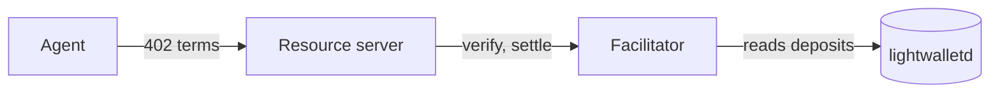
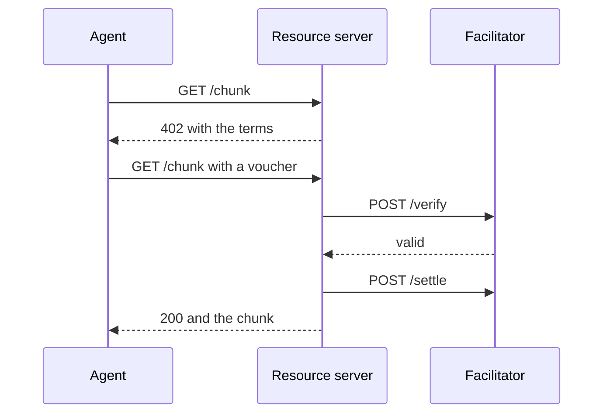
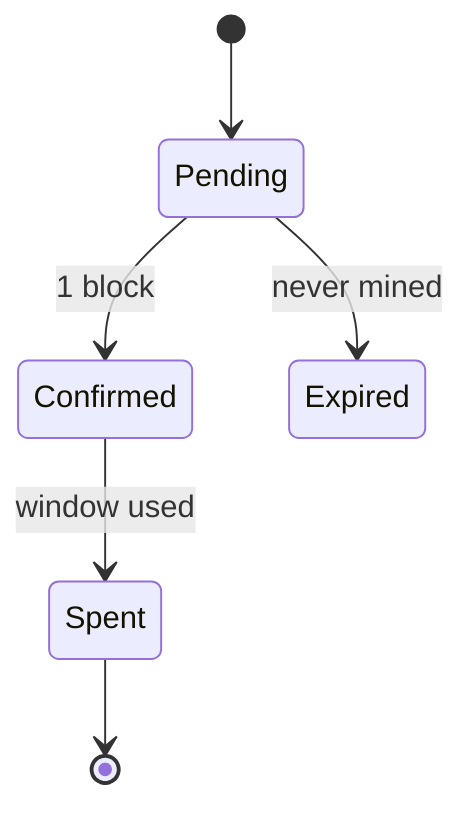
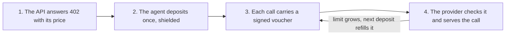

export const meta = {
  title: "Components",
  description: "Every element and component a docs page can use, on one page, to check the design. It is left out of the sidebar, the search and the sitemap.",
};

This page is the docs' test bench. It shows each piece of the MDX contract once or twice, with the edge cases that tend to break a layout: long words, wide tables, long code lines and diagrams wider than the column. It is not linked from anywhere and asks search engines not to index it.

A paragraph has **bold**, *italic*, ~~struck~~ and `inline code` text, an [internal link](/docs/quickstart), a [link to a heading below](#tables), and an [external link](https://www.x402.org). A long token such as `z402_deposit_required_but_with_a_name_that_never_seems_to_end` wraps instead of pushing the column wider. A <Term tip="Unified incoming viewing key. Whoever holds it can see the payments made to an address, but cannot spend them.">UIVK</Term> and a <Term tip="The smallest unit of ZEC. 1 ZEC is 100,000,000 zat.">zat</Term> carry the site's tooltip.

## Headings and text

Sections use `##` and `###`, which make the "On this page" list. Each heading gets an anchor from its text, and a link icon shows when the pointer is over it.

### A third-level heading with `code` in it

Body copy runs at 16px on a 26px line, about 80 characters to the line in the 720px column, which keeps long reading comfortable. Paragraphs are 20px apart, blocks such as code, tables and callouts 28px.

#### A fourth-level label

A fourth level exists for a label inside a section. It stays out of "On this page".

## Lists

- A first item with a [link](/docs/how-it-works).
- A second item that runs long enough to wrap onto a second line, to show that the text lines up under the first word and not under the bullet.
  - A nested item.
  - Another nested item with `code`.
- A third item.

1. Make the operator's keys.
2. Start the facilitator.
3. Register a provider and keep its API key.
4. Point the service at the facilitator.

- [x] A finished task
- [ ] An open task
- [ ] Another open task with **bold** text

> A quote, for a passage taken from a specification or another source. It keeps the body size and sits a step back in color.

---

## Tables

| Field | Type | Meaning |
| --- | --- | --- |
| `scheme` | string | How to pay. For z402, `prepaid-voucher`. |
| `amount` | string | The price of this call in zat, from 1 to `windowZat`. |
| `payTo` | string | The provider's shielded-only unified address. |
| `maxTimeoutSeconds` | number | How long the payment may take. |

A table with right-aligned numbers and an empty header cell:

| | Calls | Zat |
| --- | ---: | ---: |
| One window | 200 | 100,000 |
| Credit cap | 400 | 200,000 |
| Network fee | | about 10,000 |

A wide table scrolls inside its frame on a narrow screen:

| Variable | Default | Read by | Meaning |
| --- | --- | --- | --- |
| `Z402_FACILITATOR_URL` | required | every service | The facilitator's base URL, `http://` or `https://`, without credentials. |
| `Z402_FACILITATOR_TOKEN` | none | every service | The provider's API key, sent as `Authorization: Bearer z402_…`. |
| `Z402_REGISTRATION_TOKEN` | unset | the facilitator | When set (at least 32 characters), `POST /providers` needs it; when unset, registration is open, except on mainnet. |

## Code

A fence takes a language and an optional title:

```ts title="agent.ts"
import { wrapFetchWithPayment, x402Client } from "@x402/fetch";
import { zcashClientScheme } from "./zcash.js";

const client = new x402Client();
client.register("zcash:regtest", zcashClientScheme); // the one line that adds Zcash
const paidFetch = wrapFetchWithPayment(fetch, client);

const res = await paidFetch("http://localhost:4021/chunk");
console.log(res.status, await res.json());
```

Without a title the bar names the language:

```bash
docker compose up -d
docker compose run --rm smoke
export Z402_PAY_TO=uregtest1qqqqqqqqqqqqqqqqqqqqqqqqqqqqqqqqqqqqqqqqqqqqqqqqqqqqqqqq
curl -s "http://localhost:4021/chunk" -H "PAYMENT-SIGNATURE: $SIG" | jq .
```

```json title="PAYMENT-REQUIRED, decoded"
{
  "x402Version": 2,
  "accepts": [
    {
      "scheme": "prepaid-voucher",
      "network": "zcash:regtest",
      "amount": "500",
      "asset": "ZEC",
      "payTo": "uregtest1…9s3k",
      "maxTimeoutSeconds": 60,
      "extra": { "windowZat": "100000", "creditRatioBps": 2500, "termsVersion": 2 }
    }
  ]
}
```

```http title="402 response"
HTTP/1.1 402 Payment Required
content-type: application/json
PAYMENT-REQUIRED: eyJ4NDAyVmVyc2lvbiI6MiwiZXJyb3IiOiJQYXltZW50IHJlcXVpcmVkIn0
```

```yaml title="compose.yaml"
services:
  facilitator:
    image: z402/facilitator
    environment:
      Z402_REGISTRATION_TOKEN: ${Z402_REGISTRATION_TOKEN:-}
    volumes: ["facilitator-state:/data"]
```

```dockerfile
FROM node:26.12.1-bookworm-slim
RUN npm install --global pnpm@12.6.0
CMD ["node", "apps/web/server.js"]
```

```text
#001 200  c=500    limit=125,000
#002 200  c=1,000  limit=125,000
#251 402  z402_deposit_required
```

A long line scrolls sideways instead of wrapping:

```ts title="long-line.ts"
const terms = { scheme: "prepaid-voucher", network: "zcash:regtest", amount: "500", payTo: "uregtest1qqqqqqqqqqqqqqqqqqqqqqqqqqqqqqqqqqqqqqqqqqqqqqqqqq", windowZat: "100000" };
```

Tabs hold two or more fences, each named by its title:

<CodeTabs>

```ts title="agent.ts"
const paidFetch = wrapFetchWithPayment(fetch, client);
const res = await paidFetch("http://localhost:4021/chunk");
```

```ts title="zcash.ts"
import { PrepaidVoucherScheme } from "@z402-net/client";

export const zcashClientScheme = new PrepaidVoucherScheme({ wallet, chain });
```

```bash title="curl"
curl -i http://localhost:4021/chunk
```

</CodeTabs>

## Diagrams

A flowchart, drawn by Pele when the page is built:



A sequence diagram:



A state diagram:



A flowchart too wide for the column is drawn top to bottom, and on a phone it gets a narrower drawing of its own:



## Callouts

<Callout type="note">
A note adds context that a reader can skip.
</Callout>

<Callout type="tip" title="Keep the session key">

A tip with a title. Its body is Markdown, so it can hold `code`, [links](/docs/concepts/prepaid-vouchers) and more than one paragraph.

A second paragraph.

</Callout>

<Callout type="warning" title="Back up the API key">

`POST /providers` shows the key once and stores only its hash. Lose it and you register again with the same viewing key to get a new one.

```bash
chmod 600 provider.key
```

</Callout>

<Callout type="privacy" title="What stays private">

A deposit is a shielded Zcash transaction. The chain shows that it happened and what it paid in fees, not the amount, the recipient or the memo.

</Callout>

## Steps

<Steps>

<Step title="Start the stack">

Run this in the repository root:

```bash
docker compose up -d
```

</Step>

<Step title="Pay every starter service">

The smoke run makes one deposit per merchant and one paid call to each route.

</Step>

<Step title="Open the site">

Go to the [services](/services) page and watch the calls arrive.

</Step>

</Steps>

## Cards

<Cards>
<Card title="Quickstart" href="/docs/quickstart">Run the whole stack and pay four services in five minutes.</Card>
<Card title="How it works" href="/docs/how-it-works">The deposit, the voucher and the trust ramp, step by step.</Card>
<Card title="Sell an API" href="/docs/guides/sell-an-api">Register a provider, price a route and get paid in shielded ZEC.</Card>
<Card title="x402 specification" href="https://www.x402.org">The open standard z402 builds on, on its own site.</Card>
<Card title="Facilitator API" href="/docs/reference/facilitator-api">Every route of the facilitator, with its body and its answers.</Card>
</Cards>

## Video

<Video src="/docs/videos/agent-pays.mp4" poster="/docs/videos/agent-pays.jpg" title="The agent pays for calls" caption="One run of the demo agent: a deposit, then one voucher per call." />

## Endpoints and fields

<Endpoint method="POST" path="/providers" auth="registration-token">

Registers a provider from its `payTo` and its viewing key, and answers with an API key that is shown once.

<Params title="Body">
<Param name="payTo" type="string" required>The provider's shielded-only unified address, such as `uregtest1…`.</Param>
<Param name="uivk" type="string" required>The unified incoming viewing key of that address. The facilitator decrypts deposits with it.</Param>
<Param name="network" type="string">The facilitator's network, such as `zcash:regtest`. Optional; when given it must match.</Param>
</Params>

</Endpoint>

<Endpoint method="GET" path="/providers/me" auth="api-key">
Answers `200 {"providerId","network","payTo"}` for a valid key.
</Endpoint>

<Endpoint method="GET" path="/discovery/resources?type=http&limit=100&offset=0" auth="public" />

A field list on its own:

<Params>
<Param name="x402Version" type="number" required>The protocol version. z402 speaks version 2 only.</Param>
<Param name="accepts" type="PaymentRequirements[]" required>The offers. The client picks one it knows how to pay.</Param>
<Param name="extensions" type="object">Extra data keyed by extension name, such as `bazaar`.</Param>
</Params>

## References

- <Source path="apps/web/src/content/docs/components.mdx" />
- <Source path="apps/web/src/mdx-components.tsx" />
- <Source path="packages/client/src/scheme.ts" line="1" />
- [Pele](https://pele.run), which draws the diagrams
- [Shiki](https://shiki.style), which colors the code
