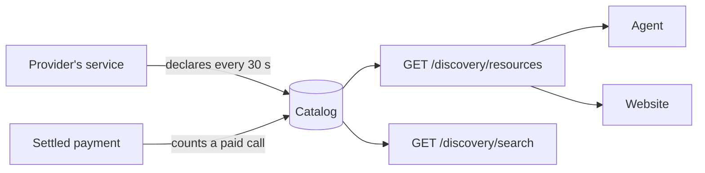
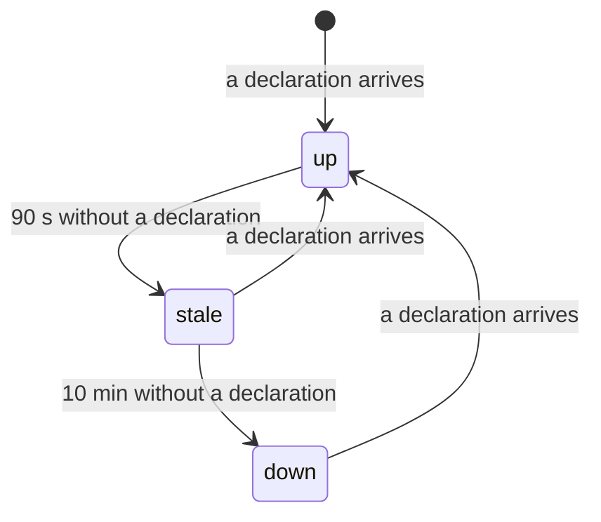

export const meta = {
  title: "Discovery",
  description: "How agents find paid services: the facilitator-hosted x402 Bazaar, declarations and heartbeats, lastSeen, paidCallsToday and local search.",
};

An agent that wants to pay for something has to find it first. x402 has a standard answer, the **Bazaar**: a catalog of paid resources that a facilitator serves, with the price, the description and an example of each. z402's facilitator hosts one for every provider on the rail. The Services page of this site and the agent's `discover` command both read it.

<Video src="/docs/videos/catalog.mp4" poster="/docs/videos/catalog.jpg" title="The service catalog" caption="Each service with its price per route, its status and its paid calls today." />

## How listings get there

A resource appears in the catalog by one of two sources.



| Source | Who writes it | What it gives |
|---|---|---|
| A declaration | The provider's service, with its API key | The full listing, and a liveness signal: `lastSeen`. A route is listed before its first sale. |
| A settled payment | The facilitator, after a successful settle | A paid call on a listed route, and a new listing only for a provider that has never declared, up to 8 of them. |

### Declarations

A service lists its routes with one authenticated call. The facilitator never fetches a provider's URL, so the catalog cannot be used to make it request anything. It takes the provider's word, within strict limits.

<Endpoint method="POST" path="/discovery/resources" auth="api-key">

Declares the provider's resources. The body is `{"items": [...]}` with 1 to 32 items. Each item is a standard Bazaar `DiscoveryResource` without `lastUpdated`. The answer is `200` with the items as served. One bad item refuses the whole call with `400 {"error": "invalid_request", "index": i, "message": "..."}`, and nothing is stored.

</Endpoint>

A declared item is checked field by field:

| Field | Rule |
|---|---|
| `resource` | An absolute http or https URL of at most 2,048 characters, with no user name or password. |
| `type`, `x402Version` | `"http"` and `2`. |
| `accepts` | 1 to 4 entries. Each must be `prepaid-voucher` on the facilitator's network, `asset` `ZEC`, the provider's own `payTo`, an `amount` from 1 to `windowZat`, a positive `maxTimeoutSeconds`, and an `extra` with the rail's terms and its `termsVersion`. The catalog therefore never lists a payment the facilitator would refuse. |
| `description`, `mimeType` | At most 512 and 128 characters. |
| `serviceName` | 1 to 32 printable ASCII characters. |
| `tags` | At most 5, each 1 to 32 printable ASCII characters. Repeats that differ only in case are dropped. |
| `iconUrl` | An http or https URL on a named host, at most 2,048 characters. Loopback names and IP addresses are refused. |
| `extensions` | A plain JSON object of at most 8 KB. It is kept as declared. |

`extensions.bazaar.info.input.method`, when present, must be `GET`, `POST`, `PUT`, `PATCH`, `DELETE` or `HEAD`. It is the item's method, and `GET` when absent. A provider may list at most 128 items, and the catalog holds at most 4,096, within 16 MiB. A declaration that would pass that budget is refused whole with `400 invalid_request` and the message `the catalog is full`.

```json title="POST /discovery/resources"
{
  "items": [
    {
      "resource": "https://markdown.example.com/v1/markdown",
      "type": "http",
      "x402Version": 2,
      "accepts": [
        {
          "scheme": "prepaid-voucher",
          "network": "zcash:regtest",
          "amount": "1000",
          "asset": "ZEC",
          "payTo": "uregtest1...",
          "maxTimeoutSeconds": 60,
          "extra": {
            "windowZat": "100000",
            "creditRatioBps": 2500,
            "creditCapZat": "200000",
            "zeroConfMinExpiryBlocks": 20,
            "termsVersion": "cb7f148af0fda19a"
          }
        }
      ],
      "description": "Fetches one public web page and returns its main content as clean markdown.",
      "mimeType": "application/json",
      "serviceName": "URL to markdown",
      "tags": ["web", "markdown", "scrape"],
      "extensions": {
        "bazaar": { "info": { "input": { "type": "http", "method": "GET" } }, "schema": "..." },
        "z402": { "unit": "page" }
      }
    }
  ]
}
```

The `schema` of the bazaar extension is shortened in this example.

The service kit makes this call for you. A ready service declares its routes at once, then every 30 seconds, and only while it is ready. Each item is built from the 402 that the route itself sends, so the listing offers exactly what the route asks for. A declaration that fails never stops the service: the kit logs one line each time the outcome changes, never the key, and tries again at the next beat. `declareIntervalMs` sets the interval, and `0` turns declaring off.

A declaration never removes another service's items. It upserts its own, sets their `lastSeen` to now, and leaves the rest.

### Settled payments

Every successful settle tells the catalog. The item of that provider whose canonical resource and method match the payment gets a new `lastUpdated` and one more in `paidCallsToday`. The resource comes from `paymentPayload.resource.url` and the bazaar `routeTemplate`, and the method from `extensions.bazaar.info.input.method`. The stock client copies the 402's `extensions` into its payment, so these are the values the server sent. Another client can echo anything, so the facilitator treats them as the payer's.

A provider that has never declared anything is listed from its payments, as standard Bazaar facilitators do. Only the `accepts` of such an item comes from the server: the facilitator builds it from `paymentRequirements`, which are the server's own and not the client's `accepted`. The URL, the `mimeType` and the `bazaar` extension are echoed by the payer, and they pass the same field checks as a declaration and nothing more. A payment never supplies a `description`, `serviceName`, `tags` or `iconUrl`, and a provider has at most 8 such items. A declaration is how a provider lists more, with text of its own.

<Callout type="warning" title="Once a provider declares, payments never create items">

In a payment, `resource.url` and `extensions.bazaar` are echoed by the client. If a payment could create an item for a provider that declares, anyone could add a listing with any URL and description under that provider's `payTo` for the price of one call. So once a provider has declared anything, its payments only update matching declared items. A provider's first declaration also removes its payment-sourced items that the declaration does not list, and is written to disk before the facilitator answers. Client-echoed data never overwrites a declared item.

</Callout>

A catalog error is logged. It never changes the answer to the settle.

## Reading the catalog

Both reads are public. They need no key, but a key that is presented must belong to a provider, or the answer is 401. The site proxies them at `/discovery/resources` and `/discovery/search` and forwards only the parameters each one documents, never an `Authorization` header, so the site's address works as a Bazaar URL too.

<Endpoint method="GET" path="/discovery/resources" auth="public">

Lists the catalog, ordered by resource, then method, then provider id, so pages stay stable. The answer is `{"x402Version": 2, "items": [...], "pagination": {"limit", "offset", "total"}}`.

</Endpoint>

<Params>
<Param name="type" type="string">Filter by type. Only `http` exists.</Param>
<Param name="payTo" type="string">Only items that accept payment to this address.</Param>
<Param name="scheme" type="string">Only items that accept this scheme.</Param>
<Param name="network" type="string">Only items that accept this network.</Param>
<Param name="extensions" type="string">One extension name. Only items that carry it, such as `bazaar` or `z402`.</Param>
<Param name="limit" type="number">Items per page. The default is 20, and a larger value is cut to 100.</Param>
<Param name="offset" type="number">Items to skip. The default is 0. `limit` and `offset` must be non-negative decimal integers, or the answer is `400`.</Param>
</Params>

<Endpoint method="GET" path="/discovery/search" auth="public">

Matches `query` as a case-insensitive substring of `resource`, `description`, `serviceName` or any tag. It takes the same filters and `limit`, plus `cursor`, an opaque string to pass back unchanged. The answer is `{"x402Version": 2, "resources": [...], "partialResults": false, "pagination": {"limit", "cursor"}}`, where `cursor` is `null` on the last page. `query` is required, 1 to 256 characters.

</Endpoint>

An item is the standard `DiscoveryResource`, plus two fields that are not in the standard:

```json title="An item as served"
{
  "resource": "https://markdown.example.com/v1/markdown",
  "type": "http",
  "x402Version": 2,
  "accepts": [
    {
      "scheme": "prepaid-voucher",
      "network": "zcash:regtest",
      "amount": "1000",
      "asset": "ZEC",
      "payTo": "uregtest1...",
      "maxTimeoutSeconds": 60,
      "extra": { "windowZat": "100000", "...": "the rail's terms" }
    }
  ],
  "lastUpdated": "2026-10-28T12:34:56.789Z",
  "serviceName": "URL to markdown",
  "extensions": { "bazaar": { "...": "as declared" }, "z402": { "unit": "page" } },
  "lastSeen": "2026-10-28T12:34:41.120Z",
  "paidCallsToday": 12
}
```

| Field | Meaning |
|---|---|
| `lastUpdated` | The time of the latest paid call, or of the first listing if there has been none. The standard requires it. |
| `lastSeen` | The time of the provider's latest declaration of this item. It is absent for an item listed only from payments. |
| `paidCallsToday` | The successful settles for this item since 00:00 UTC. An aggregate only: no session, key or amount per call is ever exposed. |

<CodeTabs>

```bash title="curl"
curl -s 'http://localhost:3000/discovery/resources?type=http&limit=100' \
  | jq '.items[] | {resource, price: .accepts[0].amount, lastSeen, paidCallsToday}'
```

```ts title="discover.ts"
import { HTTPFacilitatorClient } from "@x402/core/server";
import { withBazaar, type DiscoveryResource } from "@x402/extensions/bazaar";

// The facilitator, or the website that proxies its two public reads
const bazaar = withBazaar(new HTTPFacilitatorClient({ url: "http://localhost:3000" })).extensions.bazaar;

type Item = DiscoveryResource & { lastSeen?: string; paidCallsToday?: number };

const { items, pagination } = await bazaar.listResources({ type: "http", limit: 100 });
console.log(`${items.length} of ${pagination.total} resources`);

for (const item of items as Item[]) {
  const offer = item.accepts[0];
  console.log(item.serviceName, item.resource, `${offer?.amount} zat`, item.lastSeen, item.paidCallsToday);
}
```

</CodeTabs>

The agent has a command for the same read. It prints one line per resource, with the service name, the method, the URL, the price and unit, an activity cell and the description:

```bash
pnpm --filter @z402/agent discover --discovery http://localhost:3000 --intent "turn a web page into markdown"
```

## Liveness

A service that is up declares itself every 30 seconds. The catalog keeps the time of the latest declaration as `lastSeen`, and the facilitator serves only that timestamp. Readers work out the status from its age:



| Age of `lastSeen` | Status |
|---|---|
| Under 90 seconds | up |
| 90 seconds up to 10 minutes | stale |
| 10 minutes or more | down |
| No `lastSeen` | A dash: the item is listed from paid calls alone. |

With a 30-second beat, one missed beat still reads as up. The site and the agent's `discover` use the same limits. A `lastSeen` that is more than 90 seconds in the future says nothing, so the site shows no status for it.

The kit declares only while the service is ready, which means its `/health` answers `200`. A service whose model is still loading, or whose provider is unreachable, stops declaring, so its status decays instead of promising a service it cannot give. `lastSeen` is the provider's own statement. The facilitator does not probe the service, and a service that is up but broken in some way the kit does not check still reads as up.

## Paid calls today

`paidCallsToday` counts the settles that succeeded for an item since 00:00 UTC. It starts again at 0 each day. The Services page sums it over a service's routes as TODAY.

It is not the same as the `callsToday` that the kit's own `/health` reports. That one counts paid calls the service delivered with a 2xx, and it lives on the service. `paidCallsToday` counts settles, and it lives in the catalog.

## How the site groups services

Every field in the catalog is untrusted. Any provider can declare any name. The Services page therefore groups routes into one row only when they share an origin, a `payTo` and a service name, never on a name alone. Each route shows its own price, and a row shows the range when its routes differ. Two providers that list the same URL get two items, each with its own `payTo`.

## Search, and why our agent filters locally

The facilitator serves `GET /discovery/search` because the standard Bazaar client has it. The z402 agent and the site never call it.

A server that matches intents learns what every agent wants. So the agent and the site read the whole list instead, a page at a time, and choose on their own side. What an agent looks for stays on its machine. The facilitator's access log records the path of a request and never its query string, which covers `/discovery/search` and `/discovery/resources` alike, but the request still reaches the server. Not sending it is the stronger protection.

`discover --intent` ranks the list by word overlap between the intent and each resource's name, description, tags, billing unit and input parameter names. Ties keep the list's order. It prints the ranked list and a `pick:` line for the best match, or `pick: none` when no word of the intent matches.

The agent treats the endpoint as untrusted. One run has a single deadline of 60 seconds and a budget of 32 MiB for all its requests, reads at most 1,000 resources in at most 100 pages, and prints no character that a terminal would act on.

## What a listing does and does not promise

- **The 402 is authoritative.** A client pays what the resource's own 402 says, not what the catalog says. A catalog can be stale.
- **Duplicates are possible.** Two providers can list one URL. The catalog shows each with its own `payTo`.
- **A listing from payments is thin.** For a provider that never declares, a payer chooses the listed URL, within 8 items per provider. The `accepts` and the price are the server's, and the 402 that the URL returns stays authoritative. A provider that cares declares its routes.
- **Poisoning is limited.** Only an authenticated provider writes its own items. Every `accepts` entry must name that provider's `payTo` and the rail's terms. Sizes and counts are capped. The facilitator never fetches a provider URL. Echoed metadata never overwrites a declared item, and never creates one for a provider that declares.
- **There is no rate limit.** The public reads have none today.

## Limits and persistence

| What | Value |
|---|---|
| Items per declaration | 1 to 32 |
| Items per provider, and in all | 128 and 4,096. Past either cap a declaration gets `400`, and a payment lists nothing. Each is logged once. |
| Items listed from payments | 8 per provider. A payment for a ninth lists nothing, and a payment for a listed item still counts. |
| Size of the catalog | 16 MiB of items, counted as the JSON of each. A declaration past it gets `400` with `the catalog is full`, a payment past it lists nothing, and a file that holds more drops its oldest items at load. |
| Request body | 64 KB |
| Where it lives | In memory, and in `discovery.json` in the providers directory. Without a providers directory the catalog is memory-only. |
| When it is written | At most every 2 seconds. A provider's first declaration is written before it is answered. |
| Old items | Items neither declared nor paid for 7 days are dropped the next time the catalog loads, at the facilitator's start. |
| A damaged file | It is set aside as `discovery.json.bad-<time>`, and the catalog starts empty. |

A catalog that is lost is rebuilt at the next heartbeat of every ready service. Items that were listed from payments alone come back with the next payment.

<Cards>
  <Card title="Build with the service kit" href="/docs/guides/service-kit">Declare routes as data and let the kit keep them listed.</Card>
  <Card title="Starter services" href="/docs/services">The four services the demo catalog lists next to the demo API.</Card>
  <Card title="Providers and API keys" href="/docs/concepts/providers">The key a declaration is made with.</Card>
</Cards>

## References

- <Source path="docs/superpowers/specs/2026-10-28-z402-multi-provider-design.md" />: section 4.4, the catalog, its sources, validation and persistence.
- <Source path="docs/superpowers/specs/2026-10-27-z402-services-design.md" />: sections 5 and 6, declaring, reading, and the website.
- <Source path="docs/spec/protocol.md" />: the wire contract. Its v2.0 revision adds section 17, discovery.
- <Source path="packages/facilitator/src/discovery/catalog.ts" />: the catalog: upserts, payment counting, listing, search and the file.
- <Source path="packages/facilitator/src/discovery/validate.ts" />: every rule on a declared item and on a query.
- <Source path="packages/facilitator/src/discovery/routes.ts" />: the three routes and the settle hook.
- <Source path="packages/service-kit/src/declare.ts" />: the declaration heartbeat.
- <Source path="apps/agent/src/discover.ts" />: the `discover` command and its local ranking.
- <Source path="apps/web/src/lib/services.ts" />: how the site derives status and groups rows.
- <Source path="apps/web/src/lib/proxy.ts" />: the proxy and the parameters it forwards.
- [x402 specification v2](https://github.com/x402-foundation/x402/blob/main/specs/x402-specification-v2.md): the `resource` and `extensions` objects the Bazaar builds on.
- [x402](https://github.com/x402-foundation/x402): the Bazaar extension in `@x402/extensions`, version 2.28.0.
