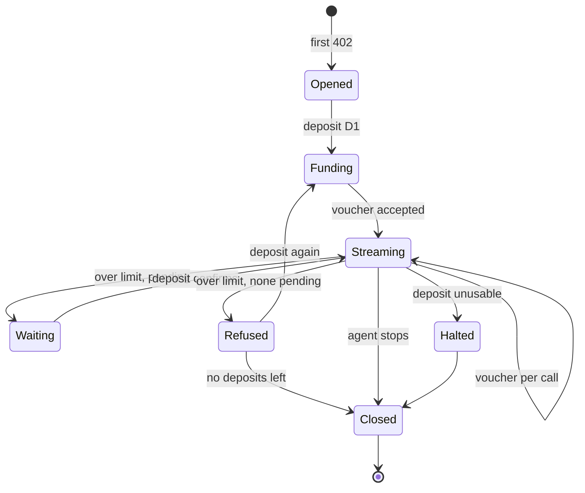
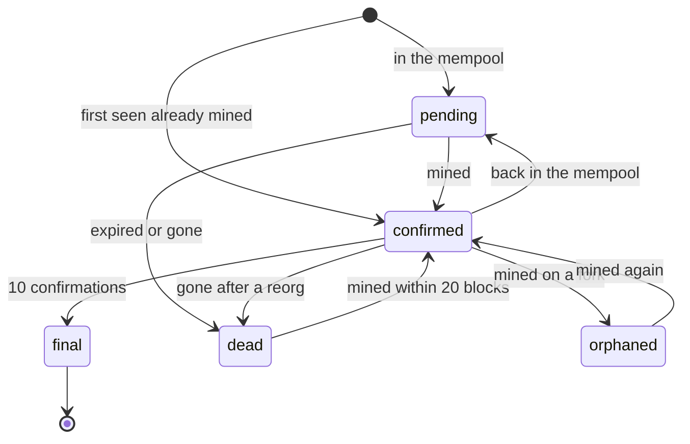

export const meta = {
  title: "Prepaid vouchers",
  description: "How z402 charges per call without a transaction per call: the window, the deposit memo, signed cumulative vouchers and the trust ramp.",
};

`prepaid-voucher` is the x402 scheme that z402 defines. The agent pays in advance, once per <Term tip="The size of one deposit. In the demo it is 100,000 zat, which buys 200 calls at 500 zat.">window</Term>, with a shielded deposit. It then pays per call with a signed voucher: a number that says how much it has used in total. Only deposits touch the chain.

Two ideas make it work. A voucher is **cumulative**, so it cannot be replayed. And the provider extends trust in steps, so the first call is served before the deposit confirms, and an agent that stops depositing is refused at a known limit.

## The pieces

| Piece | What it is | Made by |
|---|---|---|
| Window | The size of one deposit, `windowZat`. 100,000 zat in the demo. | Set by the facilitator, the same for every provider on it. |
| Deposit | One shielded payment of exactly one window to the provider's `payTo`, with a memo that names the session. | The agent's wallet. |
| Session key | An Ed25519 key pair made for one provider. Its public key names the session. | The agent. |
| Voucher | A signed running total of what the session has used. | The agent, for every call. |
| Limit | The most the facilitator will accept right now. | The facilitator, from the session's deposits. |
| Snapshot | The state of the session: total, limit, deposits. Sent back with every answer. | The facilitator. |

<Video src="/docs/videos/agent-pays.mp4" poster="/docs/videos/agent-pays.jpg" title="An agent pays a provider" caption="One deposit, then a signed voucher for every call, as the demo agent runs it." />

## The terms

The facilitator owns the terms. They travel in the `extra` object of every offer and in `/supported`, and they are the same for every provider on the rail. They are static per route: nothing in them depends on the session.

```json title="accepts[0] of a 402"
{
  "scheme": "prepaid-voucher",
  "network": "zcash:regtest",
  "amount": "500",
  "asset": "ZEC",
  "payTo": "uregtest1...",
  "maxTimeoutSeconds": 60,
  "extra": {
    "windowZat": "100000",
    "creditRatioBps": 2500,
    "creditCapZat": "200000",
    "zeroConfMinExpiryBlocks": 20,
    "termsVersion": "5a2a93e32c1aa9da"
  }
}
```

<Params>
<Param name="amount" type="string" required>The price of this call, in zat. A canonical decimal from 1 to `windowZat`. The provider sets it per route.</Param>
<Param name="payTo" type="string" required>The provider's shielded-only unified address. It must be the address registered to the API key the provider presents to the facilitator.</Param>
<Param name="extra.windowZat" type="string" required>The size of one deposit, in zat. It also caps unconfirmed exposure and the price of a call.</Param>
<Param name="extra.creditRatioBps" type="number" required>Credit on confirmed deposits, in <Term tip="One hundredth of a percent. 10,000 basis points is 100 percent, and 2,500 is 25 percent.">basis points</Term>, from 0 to 10,000.</Param>
<Param name="extra.creditCapZat" type="string" required>The most credit a session can hold, in zat.</Param>
<Param name="extra.zeroConfMinExpiryBlocks" type="number" required>The blocks a pending deposit must still have before it expires, to earn zero-conf credit: credit before it confirms.</Param>
<Param name="extra.termsVersion" type="string">An opaque 16-character hex id of the terms. The client ignores it and echoes `extra` unchanged.</Param>
</Params>

| Term | Demo value | Facilitator setting |
|---|---|---|
| `windowZat` | 100,000 zat | `Z402_WINDOW_ZAT` |
| `creditRatioBps` | `2500` (25 percent) | `Z402_CREDIT_RATIO_BPS` |
| `creditCapZat` | 200,000 zat | `Z402_CREDIT_CAP_ZAT` |
| `zeroConfMinExpiryBlocks` | 20 | `Z402_ZERO_CONF_MIN_EXPIRY_BLOCKS` |

All amounts are zat as decimal strings, and the ratio is an integer on purpose. With floats, 0.29 times 100,000 comes out as 28,999.999999999996, so a floor would differ by one zat between two implementations. In basis points both sides compute the same integer.

### What each term changes

- **A larger window** means fewer deposits and fewer transactions on chain. It also means more money prepaid by the agent and more unconfirmed exposure for the provider. A price can be at most one window, so a larger window also allows dearer routes.
- **A higher credit ratio or cap** lets a session spend more before its next deposit confirms, and raises the provider's exposure by the same amount.
- **A longer expiry margin** keeps out deposits that might expire before they confirm. A deposit that does not meet it still counts once it is mined.

## Sessions and deposits

A **session** is one agent, one provider. The agent makes a fresh Ed25519 key for each provider it pays: one per agent process and `payTo`. The public key, 64 lowercase hex characters, is the session key. The facilitator reports it as `payer`, since a shielded payer has no address to show.

Keys are ephemeral. If the agent restarts, it has a new session with no credit. The old deposit's unspent balance stays with the provider, because there are no refunds. What an agent can lose this way is the unspent part of the deposits it made, one window at a time.

A **deposit** is one shielded payment of exactly `windowZat` to `payTo`, in a single output. The agent pays the network fee on top. Its memo is `<sessionKey>:<index>`, which is how the facilitator knows which session the money funds. [Shielded payments](/docs/concepts/shielded-payments#memos) covers the memo format and how the deposit is found.

- A transaction funds at most one session per provider.
- A deposit under one window is credited at full value once it is mined, but earns no zero-conf credit before that.
- A deposit over one window is credited at full value once it is mined, but at most one window of unconfirmed deposits counts toward the limit at a time.

## The voucher

A voucher is a signature over the session's running total. Each call carries a new one.

<Params>
<Param name="sessionKey" type="string" required>64 lowercase hex characters. The raw 32-byte Ed25519 public key.</Param>
<Param name="cumulativeZat" type="string" required>Everything the session has used so far, including this call. A canonical decimal: no leading zero, no sign, at most 2,100,000,000,000,000.</Param>
<Param name="sig" type="string" required>128 lowercase hex characters. The Ed25519 signature of the message below.</Param>
<Param name="depositTxid" type="string">64 lowercase hex characters, in display order. Sent on every call until a settle acknowledges the deposit.</Param>
</Params>

The signed message is six fields joined by newlines, as UTF-8:

```text
z402-voucher-v1
prepaid-voucher
zcash:regtest
<payTo>
<sessionKey>
<cumulativeZat>
```

The signature is plain <Term tip="A fast public-key signature scheme, specified in RFC 8032. Its signatures are 64 bytes.">Ed25519</Term> as in [RFC 8032](https://www.rfc-editor.org/rfc/rfc8032.html). The facilitator builds the message from the strings it received, after it has checked each one against its pattern. It never formats a number again. Encodings are canonical or rejected: uppercase hex, a leading zero or a plus sign gives `invalid_payload`, and nothing is normalized.

What the message binds is what makes a voucher safe to send:

- **The provider.** `payTo` and the network are in the message, so a voucher for one provider never verifies at another.
- **The session.** The session key is in the message, so a voucher cannot be moved to another session.
- **The running total.** A voucher says "I have used this much", not "pay this call". The facilitator keeps one number per session, the last settled total `c_last`. A new voucher must exceed it by at least the price of the call. Sending the same voucher twice adds nothing the second time, and the facilitator refuses it with `z402_cumulative_mismatch`.

```ts title="voucher.ts"
import {
  depositMemo,
  generateSeed,
  NETWORK_REGTEST,
  publicKeyFromSeed,
  SCHEME,
  signVoucher,
  verifyVoucher,
} from "@z402/protocol";

// Take the real address from accepts[0].payTo of the 402
const payTo = "uregtest1qqqqqqqq";
const context = { scheme: SCHEME, network: NETWORK_REGTEST, payTo };

const seed = generateSeed(); // one per agent process and payTo, never reused
const sessionKey = publicKeyFromSeed(seed); // 64 hex characters: the name of the session
const memo = depositMemo(sessionKey, 1); // the memo of the first deposit

const cumulativeZat = "1500"; // everything used so far, not the price of this call
const sig = signVoucher(seed, { ...context, sessionKey, cumulativeZat });

console.log(verifyVoucher({ sessionKey, cumulativeZat, sig }, context)); // true
console.log(verifyVoucher({ sessionKey, cumulativeZat: "1501", sig }, context)); // false: the total changed
console.log(verifyVoucher({ sessionKey, cumulativeZat, sig }, { ...context, payTo: "uregtest1pppppppp" })); // false: another provider
console.log(memo);
```

The repository pins test vectors for the message and the signature in `packages/protocol/test/vectors.json`. Both sides run them as unit tests.

## The trust ramp

A deposit takes a block or more to confirm. The ramp lets the provider serve calls in the meantime, without letting a session run up an unbounded bill. The facilitator turns a session's deposits into a **limit**, the largest running total it will accept.

### The formula

```text
D_conf = sum of valueZat over the deposits that are confirmed or final
D_pend = min(windowZat, sum of valueZat over the deposits that are pending and zero-conf eligible)
credit = min(creditCapZat, floor(D_conf * creditRatioBps / 10,000))
limit  = D_conf + D_pend + credit

accept when  c_new - c_last >= amount  and  c_new <= limit
```

All values are integers in zat. `c_new` is the total in the voucher, `c_last` the last settled total, and `amount` the price of this call.

| Part | What it counts |
|---|---|
| `D_conf` | Deposits mined into a block (confirmed), including final ones (10 or more confirmations). |
| `D_pend` | Deposits still in the mempool that are <Term tip="Eligible for credit before the block arrives. A pending deposit needs at least one window of value and enough blocks left before it expires.">zero-conf eligible</Term>, capped at one window in all. |
| `credit` | A share of `D_conf`: `creditRatioBps` of it, up to `creditCapZat`. |
| `limit` | What the session may reach. It is inclusive: `c_new` may equal it. |

Two rules sit around the formula. The increment is lenient: `c_new - c_last` only has to be at least the price, so a voucher that overshoots by a price is still accepted, which absorbs a lost response. And a new session has `c_last` of 0 and a limit of 0, so its first voucher must carry a deposit. Deposits that are `orphaned` or `dead` count nowhere.

A deposit is zero-conf eligible when it holds at least one window and either never expires or has at least `zeroConfMinExpiryBlocks` blocks left, counted from the tip when the facilitator first saw it. That value is fixed per deposit and never re-evaluated.

```ts title="ramp.ts"
import { checkVoucher, computeLimit, DEMO_TERMS, zeroConfEligible, type RampDeposit } from "@z402/protocol";

const deposits: RampDeposit[] = [
  { valueZat: 100_000n, status: "confirmed", zeroConf: true }, // D1, mined
  { valueZat: 100_000n, status: "pending", zeroConf: true }, // D2, still in the mempool
];

const ramp = computeLimit(deposits, DEMO_TERMS);
console.log(ramp); // confirmed 100000n, pending 100000n, credit 25000n, limit 225000n

console.log(checkVoucher({ cLast: 224_500n, cNew: 225_000n, price: 500n, limit: ramp.limitZat })); // "ok": the limit is inclusive
console.log(checkVoucher({ cLast: 225_000n, cNew: 225_500n, price: 500n, limit: ramp.limitZat })); // "over_limit"
console.log(checkVoucher({ cLast: 1_000n, cNew: 1_000n, price: 500n, limit: ramp.limitZat })); // "cumulative_mismatch"

// A deposit first seen at tip 114 that expires at block 155 has 41 blocks of margin
console.log(zeroConfEligible({ valueZat: 100_000n, expiryHeight: 155, referenceTip: 114, terms: DEMO_TERMS })); // true
// One that expires at the next block does not
console.log(zeroConfEligible({ valueZat: 100_000n, expiryHeight: 115, referenceTip: 114, terms: DEMO_TERMS })); // false
```

### Reference values

On the demo terms (window 100,000 zat, 2,500 basis points, cap 200,000 zat):

| State of the session | Limit |
|---|---|
| New session, no deposit | 0 |
| D1 pending | 100,000 |
| D1 confirmed | 125,000 |
| D1 confirmed, D2 pending | 225,000 |
| D1 and D2 confirmed | 250,000 |
| D1 and D2 both pending | 100,000 |
| 8 deposits confirmed, credit at its cap | 1,000,000 |
| One deposit of 100,001 zat, confirmed | 125,001 |
| One deposit of 1,000,000 zat, pending | 100,000 |

### Why the ramp has these rules

**Pending money counts for one window at most.** Without the cap, one deposit of ten windows would give ten windows of credit before it confirmed. The provider's loss on an unconfirmed deposit is then bounded by one window.

**A pending deposit needs an expiry margin.** Zebra drops a transaction from its mempool when the tip reaches its expiry height. Suppose a deposit were built to expire at the next block. It would earn a full window of zero-conf credit, the agent would spend it in a fraction of a second, and the transaction would then be dropped without ever being mined. In a measured sample, the next block left such a transaction out 42 percent of the time. The margin of 20 blocks removes that free ride. Wallets set the expiry 40 or 120 blocks ahead, so honest deposits clear it with room to spare.

**Credit comes only from confirmed deposits.** The limit grows as deposits confirm, and a session that stops depositing stops growing. A cheating agent gets the unconfirmed window plus the credit and nothing more.

### A recorded run

These are the demo terms with a price of 500 zat and one call per second, one block every 25 seconds. The agent is honest: it deposits again before the limit is reached.

| Call | What happens | Confirmed | Pending | Credit | Limit |
|---|---|---|---|---|---|
| 1 | D1 is proved and sent inline. The call is served on the unconfirmed deposit. | 0 | 100,000 | 0 | 100,000 |
| 15 | The block that holds D1 is mined. | 100,000 | 0 | 25,000 | 125,000 |
| 51 | Headroom falls under one window. D2 goes out in the background. | 100,000 | 0 | 25,000 | 125,000 |
| 58 | D2 is acknowledged and pending. | 100,000 | 100,000 | 25,000 | 225,000 |
| 65 | The block that holds D2 is mined. | 200,000 | 0 | 50,000 | 250,000 |

No call waits on a block. The first call waits for the proof and the broadcast of D1, which took 5 to 7 seconds.

A cheating agent that makes one deposit and no more is stopped by the same rules. At local speed it is served 200 calls on the unconfirmed D1, up to a total of 100,000 zat. The next voucher is refused with `z402_awaiting_confirmation`, because D1 is pending. The block lands, the limit becomes 125,000, and 50 more calls run on credit. Then the voucher at 125,000 is the last one: the next is refused with `z402_deposit_required`. The provider served 25,000 zat beyond what had confirmed.

## What verify and settle check

The facilitator judges every voucher in the same order, for verify and for settle:

1. **The offer.** The requirements in the request must match what the provider is registered for: scheme, network, asset, `payTo`, a canonical `amount` from 1 to `windowZat`, and the rail's terms. Otherwise `invalid_payment_requirements`.
2. **The payload.** `x402Version` is 2, and `accepted` agrees with the requirements. The voucher fields match their patterns. Otherwise `invalid_x402_version`, `invalid_scheme`, `invalid_network` or `invalid_payload`.
3. **The signature.** Otherwise `z402_invalid_signature`.
4. **The increment.** `c_new - c_last` is at least `amount`. Otherwise `z402_cumulative_mismatch`.
5. **The deposit.** If `depositTxid` is new to this session, the facilitator looks it up. If the voucher fits without the deposit, verify answers at once and looks it up in the background. Otherwise it waits for the lookup, up to 30 seconds by default.
6. **The limit.** `c_new` is at most the limit. Otherwise `z402_awaiting_confirmation` when a live pending deposit exists, and `z402_deposit_required` when none does.

Verify never commits a voucher or credits a deposit. At most it records a change in a deposit's status, when its refresh of the session finds one. Settle repeats the same judgment using only what verify and the background lookup already cached. It never waits on the chain, and it checks and commits with no `await` between the two, so two settles of one voucher cannot both succeed. A settle that succeeds appends to the ledger first, then updates its state, and then answers. A deposit is credited only in a successful settle.

## The session snapshot

Every answer from the facilitator, once the voucher's signature has verified, carries the state of the session as `extra.session`. A refused call carries it too: the server scheme copies it into the new `402` as `extra.session` on the offer, which is called a corrective 402.

<Params>
<Param name="sessionKey" type="string" required>The session this describes.</Param>
<Param name="cumulativeZat" type="string" required>The settled total, `c_last`. After a successful settle it is the new total.</Param>
<Param name="limitZat" type="string" required>The limit, from the formula.</Param>
<Param name="headroomZat" type="string" required>The limit minus the total, or 0.</Param>
<Param name="confirmedZat" type="string" required>`D_conf`.</Param>
<Param name="pendingZat" type="string" required>`D_pend`.</Param>
<Param name="creditZat" type="string" required>`credit`.</Param>
<Param name="tip" type="number" required>The block height the facilitator judged at.</Param>
<Param name="deposits" type="object[]" required>Every deposit that is not final, plus the last four final ones. Each has `txid`, `valueZat`, `status`, `confirmations`, `expiryHeight` and `zeroConf`.</Param>
</Params>

This is a real corrective 402 from a session at its limit, with the address shortened and the extensions left out. The agent has made one deposit and has used 125,000 zat, which is all of its limit:

```json title="PAYMENT-REQUIRED after z402_deposit_required"
{
  "x402Version": 2,
  "error": "z402_deposit_required",
  "resource": { "url": "https://llm.example.com/v1/chunk" },
  "accepts": [
    {
      "scheme": "prepaid-voucher",
      "network": "zcash:regtest",
      "amount": "25000",
      "asset": "ZEC",
      "payTo": "uregtest1...",
      "maxTimeoutSeconds": 60,
      "extra": {
        "windowZat": "100000",
        "creditRatioBps": 2500,
        "creditCapZat": "200000",
        "zeroConfMinExpiryBlocks": 20,
        "termsVersion": "65864168ef76d8ae",
        "session": {
          "sessionKey": "d1684476...290a",
          "cumulativeZat": "125000",
          "limitZat": "125000",
          "headroomZat": "0",
          "confirmedZat": "100000",
          "pendingZat": "0",
          "creditZat": "25000",
          "tip": 1001,
          "deposits": [
            {
              "txid": "cd266215...0a50",
              "valueZat": "100000",
              "status": "confirmed",
              "confirmations": 1,
              "expiryHeight": 1041,
              "zeroConf": true
            }
          ]
        }
      }
    }
  ]
}
```

The snapshot is absent on answers that come before the voucher is authenticated: `invalid_payload`, `invalid_payment_requirements`, `invalid_network`, `invalid_scheme`, `unsupported_scheme`, `invalid_x402_version`, `z402_invalid_signature` and the `unexpected_*` errors.

<Callout type="note" title="Only a successful settle acknowledges a deposit">

A refused call may list a deposit it has not credited yet, as if it were credited. That is a projection. The client uses it to resync its total and to learn that a deposit is dead, but never as an acknowledgement. A deposit is acknowledged when a successful settle returns it as `transaction`, or lists it in its snapshot. Until then the client resends `depositTxid` on every call. Presenting an already credited txid again is a no-op.

</Callout>

## Session lifecycle

The agent-side scheme walks a session through these states. The facilitator sees only the vouchers and deposits that result.



A background deposit does not leave the Streaming state. It starts there when headroom falls under one window and nothing is pending, and calls continue while it is proved and sent.

| State | What it means | What the agent does |
|---|---|---|
| Opened | The first 402 from this provider created a session key. The limit is 0. | Decides to deposit: with no snapshot yet and no deposit in flight, it deposits inline before the first voucher. |
| Funding | A deposit is being proved and sent. | Waits for the wallet, then signs the first voucher with the txid attached. |
| Streaming | Vouchers are accepted. | Signs one voucher per call. When headroom falls under one window and nothing is pending, it starts the next deposit in the background. |
| Waiting | The voucher is over the limit, but a pending deposit exists (`z402_awaiting_confirmation`). | Never pays again. Waits until its own check of the chain shows the deposit mined, then retries once. |
| Refused | The voucher is over the limit and nothing is pending (`z402_deposit_required`). | Deposits inline and retries once, if its deposit budget allows. |
| Halted | A deposit was rejected as unusable, or one may exist that the agent cannot account for. | Stops depositing and signing for this provider. |
| Closed | The agent ended the session or the process exited. | Nothing. The key is gone, and the unspent balance stays with the provider. |

The agent keeps a mutex per session. A voucher is signed and sent, and its outcome is read, before the next voucher is signed, so two calls never share a total.

### Deposit status

Each deposit moves through its own states, which the facilitator records:



A `final` deposit is irreversible and is no longer read. A `dead` deposit is read again for 20 more blocks. If it shows up mined, it becomes `confirmed`, never `pending`. Records are never deleted, and presenting a dead txid again gives `z402_deposit_dead`. [Shielded payments](/docs/concepts/shielded-payments#deposit-status) lists what each status is read from.

## When a call fails after the voucher

The agent signs a voucher before it knows how the call will end. After that, a failure can come before the facilitator committed the voucher, or after, and from outside the agent cannot tell which. Take a response that is lost in transit: it may have been served and settled, or never settled.

So the agent counts what it can see. It advances its total only when it cannot rule out that the provider charged it.

| What the agent sees | What it means | The agent's total |
|---|---|---|
| `200` and a `PAYMENT-RESPONSE` with `success: true` | Paid. | Resynced to `session.cumulativeZat` from the receipt. |
| `402` and a `PAYMENT-REQUIRED`, or a `PAYMENT-RESPONSE` with `success: false` | An explicit refusal. Nothing was committed. | Unchanged, apart from a resync from the snapshot. |
| Neither header: a `502` from a facilitator timeout, a `5xx` from the handler, a dropped connection | The outcome is not known. | Advances to the value it attempted. |

If the agent did not advance after an unknown outcome and the facilitator had in fact committed the voucher, the agent would send the same total again. The facilitator would see a delta of zero, refuse it with `z402_cumulative_mismatch`, and the agent would repeat it forever. Moving forward breaks that deadlock. The next voucher covers both calls, because the increment rule only asks for at least the price.

The result is that a failure after a voucher counts as paid. The agent may pay for a call that failed, by at most one price for each unknown outcome. The cost is bounded, and in return the agent has one rule it can always follow. The same logic lets the agent trust the facilitator's total: vouchers move no money, since the deposit already did, so a facilitator that lies about `c_last` can only refuse service it could refuse anyway.

The cost to the agent is why services refuse before they take payment. A service that can reject a request should do it on the first, unpaid attempt, before any voucher exists. A handler that fails with a status of 400 or more after payment still cancels the settlement, but the agent counts that call as paid. [Build with the service kit](/docs/guides/service-kit) shows how to arrange the checks.

### What the agent does on a refusal

| Reason | Meaning | The agent |
|---|---|---|
| `z402_awaiting_confirmation` | Over the limit, and a live deposit is pending. | Never deposits. Waits for the confirmation, then retries once. If the retry is refused too, the 402 is returned. |
| `z402_deposit_required` | Over the limit, and nothing is pending. | Deposits inline, then retries once. If the retry is refused too, or no deposits are left, the 402 is returned. |
| `z402_cumulative_mismatch` | The increment is smaller than the price. | Resyncs its total from the snapshot, then retries. |
| `z402_deposit_dead` | The deposit expired, was dropped or was orphaned. | Drops the txid, deposits again, then retries. |

[Errors and reason codes](/docs/reference/errors) lists the rest, and what each one means to a caller.

## Security properties

| Threat | How it is handled |
|---|---|
| A voucher is replayed | The total must grow by at least the price. A repeat adds zero and is refused. |
| A voucher is used at another provider or session | The signature covers `payTo`, the network and the session key, so it fails to verify. |
| Two settles of one voucher race | Settle checks and commits with no `await` between. In the tests, 20 concurrent settles of one voucher give exactly one success. |
| The facilitator restarts | Sessions and deposits are rebuilt from an append-only ledger of `deposit`, `voucher` and `status` events. A voucher event records only the total, never a signature. One facilitator at a time writes a ledger, through a lock that its holder keeps fresh. |
| The agent restarts | It has a new session key and no credit. The old deposit's unspent balance stays with the provider. |
| A deposit is unconfirmed and never confirms | It counts for one window at most, and only with an expiry margin. |
| One agent opens many sessions | Each session key gets its own unconfirmed window. The expiry margin removes the free ride, and a double-spend of an unconfirmed deposit stays the accepted risk, bounded by one window per session. |
| A deposit is mined, credited, and then removed by a reorg | The deposit is demoted at the next read. The value it had credited, and the credit on top of it, are the residual risk until the deposit is final. |
| A `PAYMENT-SIGNATURE` leaks | Vouchers are not bound to a route, so a leaked one can be raced to any route of the same provider, and the first settle wins. TLS is the defence. z402 never logs the header. |

The worst-case loss for a provider on one session is the smaller of one window and the live pending deposits, plus the smaller of the credit cap and the credit ratio on confirmed deposits, plus the value of a confirmed deposit that a reorg removes before it is final. On the demo terms that is up to 100,000 zat while the first deposit is unconfirmed, and 25,000 zat beyond confirmed money after it.

<Cards>
  <Card title="How it works" href="/docs/how-it-works">One session from the first call to the next hundreds.</Card>
  <Card title="Providers and API keys" href="/docs/concepts/providers">Who owns a payTo, and how a provider connects to the rail.</Card>
  <Card title="Protocol" href="/docs/reference/protocol">The wire contract, section by section.</Card>
</Cards>

## References

- <Source path="docs/spec/protocol.md" />: sections 2 to 9, the offer, payload, voucher, deposits, ramp, answers, snapshot and client rules.
- <Source path="docs/research/design-critique.md" />: the voucher bytes, the replay analysis, the expiry attack and the ramp's bounds.
- <Source path="docs/research/live-run.md" />: the recorded honest and cheat runs of section 8.
- <Source path="docs/demo.md" />: the demo terms and the beats of the demo run.
- <Source path="packages/protocol/src/ramp.ts" />: `computeLimit`, `zeroConfEligible`, `confirmations`, `isDepositDead` and `checkVoucher`.
- <Source path="packages/protocol/src/voucher.ts" />: `voucherMessage`, `signVoucher` and `verifyVoucher`.
- <Source path="packages/protocol/src/terms.ts" />: the terms and `DEMO_TERMS`.
- <Source path="packages/protocol/src/snapshot.ts" />: the session snapshot and its parser.
- <Source path="packages/protocol/test/vectors.json" />: the pinned voucher test vectors.
- <Source path="packages/facilitator/src/scheme.ts" />: the order of checks in verify and settle.
- <Source path="packages/facilitator/src/core/transitions.ts" />: how a deposit changes status.
- <Source path="packages/facilitator/src/core/ledger.ts" />: the ledger events.
- <Source path="packages/client/src/scheme.ts" />: the client scheme, the session lock and the deposit decision.
- <Source path="packages/client/src/respond.ts" />: what the client does with each outcome.
- <Source path="packages/client/src/session.ts" />: the client's session state.
- [RFC 8032, Ed25519](https://www.rfc-editor.org/rfc/rfc8032.html): the signature scheme.
- [x402 specification v2](https://github.com/x402-foundation/x402/blob/main/specs/x402-specification-v2.md): the facilitator's duties for verify and settle.
