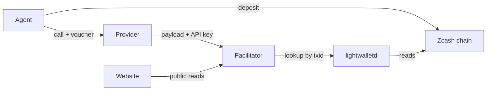

export const meta = {
  title: "Privacy model",
  description: "What the agent, the provider, the facilitator, a chain observer and the website each learn, and a checklist for running a service anonymously.",
};

z402 payments are shielded, and nobody opens an account. That does not make every party blind. This page lists what stays off the chain, what each party can see, where the real exposure is, and what to do about it if you run an agent, a service or a facilitator.

## What stays off the chain

| Data | On the chain | Who can read it |
|---|---|---|
| The amount of a deposit | No | Holders of the provider's viewing key: the provider and the facilitator. |
| The recipient of a deposit | No | The same. |
| The memo, which names the session key | No | The same. |
| The sender of a deposit | No | Nobody. The note has no sender field. |
| Each call, its price and the running total | Never reaches the chain | The agent, the provider and the facilitator. |
| That a deposit happened, its block and time, its size, its fee and its expiry height | Yes | Everyone. |

Only deposits touch the chain, and each one is fully shielded: a deposit with any transparent input or output is refused. Per-call spending is a signature that leaves the agent as an HTTP header. [Shielded payments](/docs/concepts/shielded-payments) shows the same transaction as a block explorer and as a viewing key read it.

## Who learns what

### The agent

It knows everything about its own sessions. It holds the wallet that funds deposits and a fresh <Term tip="A throwaway Ed25519 key the agent makes for each provider. It signs the vouchers and names the session.">session key</Term> for each provider. The session key is random: nothing links it to the wallet, and it is gone when the process ends.

A provider sees the agent's network address. z402 does not hide it.

### The provider

**Learns:**

- The request, and the address it came from. If the service takes a prompt, a page URL or a text, the provider reads it.
- The session key, which is a pseudonym for one agent at this provider. It can link every call of a session by that key, and it knows the session's running total.
- The deposits to its `payTo`. It owns the address, so it can read the value and the memo of each, and the facilitator's answers list a session's deposits with their values.

**Does not learn:** the agent's wallet address or balance, or what the agent does at other providers. The session key at another provider is a different key.

### The facilitator

The operator of the facilitator sees more than anyone else, because it serves every provider on the rail.

**Learns, for every provider it hosts:**

- Each deposit to the provider's `payTo`: its value, its memo, its txid and when it arrived. It reads them with the provider's viewing key.
- Each voucher: the session key, the running total, the price of the call, and when it arrived.
- The resource URL and the `extensions` of every payment, since the payment carries them.

**Does not learn:** the agent's network address, because the provider's server calls the facilitator and the stock x402 server code sends only the payment payload and the requirements. It does not learn the agent's wallet address or balance either, and it needs no spending key.

### A chain observer

Anyone with a node or an explorer sees that a shielded transaction exists, in which block, with what size, fee and expiry height. They see no sender, recipient, amount or memo. Wallets set the expiry differently, 40 or 120 blocks ahead in the cases measured, and that is public too.

Per-call activity never reaches the chain, so call volume is not visible. Deposits are visible as shielded transactions, and one happens each time an agent's window runs low.

### The lightwalletd operator

A <Term tip="A server that gives wallets and services a compact view of the Zcash chain over gRPC. Zaino is a compatible one.">lightwalletd</Term> server sees what a chain observer sees, and also the requests it serves: which transaction ids are asked about, when, and from where. The facilitator looks a deposit up by txid within seconds of the agent's broadcast. An operator that sees both the broadcast and the lookup can link them.

The facilitator also trusts its lightwalletd about whether a deposit exists. For both reasons, real money needs an endpoint that the facilitator's operator runs.

### The website

The website reads the public catalog. It holds no API key, no viewing key and no wallet, and it never receives a voucher or a deposit. It proxies only `GET /discovery/resources` and `GET /discovery/search`, and forwards only the parameters those reads document. Its pages and the agent's `discover` command filter the catalog on their own side and never send a search query.

Like any web server, it sees the addresses and the requests of the people who load its pages.

## The facilitator holds viewing keys

<Callout type="privacy" title="The facilitator can read every incoming payment it hosts">

To find a deposit, the facilitator needs each provider's <Term tip="Unified incoming viewing key. Whoever holds it can see the payments made to an address, but cannot spend them.">viewing key</Term>. With it the facilitator sees all incoming payments to that provider, their values and memos. This is the main thing you trust it with.

It cannot spend. The key it holds is view-only, and a keys file that holds a seed or a full viewing key is refused on mainnet. Sender-disclosed decryption, in the style of ZIP 311, would have the agent disclose each deposit to the facilitator, so that no provider hands over a viewing key. It is future work.

</Callout>

What limits the exposure:

- **View-only keys.** The facilitator is configured with a UIVK and a `payTo`. The registry that holds every registered provider's UIVK is a file with mode 0600, in a directory with mode 0700.
- **Keys stay out of logs and argv.** A viewing key reaches the decryptor only through an environment variable, because argv shows in `ps`. API keys, viewing keys and tokens are never logged, and an access-log line names a provider by id.
- **The log records paths only.** No query string is written. That covers searches, though z402's own readers do not send any.
- **Totals, not signatures.** The ledger records a voucher's running total and never its signature. `PAYMENT-SIGNATURE` is never logged.
- **Aggregates only.** The catalog shows how many paid calls an item had today. It never shows a session, a key or an amount per call.
- **Payments list little.** A payment never gives the catalog a description, a service name, tags or an icon, and a provider that never declares has at most 8 items listed from its payments.
- **It can be your own.** The operator is a provider like any other, and the facilitator is ordinary software. A provider that does not want another party to read its deposits can run the facilitator itself.

## What leaks anyway

| What | Who sees it | What helps |
|---|---|---|
| Every incoming payment of every hosted provider | The facilitator's operator | Run your own facilitator. Sender-disclosed decryption is future work. |
| That a deposit and the lookup that follows it are one payment | The lightwalletd operator | Run the node the facilitator reads. |
| The agent's network address, and the request itself | The provider | Send the agent's requests through a proxy. z402 does not hide the address. |
| That deposits happen, their timing, their fee and their expiry | Everyone | They are public on any Zcash chain. |
| A `PAYMENT-SIGNATURE` that leaks | Whoever holds it | Use TLS. A voucher is not bound to a route, so a leaked one can be raced to any route of the same provider. |
| What a service does with your data | The service's operator | Read its note, below. |

Each starter service puts a short note in its 402:

| Service | Its note | What it means |
|---|---|---|
| LLM inference | The operator sees your prompts. Open-weights model. | The prompt and the output are visible to the operator. |
| URL to markdown | The site sees this server's IP, not yours. | The page you fetch sees the service, not you. The service sees the URL. |
| Text embeddings | About 1,000 tokens per call. | The provider sees the text it embeds. |
| Encrypted drop box | Only client-side encrypted (age) blobs. Size and time are capped. | The service holds ciphertext and sees its size and timing. |

## Checklists

### Running a service anonymously

Listing needs no account. Registering takes a `payTo` and a viewing key and nothing else, and a shielded-only `payTo` links nothing to the operator on the chain. What can still identify the operator is the infrastructure around the service:

- [ ] A shielded-only unified address as `payTo`
- [ ] A new domain, unrelated to existing sites
- [ ] A separate host, paid privately
- [ ] No IPs, analytics IDs, emails or certificates shared with other sites
- [ ] A separate git identity for the service's repository
- [ ] An onion address only as a second endpoint, since stock x402 clients cannot reach `.onion` without a proxy

Two more belong to the provider's own keys. Give the facilitator only the viewing key and the address, never a seed. And keep the viewing key private otherwise: it shows every payment to the address, and whoever holds it can take over the API key by registering the `payTo` again.

### Running a facilitator

- [ ] A lightwalletd you operate, so that no one else sees the lookups and the endpoint is one you trust
- [ ] Only viewing keys in its configuration: a `uivk` and an address, never a `seedHex` or a `ufvk`
- [ ] TLS in front of it, and a registration token of at least 32 characters set, before outside providers connect. Open registration warns at every start, and on mainnet it is off unless `Z402_REGISTRATION_OPEN=1`
- [ ] The providers directory and its files kept at mode 0700 and 0600
- [ ] Logs left as they are: paths only, with no keys

### Running an agent

- [ ] A wallet that makes fully shielded deposits, since any transparent part is refused
- [ ] A proxy for the agent's requests, if the provider learning its address matters
- [ ] A lightwalletd endpoint you trust for the agent's own status checks, set with `--lightwalletd`

## What each party must trust

| Party | Trusts | For |
|---|---|---|
| The agent | The provider | To serve calls it paid for. The window bounds what is at stake, and there are no refunds. |
| The provider | The facilitator | To read deposits and settle honestly. The facilitator cannot spend, but it can refuse service or misreport. |
| The facilitator's operator | Its lightwalletd | To say whether a deposit exists and how deep it is mined. |

The agent can follow the facilitator's running total without extra trust. Vouchers move no money, so a facilitator that lies about it can only refuse service that the provider could refuse anyway.

<Cards>
  <Card title="Shielded payments" href="/docs/concepts/shielded-payments">The deposit, the viewing key and the memo in detail.</Card>
  <Card title="Run the facilitator" href="/docs/guides/run-a-facilitator">Keys, the lightwalletd endpoint and TLS.</Card>
  <Card title="FAQ" href="/docs/faq">Short answers on money, privacy and limits.</Card>
</Cards>

## References

- <Source path="services/README.md" />: the checklist for running a service anonymously, and each starter service's note.
- <Source path="docs/superpowers/specs/2026-10-27-z402-facilitator-design.md" />: section 7, the endpoint trust and the lookup that lets a lightwalletd operator link a deposit.
- <Source path="docs/superpowers/specs/2026-10-28-z402-multi-provider-design.md" />: sections 7 and 9, secrets, the logging rule and the viewing-key limit.
- <Source path="docs/spec/protocol.md" />: section 5 (deposits and expiry), section 7.1 (what an answer carries) and section 15 (the keys file).
- <Source path="docs/demo.md" />: beat 7, what the chain shows and what the viewing key shows.
- <Source path="docs/research/live-run.md" />: one deposit as the chain stores it and as the viewing key reads it.
- <Source path="packages/facilitator/src/config.ts" />: the keys-file rules and the viewing key prefixes.
- <Source path="packages/facilitator/src/chain/zdecrypt.ts" />: the key travels in the environment, never argv.
- <Source path="packages/facilitator/src/providers/registry.ts" />: the registry that holds each viewing key.
- <Source path="packages/facilitator/src/app.ts" />: the access log, which writes the path and never the query string.
- <Source path="apps/web/src/lib/proxy.ts" />: the two public reads the website proxies, and the parameters it forwards.
- <Source path="apps/agent/src/discover.ts" />: local ranking, so a search never leaves the agent.
- [ZIP 311, payment disclosures](https://zips.z.cash/zip-0311): the family of mechanisms that sender-disclosed decryption belongs to.
