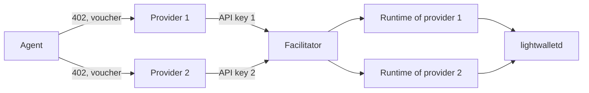
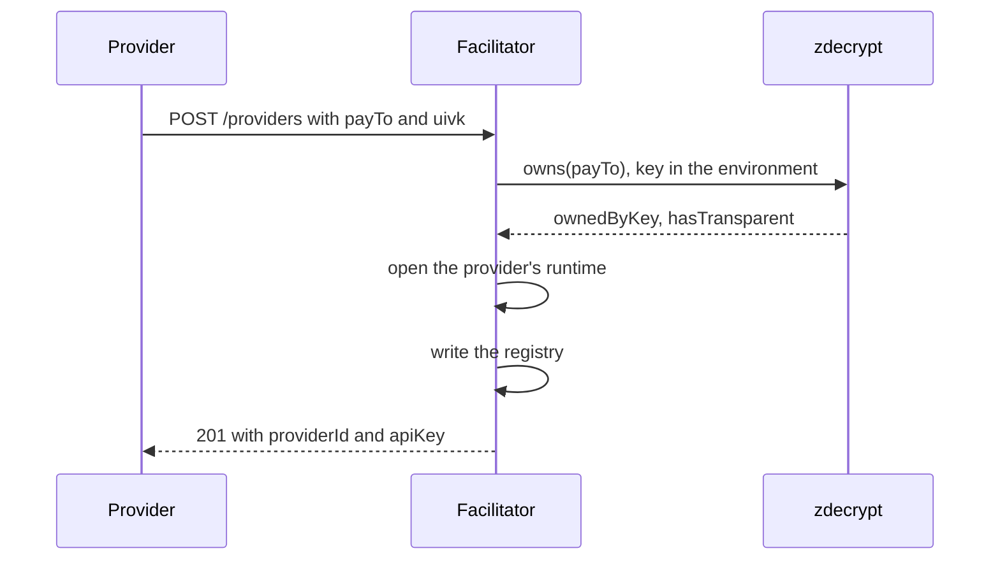

export const meta = {
  title: "Providers and API keys",
  description: "How independent services share one facilitator: registration, API keys, payTo binding, tenant isolation and key rotation.",
};

A **provider** is anyone who sells over z402: one `payTo` address, a set of priced routes, and a server that answers `402`. In x402 terms it is the resource server. A provider does not run payment infrastructure. It connects to a hosted facilitator with an API key.

The facilitator is one rail that many providers share. Each provider keeps its own address, its own prices, its own key and its own ledger, and nothing in one provider's state is visible to another. The operator who runs the facilitator is a provider like any other. This is protocol v2.0, the multi-provider rail.

## Who is who

| Role | Who | What it holds |
|---|---|---|
| Agent | The buyer. | A wallet, and a session key per provider. |
| Provider | A seller, with one `payTo`. | Its `payTo`, a view-only key for it, an API key, its prices. |
| Facilitator | The hosted rail. | Each provider's view-only key and a ledger per provider. It needs no spending key. |
| Operator | Whoever runs the facilitator. | The facilitator's configuration, and its own provider: its `payTo` and its token. |



An agent pays each provider on its own terms. It opens a separate session, with a separate key and a separate deposit, for every `payTo` it meets.

## What a provider owns

| Item | What it is | Where it lives |
|---|---|---|
| `payTo` | The shielded-only unified address its deposits go to. | In every `402` the provider sends. |
| <Term tip="Unified incoming viewing key. Whoever holds it can see the payments made to an address, but cannot spend them.">UIVK</Term> | The view-only key of `payTo`. It lets the facilitator read the provider's deposits. | Given to the facilitator once, at registration. Stored in `registry.json`, mode 0600. |
| API key | A bearer secret that starts with `z402_`. It picks the provider's runtime. | Shown to the provider once. The facilitator keeps only its sha256. |
| Provider id | 16 hex characters: the start of the sha256 of `z402-provider-v1`, the network and the `payTo`. | Derived. It names the provider's ledger and catalog entries. |
| Prices | One per route, from 1 zat to `windowZat`. | In the provider's own routes. |
| Ledger | The provider's sessions, deposits and vouchers. | `ledgers/<providerId>.jsonl`, in the providers directory. |

The provider id depends on the network and the `payTo` alone, so it does not change when the key is rotated. The ledger and the catalog entries stay with the provider.

## Registering a provider

A provider registers once. It proves it owns its `payTo`, and gets an API key.

<Endpoint method="POST" path="/providers" auth="registration-token">

Registers a provider, or rotates the key of one that is registered. The route is open until the operator sets `Z402_REGISTRATION_TOKEN`, except on mainnet, where it is closed until the operator sets the token or `Z402_REGISTRATION_OPEN=1`. With a token set, it needs that token as a bearer. It answers `201` for a new provider and `200` for a rotated key.

</Endpoint>

<Params>
<Param name="payTo" type="string" required>The provider's shielded-only unified address, valid for the facilitator's network, and at most 1,024 characters.</Param>
<Param name="uivk" type="string" required>The unified incoming viewing key of `payTo`. It has to own the address.</Param>
<Param name="network" type="string">Optional. If given, it must be the facilitator's network, such as `zcash:regtest`.</Param>
</Params>



These are the steps for a new provider. A rotation skips the runtime.

<Steps>
<Step title="Check the body">`payTo` must pass the address check for the network, `uivk` must have the shape of a viewing key for it, and `network`, if present, must be the facilitator's. A body that fails gets `400`, and the message names the field.</Step>
<Step title="Prove ownership">`zdecrypt owns` must answer `ownedByKey: true` and `hasTransparent: false`. The viewing key goes in the environment, never in argv. A key that does not own the address, or an address with a transparent receiver, gets `403 not_owner`.</Step>
<Step title="Open the runtime">For a new `payTo`, the facilitator locks and replays the provider's ledger, polls the chain once and starts its watcher. Registrations run one at a time.</Step>
<Step title="Write the registry">Only now is the registry written: to a temporary file, synced, renamed over `registry.json`, and the directory synced. A crash therefore never leaves an entry without a runtime.</Step>
<Step title="Issue the key">The facilitator answers with the key. It is shown once.</Step>
</Steps>

```json title="201 Created"
{
  "providerId": "3f9a0c1d5e7b2a46",
  "network": "zcash:regtest",
  "payTo": "uregtest1...",
  "apiKey": "z402_..."
}
```

The answer carries `Cache-Control: no-store`, and it never echoes the viewing key.

<CodeTabs>

```bash title="curl"
# Leave out the authorization header when the facilitator has no registration token
curl -sS https://facilitator.example.com/providers \
  -H 'content-type: application/json' \
  -H "authorization: Bearer $Z402_REGISTRATION_TOKEN" \
  -d '{"payTo":"uregtest1...","uivk":"uivkregtest1..."}'
```

```bash title="register-provider.mjs"
node scripts/register-provider.mjs \
  --keys .secrets/merchant-regtest.view.json \
  --facilitator http://127.0.0.1:4022 \
  --out .secrets/provider-api-key
```

</CodeTabs>

The script reads `network`, `uivk` and `orchardOnlyAddress` from a view-only keys file, and sends only the address, the viewing key and the network. It opens the key file, with mode 0600, before it sends the request, so a key that is issued always has somewhere to go. It refuses to replace an existing key file without `--force`, takes `--registration-token-file` when the operator set a token, and never prints the key, the viewing key or the token.

Refusals have the body `{"error": "<code>", "message": "<text>"}`:

| Status | Code | When |
|---|---|---|
| 400 | `invalid_request` | A field is missing or invalid. The message names it. A `payTo` of more than 1,024 characters is one. |
| 401 | `unauthorized` | A registration token is set and was not presented. |
| 403 | `not_owner` | The viewing key does not own `payTo`, or `payTo` has a transparent receiver. |
| 403 | `provider_limit` | The limit, `Z402_MAX_PROVIDERS`, is reached. |
| 403 | `registration_disabled` | The facilitator was started without a providers directory, as embedded and test facilitators are, or it runs on mainnet with no registration token and no `Z402_REGISTRATION_OPEN=1`. |
| 409 | `operator` | `payTo` is the operator's own address, which is never registered. |
| 500 | `internal_error` | The registration failed. Nothing was changed. |

<Callout type="warning" title="Keep the UIVK private">

Registration proves ownership with the viewing key, and so does re-registration. Whoever holds a provider's viewing key can register its `payTo` again and take over its API key. A viewing key also shows every payment to the address. Providers must keep theirs private for both reasons, and give it only to the facilitator.

</Callout>

## API keys

A key is `z402_` followed by 43 base64url characters, which is 32 random bytes. That is a valid RFC 6750 bearer token. The facilitator stores only its sha256, and looks a key up by that hash. The key is never logged: access-log lines name the provider id.

A provider sends its key as `Authorization: Bearer <apiKey>`.

| Route | What it needs |
|---|---|
| `GET /supported`, `GET /discovery/resources`, `GET /discovery/search` | Nothing. A key that is presented must still be a real one, so a wrong key is found out at once. |
| `POST /providers` | The registration token, when the operator has set one. Without one it is open, except on mainnet, where it is closed unless the operator opened it with `Z402_REGISTRATION_OPEN=1`. |
| `GET /providers/me`, `POST /verify`, `POST /settle`, `POST /discovery/resources` | The provider's API key. A request without a valid one gets `401` with `WWW-Authenticate: Bearer`. |

```json title="GET /providers/me"
{
  "providerId": "3f9a0c1d5e7b2a46",
  "network": "zcash:regtest",
  "payTo": "uregtest1..."
}
```

A resource server calls `GET /providers/me` once, when it starts, to prove that its key and its configured `payTo` belong together.

## Tenant isolation

The key picks the provider's runtime. A runtime is everything that serves one `payTo`, and nothing in it is shared with another provider:

| Per provider | Shared by all providers |
|---|---|
| A chain view that decrypts with the provider's viewing key and keeps only outputs to its `payTo`. | The lightwalletd client, and one tip it reads, cached for 1 second. |
| The ledger file, its lock and its header, which names the provider's `payTo`. | The `zdecrypt` program, run at most 8 times at once across all providers. |
| Sessions, deposits and credit. | The start-up self-test and network checks, which run once. |
| The deposit resolver (4 lookups at a time, 16 waiting) and the watcher. | The HTTP server, the registry and the catalog. |
| The x402 facilitator and its scheme, which knows one `payTo`. | |

Four rules keep one provider's traffic out of another's:

- **The key binds the `payTo`.** The scheme of a runtime refuses any `paymentRequirements.payTo` other than its own, with `invalid_payment_requirements`. The answer is still HTTP 200, as every verify and settle answer is.
- **The voucher binds the `payTo`.** The signed message contains it, so a voucher made for one provider does not verify at another.
- **Credit is kept per provider.** A deposit is consumed once per provider, under the network, the `payTo` and the txid. A transaction funds at most one session per `payTo`, and each provider credits only the outputs to its own address.
- **Deposits decrypt only for their provider.** A deposit is read with that provider's viewing key, so a provider's runtime cannot read another's deposits.

A ledger that does not belong to its runtime is refused when the facilitator starts. A new ledger begins with a header that names its network and `payTo`, and a start that finds another network or address in it stops.

Failure is the one thing the providers share. A failed ledger write, or a lost ledger lock, in any runtime exits the whole process, and the restart replays every ledger. Those are disk or deployment faults that would hit every provider, so the facilitator does not try to keep serving some of them.

## The operator provider

The provider whose address and viewing key the facilitator is configured with is the operator. It is not registered:

- Its API key is `Z402_FACILITATOR_TOKEN`.
- Its ledger stays at `Z402_LEDGER`.
- Registering its `payTo` is refused with `409 operator`.

A facilitator started without a token, as embedded test facilitators are, treats a request with no `Authorization` header as the operator's. A registered provider always needs its key.

In the starter deployment, the operator's address and token serve `apps/api` and three starter services: the LLM, embeddings and drop box services. One deposit window funds all of them, because an agent keeps one session per `payTo`. URL to markdown is registered as an independent provider with its own keys, so an agent pays it with a deposit of its own.

## Prices and terms

A provider prices each of its routes. Protocol v2.0 accepts any canonical amount from 1 zat to `windowZat`, and the facilitator takes the price from the `paymentRequirements` of each call. The routes of one provider share one session, and each voucher must advance the total by the price of its own call. The service kit refuses to start a route whose price is outside that range.

| Service | One call buys | Price |
|---|---|---|
| `apps/api` `GET /chunk` | One chunk | 500 zat |
| LLM inference | One output chunk | 200 zat |
| URL to markdown | One page | 1,000 zat |
| Text embeddings | About 1,000 tokens | 100 zat |
| Encrypted drop box | An upload, or 10 more blocks of storage | 500 zat |

The trust terms are not per provider. The window, the credit ratio, the cap and the expiry margin are the same for every provider on the rail, and they are advertised in `/supported`. Per-provider terms are future work.

## Rotating a key

Registering a `payTo` that is already registered, with a key that owns it, rotates its API key. The answer is `200`, with the same shape as the first registration and a new key.

- The facilitator writes the new hash before it swaps the key in memory, so no request sees the new hash stored with the old key still working.
- The old key stops working at once, on every route. `GET /providers/me` answers `401` from that moment.
- The provider's ledger, its catalog entries and its provider id stay as they were.

This is also how a lost key is recovered: register again. Rotating a key does not count as a new provider, so the provider limit does not apply.

<Callout type="warning" title="Deploy the new key before the old one is missed">

A resource server that is running with the old key is refused from the moment of rotation. Rotate, then give the new key to the server and restart it. In the starter deployment, `markdown-register --rotate` does the first part for URL to markdown.

</Callout>

## Connecting a resource server

A resource server uses its key in two ways. It sends the key as a bearer token on every call to the facilitator, and it checks the key and its `payTo` at start with `checkProvider` from `@z402/server`. That calls `GET /providers/me`. When it fails it throws a `ProviderCheckError`, and callers branch on its fields, never on its message. The message never contains the key.

| Outcome | `field` | `retryable` |
|---|---|---|
| A connection error, a timeout, a body that breaks off, 5xx, 408 or 429 | `facilitatorUrl` | `true` |
| 404, which is a facilitator without the route, any other status, or an unreadable `200` | `facilitatorUrl` | `false` |
| 401 or 403 | `facilitatorToken` | `false` |
| `200`, but for another `payTo` or network | `payTo` | `false` |
| Before any request: a URL that is not http or https or carries credentials, or a token that is not a bearer token | `facilitatorUrl` or `facilitatorToken` | `false` |

```ts title="check-provider.ts"
import { checkProvider, ProviderCheckError } from "@z402/server";

const facilitatorUrl = "https://facilitator.example.com";
const token = process.env["Z402_FACILITATOR_TOKEN"]; // the API key
const payTo = process.env["Z402_PAY_TO"] ?? "";

for (;;) {
  try {
    await checkProvider({ facilitatorUrl, token, payTo, network: "zcash:regtest" });
    console.log("the key and the payTo belong together");
    break;
  } catch (e) {
    if (!(e instanceof ProviderCheckError)) throw e;
    // Branch on the fields. A key or an address that is wrong will not get better by waiting.
    if (!e.retryable) throw new Error(`fix ${e.field}: ${e.message}`);
    console.log(`the facilitator is not ready (${e.field}), trying again in 2 s`);
    await new Promise((resolve) => setTimeout(resolve, 2000));
  }
}
```

The demo API calls `checkProvider` at start and exits on any error. The service kit waits for a facilitator that is starting or down, and fails at once on anything it cannot fix by waiting. [Sell an API](/docs/guides/sell-an-api) and [Build with the service kit](/docs/guides/service-kit) show both.

## Running registration in the open

<Callout type="warning" title="Open registration takes slots">

Until the operator sets `Z402_REGISTRATION_TOKEN`, anyone who can reach `POST /providers` can register, and each registration holds a runtime. They can fill the provider slots, and they can list resources on the site. Every start of the facilitator warns while registration is open: `POST /providers is open to anyone: set Z402_REGISTRATION_TOKEN to require a token`. Before outside providers connect over the internet, put the facilitator behind TLS and set a registration token.

</Callout>

On mainnet, open registration is off. With no token and no `Z402_REGISTRATION_OPEN=1`, the facilitator still starts and serves the operator and the providers already registered, and `POST /providers` answers `403 registration_disabled`. The start prints a warning that says so.

| Setting | Default | What it does |
|---|---|---|
| `Z402_PROVIDERS_DIR` | `.data/providers.<network>` | Where the registry, the provider ledgers and the catalog live. The directory has mode 0700. |
| `Z402_MAX_PROVIDERS` | 32 | How many providers can register, the operator not counted. `0` turns away new providers. A registered provider can still rotate its key. |
| `Z402_REGISTRATION_TOKEN` | none | A bearer token that `POST /providers` then requires. It must be one token of letters, digits and `-._~+/`, and at least 32 characters, for example `openssl rand -hex 32`. A shorter one stops the start. |
| `Z402_REGISTRATION_OPEN` | unset | `1`, or unset. Only mainnet reads it: `1` lets anyone register there, with the warning above. A token always gates registration, so `1` beside a token changes nothing. |

At start the facilitator opens the operator's runtime, then loads the registry and asks `zdecrypt` again whether each stored viewing key still owns its `payTo`. A malformed registry, or one for another network, stops the start. So does an entry whose key no longer owns its address, and that message names the provider id. Every provider's ledger is then opened in parallel and polled once. The facilitator prints its usual ready line, then a second line with the number of registered providers.

Nothing removes a provider while the facilitator runs, and an idle provider keeps its slot. To free a slot or to drop an abusive provider, the operator stops the facilitator, removes the entry from `registry.json` and starts it again. [Run the facilitator](/docs/guides/run-a-facilitator#remove-a-provider) gives the steps, and the facilitator's README has the whole procedure under "Removing a provider": <Source path="packages/facilitator/README.md" />.

<Cards>
  <Card title="Sell an API" href="/docs/guides/sell-an-api">Charge for a route and connect it to the facilitator.</Card>
  <Card title="Run the facilitator" href="/docs/guides/run-a-facilitator">Configure the rail, register providers, read the logs.</Card>
  <Card title="Discovery" href="/docs/concepts/discovery">How a provider's routes get listed.</Card>
</Cards>

## References

- <Source path="docs/superpowers/specs/2026-10-28-z402-multi-provider-design.md" />: the multi-provider rail, sections 3, 4.1, 4.5, 4.6 and 7.
- <Source path="docs/spec/protocol.md" />: the wire contract. Its v2.0 revision adds section 16, providers and API keys, and changes sections 2, 5.2, 10 and 15.
- <Source path="packages/facilitator/src/providers/register.ts" />: the registration and rotation flow, and its refusals.
- <Source path="packages/facilitator/src/providers/registry.ts" />: the registry file and its atomic write.
- <Source path="packages/facilitator/src/providers/apiKey.ts" />: the key format and its hash.
- <Source path="packages/facilitator/src/providers/id.ts" />: the provider id.
- <Source path="packages/facilitator/src/runtime.ts" />: one provider's runtime.
- <Source path="packages/facilitator/src/app.ts" />: the routes, the key lookup and the start-up order.
- <Source path="packages/facilitator/src/config.ts" />: `Z402_PROVIDERS_DIR`, `Z402_MAX_PROVIDERS`, `Z402_REGISTRATION_TOKEN` and `Z402_REGISTRATION_OPEN`.
- <Source path="packages/facilitator/README.md" />: the environment, registration, and removing a provider.
- <Source path="packages/server/src/provider.ts" />: `checkProvider` and `ProviderCheckError`.
- <Source path="scripts/register-provider.mjs" />: registration from a view-only keys file.
- <Source path="docs/superpowers/specs/2026-10-27-z402-services-design.md" />: the starter services, with URL to markdown as provider 2.
- [RFC 6750, bearer tokens](https://www.rfc-editor.org/rfc/rfc6750.html): the token format of every key.
