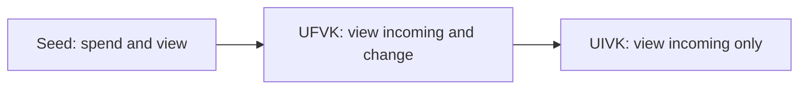
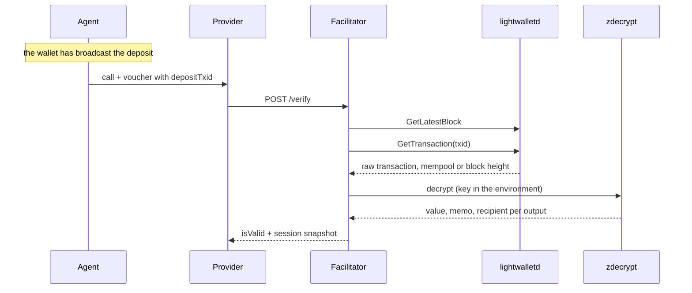

export const meta = {
  title: "Shielded payments",
  description: "What a shielded Zcash deposit hides, how addresses, viewing keys and memos work, and how the facilitator finds and reads a deposit.",
};

In z402 the chain sees one thing: the deposit. It is a shielded Zcash transaction from the agent's wallet to the provider's address. Every call after it is an off-chain signature. This page explains what a shielded transaction is made of, what it keeps from the public, and how the facilitator still finds the money.

## What a shielded payment hides

On a transparent chain, every payment shows who paid whom and how much. A shielded Zcash transaction replaces those fields with encrypted ones and a proof that the transaction is valid. Nodes check the proof. They never see the plaintext.

Take the deposit of the demo: 100,000 zat to the provider, with the agent's session key in the memo. This is what a block explorer has for it, next to what the provider's viewing key reads from the same bytes:

| | A block explorer | The provider's viewing key |
|---|---|---|
| That the transaction exists, its block, its time | Yes | Yes |
| Its size: 9,166 bytes for two shielded actions | Yes | Yes |
| Its expiry height | Yes | Yes |
| The fee: the net value balance, 10,000 zat here | Yes | Yes |
| The amount paid to the provider | No | 100,000 zat |
| The recipient | No | The provider's address |
| The memo | No | `<sessionKey>:1` |
| The sender | No | No |

The last row holds for the key too. A viewing key decrypts what was sent to an address. The note carries a value, a memo and a recipient, and no field names the sender. This is the report of `zdecrypt`, the decryptor the facilitator runs, for one real deposit on the regtest stack. The transaction id is shortened, and the address is a placeholder:

```json title="zdecrypt decrypt, trimmed"
{
  "txid": "98e84dab...0eaf",
  "version": 6,
  "expiryHeight": 155,
  "transparentIn": 0,
  "transparentOut": 0,
  "ironwood": { "actions": 2, "valueBalanceZat": 10000 },
  "outputs": [
    {
      "pool": "ironwood",
      "scope": "external",
      "valueZat": 100000,
      "memoKind": "text",
      "memoText": "aa80f78d...2046:1",
      "toPayTo": true,
      "recipient": "uregtest1..."
    }
  ]
}
```

The `memoText` is the session key, a colon and the deposit index. The rest of the page explains each field.

## Pools

A shielded transaction moves value between pools. A pool is a set of encrypted notes with its own rules.

| Pool | What it is | In z402 |
|---|---|---|
| Sapling | The older shielded pool. | `zdecrypt` still reads its outputs. The keygen's `orchardOnlyAddress` has no Sapling receiver, so deposits to it do not use this pool. |
| Orchard | The newer shielded pool. | Since NU6.3, consensus forbids new value in it. |
| Ironwood | The Orchard-family pool added in NU6.3. | A payment to an address's Orchard receiver lands here, in a version 6 transaction. It decrypts with the same incoming viewing key, under note plaintext version 3. |

The consequence is practical. A decryptor that reads only Orchard actions finds nothing in a current deposit. `zdecrypt` reads Sapling, Orchard and Ironwood.

## Unified addresses

A unified address is one string that bundles receivers of several kinds, one per pool. The sender's wallet picks a receiver it can use. [ZIP 316](https://zips.z.cash/zip-0316) defines the format.

A provider's `payTo` must be a unified address with **shielded receivers only**. With no transparent receiver, no one can pay the address in the open. `isValidPayTo` checks the prefix for the network, and it rejects the transparent-including prefixes (`tu`, `tutest`, `turegtest`) outright:

| Network | `payTo` prefixes | Viewing key prefixes | Upgrade the facilitator expects |
|---|---|---|---|
| `zcash:regtest` | `uregtest1`, `zuregtest1` | `uivkregtest1`, `uviregtest1` | `37a5165b` (NU6.3) |
| `zcash:testnet` | `utest1`, `zutest1` | `uivktest1`, `uvitest1` | `77190ad9` (NU7) |
| `zcash:mainnet` | `u1`, `zu1` | `uivk1`, `uvi1` | None by default: the check is skipped with a warning. |

The `zu` forms are the ZIP 316 revision 2 encodings of the same kinds of address, and `uvi` is the matching viewing key. The body of an address is lowercase bech32.

```ts title="payto.ts"
import { isValidPayTo, NETWORK_REGTEST } from "@z402/protocol";

// Shortened addresses: only the prefix and the character set are checked here
console.log(isValidPayTo("uregtest1qqqqqqqq", NETWORK_REGTEST)); // true: a shielded-only address for regtest
console.log(isValidPayTo("turegtest1qqqqqqqq", NETWORK_REGTEST)); // false: its prefix allows a transparent receiver
console.log(isValidPayTo("utest1qqqqqqqq", NETWORK_REGTEST)); // false: an address of another network
```

The check of the prefix is not proof that the address works. When a provider registers, the facilitator also proves that the provider's viewing key belongs to the address, and that the address has no transparent receiver. [Providers and API keys](/docs/concepts/providers#registering-a-provider) shows how.

## Viewing keys

Zcash keys form a chain. Each key sees less than the one before it:



| Key | Spends | Sees payments to the address | Sees the wallet's own change |
|---|---|---|---|
| The seed (`seedHex`) | Yes | Yes | Yes |
| <Term tip="Unified full viewing key. It sees everything the seed sees, including the wallet's own change, but cannot spend.">UFVK</Term> | No | Yes | Yes |
| <Term tip="Unified incoming viewing key. Whoever holds it can see the payments made to an address, but cannot spend them.">UIVK</Term> | No | Yes | No |

The facilitator needs the last one only. It reads deposits to a provider's address with that provider's UIVK, and it cannot move a zat. The configuration enforces that. A keys file that holds a `seedHex` or a `ufvk` is refused on mainnet, and gets a warning on other networks. `scripts/merchant-keygen.mjs --view-only` writes a keys file with no seed and no full viewing key: only `network`, `uivk` and `orchardOnlyAddress`.

<Callout type="privacy" title="A viewing key reads, it does not spend">

Whoever holds a provider's UIVK sees every payment to that provider's address: the value and the memo of each. It cannot spend them, and it cannot tell who sent them. Providers keep their UIVK private for that reason. They give it to the facilitator once, when they register. [Privacy model](/docs/concepts/privacy) lists what that means for each party.

</Callout>

## Memos

Every shielded output can carry a memo: a 512-byte field, encrypted with the note. Only a viewing key of the recipient reads it. [ZIP 302](https://zips.z.cash/zip-0302) defines the text format: UTF-8 text padded with zero bytes.

A deposit memo is the thing that ties an anonymous payment to a session. Without it the facilitator would see 100,000 zat arrive and not know whose voucher it funds. z402 uses this memo, exactly:

```text
<sessionKey>:<index>
```

The session key is 64 lowercase hex characters, the agent's Ed25519 public key. The index is a decimal counter of the session's deposits (1, 2, 3, and so on) with no leading zeros and at most nine digits. The facilitator strips trailing zero bytes from the memo field and then matches the text against `^<sessionKey>:(0|[1-9][0-9]{0,8})$`. It trims nothing else. The index is informational: it has no uniqueness or ordering rule.

```ts title="memo.ts"
import { depositMemo, parseDepositMemo } from "@z402/protocol";

const sessionKey = "03a107bff3ce10be1d70dd18e74bc09967e4d6309ba50d5f1ddc8664125531b8";
const memo = depositMemo(sessionKey, 1);

console.log(memo); // 03a107bf...31b8:1
console.log(parseDepositMemo(memo)); // { sessionKey: "03a107bf...31b8", index: 1 }
console.log(parseDepositMemo(`${sessionKey}:01`)); // null: no leading zero
console.log(parseDepositMemo(` ${memo}`)); // null: nothing is trimmed
```

Three rules follow from the memo:

- The credited value of a deposit is the sum of its outputs to `payTo` whose memo matches the session. Outputs with other memos are ignored.
- A transaction id is a credit unit. It is consumed once per provider, so one transaction funds one session at a provider.
- A deposit with a transparent input or output is refused.

## How the facilitator detects a deposit

The facilitator does not scan the chain. The agent tells it which transaction to look at: the voucher of the call that follows the deposit carries the txid as `depositTxid`. The facilitator looks that transaction up, reads it with the provider's viewing key, and decides.



<Steps>
<Step title="Fetch">The facilitator reads the tip, then the transaction, from <Term tip="A server that gives wallets and services a compact view of the Zcash chain over gRPC. Zaino is a compatible one.">lightwalletd</Term>. It learns the raw bytes and whether the transaction is in the mempool, mined at a height, or on a fork. The tip comes first, so an answer of unmined or not found speaks for a chain at least that high.</Step>
<Step title="Decrypt">It passes the raw bytes to `zdecrypt`, a Rust program built on the Zcash crates. `zdecrypt` parses the transaction and trial-decrypts every Sapling output and every Orchard and Ironwood action with the provider's UIVK. The key travels in the environment variable `ZDECRYPT_KEY`, never in argv, which `ps` shows.</Step>
<Step title="Keep what is for this provider">Only outputs in the external scope that decrypt to the provider's `payTo` count. Each comes with its value and its memo.</Step>
<Step title="Judge">The facilitator applies the rules below and, if the deposit is usable, credits it to the session whose memo it carries.</Step>
</Steps>

A deposit is usable only if all of these hold:

| Check | If it fails |
|---|---|
| The transaction exists | `z402_deposit_not_found` once lookups kept answering not-found for the whole wait (30 s by default), or `z402_chain_unavailable` when lightwalletd itself fails |
| It has no transparent input or output | `z402_deposit_transparent` |
| An output decrypts to the provider's `payTo` | `z402_deposit_memo_mismatch` |
| One of those outputs carries this session's memo | `z402_deposit_memo_mismatch` |
| No other session has credited it | `z402_deposit_memo_mismatch` |
| It has not expired unmined | `z402_deposit_dead` |

The three mismatch cases share one code and one message, "the deposit cannot be credited". A refusal is therefore no oracle on what the provider's key can see: a transaction that pays someone else, a transaction with the wrong memo and a transaction another session already used all get the same answer. The protocol's section 5.2 records the one known exception.

The facilitator also keeps watching. Every 5 seconds it asks lightwalletd for the tip. On a new tip, and at least every 30 seconds, it reads every deposit that is not final again and records any change in status.

## Deposit status

The facilitator gives each credited deposit one of five statuses, from what lightwalletd says about it:

| What lightwalletd says | Status |
|---|---|
| In the mempool, not mined | `pending` |
| Mined, 1 to 9 confirmations | `confirmed` |
| Mined, 10 or more confirmations | `final` |
| Mined on a fork that is not the main chain | `orphaned`, which counts nowhere |
| Unmined, and the tip has reached its expiry height | `dead` |
| Unmined, and every answer for 120 seconds or more was a definitive not-found, across at least 2 new blocks | `dead` |

The block that holds a transaction is its first confirmation. Not-found is not death by itself: a load-balanced lightwalletd can lag, and any found answer resets the streak. Zebra drops a transaction from its mempool when the tip reaches the transaction's expiry height, which is why the tip rule is exact.

Status drives credit. [Prepaid vouchers](/docs/concepts/prepaid-vouchers#the-trust-ramp) shows how each status changes what an agent may spend.

## What the facilitator trusts

`zdecrypt` checks no proof, no signature and no block inclusion. It decrypts bytes. The facilitator therefore trusts its lightwalletd endpoint on two things: whether a deposit exists, and how deep it is mined. A dishonest endpoint could report a deposit that is not real.

That is why real money needs an endpoint the facilitator's operator runs. On mainnet, the facilitator logs a warning at start when `Z402_LWD_URL` is not a loopback host, and it has no default endpoint. At start it also checks that lightwalletd serves the network it was configured for, and that the chain's consensus branch is the expected one.

## Fees and timing

The agent pays the network fee on top of the window. The numbers below were measured on the regtest stack. They are examples, not guarantees.

| What | Measured |
|---|---|
| Fee of a deposit with one recipient output and one change output | 10,000 zat: two shielded actions at the ZIP 317 rate of 5,000 zat each. Three actions cost 15,000 zat, and five, from a send that splits the change, cost 25,000 zat. |
| Building the proof and broadcasting | 5 to 7 seconds in the recorded runs |
| From broadcast to the first sighting in the mempool | 0.5 seconds on one measured deposit |
| Decrypting a transaction of two actions | 0.9 to 1.7 milliseconds |
| From a mined block to the facilitator's view | A few seconds of lag in the index, plus up to one 5-second poll |

The first call is served on the unconfirmed deposit. It waits for the proof and the broadcast, not for a block.

<Cards>
  <Card title="Prepaid vouchers" href="/docs/concepts/prepaid-vouchers">How a deposit becomes spending power, with the exact formula.</Card>
  <Card title="Privacy model" href="/docs/concepts/privacy">Who learns what, and what the viewing key changes.</Card>
  <Card title="Run the facilitator" href="/docs/guides/run-a-facilitator">Keys, the lightwalletd endpoint and the start-up checks.</Card>
</Cards>

## References

- <Source path="docs/spec/protocol.md" />: section 5 (deposits, crediting and status), section 11 (chain access), section 2 (`payTo` prefixes).
- <Source path="docs/research/decrypt-spike.md" />: Ironwood, the Orchard viewing key and `zdecrypt`.
- <Source path="docs/research/live-run.md" />: a real deposit as the chain stores it and as the viewing key reads it, with the measured fees and timings.
- <Source path="docs/demo.md" />: beat 7, what the chain shows.
- <Source path="crates/zdecrypt/src/lib.rs" />: the decryptor.
- <Source path="packages/facilitator/src/chain/zdecrypt.ts" />: how the facilitator runs it.
- <Source path="packages/facilitator/src/chain/lightwalletdChainView.ts" />: the lookup that joins lightwalletd and `zdecrypt`.
- <Source path="packages/facilitator/src/core/evaluate.ts" />: the deposit rules.
- <Source path="packages/facilitator/src/core/watcher.ts" />: the 5-second poll and the 30-second sweep.
- <Source path="packages/facilitator/src/config.ts" />: key prefixes, the keys-file rules and the expected branch ids.
- <Source path="packages/protocol/src/validate.ts" />: `isValidPayTo` and the address patterns.
- <Source path="packages/protocol/src/memo.ts" />: `depositMemo` and `parseDepositMemo`.
- [ZIP 316, unified addresses](https://zips.z.cash/zip-0316): the address and viewing key formats.
- [ZIP 302, the memo field](https://zips.z.cash/zip-0302): the text memo.
- [ZIP 317, the fee](https://zips.z.cash/zip-0317): the conventional fee.
- [lightwalletd](https://github.com/zcash/lightwalletd) and its [protocol](https://github.com/zcash/lightwallet-protocol): the interface the facilitator reads.
