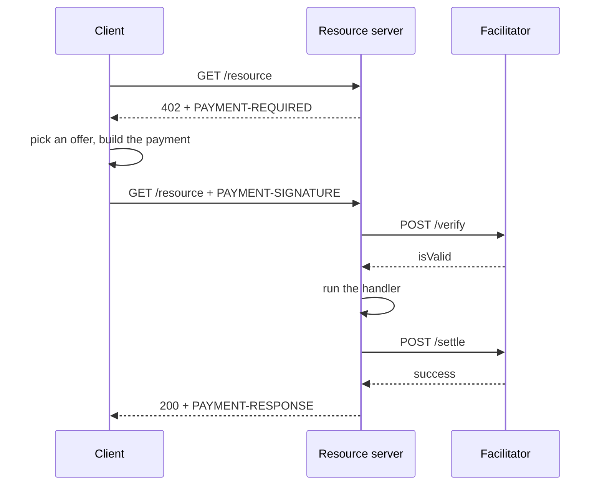

export const meta = {
  title: "x402 and HTTP 402",
  description: "How a paid HTTP call works in x402 v2: the 402 offer, the signed payment, the facilitator, and what z402 adds on Zcash.",
};

HTTP reserves a status code for payments: `402 Payment Required`. [RFC 9110](https://www.rfc-editor.org/rfc/rfc9110.html#name-402-payment-required) marks it as reserved for future use. <Term tip="An open standard that lets a web server ask for payment with the HTTP status 402 Payment Required, and lets a client pay and ask again.">x402</Term> gives it a job. A server answers `402` with what it wants to be paid, the client pays, and the same request goes through.

z402 is a payment scheme for x402. It settles in shielded Zcash. Most of this page is plain x402 v2, which z402 uses as it is: the stock client and server code run unchanged, with one scheme registered. [What z402 adds](/docs/concepts/x402#what-z402-adds) lists the differences.

## Who is in the flow

| Role | In x402 | In z402 |
|---|---|---|
| Client | The buyer. It makes the HTTP request and pays. | An agent with a wallet and a session key. |
| Resource server | The seller. It serves the resource and answers `402`. | A provider's API or service. |
| <Term tip="The service a resource server asks to check and record payments. It keeps the server from running payment code itself.">Facilitator</Term> | Verifies and settles payments for resource servers. | One hosted rail that many providers share. It reads deposits from the Zcash chain. |

The client never talks to the facilitator to pay. The resource server does, with an API key. That keeps chain access and payment logic out of every API that sells something.

## One paid call



<Steps>
<Step title="Ask">The client sends the request with no payment.</Step>
<Step title="Offer">The server answers `402` and a `PAYMENT-REQUIRED` header that lists what it accepts.</Step>
<Step title="Pay">The client picks an offer, builds a payment for it, and repeats the request with a `PAYMENT-SIGNATURE` header.</Step>
<Step title="Verify">The server sends the payment and the offer it matched to the facilitator's `/verify`. Verify checks and reads. It commits nothing.</Step>
<Step title="Serve">If the payment is valid, the server runs its handler. A handler that fails with a status of 400 or more ends the flow here, and nothing is settled.</Step>
<Step title="Settle">The server calls `/settle`. The facilitator commits the payment. The server returns the handler's response with a `PAYMENT-RESPONSE` header.</Step>
</Steps>

This order, verify then handler then settle, is the x402 `authorization` flow. z402 uses it and nothing else. The SDK's default is the same, so a z402 scheme sets no `paymentFlow` key.

## The three headers

| Header | Direction | Carries |
|---|---|---|
| `PAYMENT-REQUIRED` | Server to client, on the `402` | The offers: a `PaymentRequired` object. |
| `PAYMENT-SIGNATURE` | Client to server, on the retry | The chosen offer and the proof: a `PaymentPayload` object. |
| `PAYMENT-RESPONSE` | Server to client, with the result | The outcome of settlement: a `SettleResponse` object. |

Each value is the UTF-8 JSON of the object, encoded as standard base64. It is not base64url, and the decoder refuses other characters. A z402 server sends `{}` as the body of its `402`: everything is in the header.

<CodeTabs>

```bash title="curl"
curl -s -D - -o /dev/null http://127.0.0.1:4021/chunk | tr -d '\r' \
  | awk -F': ' 'tolower($1) == "payment-required" { print $2 }' | base64 -d | jq '.accepts[0]'
```

```ts title="decode.ts"
import { decodePaymentRequiredHeader } from "@x402/core/http";

const res = await fetch("http://127.0.0.1:4021/chunk");
const header = res.headers.get("PAYMENT-REQUIRED");

if (res.status === 402 && header !== null) {
  const required = decodePaymentRequiredHeader(header);
  console.log(required.accepts[0]);
}
```

</CodeTabs>

## The offer: PaymentRequired

A server that wants payment sends one `PaymentRequired` object.

<Params>
<Param name="x402Version" type="number" required>The protocol version. z402 speaks version 2 only, and answers anything else with `invalid_x402_version`.</Param>
<Param name="error" type="string">Why payment is needed. An unpaid request gets `Payment required`. A refused payment carries the facilitator's reason code, such as `z402_deposit_required`.</Param>
<Param name="resource" type="object" required>What is for sale: a `url`, and optionally a `description`, `mimeType`, `serviceName`, `tags` and `iconUrl`.</Param>
<Param name="accepts" type="PaymentRequirements[]" required>The offers. The client picks one it knows how to pay. A z402 service lists one.</Param>
<Param name="extensions" type="object">Extra data keyed by extension name. The `bazaar` extension describes the route for the catalog. The `z402` extension names the billing unit and an optional privacy note. The stock client copies the object into its payment.</Param>
</Params>

Each offer is a `PaymentRequirements` object:

<Params>
<Param name="scheme" type="string" required>How to pay. For z402, `prepaid-voucher`.</Param>
<Param name="network" type="string" required>Where to pay, as a CAIP-2 style id. For z402, `zcash:regtest`, `zcash:testnet` or `zcash:mainnet`.</Param>
<Param name="asset" type="string" required>What to pay in. For z402, `ZEC`.</Param>
<Param name="amount" type="string" required>The price of this call, as a decimal string in the asset's smallest unit. For z402, zat.</Param>
<Param name="payTo" type="string" required>Who is paid. For z402, the provider's shielded-only unified address.</Param>
<Param name="maxTimeoutSeconds" type="number" required>How long the payment may take. z402 routes use 60.</Param>
<Param name="extra" type="object" required>Scheme-specific terms. For z402, the window, the credit rules and a terms version. [Prepaid vouchers](/docs/concepts/prepaid-vouchers) explains them.</Param>
</Params>

This is a decoded `PAYMENT-REQUIRED` from the URL to markdown service, with the address shortened and the `bazaar` schema left out:

```json title="PAYMENT-REQUIRED, decoded"
{
  "x402Version": 2,
  "error": "Payment required",
  "resource": {
    "url": "https://markdown.example.com/v1/markdown",
    "description": "Fetches one public web page and returns its main content as clean markdown.",
    "mimeType": "application/json",
    "serviceName": "URL to markdown",
    "tags": ["web", "markdown", "scrape"]
  },
  "accepts": [
    {
      "scheme": "prepaid-voucher",
      "network": "zcash:regtest",
      "amount": "1000",
      "asset": "ZEC",
      "payTo": "uregtest1...",
      "maxTimeoutSeconds": 60,
      "extra": {
        "windowZat": "100000",
        "creditRatioBps": 2500,
        "creditCapZat": "200000",
        "zeroConfMinExpiryBlocks": 20,
        "termsVersion": "5a2a93e32c1aa9da"
      }
    }
  ],
  "extensions": {
    "bazaar": {
      "info": {
        "input": { "type": "http", "queryParams": { "url": "https://example.com" }, "method": "GET" },
        "output": { "type": "json", "example": { "title": "Example Domain", "length": 16 } }
      },
      "schema": "..."
    },
    "z402": { "unit": "page" }
  }
}
```

<Callout type="note" title="The extra object is static per route">

The server matches the `accepted` offer in a payment against the offer it would send now. Every key of the server's `extra` must come back with the same value. Per-session values therefore never go in the offer. A refused payment is the one exception: the server adds the session's state to the refusal, and [Prepaid vouchers](/docs/concepts/prepaid-vouchers#the-session-snapshot) shows how.

</Callout>

## The payment: PaymentPayload

The client answers with a `PaymentPayload` in the `PAYMENT-SIGNATURE` header.

<Params>
<Param name="x402Version" type="number" required>Echoes the version it was given.</Param>
<Param name="accepted" type="PaymentRequirements" required>The offer the client chose, copied back unchanged. The server refuses a payment whose `accepted` differs from what it offers, with `No matching payment requirements`.</Param>
<Param name="payload" type="object" required>The proof of payment. Its shape belongs to the scheme. For z402 it is a voucher: `sessionKey`, `cumulativeZat`, `sig` and, while a deposit is not yet acknowledged, `depositTxid`.</Param>
<Param name="resource" type="object">The `resource` of the offer, echoed.</Param>
<Param name="extensions" type="object">The `extensions` of the offer, echoed.</Param>
</Params>

```json title="PAYMENT-SIGNATURE, decoded"
{
  "x402Version": 2,
  "payload": {
    "sessionKey": "7dc02259...2609",
    "cumulativeZat": "1000",
    "sig": "76b6ee6c...4a03",
    "depositTxid": "cd266215...0a50"
  },
  "accepted": { "scheme": "prepaid-voucher", "network": "zcash:regtest", "amount": "1000", "...": "as offered" },
  "resource": { "url": "https://markdown.example.com/v1/markdown" },
  "extensions": { "...": "as offered" }
}
```

The hex values are shortened. A missing or undecodable `PAYMENT-SIGNATURE` is not an error to the server: it counts as no payment and gets a fresh `402`.

## The facilitator

A facilitator exposes three routes to resource servers.

| Route | Auth | What it does |
|---|---|---|
| `GET /supported` | Public | Lists what the facilitator can settle: `kinds` (version, scheme, network, `extra`), `extensions` and `signers`. |
| `POST /verify` | API key | Checks a payment against an offer. Read-only: it must not commit payment state. Answers `isValid`, with `invalidReason` and `invalidMessage` when not. |
| `POST /settle` | API key | Commits the payment. Answers `success`, `transaction` and `network`, with `errorReason` and `errorMessage` when not. |

A resource server reads `/supported` when it starts, and it refuses to start a route whose exact scheme and network the facilitator does not list. For that reason the facilitator starts before the API.

```json title="GET /supported"
{
  "kinds": [
    {
      "x402Version": 2,
      "scheme": "prepaid-voucher",
      "network": "zcash:regtest",
      "extra": {
        "windowZat": "100000",
        "creditRatioBps": 2500,
        "creditCapZat": "200000",
        "zeroConfMinExpiryBlocks": 20,
        "termsVersion": "5a2a93e32c1aa9da"
      }
    }
  ],
  "extensions": ["bazaar"],
  "signers": { "zcash:*": [] }
}
```

`signers` is empty because a z402 facilitator signs nothing on chain. The `extra` of a kind holds the terms that apply to every provider on the rail.

Once it accepts the API key, the z402 facilitator answers every `/verify` and `/settle` with HTTP 200, success or not, and puts the outcome in the body. A non-200 answer would leak its body into the client's error, and a `/settle` answer without `transaction` makes the stock server return 502.

## What the client sees

| What happened | What the client gets |
|---|---|
| Paid and settled | `200`, the handler's body, and `PAYMENT-RESPONSE` with `success: true`. |
| Verify refused | `402` and a new `PAYMENT-REQUIRED` whose `error` is the facilitator's `invalidReason`. |
| Settle refused | `402` and `PAYMENT-RESPONSE` with `success: false`. The handler's output is discarded. |
| The handler failed with a status of 400 or more | The handler's response. Nothing is settled. |
| The facilitator timed out | `502` with neither header. |
| The facilitator could not be reached | `402` whose `error` is the network error text, such as `fetch failed`. |
| `PAYMENT-SIGNATURE` missing or undecodable | A fresh `402` with `error: "Payment required"`. |
| `accepted` does not match any offer | `402` with `error: "No matching payment requirements"`. |

The stock fetch wrapper returns a refused call as a `402` response. It does not throw, so a loop must check `res.status`. The wrapper makes one paid attempt, plus one recovery attempt when the scheme's hook asks for it. It never makes a third.

```ts title="agent.ts"
import { decodePaymentResponseHeader } from "@x402/core/http";
import { wrapFetchWithPayment, x402Client } from "@x402/fetch";
import { LightwalletdTxStatus, PrepaidVoucherScheme, ZalletRpcWallet } from "@z402/client";
import { createLightwalletdClient } from "@z402/lightwalletd";
import { parseSessionSnapshot } from "@z402/protocol";

// The endpoints and credentials of the local Z3 regtest stack
const lwd = createLightwalletdClient({ url: "http://127.0.0.1:28137" });
const scheme = new PrepaidVoucherScheme({
  wallet: new ZalletRpcWallet({ url: "http://127.0.0.1:50232", user: "zebra", password: "zebra" }),
  chain: new LightwalletdTxStatus(lwd),
});

const client = new x402Client();
client.register("zcash:regtest", scheme); // the one line that adds Zcash
const paidFetch = wrapFetchWithPayment(fetch, client);

const res = await paidFetch("http://127.0.0.1:4021/chunk");
const receipt = res.headers.get("PAYMENT-RESPONSE");
if (res.status === 200 && receipt !== null) {
  // The receipt carries the session's state next to the outcome
  const settled = decodePaymentResponseHeader(receipt);
  const session = parseSessionSnapshot(settled.extra?.["session"]);
  console.log(`paid ${settled.amount} zat, ${session?.headroomZat} zat of headroom left`);
} else {
  console.log(`refused with ${res.status}`);
}

await scheme.close();
lwd.close();
```

## What z402 adds

| x402 asks for | z402 chooses |
|---|---|
| A scheme id that names the semantics | `prepaid-voucher` |
| A network id in CAIP-2 form | `zcash:regtest`, `zcash:testnet`, `zcash:mainnet`. The syntax is valid CAIP-2, but no `zcash` namespace is registered, so the ids are provisional. |
| An asset and an amount in its smallest unit | `ZEC` and zat. One ZEC is 100,000,000 zat. |
| A recipient | A shielded-only unified address. [Shielded payments](/docs/concepts/shielded-payments) covers addresses. |
| Scheme-specific terms in `extra` | The deposit window, the credit rules and a terms version. |
| Scheme-specific proof in `payload` | A signed cumulative voucher, plus the txid of a deposit when one is not yet acknowledged. |
| A `payer` in verify and settle answers | The session key. A shielded payer has no address to show. |

Three differences matter when you read the SDK's docs for other schemes.

- **Settle moves no money.** The money moved earlier, in the agent's deposit. Settle credits that deposit once, records the voucher, and returns the session's state.
- **The client keeps state.** The scheme remembers a session per provider, serializes calls on it, and decides when to deposit. The stock client only hands it the offer and the outcome.
- **A refusal carries data.** When verify refuses a voucher, the server scheme adds the session's state to the new `402`, as `extra.session` on the offer. The client reads it to resync and to decide what to do next.

The stock client's spend controls reject an asset that its scheme cannot price. The z402 scheme implements `findDefaultAsset` for `ZEC`, so the stock client accepts it.

z402 pins `@x402/core`, `@x402/fetch`, `@x402/express` and `@x402/extensions` to exactly 2.28.0.

<Cards>
  <Card title="Shielded payments" href="/docs/concepts/shielded-payments">What the deposit is, and how the facilitator finds it.</Card>
  <Card title="Prepaid vouchers" href="/docs/concepts/prepaid-vouchers">The scheme itself: window, voucher, trust ramp.</Card>
  <Card title="Protocol" href="/docs/reference/protocol">Every field and rule of the wire contract.</Card>
</Cards>

## References

- <Source path="docs/research/x402-spec.md" />: the v2 objects, header encodings, status codes and facilitator duties, checked against SDK 2.28.0.
- <Source path="docs/spec/protocol.md" />: sections 2, 3, 7 and 8, the z402 offer, payload, answers and codes.
- <Source path="packages/protocol/src/constants.ts" />: the scheme id, the network ids and the asset.
- <Source path="packages/server/src/scheme.ts" />: the server scheme and the corrective `402`.
- <Source path="packages/client/src/scheme.ts" />: `PrepaidVoucherScheme` and `findDefaultAsset`.
- <Source path="apps/api/src/app.ts" />: a resource server with one paid route, `GET /chunk`.
- <Source path="apps/agent/src/agent.ts" />: the stock client and the one `register` line.
- [x402 specification v2](https://github.com/x402-foundation/x402/blob/main/specs/x402-specification-v2.md): the objects and headers.
- [x402 HTTP transport](https://github.com/x402-foundation/x402/blob/main/specs/transports-v2/http.md): header names, encodings and status codes.
- [RFC 9110, 402 Payment Required](https://www.rfc-editor.org/rfc/rfc9110.html#name-402-payment-required): the HTTP status code.
- [CAIP-2](https://github.com/ChainAgnostic/CAIPs/blob/main/CAIPs/caip-2.md): the network id format.
