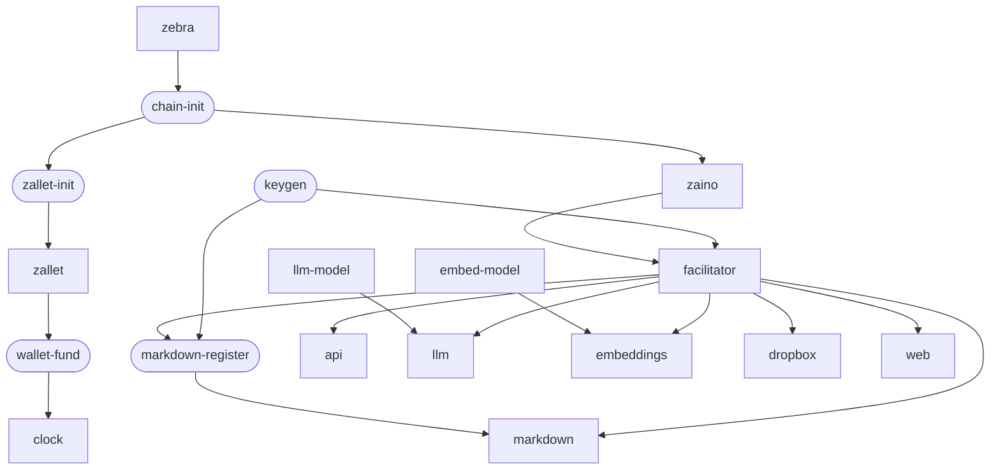
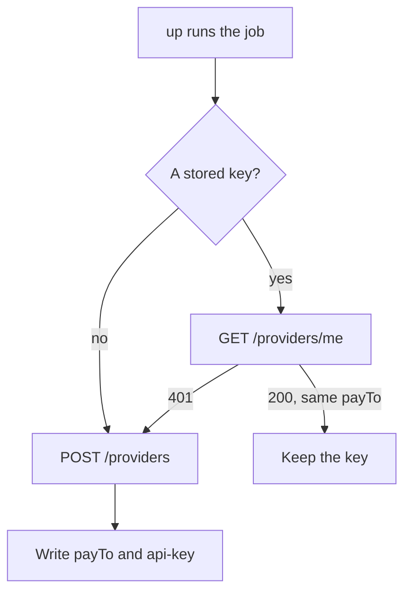

export const meta = {
  title: "Deploy with Docker",
  description: "Run the whole z402 stack on one machine with Docker Compose: every service and job, the start order, volumes, provider 2, updates and wiping.",
};

`docker compose up -d` in the repository root runs the whole project on one machine. It starts a private Zcash regtest chain with a funded agent wallet and a block clock, the merchant keys, the facilitator (which also hosts the service catalog), the paid API, the four starter services, a local llama.cpp model runtime for `llm` and `embeddings`, and the website. URL to markdown runs as an independent second provider. You need no `.env` file and no other step.

## Requirements

- Docker Engine 25 or later with Compose v2.24 or later.
- At least 4 GB of memory and about 8 GB of free disk.
- Internet access on the first start.
- Linux amd64 is the target. macOS on arm64 works too, with Zaino, which publishes amd64 only, running emulated. A Linux arm64 host needs amd64 emulation first: `docker run --privileged --rm tonistiigi/binfmt --install amd64`.

The first start downloads images from Docker Hub and ghcr.io, npm packages and Rust crates for the build, the website's fonts from Google Fonts during its build, and the two models from Hugging Face. A build step that fails on the network stops `up -d` before any container starts. Run it again, and the steps that finished are reused. The website build tries three times, 30 s apart. A model that cannot be downloaded only keeps `llm` or `embeddings` unready, which refuses calls before payment.

## Quick start

<Steps>
<Step title="Start everything">

```bash
docker compose up -d
docker compose ps
```

`up -d` builds five images (`z402-node`, `z402-web`, `z402-zallet`, `z402-zebra`, `z402-zaino`), pulls the rest, and starts everything in dependency order. It returns once every service has started: the website once the facilitator answers, and the clock once the agent is funded.

</Step>
<Step title="Check that it works">

```bash
docker compose ps                                                      # services healthy, jobs Exited (0)
curl -s -o /dev/null -w '%{http_code}\n' http://localhost:4021/chunk   # 402
curl -s http://localhost:4031/health                                   # {"ok":true,...,"ready":true,...}
```

An unpaid call to a paid route gets `402 Payment Required`. That is the stack working.

</Step>
<Step title="Pay for something">

```bash
docker compose run --rm agent --calls 10   # ten paid calls, each printed as "#001 200 ..."
docker compose run --rm smoke              # one paid call on every starter service
```

</Step>
<Step title="Open the site">

Open `http://localhost:3000`. The services page lists every paid route the facilitator's catalog knows.

</Step>
</Steps>

Watch it start with `docker compose logs -f wallet-fund facilitator`, or `docker compose logs -f` for everything.

Measured on a 4-CPU arm64 VM with a fast link, building the images from nothing took about 1.5 minutes: the Node image 69 s, 31 s of it compiling `zdecrypt`, and the web image 19 s. With the images built, `up -d` on empty volumes returned after 45 s, and every service was healthy a second later. Funding the agent is most of that, 36 s. A fresh server first downloads about 1 GB of images, plus the crates and npm packages of the build.

## Start order

Compose starts a service only when the services it waits for are ready. An arrow means "waits for". Rounded boxes are one-shot jobs that run to the end and exit.



1. `zebra` starts, and `chain-init` mines blocks 1 and 2, where NU5 to NU6.3 activate.
2. `zallet-init` creates the wallet, account 0 and the miner address, once. Then `zallet` starts, and `zaino` beside it.
3. `wallet-fund` mines 110 blocks and shields 62.5 ZEC to the agent, when the agent holds less than 1 ZEC. Then `clock` starts.
4. `keygen` creates the merchant keys of the operator and of provider 2, and the facilitator token, once. Then `facilitator` starts, once Zaino answers. After it, `api`, `llm`, `embeddings`, `dropbox` and `web` start, and so does `markdown-register`, which registers provider 2 with the facilitator once. `markdown` starts when that job has finished.
5. `llm-model` and `embed-model` download their models, about 580 MB in all, on the first start. `llm` and `embeddings` show `health: starting` until their model is loaded. Nothing else waits for them.

A restart or a reboot starts every container at once. The services wait up to 2 minutes for the facilitator, and the API waits for it before it starts. After a reboot, all were healthy again after 20 to 27 s.

## Services and jobs

Every Node process except the website runs the same image, `z402-node`: the pnpm workspace run from source with `tsx`, plus the `zdecrypt` binary. The website has its own image, `z402-web`. All containers drop every Linux capability and set `no-new-privileges`. Zebra gets back the few it needs to take ownership of its state directory.

### Long-running services

| Service | What it does | Port | Memory limit |
| --- | --- | --- | --- |
| `zebra` | The Zcash node, on a private regtest chain. | 18232 (RPC) | 1 GiB |
| `zaino` | A lightwalletd-compatible gRPC server in front of Zebra. | 8137 | 1 GiB |
| `zallet` | The wallet that holds the agent's coins. | 28232 (RPC) | 1 GiB |
| `clock` | Mines one block every `Z402_BLOCK_SECONDS`, 25 by default. | none | 128 MiB |
| `facilitator` | The payment rail and the Bazaar. Its port is never published. | 4022 | 512 MiB |
| `api` | The paid demo API, `GET /chunk`. | 4021 | 256 MiB |
| `llm` | LLM inference, paid per output chunk. | 4031 | 384 MiB |
| `markdown` | URL to markdown, paid per page. It is provider 2. | 4032 | 768 MiB |
| `embeddings` | Text embeddings, paid per call. | 4033 | 256 MiB |
| `dropbox` | The encrypted drop box, paid per upload or hold. | 4034 | 384 MiB |
| `llm-model` | A llama.cpp server with a small chat model, `Qwen/Qwen2.5-0.5B-Instruct-GGUF:Q4_K_M`, in two slots of 10,240 tokens. | 8080 | 1.5 GiB |
| `embed-model` | A llama.cpp server with an embedding model, `nomic-ai/nomic-embed-text-v1.5-GGUF:Q4_K_M`. | 8080 | 512 MiB |
| `web` | The website and these docs, and a read-only proxy of the facilitator's catalog at `/discovery/*`. | 3000 | 512 MiB |

All of them restart with `unless-stopped`, so after a reboot they come back by themselves. `facilitator` sets `hostname: facilitator`, so a recreated container finds its own ledger lock under the same name.

### One-shot jobs

`docker compose ps -a` shows jobs as `Exited (0)`. Every `up` runs them again, and they do nothing once their work is done.

| Job | What it does |
| --- | --- |
| `chain-init` | Mines blocks 1 and 2 unless the chain already has them, then checks that the chain tip runs consensus branch `37a5165b` (NU6.3). It also builds the `z402-node` image. |
| `zallet-init` | Creates the wallet, its mnemonic, account 0 and the miner address. It writes a marker and never runs again. |
| `wallet-fund` | When the agent holds less than 1 ZEC spendable, mines 110 blocks of coinbase to the miner address, shields up to 10 mature outputs to the agent, and mines the block that confirms them. Otherwise it changes nothing. |
| `keygen` | Generates the merchant keys of the operator and of provider 2, if their files do not exist, and checks them without ever printing them. Writes the operator's public `payTo` and, once, the facilitator token to the `runtime` volume. |
| `markdown-register` | Registers provider 2 with the facilitator and keeps its API key. See [Provider 2](#provider-2). |

## Volumes

The project is named `z402`, so the volumes are `z402_chain`, `z402_keys` and so on. Each volume that holds a secret reaches only the containers that use it.

| Volume | Mounted by | Holds |
| --- | --- | --- |
| `chain` | `zebra` | The regtest chain. |
| `zallet` | `zallet-init`, `zallet` | The agent's wallet and its seed. |
| `zaino` | `zaino` | Zaino's index of the chain. |
| `chain-info` | `zallet-init`, `wallet-fund` | The miner address and the agent's address, which are public. |
| `keys` | `keygen` (read-write), `facilitator` (read-only) | The operator's merchant keys, the seed included. |
| `runtime` | `keygen` (read-write); `facilitator`, `api`, `llm`, `embeddings`, `dropbox` (read-only) | The operator's public `payTo` and the facilitator token, which is the operator's API key. |
| `markdown-keys` | `keygen` (read-write), `markdown-register` (read-only) | Provider 2's merchant keys, the seed included. |
| `markdown-runtime` | `markdown-register` (read-write), `markdown` (read-only) | Provider 2's `payTo` and API key. |
| `facilitator-data` | `facilitator` | The operator's ledger, and under `providers.regtest` the registry with every provider's viewing key, their ledgers and the catalog. |
| `dropbox-data` | `dropbox` | The stored drops. |
| `models` | `llm-model`, `embed-model` | The downloaded models. |

`node.Dockerfile` creates every mount point and gives it to the `node` user, because a fresh named volume takes the owner of its mount point and would otherwise belong to root.

## Ports

| Service | Container port | Published on the host |
| --- | --- | --- |
| `web` | 3000 | `Z402_WEB_PORT`, 3000 |
| `api` | 4021 | `Z402_API_PORT`, 4021 |
| `llm` | 4031 | `Z402_LLM_PORT`, 4031 |
| `markdown` | 4032 | `Z402_MARKDOWN_PORT`, 4032 |
| `embeddings` | 4033 | `Z402_EMBEDDINGS_PORT`, 4033 |
| `dropbox` | 4034 | `Z402_DROPBOX_PORT`, 4034 |
| `facilitator` | 4022 | No. The website serves its catalog at `/discovery/*`. |
| `zebra`, `zallet`, `zaino`, `llm-model`, `embed-model` | 18232, 28232, 8137, 8080 | No |

Published ports bind to `Z402_PUBLISH_HOST`, which is `0.0.0.0` by default so a server serves them. On a laptop, or behind a reverse proxy, set it to `127.0.0.1`. Behind a proxy, also set `MARKDOWN_TRUST_PROXY=uniquelocal` in `services/markdown/.env`, or its per-client rate limit counts every client as the proxy. Docker's published ports bypass `ufw`.

## Settings

Four files change the stack. Every variable is in [Configuration](/docs/reference/configuration#compose).

| File | What goes in it |
| --- | --- |
| `.env` next to `compose.yaml` | Compose settings: the bind address, host ports, block time, registration token and models. Copy it from `.env.example`. |
| `docker/env/<name>.env` | The Docker defaults of a service: the local model URLs, and limits that fit the local models. |
| `services/<name>/.env` | A service's own limits and provider keys, and `PUBLIC_URL`. Copy it from `services/<name>/.env.example`. |
| `compose.yaml` | What cannot change from outside: `HOST`, `PORT`, the network, the facilitator URL, and the token and `payTo` files. |

For a service's own environment the strongest source is `compose.yaml`, then `services/<name>/.env`, then `docker/env/<name>.env`, then the service's own default. The `.env` next to `compose.yaml` is separate: it fills the `${...}` values inside `compose.yaml`.

An empty value counts as unset, so `NAME=` brings back the service's own default. Leave out any `127.0.0.1` URL copied from an example, because inside a container that address is the container itself.

On a server, set `PUBLIC_URL` in each `services/<name>/.env` to the origin agents reach the service at, for example `https://llm.example.com` or `http://203.0.113.7:4031`. It is the resource URL in every 402 and in the catalog. Change it together with the host port.

`docker compose up -d` recreates a service whose settings changed.

### A hosted model provider

`llm` and `embeddings` take any OpenAI-compatible API. Put the provider in `services/llm/.env`:

```bash title="services/llm/.env"
LLM_BASE_URL=https://openrouter.ai/api/v1
LLM_API_KEY=...
LLM_MODEL=qwen/qwen-2.5-7b-instruct
LLM_MAX_PROMPT_CHARS=
```

and in `services/embeddings/.env`:

```bash title="services/embeddings/.env"
EMBEDDINGS_BASE_URL=https://api.openai.com/v1
EMBEDDINGS_API_KEY=...
EMBEDDINGS_MODEL=text-embedding-3-small
EMBEDDINGS_MAX_INPUT_CHARS=
```

The empty lines lift the Docker limits that keep a call within the local models, 1,600 characters per prompt and 2,000 per embedded string, so the service's own defaults apply. Then leave the local models out by setting `Z402_LLM_MODEL_SCALE=0` and `Z402_EMBED_MODEL_SCALE=0` in `.env`, and run `docker compose up -d`. A service is ready, and charges, once its provider lists the model.

## Provider 2

The facilitator is one payment rail for many providers. Compose runs two:

- **The operator** owns the API, `llm`, `embeddings` and `dropbox`. They share one `payTo` and one API key, which is the facilitator token. One deposit window funds them all.
- **Provider 2** is `markdown`. It has keys, a `payTo` and an API key of its own, as a provider on another machine would. An agent pays it with a deposit of its own.

Provider 2's keys are made in the `markdown-keys` volume, which only `keygen` and `markdown-register` mount. `markdown-register` sends the viewing key and the address to the facilitator, receives an API key, and writes the address and the key into `markdown-runtime`, which only `markdown` mounts besides it, read-only. The key is `/run/markdown/api-key` there, with mode 0600. The job prints the provider id and never the key, the viewing key or the seed.

Every `up` runs `markdown-register` again. Registering a second time would rotate the key and cut off the running `markdown`, so the job first asks whether the stored key still works:



The job registers again only when there is no stored key, when the facilitator no longer knows it (a 401, for example after the `facilitator-data` volume was deleted), or when you ask with `--rotate`. It says so. If `markdown` was running, run `docker compose restart markdown`, because a server reads its key only when it starts.

When the facilitator refuses the registration, the job exits 1 and `markdown` does not start. `docker compose logs markdown-register` says why:

| The job says | What it means | What to do |
| --- | --- | --- |
| `the facilitator registers providers only with its registration token` | The facilitator has `Z402_REGISTRATION_TOKEN` set and the job has none. | Put the same value in `.env`. Compose gives it to both. |
| `the facilitator refused the registration token` | The two tokens differ. | Make them equal in `.env`, then `docker compose up -d`. |
| `the UIVK in the keys file does not own its payTo` | Provider 2's keys file was damaged or replaced. | Run `docker compose down`, then `docker volume rm z402_markdown-keys z402_markdown-runtime`, then `docker compose up -d`. Provider 2 gets new keys. |
| `the facilitator has no provider slot left` | `Z402_MAX_PROVIDERS` is reached. | Raise it in the facilitator's environment in `compose.yaml`. |
| `the facilitator takes no registrations` | The facilitator has no providers directory, or it runs on mainnet with registration neither opened (`Z402_REGISTRATION_OPEN=1`) nor gated by `Z402_REGISTRATION_TOKEN`. | Set `Z402_PROVIDERS_DIR` (compose sets it), or on mainnet set `Z402_REGISTRATION_TOKEN`. |
| `the payTo is the facilitator operator's own` | Provider 2 has the operator's keys. | A provider needs keys of its own. |

The job retries a facilitator that does not answer or answers 5xx, for up to 900 s. `Z402_FACILITATOR_WAIT_MS` changes that.

### Rotate the key

A new key ends the old one at once. Stop `markdown` first. Running on the old key, it would take payments it can no longer settle, which the agent counts as paid all the same.

```bash
docker compose stop markdown
docker compose run --rm markdown-register --rotate
docker compose start markdown
```

## The agent, discovery and the smoke test

Three services run on demand, through Compose profiles. Flags that you give after the service name are added to the ones compose sets, and win over them.

```bash
docker compose run --rm agent --calls 20                            # honest agent, one paid call per second
docker compose run --rm agent --calls 300 --interval-ms 0 --cheat  # one deposit, then refused at its credit limit
docker compose run --rm discover                                    # the service catalog, as an agent sees it, no wallet
docker compose run --rm smoke                                       # one paid call on every starter service
```

**The agent** pays from Zallet account 0. Each run first checks that the agent still holds 1 ZEC, and tops it up if not. It prints one line per paid call:

```text
#012 200  c=6,000  limit=100,000  conf=0  pend=100,000  credit=0  D1 3f2a…c1 pending
```

`c` is the running total it has signed for, in zat. `limit` is the most the facilitator accepts right now. `conf`, `pend` and `credit` are the three parts of that limit: confirmed deposits, the unconfirmed deposit, and the credit line. `D1` is its first deposit and its status.

<Video src="/docs/videos/agent-pays.mp4" poster="/docs/videos/agent-pays.jpg" title="The agent pays for calls" caption="One run of the demo agent: a deposit, then one voucher per call." />

**`discover`** reads the facilitator's list of paid services and ranks it on your machine. It needs no wallet and pays nothing. Pass `--intent "..."` to rank by a phrase, or `--json` to print the list as the facilitator sent it.

**`smoke`** proves that paid calls work end to end. It waits until `llm`, `markdown`, `embeddings` and `dropbox` are healthy, makes a deposit from the agent's wallet to each payee, and runs a short script on each service over the compose network: an `llm` stream of up to three chunks, one page, one embedding, and a drop that is uploaded, held, fetched and deleted. It checks every answer, prints one line per step, then `smoke ok` and exit code 0, or `smoke FAILED` and exit code 1. `markdown` fetches `https://example.com` unless you name another page:

```bash
docker compose run --rm smoke --page https://www.rfc-editor.org/rfc/rfc9110.html
```

## Update, stop, restart and wipe

To update, pull the code and rebuild:

```bash
git pull
docker compose up -d --build --remove-orphans
```

`--remove-orphans` also removes the container of a service that is gone from the file, such as the old `discovery` service. The one-shot jobs run again and change nothing.

| Command | What it does |
| --- | --- |
| `docker compose stop` and `docker compose start` | Stops and starts the stack. Nothing is lost. |
| `docker compose restart` | Restarts every service. The jobs run again and change nothing. |
| `docker compose down` | Removes the containers. The volumes stay, so the next `up -d` continues where it stopped. |
| `docker compose down -v` | Also deletes every volume: the chain, the wallet, Zaino's index, both providers' keys and provider 2's API key, the facilitator's ledgers and registered providers, the drops and the models. The next `up -d` starts a new chain from height 0. |

<Callout type="warning" title="The chain and the ledgers go together">

The facilitator's ledgers record sessions and deposits by transaction id and height on one chain. A new chain reuses the heights and has none of those transactions, so a ledger kept from the old chain credits deposits that do not exist. The wallet is tied to the chain the same way. Never delete one of the `chain`, `zallet`, `zaino` or `facilitator-data` volumes without the others.

</Callout>

To start a new chain but keep the models and the merchant keys:

```bash
docker compose down
docker volume rm z402_chain z402_zallet z402_zaino z402_chain-info z402_facilitator-data z402_dropbox-data
```

The facilitator then no longer knows provider 2, so the next `up -d` registers it again, with a new API key.

Docker keeps container logs without limit unless the daemon sets a rotating default. In `/etc/docker/daemon.json`:

```json
{ "log-opts": { "max-size": "10m", "max-file": "3" } }
```

`node --test docker/test/` checks this setup without a running Docker daemon: the start order, restarts, the smoke service, which containers each key volume reaches, image pins, file modes in the images, the limits that fit the local models, and `markdown-register` against a stub facilitator.

## Size the Docker VM

On macOS and Windows, Docker runs in a virtual machine with its own memory and disk. The VM's limits apply, not the host's, so a VM that is smaller than the stack runs out of memory however much memory the host has.

- Give the VM at least 4 GB of memory and about 8 GB of free disk, which is what the run book asks for.
- The memory limits above add up to about 8.1 GiB for the 13 long-running containers if each reached its cap. They are ceilings, not what the stack uses at rest, but they show what to give a VM that must hold everything at once.
- On a small VM, leave the local models out. Set `Z402_LLM_MODEL_SCALE=0` and `Z402_EMBED_MODEL_SCALE=0` in `.env` and point `llm` and `embeddings` at a hosted provider (see [A hosted model provider](#a-hosted-model-provider)). That frees 2 GiB of limits and about 580 MB of downloads.
- Keep several GB of disk free. The images are about 1 GB, and the chain, the index and the models grow on top.
- Do not run `docker system prune` on a VM that other stacks share.

To test a second stack next to a running one, give it its own project name and ports. `docker/test.env` binds to `127.0.0.1` and uses ports 13000 and 14021 to 14034:

```bash
docker compose -p z402test --env-file docker/test.env up -d
```

## Expose it

The facilitator's port is never published. The services, the API and the website reach it over the compose network, and the website passes on only the public catalog reads, `GET /discovery/resources` and `GET /discovery/search`. While that holds, no one outside can reach `POST /providers`, which is open by default.

Before outside providers connect:

1. Put the facilitator behind TLS, with a reverse proxy that terminates HTTPS in front of port 4022.
2. Set `Z402_REGISTRATION_TOKEN` in `.env` to a random token of at least 32 characters (the facilitator refuses to start with a shorter one), for example `openssl rand -hex 32`, and run `docker compose up -d`. A provider then registers with `Authorization: Bearer <token>`, and `markdown-register` sends the token for provider 2.

With open registration, anyone who reaches the facilitator can take its provider slots, 32 by default, and list resources on the website, so every start warns while it is open. On mainnet, registration stays closed unless a token is set or `Z402_REGISTRATION_OPEN=1`. To remove a provider, follow "Removing a provider" in <Source path="packages/facilitator/README.md" />. See [Run the facilitator](/docs/guides/run-a-facilitator#expose-it-safely) for the full list of what to protect.

## Beyond regtest

Compose runs a private regtest chain, so only the bundled agent holds coins that can pay. It also fixes `Z402_NETWORK` to `regtest` for the facilitator and every service, and gives the facilitator the full keys file, which holds the seed. That is fine for regtest coins. Mainnet refuses such a file.

On testnet or mainnet the chain containers are not needed. Point the facilitator at a public lightwalletd over `https://` with `Z402_LWD_URL`, for example `https://zec.rocks:443` on mainnet, and set `Z402_NETWORK`. Give the facilitator only `Z402_PAY_TO` and `Z402_UIVK` instead of the keygen file: the viewing key reads deposits and cannot spend. Set each service's `PUBLIC_URL` to the address agents reach it at. [Run the facilitator](/docs/guides/run-a-facilitator#regtest-testnet-and-mainnet) lists what changes by network and what is still open for mainnet.

## Troubleshooting

| Symptom | Cause | What to do |
| --- | --- | --- |
| `up -d` fails while building. | A download failed. | Run it again. The steps that finished are reused. |
| `llm` or `embeddings` shows `health: starting` for a long time. | The model is downloading, about 580 MB. | Wait. It blocks nothing else. Check `docker compose logs llm-model`. |
| `markdown` never starts. | `markdown-register` failed. | `docker compose logs markdown-register` names the reason. |
| `facilitator` stays unhealthy for minutes. | It waits for Zaino for up to 10 minutes, then runs its start-up checks. | `docker compose logs facilitator`. |
| After a hard kill the facilitator takes about 15 s to start. | The old ledger lock has to go stale first. | Wait. A clean stop removes the lock. |
| `zaino` is slow or fails on an arm64 host. | Zaino is amd64 only and runs emulated. | Install amd64 emulation, as above. |
| A bind error on `up -d`. | A host port is taken. | Change the `Z402_*_PORT` setting in `.env`. |
| Deposits are credited that never happened. | The chain was wiped and a ledger was kept. | Delete the chain and the ledgers together, as above. |

<Cards>
<Card title="Run the facilitator" href="/docs/guides/run-a-facilitator">Run one facilitator outside Docker, and keep it safe.</Card>
<Card title="Configuration" href="/docs/reference/configuration">Every compose and service setting.</Card>
<Card title="Starter services" href="/docs/services">The four services this stack runs.</Card>
<Card title="Troubleshooting" href="/docs/troubleshooting">More fixes for common problems.</Card>
</Cards>

## References

- <Source path="compose.yaml" />: every service, job, volume and health check.
- <Source path=".env.example" />: the compose settings.
- <Source path="docs/deploy.md" />: the run book this guide follows.
- <Source path="docker/node.Dockerfile" />: the one image of every Node process.
- <Source path="docker/keygen.mjs" />: the second half of the `keygen` job.
- <Source path="docker/register-provider.mjs" />: the `markdown-register` job.
- <Source path="docker/healthcheck.mjs" />: the health check of the Node images.
- <Source path="docker/wait-facilitator.mjs" />: how the API waits for the facilitator.
- <Source path="docker/wait-lightwalletd.mjs" />: how the facilitator waits for Zaino.
- <Source path="docker/z3/wallet-fund.mjs" />: the funding job.
- <Source path="docker/z3/chain-init.mjs" />: the chain job.
- <Source path="docker/z3/zallet-init.sh" />: the wallet setup job.
- <Source path="docker/agent.sh" />: the agent's entrypoint.
- <Source path="docker/test/deploy.test.mjs" />: the checks of this setup.
- <Source path="apps/smoke/README.md" />: the smoke test.
- <Source path="services/README.md" />: the starter services.
- <Source path="docs/superpowers/specs/2026-10-28-z402-multi-provider-design.md" />: the provider and registration rules.
- [Docker Compose](https://docs.docker.com/compose/): the tool.
