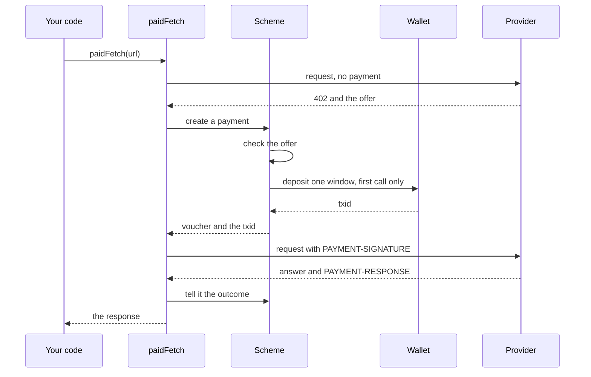
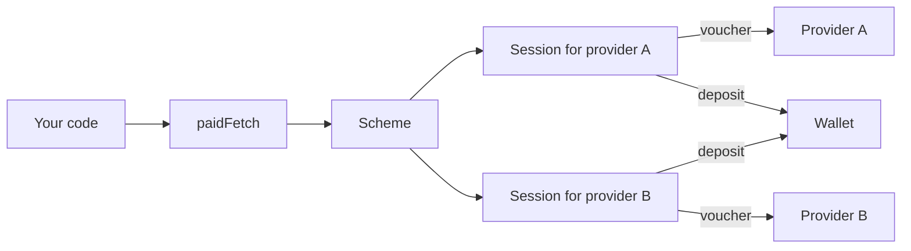

export const meta = {
  title: "Pay from an agent",
  description: "Give an agent a Zcash wallet, register the z402 scheme with the stock x402 client, and pay one provider or many from a plain fetch.",
};

An agent pays with the stock x402 client and one extra line. This guide builds that agent: a wallet that makes the deposits, the z402 scheme that signs a voucher for every call, and a `fetch` that pays by itself. It ends with a complete agent that finds two services in the catalog and pays both.

<Video src="/docs/videos/agent-pays.mp4" poster="/docs/videos/agent-pays.jpg" title="An agent pays two providers" />

The whole integration is three lines. The rest of this page is what goes into `wallet` and `chain`, and what to do when a call does not go as planned.

```ts
import { wrapFetchWithPayment, x402Client } from "@x402/fetch";
import { PrepaidVoucherScheme } from "@z402/client";

const scheme = new PrepaidVoucherScheme({ wallet, chain });
const client = new x402Client().register("zcash:regtest", scheme); // the one line that adds Zcash
const paidFetch = wrapFetchWithPayment(fetch, client);

const res = await paidFetch("http://127.0.0.1:4021/chunk"); // pays when the API asks
```

## How a paid call works

`paidFetch` is the `fetch` wrapper from `@x402/fetch`. It sends your request as it is. If the answer is not a 402, you get it back and nothing else happens. If it is a 402, the wrapper asks the registered scheme to pay, then sends the request again with a voucher.



1. Your code calls `paidFetch(url)`, and the request goes out unpaid.
2. The provider answers `402` with its offer: the price of the call, its address and the terms of the deposit.
3. The scheme checks the offer. On the first call to a provider it asks your wallet for a deposit and waits until the wallet has sent it.
4. The scheme signs a <Term tip="A signed running total. It says: so far I have used this many zat with this provider.">voucher</Term> for the new running total. It attaches the deposit's txid until a settle acknowledges the deposit.
5. The wrapper sends the request again, with the voucher in the `PAYMENT-SIGNATURE` header.
6. The provider answers. A paid answer carries a receipt in `PAYMENT-RESPONSE`. The scheme reads it to learn the provider's view of the session. If the provider refused, the scheme decides whether to wait for a block, deposit, or give up, and the wrapper retries once when the scheme asks it to.
7. You get a normal `Response`.

The scheme keeps one session for each provider address, in memory only: a fresh session key, the running total, and the list of deposits. [How it works](/docs/how-it-works) follows the same call on the provider's side.

## Before you start

| You need | What for | On the local regtest stack |
|---|---|---|
| Node.js 22 or later | Running the agent | The repository's own requirement |
| A Zallet wallet with shielded funds | Paying deposits | JSON-RPC at `http://127.0.0.1:50232`, user and password `zebra` |
| A lightwalletd-compatible endpoint | Watching deposits confirm | Zaino at `http://127.0.0.1:28137` |
| A network id | Which chain you pay on | `zcash:regtest` |
| A provider to pay | Something to call | The demo API at `http://127.0.0.1:4021/chunk` |
| The catalog of services | Finding providers, if you do not know their URLs | The website at `http://localhost:3000`, which serves the facilitator's catalog |

The addresses above are those of the local Z3 regtest stack in `infra/z3`, which `scripts/demo.sh up` starts. The [Quickstart](/docs/quickstart) runs the providers and the catalog in Docker, on a chain of its own, which a wallet on the Z3 stack cannot pay. Zallet's login is the public regtest default. On a real network, read the password from the environment and never commit it.

<Callout type="note" title="Docker Compose keeps these two ports private">

The Docker Compose stack runs the same wallet and indexer on its private network and does not publish them. Inside that network they are `http://zallet:28232` and `http://zaino:8137`. To run your own agent against the compose stack, put it in a container on that network. To run it from your machine, use the Z3 stack. See [Deploy with Docker](/docs/guides/deploy-with-docker) for the ports.

</Callout>

The wallet needs funds for one deposit and its fee for each provider you will pay. On the demo terms a deposit is 100,000 zat, and the smoke test allows up to 25,000 zat of fee on top, so it refuses to start with less than 125,000 zat. On the Z3 stack, `bash infra/z3/fund-agent.sh` funds the agent. The compose stack funds it by itself.

## Install

<CodeTabs>

```bash title="npm"
npm install --save-exact @z402/client @z402/lightwalletd @z402/protocol @x402/core@2.28.0 @x402/fetch@2.28.0 @x402/extensions@2.28.0
```

```bash title="pnpm"
pnpm add --save-exact @z402/client @z402/lightwalletd @z402/protocol @x402/core@2.28.0 @x402/fetch@2.28.0 @x402/extensions@2.28.0
```

</CodeTabs>

| Package | You use it for |
|---|---|
| `@z402/client` | The scheme, the Zallet wallet and the chain status source |
| `@z402/lightwalletd` | `createLightwalletdClient`, the gRPC client that the status source reads through |
| `@z402/protocol` | Types such as `ZcashWallet`, which you need only to write a wallet of your own |
| `@x402/fetch` | `x402Client` and `wrapFetchWithPayment` |
| `@x402/core` | `HTTPFacilitatorClient` and the header decoders |
| `@x402/extensions` | `withBazaar`, to read the catalog of services |

Pin the three `@x402` packages to exactly 2.28.0, which `--save-exact` keeps in your `package.json`. The scheme is built and tested against that version, and the protocol pins it too. To run TypeScript directly, use `npx tsx agent.ts`.

## Create the wallet

The scheme does not hold money. It asks a wallet to send each deposit. `ZalletRpcWallet` does that through the JSON-RPC interface of [Zallet](https://github.com/zcash/zallet), the RPC wallet that replaces the wallet inside `zcashd`.

```ts
import { ZalletRpcWallet } from "@z402/client";

const wallet = new ZalletRpcWallet({
  url: "http://127.0.0.1:50232", // Zallet's JSON-RPC
  user: "zebra", // the public regtest login
  password: "zebra",
});

console.log(await wallet.spendableBalance()); // zat, as a bigint
```

What the wallet does for each deposit:

- It uses the first account that `z_listaccounts` returns, and sends from that account's Orchard-only address. Pass `account` or `fromAddress` to choose.
- It sends one shielded payment with `z_sendmany`: the deposit amount, the memo as a text memo, notes with at least one confirmation, and the `FullPrivacy` policy.
- It sends one deposit at a time. Deposits to two providers queue behind each other, so they never pick the same notes.
- When Zallet says the funds are not enough, it waits 25 seconds and tries again, up to three times, then throws `InsufficientFundsError`.
- When it cannot tell whether a send reached the network, it looks for the memo in the wallet's own transaction list before it gives up. That is how one window is never paid twice.

`spendableBalance()` counts only shielded funds that have at least one confirmation. Transparent funds, such as an immature coinbase, do not count. Read it before the first call, as the demo agent does: a wallet that cannot be read, or that cannot fund the deposit, otherwise shows up as a failed payment on every paid call, each one after a wait. The full list of options is in the [reference](/docs/reference/client#wallet-options).

### Bring your own wallet

`ZalletRpcWallet` is the only wallet in the package, and it is built and tested against Zallet on the regtest stack. The demo agent's `--wallet zingo` option is a placeholder for a mainnet wallet that does not exist yet. For anything else, write an object that fits this interface. `@z402/client` exports both types:

```ts
interface DepositRequest {
  to: string; // the provider's payTo
  amountZat: bigint; // exactly one window
  memo: string; // "<sessionKey>:<index>", sent as a text memo
}

interface ZcashWallet {
  sendDeposit(req: DepositRequest): Promise<{ txid: string }>;
  close?(): Promise<void>;
}
```

The scheme relies on these rules:

- Send exactly `amountZat` to `to`, shielded, with `memo` as a UTF-8 text memo ([ZIP 302](https://zips.z.cash/zip-0302)).
- Resolve with the txid, 64 lowercase hex characters as an explorer prints it, once the transaction is broadcast.
- If the send fails after the transaction was built, say whether it may have reached the network. Throw `DepositUncertainError(txid)` when you know the txid: the scheme keeps checking that txid, uses the deposit if it appears, and a deposit that lands late still counts for the session. Throw `DepositStatusUnknownError(memo)` when you cannot tell: the scheme halts that session, because another deposit could pay twice.
- Never throw a plain error for a deposit that may exist, because the scheme treats it as a deposit that failed and may send another. And never send again for a memo that may already have gone out.

## Read the chain

The scheme reads the chain for itself only in a few cases: to wait until a pending deposit is mined, to look for a deposit the provider could not find, and to recheck a deposit whose send was uncertain. In each it also learns whether a deposit has died, so that it can replace it. It never reads the chain for an ordinary call.

```ts
import { LightwalletdTxStatus } from "@z402/client";
import { createLightwalletdClient } from "@z402/lightwalletd";

const lightwalletd = createLightwalletdClient({ url: "http://127.0.0.1:28137" });
const chain = new LightwalletdTxStatus(lightwalletd);
```

The URL scheme sets the transport: `http://` is plaintext and `https://` is TLS. `LightwalletdTxStatus` accepts any object with `getTip()` and `getTransaction(txid)`, so you can read through a client of your own. Point it at the same node the facilitator reads if you can, so both see the chain the same way. A wrong answer from this node can make the agent wait too long or deposit again, so use one you trust. `maxDeposits` and a wallet budget, below, bound the damage.

<Callout type="privacy" title="The node sees your deposits">

The lightwalletd endpoint you read through learns your IP address and the txids of the deposits you ask about. The vouchers never touch the chain, so it sees nothing of the calls. Run your own node, or use one you trust.

</Callout>

## Register the scheme and wrap fetch

```ts
import { wrapFetchWithPayment, x402Client } from "@x402/fetch";
import { PrepaidVoucherScheme } from "@z402/client";

const scheme = new PrepaidVoucherScheme({
  wallet,
  chain,
  onEvent: (e) => console.log(e.type), // see Errors, below, for what the events carry
});
const client = new x402Client().register("zcash:regtest", scheme);
const paidFetch = wrapFetchWithPayment(fetch, client);
```

`register(network, scheme)` is the stock call. It pays only offers on the network you name. An offer on any other network makes `paidFetch` throw an error that starts `Failed to create payment payload: No network/scheme registered`. A scheme belongs to one network, because its wallet and its chain reader do. To pay on two networks, build two schemes and register each.

The stock client also applies its own spend controls before the scheme sees an offer. The scheme reports ZEC as a default asset with 8 decimals, so an offer in any other asset is rejected, and the default cap of one dollar per payment becomes 100,000,000 zat, which is 1 ZEC. The cap applies to the price of a call and to the size of the window. The scheme's own `maxDepositZat`, 1,000,000 zat by default, is stricter, and it is the one you will meet first. See [Budgets and windows](#budgets-and-windows).

## Pay a route

<CodeTabs>

```ts title="GET"
const res = await paidFetch("http://127.0.0.1:4021/chunk");
console.log(res.status, await res.json()); // 200 { chunk: 1, cumulativeZat: "500", data: "chunk-1" }
```

```ts title="POST"
const res = await paidFetch("http://127.0.0.1:4033/v1/embeddings", {
  method: "POST",
  headers: { "content-type": "application/json" },
  body: JSON.stringify({ input: "The quick brown fox" }),
});
console.log(res.status); // 200
```

</CodeTabs>

`paidFetch` takes the same arguments as `fetch` and returns the provider's own `Response`. Check `res.ok` as you would for any call, and read or cancel the body.

The first call to a provider makes a deposit and waits for the wallet to send it. On the regtest stack that took 5 to 10 seconds, almost all of it the wallet building the proof. The call is then served on the unconfirmed deposit, before any block. Later calls only sign. When the limit runs low, the scheme starts the next deposit in the background, so no call waits for it.

### Read the receipt

A paid answer carries a `PAYMENT-RESPONSE` header: base64 JSON, the provider's settle answer. `snapshotFromExtra` reads the session snapshot out of it and returns `undefined` when it is missing or malformed.

```ts
import { decodePaymentResponseHeader } from "@x402/fetch";
import { snapshotFromExtra } from "@z402/client";

const header = res.headers.get("PAYMENT-RESPONSE");
if (header !== null) {
  const settle = decodePaymentResponseHeader(header);
  const session = snapshotFromExtra(settle.extra);
  console.log(settle.success, settle.amount, session?.cumulativeZat, session?.limitZat);
}
```

```json
{
  "success": true,
  "payer": "7c1e…9d",
  "transaction": "3f2a…c1",
  "network": "zcash:regtest",
  "amount": "500",
  "extra": {
    "session": {
      "sessionKey": "7c1e…9d",
      "cumulativeZat": "500",
      "limitZat": "100000",
      "headroomZat": "99500",
      "confirmedZat": "0",
      "pendingZat": "100000",
      "creditZat": "0",
      "tip": 119,
      "deposits": [
        { "txid": "3f2a…c1", "valueZat": "100000", "status": "pending", "confirmations": 0, "expiryHeight": 160, "zeroConf": true }
      ]
    }
  }
}
```

| Field | Meaning |
|---|---|
| `success` | `true` when the call was settled. A refused settle sets it to `false` and gives `errorReason`. |
| `payer` | Your session key with this provider. |
| `transaction` | The txid of a deposit this settle credited to your session, and an empty string otherwise. It is the acknowledgement, and the scheme stops resending the deposit when it sees it. |
| `amount` | What this call cost, in zat. It is the difference between the new and the old running total. |
| `extra.session.cumulativeZat` | The running total the provider holds for your session. |
| `extra.session.limitZat` | The most the provider will accept right now: confirmed and pending deposits plus credit. |
| `extra.session.headroomZat` | `limitZat` minus `cumulativeZat`. |
| `extra.session.deposits` | Your deposits and their status: `pending`, `confirmed`, `final`, `orphaned` or `dead`. |

All amounts are zat strings. The demo agent prints the same numbers on one line per call, for example `#001 200  c=500  limit=100,000  conf=0  pend=100,000  credit=0  D1 3f2a…c1 pending`, and [Reference: Protocol](/docs/reference/protocol) has the full snapshot contract.

A 200 without a `PAYMENT-RESPONSE` header was not paid. The route either does not ask for payment or is misconfigured. The smoke test treats it as a failure for that reason.

### Read a refusal

When a provider refuses and the scheme gives up, `paidFetch` does not throw. It resolves with the provider's `402` response, and the reason is in a header. A refusal at verify comes in `PAYMENT-REQUIRED`, whose `error` is the reason code. A refusal at settle comes as a 402 with `PAYMENT-RESPONSE` alone, whose `errorReason` is the code, and the client reads that header first.

```ts
import { decodePaymentRequiredHeader } from "@x402/core/http";

if (res.status === 402) {
  const header = res.headers.get("PAYMENT-REQUIRED");
  const error = header === null ? undefined : decodePaymentRequiredHeader(header).error;
  console.log("refused:", error); // for example z402_deposit_required
}
```

The `outcome` function in the [complete agent](#a-complete-agent) handles both headers. [Errors](#errors) says what each code means for your code.

## Budgets and windows

A deposit is a payment to the provider, and it is the only thing that moves money. A voucher moves none, so the most an agent can lose to a provider is the deposits it made to it, plus the network fee of each. z402 has no refunds: whatever is left of a window when the agent stops stays with the provider. The session also lives only in memory. A restart starts a new session with a new key, and the old session's unused deposit is never used again.

The offer carries a price and two terms of the deposit. The price is the provider's own, set for each route. The two terms are the facilitator's, the same for every provider on it:

| Term | Demo value | What it means for the agent |
|---|---|---|
| `amount` | 500 zat on the demo API | The price of one call. Each provider sets it for each route. |
| `windowZat` | 100,000 zat | The size of every deposit. The agent deposits exactly one <Term tip="One deposit. The offer names its size, and the agent always deposits exactly that much.">window</Term> at a time. |
| `creditRatioBps`, `creditCapZat` | 2500, 200,000 zat | A confirmed deposit earns 25 percent credit, up to the cap. The limit is confirmed deposits, plus up to one unconfirmed window, plus credit. |

On the demo terms, one deposit that confirms gives a limit of 125,000 zat, which is 250 calls at 500 zat. Two confirmed deposits give 250,000 zat. [How it works](/docs/how-it-works#the-credit-limit) has the whole table.

You set the limits yourself:

| Control | Default | What it bounds |
|---|---|---|
| `maxDepositZat`, a scheme option | 1,000,000 zat | The size of one deposit. The scheme refuses an offer whose window is larger, before any lock or wallet call. |
| `maxAmountPerPayment`, set on the stock client | 100,000,000 zat | The price of a call, and through the scheme the size of a window. |
| `maxDeposits`, a scheme option | no limit | Deposits one provider may get from this scheme. `1` is the demo's cheat mode: one deposit, then a refusal at the limit. `0` never deposits. |
| `depositTriggerZat`, a scheme option | the window | How low the headroom may fall before the next deposit starts in the background. |
| A wallet that counts | none | The total of all deposits, over every provider. |

To change the stock cap, set an atomic cap for ZEC. It is a string of digits, in zat:

```ts
client.setSpendControls({
  allowedAssets: [{ network: "zcash:regtest", asset: "ZEC", maxAmountPerPayment: "200000" }],
});
```

To accept a window above 1,000,000 zat, raise `maxDepositZat` as well, because both limits apply.

To bound the money across all providers, count in the wallet, which sees every deposit. This wrapper refuses a deposit that would take the total past a budget. The scheme records the refusal as a failed deposit (`deposit_failed`). A background deposit then does not happen, and the scheme tries again at the next trigger. Once the headroom no longer covers a call, the deposit is made inline, and that call throws `Failed to create payment payload: ...` before any voucher is sent.

```ts
import { DepositStatusUnknownError, DepositUncertainError, type ZcashWallet } from "@z402/client";

function withBudget(wallet: ZcashWallet, budgetZat: bigint): ZcashWallet {
  let committed = 0n;
  return {
    async sendDeposit(req) {
      if (committed + req.amountZat > budgetZat) {
        throw new Error(`budget of ${budgetZat} zat is spent, refusing a deposit of ${req.amountZat} zat`);
      }
      committed += req.amountZat;
      try {
        return await wallet.sendDeposit(req);
      } catch (e) {
        // A deposit that may have reached the chain keeps counting, any other failure gives its share back
        if (!(e instanceof DepositUncertainError || e instanceof DepositStatusUnknownError)) committed -= req.amountZat;
        throw e;
      }
    },
    async close() {
      await wallet.close?.();
    },
  };
}
```

Pass `withBudget(wallet, 250_000n)` as the scheme's `wallet`. The wrapper does not count network fees, so leave room for them in the wallet.

## Pay several providers

The scheme keeps one session for each provider address, and a provider is found by its `payTo` in the offer. The first call to a new address starts a session with a new random key, makes a deposit to that address, and from then on counts the calls to it. Nothing is shared between two providers except the wallet and the chain reader.



```ts
await paidFetch("http://127.0.0.1:4021/chunk"); // the operator: its first deposit
await paidFetch("http://127.0.0.1:4032/v1/markdown?url=https://example.com"); // provider 2: a deposit of its own

for (const s of scheme.sessions()) {
  console.log(s.payTo, s.sessionKey, s.cumulativeZat, s.depositsMade);
}
```

- **One deposit per address.** Services that pay the same address share one session and one deposit. In the local stack, the demo API, `llm`, `embeddings` and `dropbox` pay the operator's address. URL to markdown is provider 2, with an address of its own, so it needs a deposit of its own.
- **One call at a time per provider.** Calls to one provider take turns, because each voucher carries the running total of the one before it. Calls to different providers can run at once.
- **Deposits queue.** `ZalletRpcWallet` sends one deposit at a time, so two first calls made together wait for two deposits in turn.
- **No shared key.** Each provider sees a different session key, so the key links nothing across providers.
- **Prices differ.** Each voucher advances the total by the price of its own call, and a deposit is always one window of that provider's terms.

`scheme.session(payTo)` returns one session, and `scheme.sessions()` returns all of them in the order they started. Both return read-only copies. They are the way to see what each provider has been vouchered, and how many deposits it got. The [reference](/docs/reference/client#sessionview) lists the fields.

## Errors

A call can go wrong in three ways. Your code sees each differently. A refusal that the client cannot recover from is returned, as the provider's 402. A payment that cannot be built is thrown, and so is a failure of `fetch` itself. Code that pays therefore checks `res.status` and catches too.

### Errors that `paidFetch` throws

When a payment cannot be built, the stock wrapper throws a plain `Error` whose message starts `Failed to create payment payload:`, with no `cause`. On its one recovery retry the wrapper does not wrap, so the original error, such as an `InsufficientFundsError` or `session halted by ...`, is thrown as it is. Check the prefix and `instanceof` both. To get the original wallet error in either case, read it from the `deposit_failed` event.

| The error | What happened | What to do |
|---|---|---|
| `Failed to parse payment requirements:` | The 402 carried no readable offer. | The URL is not an x402 route, or a proxy removed `PAYMENT-REQUIRED`. Do not retry. |
| `Failed to create payment payload: No network/scheme registered` | The offer is on a network or scheme you did not register. | Register the network, or choose another route. |
| `Failed to create payment payload: windowZat:` | The provider's window is larger than `maxDepositZat` or the stock cap. | Raise the limit if you accept that deposit, or skip the provider. |
| `Failed to create payment payload: All payment requirements were rejected by spendControls` | The stock client dropped every offer: the asset is not ZEC, or the price is above its cap. | Raise the cap with `setSpendControls`, or choose another route. |
| `Failed to create payment payload:` with `scheme:`, `network:`, `asset:`, `payTo:`, `amount:` or `extra:` | The offer is invalid. The message names the field. | The provider is misconfigured. Do not retry. |
| `Failed to create payment payload: session halted by`, or `session halted by` alone | The session stopped for good: the provider rejected a deposit, asked for another while one was unaccounted for, or the wallet lost track of one. | Stop paying this provider. `scheme.session(payTo)?.halted` says why. A restart starts a new session. |
| `Failed to create payment payload:` and a wallet message, or the bare wallet error, such as an `InsufficientFundsError` | The deposit failed, for example no funds or a budget spent. | Read `deposit_failed`. Fund the wallet and call again. |
| `AbortError` (a manual abort), `TimeoutError` (from `AbortSignal.timeout`), or `TypeError: fetch failed` | The request was aborted, its deadline passed, or the network failed. | See [Cancel a call](#cancel-a-call). |

The events carry the details. This handler logs the three that matter most:

```ts
import { PrepaidVoucherScheme } from "@z402/client";

const scheme = new PrepaidVoucherScheme({
  wallet,
  chain,
  onEvent: (e) => {
    if (e.type === "deposit_failed") console.error("deposit failed:", e.error); // the original error object
    if (e.type === "ambiguous") console.warn(`may have been charged: ${e.attemptedZat} zat`);
    if (e.type === "fatal") console.error(`stopped: ${e.code}: ${e.message}`);
  },
});
```

An exception thrown by `onEvent` is ignored, so a logging bug cannot break a payment.

### Refusals that come back as a 402

When the provider refuses a voucher, the scheme acts on the code first. It waits for a block, deposits, resyncs its running total or backs off, and asks the wrapper for one retry. Your code sees a 402 only when that fails, or when there was nothing to try. The reason is in the header, as shown in [Read a refusal](#read-a-refusal).

| Code | You see it when | What to do |
|---|---|---|
| `z402_deposit_required` | The limit is reached and the scheme may not deposit: `maxDeposits` is reached, or the retry was refused too. | Raise your limits or stop. |
| `z402_awaiting_confirmation` | A deposit stayed unconfirmed for `confirmationWaitMs`, 10 minutes by default, or the retry was refused again. | Call again after the next block. |
| `z402_cumulative_mismatch` | Your running total and the provider's disagreed, and after the scheme resynced, the retry was refused again, or the refusal carried no snapshot. | Call again. |
| `z402_chain_unavailable`, `unexpected_verify_error`, `unexpected_settle_error` | The provider's facilitator or node failed twice in a row. | Call again later. |
| `z402_deposit_not_found` | Neither the facilitator nor your chain reader saw the deposit in time. | Check that wallet and chain reader are on the same chain, and call again. |
| `z402_deposit_dead` | A deposit expired or was dropped, and the scheme could not replace it. | Raise your limits so it can deposit again. |
| `z402_deposit_memo_mismatch`, `z402_deposit_transparent`, `z402_deposit_not_to_merchant`, `z402_deposit_other_session` | The provider cannot use the deposit. The session halts. | Stop. The address is wrong, or there is a bug. |
| Anything else, such as `z402_invalid_signature` or `invalid_payload` | A bug or a configuration drift. | Stop and report it. The scheme emits `fatal`. |

The [reference](/docs/reference/client#refusal-codes) gives the scheme's action for every code, and [Errors and reason codes](/docs/reference/errors) lists all 19.

### Failures after the voucher: the ambiguous rule

Sometimes the call fails after the voucher has left: the provider answers 500, the connection drops, the request is aborted. The agent cannot tell whether the provider settled the voucher. The scheme assumes that it did, and moves its running total up to the value it attempted. The next voucher then covers the failed call too.

The provider's accept rule is lenient, so that next voucher is accepted. The result is that you pay for the failed call with the next successful one, at most one price per ambiguous call. In return, the running total never falls behind the provider's, and a lost response cannot make later calls fail.

- You see it as an `ambiguous` event, and as a response with no `PAYMENT-RESPONSE` header and a status other than 402.
- When the hook that reads the outcome never runs, for example because the request threw, the scheme waits `safetyReleaseMs`, 120 seconds by default, and then counts the call as ambiguous. Until then the session's lock is held, and the next call to the same provider waits.
- Providers that refuse everything they can before the voucher exists, as the starter services do, make this rare. A failure before the voucher costs nothing.

## Cancel a call

`paidFetch` accepts an `AbortSignal` like any `fetch`, but the stock wrapper does not honor it reliably. It sends the paid request from a clone of your request, and Node's `fetch` stops linking a clone to your signal once the garbage collector has run. An abort can then miss the paid retry, and the call carries on. The client design records this as a known risk, it was found under load, and the smoke test works around it.

The fix is to bind the signal in the fetch that the wrapper wraps, where the request is made:

```ts
import { wrapFetchWithPayment } from "@x402/fetch";

function paidFetchWithin(ms: number): typeof fetch {
  const signal = AbortSignal.timeout(ms);
  return wrapFetchWithPayment((input, init) => fetch(new Request(input, init), { signal }), client);
}

const res = await paidFetchWithin(90_000)("http://127.0.0.1:4021/chunk");
```

Build one wrapper for each call that has its own deadline. The scheme and its sessions live in `client`, so nothing is lost. For a signal shared by the whole agent, such as Ctrl-C, make one wrapper with one controller, as the complete agent below does.

What to know before you abort:

- **A deposit in flight is not cancelled.** An abort cuts the HTTP request, not a wallet send that is already under way. The deposit completes, and the next call presents it.
- **The call becomes ambiguous.** If the abort lands after the voucher was signed, the hook never runs. The scheme holds the session's lock until `safetyReleaseMs` has passed, then counts the call as ambiguous and moves the running total up by one price. The next call to that provider waits for the release, so lower `safetyReleaseMs` if you abort on purpose. Keep it above the longest call you expect, because a facilitator may take up to 60 seconds to answer.
- **Close the scheme before the process ends.** `scheme.close()` waits for a deposit in flight. A process that exits first can leave a deposit on the chain that no session will ever use.
- **To stop waiting at once, whatever `fetch` does,** race the call against the signal, as `abortable` in <Source path="apps/smoke/src/http.ts" /> does.

## Find services in the Bazaar

Providers list their routes in the facilitator's public catalog, the x402 Bazaar, and the website serves it at `/discovery/resources`. Read it with the stock Bazaar client. Nothing in this call is specific to z402.

```ts
import { HTTPFacilitatorClient } from "@x402/core/server";
import { withBazaar } from "@x402/extensions/bazaar";

const bazaar = withBazaar(new HTTPFacilitatorClient({ url: "http://localhost:3000" })).extensions.bazaar;
const { items, pagination } = await bazaar.listResources({ type: "http", limit: 100 });
console.log(items.length, pagination.total);
```

The URL is the facilitator, or the website that proxies its catalog. A list holds at most 100 items a page, and `offset` moves to the next page. Each item is one route:

```json
{
  "resource": "http://localhost:4032/v1/markdown",
  "type": "http",
  "x402Version": 2,
  "accepts": [
    {
      "scheme": "prepaid-voucher",
      "network": "zcash:regtest",
      "amount": "1000",
      "asset": "ZEC",
      "payTo": "uregtest1...",
      "maxTimeoutSeconds": 60,
      "extra": { "windowZat": "100000", "creditRatioBps": 2500, "creditCapZat": "200000", "zeroConfMinExpiryBlocks": 20, "termsVersion": "<16 hex characters>" }
    }
  ],
  "lastUpdated": "2026-10-28T15:20:10.653Z",
  "description": "Fetches one public web page and returns its main content as clean markdown.",
  "mimeType": "application/json",
  "serviceName": "URL to markdown",
  "tags": ["web", "markdown", "scrape"],
  "extensions": {
    "bazaar": { "info": { "input": { "type": "http", "method": "GET", "queryParams": { "url": "https://example.com" } } } },
    "z402": { "unit": "page" }
  },
  "lastSeen": "2026-10-28T15:20:01.963Z",
  "paidCallsToday": 1748
}
```

| Field | Use it to |
|---|---|
| `resource` | Call the route. It is the origin plus the path, with `:name` for a path parameter. |
| `accepts[0].amount`, `.payTo` | Compare prices, and tell providers apart: one `payTo` is one session. |
| `accepts[0].scheme`, `.network` | Keep only what you can pay: `prepaid-voucher` on the network you registered. |
| `serviceName`, `description`, `tags` | Match the route against your task. |
| `extensions.bazaar.info.input` | See the method and an example input. |
| `extensions.z402.unit` | Learn what one call buys, such as a page or an output chunk. |
| `lastSeen` | Tell whether the service is up. It is the time of its latest declaration, and it is absent on a route listed only from its payments. |
| `paidCallsToday` | See how many calls settled since 00:00 UTC. |

`lastSeen` and `paidCallsToday` are z402 additions to the standard item. Services declare themselves every 30 seconds, so the website and the demo agent read a service as up when `lastSeen` is under 90 seconds old, stale under 10 minutes, and down after that.

Pick on your own side. List the whole catalog, filter it, and rank what is left against your task, as the complete agent below does. Do not call `search()`: it sends your words to the catalog. The facilitator logs request paths and never query strings, but a catalog you do not run might. A plain list sends no words, so what your agent looks for never leaves its process. The demo agent does the same with `pnpm --filter @z402/agent discover --intent "..."`.

<Callout type="warning" title="Treat the catalog as untrusted">

Every field is text that a provider wrote. The 402 that a route returns stays authoritative: pay what it says, never what the catalog says. Set a ceiling on the price you will pay, and enforce it on the 402 with a policy on the client, as `MAX_PRICE_ZAT` does below, because the catalog's price does not bind the route. Read a bounded amount, with a limit on entries and a deadline: `listResources` sets no deadline of its own. Do not print catalog text to a terminal unfiltered. And pass `redirect: "manual"` on paid calls to a URL you got from a catalog, because a paid request carries a voucher, which must not go anywhere but the URL you meant. The demo agent's `discover` command bounds and cleans what it reads, and the smoke test never follows a redirect.

</Callout>

## A complete agent

This agent finds a route for two tasks in the catalog, pays both, and prints what each call cost. The routes belong to two providers, so it makes two deposits. A wallet budget bounds its deposits, a policy on the client caps the price of a call, `Ctrl-C` ends it cleanly, and a few lines print the events that matter. It is about 150 lines and needs nothing beyond the packages installed above.

```ts title="agent.ts"
import { decodePaymentRequiredHeader } from "@x402/core/http";
import { HTTPFacilitatorClient } from "@x402/core/server";
import { withBazaar, type DiscoveryResource } from "@x402/extensions/bazaar";
import { decodePaymentResponseHeader, wrapFetchWithPayment, x402Client } from "@x402/fetch";
import {
  DepositStatusUnknownError,
  DepositUncertainError,
  LightwalletdTxStatus,
  PrepaidVoucherScheme,
  ZalletRpcWallet,
  snapshotFromExtra,
  type ZcashWallet,
} from "@z402/client";
import { createLightwalletdClient } from "@z402/lightwalletd";

const NETWORK = "zcash:regtest";
const BAZAAR_URL = "http://localhost:3000"; // the website, which serves the facilitator's catalog
const BUDGET_ZAT = 250_000n; // the most this agent ever deposits, over every provider
const MAX_PRICE_ZAT = 2_000n; // never pay a route whose 402 asks more per call
const PAGE = "https://example.com";

/** A wallet that refuses to send more than a fixed total, whichever provider asks */
function withBudget(wallet: ZcashWallet, budgetZat: bigint): ZcashWallet {
  let committed = 0n;
  return {
    async sendDeposit(req) {
      if (committed + req.amountZat > budgetZat) {
        throw new Error(`budget of ${budgetZat} zat is spent, refusing a deposit of ${req.amountZat} zat`);
      }
      committed += req.amountZat;
      try {
        return await wallet.sendDeposit(req);
      } catch (e) {
        // A deposit that may have reached the chain keeps counting, any other failure gives its share back
        if (!(e instanceof DepositUncertainError || e instanceof DepositStatusUnknownError)) committed -= req.amountZat;
        throw e;
      }
    },
    async close() {
      await wallet.close?.();
    },
  };
}

// The local regtest stack: Zallet's public default login, and Zaino as the lightwalletd
const zallet = new ZalletRpcWallet({ url: "http://127.0.0.1:50232", user: "zebra", password: "zebra" });
const lightwalletd = createLightwalletdClient({ url: "http://127.0.0.1:28137" });

const scheme = new PrepaidVoucherScheme({
  wallet: withBudget(zallet, BUDGET_ZAT),
  chain: new LightwalletdTxStatus(lightwalletd),
  onEvent: (e) => {
    if (e.type === "deposit_started") console.log(`  * deposit ${e.index} started${e.inline ? ", the call waits for it" : ""}`);
    else if (e.type === "deposit_confirmed") console.log(`  * deposit ${e.txid.slice(0, 8)} confirmed`);
    else if (e.type === "refused") console.log(`  * refused: ${e.code}`);
    else if (e.type === "fatal") console.error(`  * fatal ${e.code}: ${e.message}`);
  },
});

// The route's own 402 sets what a call costs, and the catalog's price does not bind it, so the cap is enforced here
const client = new x402Client()
  .register(NETWORK, scheme)
  .registerPolicy((_version, requirements) => requirements.filter((r) => BigInt(r.amount) <= MAX_PRICE_ZAT));

// Ctrl-C ends the call in flight. The signal is bound in the base fetch, because the wrapper sends clones of the request.
const stop = new AbortController();
process.once("SIGINT", () => stop.abort());
const paidFetch = wrapFetchWithPayment((input, init) => fetch(new Request(input, init), { signal: stop.signal }), client);

type Route = DiscoveryResource & { lastSeen?: string; paidCallsToday?: number };

/** Every route the Bazaar lists, a page of 100 at a time, up to 1,000 */
async function listRoutes(): Promise<Route[]> {
  const bazaar = withBazaar(new HTTPFacilitatorClient({ url: BAZAAR_URL })).extensions.bazaar;
  const routes: Route[] = [];
  while (routes.length < 1_000) {
    const page = await bazaar.listResources({ type: "http", limit: 100, offset: routes.length });
    routes.push(...page.items);
    if (page.items.length === 0 || routes.length >= page.pagination.total) break;
  }
  return routes;
}

/** The price of a route in zat, or undefined when its offer is not one this agent can pay */
function priceOf(route: Route): bigint | undefined {
  const offer = route.accepts[0];
  if (offer?.scheme !== "prepaid-voucher" || offer.network !== NETWORK) return undefined;
  return /^[0-9]{1,15}$/.test(offer.amount) ? BigInt(offer.amount) : undefined;
}

// The website reads lastSeen as up under 90 seconds, stale under 10 minutes, down after
const isDown = (route: Route): boolean =>
  route.lastSeen !== undefined && !(Date.now() - Date.parse(route.lastSeen) < 600_000);

const words = (text: string): Set<string> => new Set(text.toLowerCase().match(/\p{L}{3,}/gu) ?? []);

/** The best route for a task, chosen here: one we can pay, listed cheap enough, not down, and the most words in common */
function pick(routes: Route[], task: string): Route | undefined {
  const wanted = words(task);
  let best: { route: Route; score: number } | undefined;
  for (const route of routes) {
    const price = priceOf(route);
    if (price === undefined || price > MAX_PRICE_ZAT || isDown(route)) continue;
    const described = [route.serviceName, route.description, ...(route.tags ?? [])].join(" ");
    const score = [...words(described)].filter((word) => wanted.has(word)).length;
    if (score > (best?.score ?? 0)) best = { route, score };
  }
  return best?.route;
}

/** What a paid call came to, from its receipt or its refusal */
function outcome(res: Response): string {
  const receipt = res.headers.get("PAYMENT-RESPONSE");
  if (receipt !== null) {
    const settle = decodePaymentResponseHeader(receipt);
    if (!settle.success) return `refused: ${settle.errorReason}`;
    const session = snapshotFromExtra(settle.extra);
    return `paid ${settle.amount ?? "?"} zat, ${session?.cumulativeZat} of ${session?.limitZat} used`;
  }
  const required = res.headers.get("PAYMENT-REQUIRED");
  if (res.status === 402 && required !== null) return `refused: ${decodePaymentRequiredHeader(required).error}`;
  return "no receipt";
}

async function main(): Promise<void> {
  console.log(`wallet: ${await zallet.spendableBalance()} zat spendable`);

  const routes = await listRoutes();
  const markdown = pick(routes, "turn a web page into markdown");
  const embeddings = pick(routes, "text embeddings");
  if (markdown === undefined || embeddings === undefined) throw new Error("the Bazaar lists no route for a task");

  const page = await paidFetch(`${markdown.resource}?url=${encodeURIComponent(PAGE)}`);
  console.log(`markdown    ${page.status}  ${outcome(page)}`);
  if (!page.ok) return;
  const { markdown: text } = (await page.json()) as { markdown: string };

  const embedded = await paidFetch(embeddings.resource, {
    method: "POST",
    headers: { "content-type": "application/json" },
    body: JSON.stringify({ input: text.slice(0, 1_000) }),
  });
  console.log(`embeddings  ${embedded.status}  ${outcome(embedded)}`);
  await embedded.body?.cancel();

  for (const s of scheme.sessions()) {
    console.log(`${s.payTo.slice(0, 14)}…  vouchered ${s.cumulativeZat} zat, ${s.depositsMade} deposit(s)`);
  }
}

main()
  .catch((e: unknown) => {
    console.error(e instanceof Error ? e.message : e);
    process.exitCode = 1;
  })
  .finally(() => scheme.close().finally(() => lightwalletd.close()));
```

It needs Zallet, Zaino, the website and both services reachable from your machine, on one chain. The Docker stack publishes the website and the services and keeps Zallet and Zaino private, and the Z3 stack publishes Zallet and Zaino but runs neither the website nor the services, so neither starts all of them for you. With everything reachable, start the agent with `npx tsx agent.ts`. Your amounts and addresses will differ.

```text
wallet: 6249460000 zat spendable
  * deposit 1 started, the call waits for it
markdown    200  paid 1000 zat, 1000 of 100000 used
  * deposit 1 started, the call waits for it
embeddings  200  paid 100 zat, 100 of 100000 used
uregtest1k3x9w…  vouchered 1000 zat, 1 deposit(s)
uregtest1m7q2d…  vouchered 100 zat, 1 deposit(s)
```

Each `deposit 1` is the first deposit to a different provider, and each one makes its call wait. The two last lines are the two sessions, in the order they started. The agent chose the routes on its own: the catalog never saw the words `markdown` or `embeddings`.

What the example does, step by step:

1. It builds the wallet, the chain reader and the scheme. The wallet is wrapped so that its deposits cannot pass 250,000 zat, and the client gets a policy that drops any offer above `MAX_PRICE_ZAT`, whatever the catalog said.
2. It reads the catalog, 100 items at a time, and chooses the best route for each task. It skips offers it cannot pay, routes that the catalog lists above `MAX_PRICE_ZAT`, and routes whose service is down.
3. It pays the first route, with the page in the query string, and reads the answer.
4. It pays the second route, with a body, and prints the receipt.
5. It prints each session. `scheme.close()` runs last, so a deposit in flight finishes before the process ends.

## Before you go live

- [ ] Put a budget on the wallet, as `withBudget` does, so the total of all deposits has a ceiling.
- [ ] Set `maxDepositZat` to the largest window you accept, and enforce a ceiling on the price per call with `registerPolicy`, since the route's own 402 decides what a call costs.
- [ ] Log the `deposit_failed`, `ambiguous` and `fatal` events somewhere you will see them.
- [ ] Bind the abort signal in the base fetch for every call that has a deadline, and decide what `safetyReleaseMs` should be.
- [ ] Call `scheme.close()` before the process exits.
- [ ] Read the wallet balance before the first call.
- [ ] Point the chain reader at a node you trust.
- [ ] Pass `redirect: "manual"` on paid calls to URLs that came from a catalog.

## Limits today

- Sessions live in memory. A restart starts new sessions, with new deposits and no credit.
- `ZalletRpcWallet` is the only wallet in the package, and it is built for the regtest stack.
- There are no refunds. A deposit is paid to the provider, and what is left of it stays there.
- A halted session stays halted until the process restarts. `scheme.session(payTo)?.halted` names the code and the txid that stopped it.
- Calls to one provider run one at a time.

## Next steps

<Cards>
  <Card title="@z402/client reference" href="/docs/reference/client">Every export, option, event and error of the client package.</Card>
  <Card title="Errors and reason codes" href="/docs/reference/errors">All 19 codes, with their meaning and the client's action.</Card>
  <Card title="Prepaid vouchers" href="/docs/concepts/prepaid-vouchers">Why the running total, the window and the credit work as they do.</Card>
  <Card title="Discovery" href="/docs/concepts/discovery">How services list themselves, and what the catalog can and cannot tell you.</Card>
  <Card title="Troubleshooting" href="/docs/troubleshooting">A deposit that never confirms, a 402 after paying, and more.</Card>
</Cards>

## References

- <Source path="packages/client/src/index.ts" />: every export of the package.
- <Source path="packages/client/src/scheme.ts" />: the scheme, its options, its offer checks, the lock, the deposit decision and the safety release.
- <Source path="packages/client/src/respond.ts" />: what the scheme does with each outcome and each refusal code.
- <Source path="packages/client/src/outcome.ts" />: how an outcome is read, and the action for each code.
- <Source path="packages/client/src/session.ts" />: the session, its deposits and when it deposits.
- <Source path="packages/client/src/wallet/zallet-rpc.ts" />: the Zallet wallet, its retries and its memo lookup.
- <Source path="packages/client/src/chain/lightwalletd.ts" />: the chain status source.
- <Source path="packages/client/src/errors.ts" />: the error classes a wallet throws.
- <Source path="apps/agent/src/agent.ts" />: the demo agent's loop, with its one `register` line.
- <Source path="apps/agent/src/zcash.ts" />: how the demo agent builds the wallet, the chain reader and the scheme, and its balance check.
- <Source path="apps/agent/src/discover.ts" />: reading the catalog with the stock Bazaar client and choosing locally.
- <Source path="apps/agent/src/log.ts" />: the agent's log lines, and how it reads a receipt and a refusal.
- <Source path="apps/smoke/src/payer.ts" />: one session and one deposit for each provider, and a budget check before the first call.
- <Source path="apps/smoke/src/http.ts" />: the abort that does not rely on `fetch` to stop.
- <Source path="docs/superpowers/specs/2026-10-27-z402-client-design.md" />: the client's design, including the abort caveat and its workaround.
- <Source path="docs/superpowers/specs/2026-10-28-z402-multi-provider-design.md" />: per-provider prices, the catalog and its fields.
- <Source path="docs/spec/protocol.md" />: the wire contract, section 9 for the client rules and section 8 for the codes.
- <Source path="docs/demo.md" />: the demo run, with the timings of a deposit.
- <Source path="apps/e2e/test/two-merchants.test.ts" />: one client paying two merchants, in turn and at once.
- [x402 HTTP transport](https://github.com/x402-foundation/x402/blob/main/specs/transports-v2/http.md): the `PAYMENT-REQUIRED`, `PAYMENT-SIGNATURE` and `PAYMENT-RESPONSE` headers.
- [x402 repository](https://github.com/x402-foundation/x402): the SDK, `@x402/fetch`, `@x402/core` and `@x402/extensions`.
- [Zallet](https://github.com/zcash/zallet): the wallet behind `ZalletRpcWallet`.
- [ZIP 302](https://zips.z.cash/zip-0302): the memo format of a deposit.
