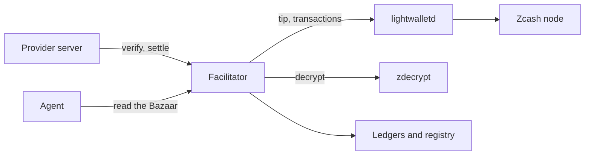
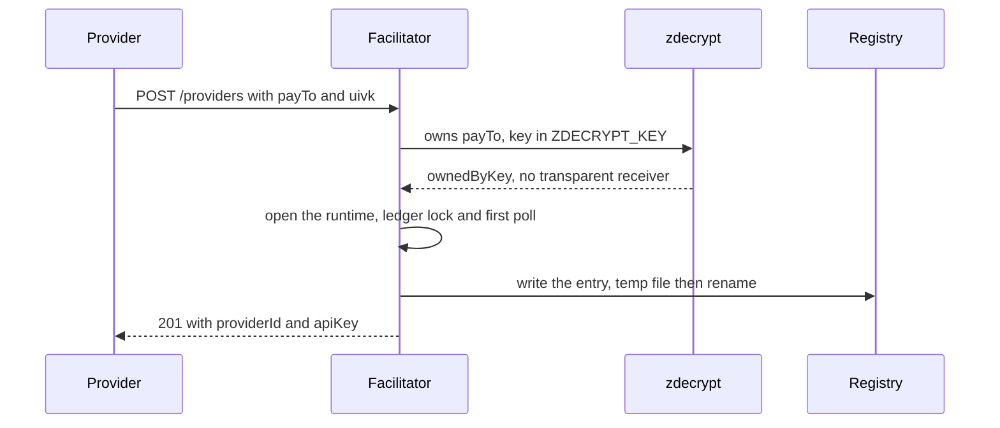
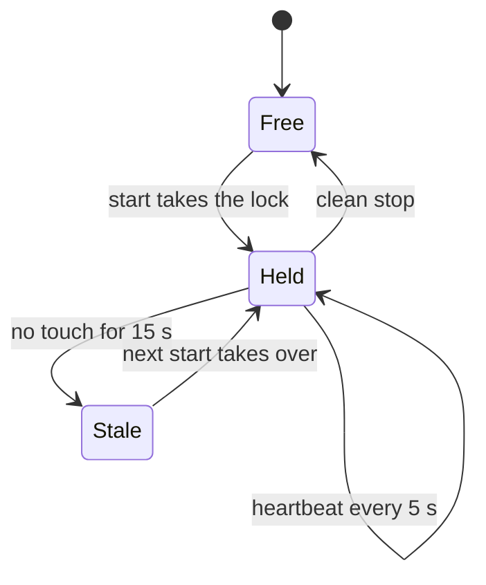
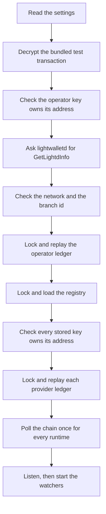

export const meta = {
  title: "Run the facilitator",
  description: "Start a z402 facilitator: what it needs, how to configure it and register providers, how its ledger stays safe, and how to expose it.",
};

The facilitator is the payment rail. A provider's server sends it each voucher. It checks the voucher against the provider's shielded deposits, records the settled call, and keeps the public catalog of paid services. You run one when you want to operate the rail yourself. A provider that only sells an API connects to a facilitator and never runs one: see [Sell an API](/docs/guides/sell-an-api).

This guide covers one facilitator process: its inputs, its settings, its state on disk, and how to run it safely. To run the whole stack with one command, use [Deploy with Docker](/docs/guides/deploy-with-docker).

## What it needs

| Need | Why | Where it comes from |
| --- | --- | --- |
| A lightwalletd-compatible endpoint | Finds deposits and reads the chain tip. The facilitator calls `GetLatestBlock`, `GetTransaction` and `GetLightdInfo`. | lightwalletd or Zaino, in front of a Zcash node |
| The `zdecrypt` binary | Decrypts each deposit with a provider's viewing key. | `pnpm --filter @z402/facilitator build:native`, which needs a Rust toolchain |
| The operator's keys | A shielded-only address (`payTo`) and its viewing key. | `node scripts/merchant-keygen.mjs` |
| A bearer token | The operator's API key. | Any token of letters, digits and `-._~+/`, for example `openssl rand -hex 16` |
| A writable disk | The ledgers, the provider registry and the catalog. | `Z402_LEDGER` and `Z402_PROVIDERS_DIR` |
| Blocks, on regtest only | Nothing confirms or expires until a block is mined. | `node infra/z3/clock.mjs run --every 25` |

You also need Node.js 22 or later and pnpm. The Z3 helper scripts used below need Node.js 24.2 or later, plus Docker, `jq`, `curl`, `perl` and `openssl`.



## How it is organised

The facilitator serves many providers. Each one is paid to its own address, sends calls with its own API key, and prices its own routes.

- **The operator provider** is configured when the process starts. Its keys come from `Z402_MERCHANT_KEYS_FILE`, or from `Z402_PAY_TO` and `Z402_UIVK`. Its API key is `Z402_FACILITATOR_TOKEN`. Its ledger is `Z402_LEDGER`.
- **Every other provider registers itself** with `POST /providers` and receives an API key. Its state lives under `Z402_PROVIDERS_DIR`.
- **Each provider has its own runtime.** A runtime holds a chain view that decrypts with that provider's viewing key, a ledger with its lock, the sessions and deposits, the deposit resolver, the chain watcher and the voucher scheme. Nothing is shared between two providers' state.
- **The API key picks the runtime.** The scheme of that runtime refuses any `payTo` that is not the provider's own, so a key can never settle a payment owed to someone else.
- **Some parts are shared:** one lightwalletd client, one chain tip cached for 1 s, at most 8 `zdecrypt` runs at once across all providers, the HTTP server, the registry and the catalog.

<Callout type="privacy" title="The facilitator sees incoming payments">

A <Term tip="Unified incoming viewing key. It shows the payments sent to an address and cannot spend them.">UIVK</Term> lets the facilitator read every deposit sent to a provider's address, including its amount and memo. The facilitator holds the viewing key of every provider it serves. It needs no spending key, a keys file that holds one is refused on mainnet, and it never logs a key. Sender-disclosed decryption, which would remove this limit, is future work. See [Privacy model](/docs/concepts/privacy).

</Callout>

## Quick start on regtest

This starts one facilitator against the local Z3 regtest chain (Zebra, Zallet and Zaino in Docker). Run every command from the repository root.

<Steps>
<Step title="Build the tools">

```bash
pnpm install
pnpm --filter @z402/facilitator build:native
```

The second command builds `crates/zdecrypt` into `crates/zdecrypt/target/release/zdecrypt`, which is where the facilitator looks by default.

</Step>
<Step title="Make the operator's keys">

```bash
node scripts/merchant-keygen.mjs --network regtest
node scripts/merchant-keygen.mjs --view-only --from .secrets/merchant-regtest.json
```

The first command writes `.secrets/merchant-regtest.json`, which holds the account seed, and prints the `payTo` address. The second writes `.secrets/merchant-regtest.view.json`, which holds only `network`, `uivk` and `orchardOnlyAddress`. That second file is the one to give the facilitator.

</Step>
<Step title="Start the chain and the block clock">

```bash
bash infra/z3/up.sh
node infra/z3/clock.mjs run --every 25
```

The clock runs until you stop it, so give it a terminal of its own.

</Step>
<Step title="Make the token">

```bash
mkdir -p .data && (umask 077; rm -f .data/manual-token; openssl rand -hex 16 > .data/manual-token)
```

The file is created under `umask 077`, so only you can read it from the first moment. Run this line once: a second run writes a new token that running processes do not have.

</Step>
<Step title="Start the facilitator">

```bash
export Z402_FACILITATOR_TOKEN="$(cat .data/manual-token)"
Z402_NETWORK=regtest \
Z402_MERCHANT_KEYS_FILE=.secrets/merchant-regtest.view.json \
pnpm --filter @z402/facilitator start
```

Wait for the ready lines on stdout. Everything else goes to stderr.

```text
facilitator listening on http://127.0.0.1:4022 network=zcash:regtest payTo=uregtest1...
facilitator providers=0
```

</Step>
<Step title="Check it">

```bash
curl -s http://127.0.0.1:4022/supported | jq '.kinds[0].network'
```

The answer is `"zcash:regtest"`. `GET /supported` needs no key. If you do send one, it must belong to a provider, or the answer is 401.

</Step>
</Steps>

Stop the facilitator with Ctrl-C (SIGINT) or SIGTERM. It closes the server, lets requests in flight finish, frees the ledger locks and exits 0. If that takes more than 5 s it exits 1.

## The operator's keys

The facilitator needs two things for its own provider: a shielded-only unified address and the viewing key that owns it. Give them either way:

- **A keys file:** set `Z402_MERCHANT_KEYS_FILE` to a JSON file with `uivk` and `orchardOnlyAddress`. `--view-only` writes exactly that file.
- **Two variables:** set `Z402_PAY_TO` and `Z402_UIVK`. A variable that is set wins over the file, and the file is opened only for what is still missing.

<Callout type="warning" title="Keep the seed away from the facilitator">

Whoever breaks into a network-facing facilitator gets everything it can read. Give it a view-only file, or the two variables. A keys file that holds the spending seed (`seedHex`) or the full viewing key (`ufvk`) is refused on mainnet and gives a warning on regtest and testnet. The rule goes by those two key names only.

</Callout>

To check that a viewing key owns an address, run `zdecrypt owns`. The key goes through the environment, never through an argument:

```bash
ZDECRYPT_KEY=$(jq -r .uivk .secrets/merchant-regtest.json) crates/zdecrypt/target/release/zdecrypt owns \
  --network regtest --address $(jq -r .orchardOnlyAddress .secrets/merchant-regtest.json)
```

```json
{"hasTransparent":false,"orchardOwned":true,"ownedByKey":true,"saplingOwned":null}
```

The facilitator uses the same check at start-up and at every registration. It needs `ownedByKey` to be true and `hasTransparent` to be false.

## Settings you will change first

An empty variable counts as unset. A relative path is relative to the repository root, whatever directory `pnpm` runs from. The full list, with every range and message, is in [Configuration](/docs/reference/configuration).

| Variable | Default | What it does |
| --- | --- | --- |
| `Z402_NETWORK` | `regtest` | `regtest`, `testnet` or `mainnet`. It picks the other defaults and the address and key prefixes that are accepted. |
| `Z402_MERCHANT_KEYS_FILE` | none | A keys file for the operator. |
| `Z402_PAY_TO`, `Z402_UIVK` | from the keys file | The operator's address and viewing key. |
| `Z402_FACILITATOR_TOKEN` | none, required | The operator's API key, sent as `Authorization: Bearer <token>`. |
| `Z402_LWD_URL` | by network | The lightwalletd endpoint. Required on mainnet. |
| `Z402_LEDGER` | `.data/facilitator-ledger.<network>.jsonl` | The operator's ledger. |
| `Z402_PROVIDERS_DIR` | `.data/providers.<network>` | The registry, the registered providers' ledgers and the catalog. |
| `Z402_REGISTRATION_TOKEN` | unset | When set, `POST /providers` needs it as a bearer token. At least 32 characters. |
| `Z402_REGISTRATION_OPEN` | unset | `1` lets anyone register on mainnet when no token is set. Only mainnet reads it. |
| `Z402_MAX_PROVIDERS` | `32` | The most providers that can register. The operator is not counted. `0` turns away new providers. |
| `Z402_FACILITATOR_HOST`, `Z402_FACILITATOR_PORT` | `127.0.0.1`, `4022` | Where it listens. |

The trust terms (`Z402_WINDOW_ZAT`, `Z402_CREDIT_RATIO_BPS`, `Z402_CREDIT_CAP_ZAT`, `Z402_ZERO_CONF_MIN_EXPIRY_BLOCKS`) are the same for every provider. Resource servers read them from `GET /supported` when they start, so restart them after you change one.

Prices are not a facilitator setting. Each provider sets the price of each of its routes, any whole number of zat from 1 to `windowZat`. The facilitator ignores `Z402_PRICE_ZAT`. If it is set, it prints one warning, `facilitator: warning: Z402_PRICE_ZAT is ignored: each provider prices its own routes`.

## The providers directory

`Z402_PROVIDERS_DIR` holds everything the facilitator keeps for registered providers. The directory is created with mode 0700.

| Path | Mode | Holds |
| --- | --- | --- |
| `registry.json` | 0600 | One entry per provider: `id`, `payTo`, `uivk`, `keyHash`, `createdAt` and `keyIssuedAt`. |
| `registry.json.lock` | 0600 | The lock that makes one process the only writer of the registry. |
| `ledgers/<id>.jsonl` and its `.lock` | 0600 | One ledger per registered provider, in the same format as the operator's. Its first line names that provider's `payTo`. |
| `discovery.json` | 0600 | The Bazaar catalog, at most 16 MiB of items. It is not critical: a file that cannot be read is set aside and the catalog starts empty. |

- **The provider id** is the first 16 hex characters of the SHA-256 of `z402-provider-v1`, a newline, the network, a newline and the `payTo`. It depends only on the address, so rotating a key keeps the provider's ledger and its catalog entries.
- **API keys are stored as hashes.** The registry holds the SHA-256 of each key and never the key. The key itself is shown once, when it is issued.
- **The registry holds each provider's viewing key.** Treat the directory as a secret.
- **Writes are atomic.** The registry is written to a temporary file, synced, renamed over the old file, and the directory is synced. A crash leaves the old file or the new one, whole.
- **A bad registry stops the start.** A registry that is not exactly what the facilitator writes (an entry whose `payTo` is over 1,024 characters is not), or is for another network, refuses the start. So does an entry whose stored viewing key no longer owns its address: the facilitator checks every entry again at start-up and names the provider id.

## Register providers

A provider registers once. It sends its address and its viewing key, and the facilitator proves that the key owns the address before it accepts either.



The runtime opens before the registry is written, so a crash never leaves an entry with no runtime. At worst it leaves a ledger that no entry names. Registrations run one at a time.

A provider makes its own keys, the same way the operator does, and sends the viewing key and the address. The easiest way to register is the script. It reads a keys file, sends only the address, the viewing key and the network, and saves the API key with mode 0600 without printing it:

```bash
node scripts/merchant-keygen.mjs --network regtest --out "$PWD/.secrets/provider2.json"
node scripts/merchant-keygen.mjs --view-only --from .secrets/provider2.json --out "$PWD/.secrets/provider2.view.json"
node scripts/register-provider.mjs \
  --keys .secrets/provider2.view.json \
  --facilitator http://127.0.0.1:4022 \
  --out .secrets/provider2.key
```

```text
providerId 3f9a1c2b4d5e6f70
payTo uregtest1...
key file .secrets/provider2.key
```

Add `--registration-token-file <file>` when the facilitator asks for a registration token, and `--force` to replace an existing key file. Off regtest the script refuses a plain `http://` facilitator that is not on loopback, because the viewing key would travel in the clear.

To check a key, read the provider it belongs to:

```bash
curl -q -s -K - http://127.0.0.1:4022/providers/me <<<"header = \"authorization: Bearer $(cat .secrets/provider2.key)\""
```

The key goes in on stdin, so it never shows in `ps`. The request and its answers are in the [Facilitator API](/docs/reference/facilitator-api#register-a-provider).

### Registration token and limits

On regtest and testnet, anyone who can reach `POST /providers` can register until you set a token, and every start of the facilitator warns while registration is open: `facilitator: warning: POST /providers is open to anyone: set Z402_REGISTRATION_TOKEN to require a token`. That is right for a private network. Before you let outside providers connect, set `Z402_REGISTRATION_TOKEN` to a random token of at least 32 characters, for example `openssl rand -hex 32`. A shorter one stops the start. Registration then needs `Authorization: Bearer <registration token>`.

On mainnet, open registration is off. With no token and no `Z402_REGISTRATION_OPEN=1`, the facilitator still starts and serves the operator and the providers already registered, `POST /providers` answers `403 registration_disabled`, and the start prints a warning that says so. `Z402_REGISTRATION_OPEN=1` lets anyone register there, with the warning about open registration. It takes exactly `1`, or nothing. A token always gates registration, so `1` beside a token changes nothing.

With open registration, anyone can take your provider slots, which cost a runtime each, and list resources on your site. `Z402_MAX_PROVIDERS` caps the slots. A rotation is not a new provider, so it works even when the cap is reached.

### Rotate or recover a key

Registering an address that is already registered, with a viewing key that owns it, rotates the key. The answer is `200` with the same shape and a new key, and the old key stops working at once, on every route. This is also how a provider recovers a lost key.

Whoever holds a provider's viewing key controls its API key. Providers have to keep that key private anyway, because it shows their incoming payments. There is no route to remove a provider: revocation beyond key rotation is not supported. [Remove a provider](#remove-a-provider) says how to do it by hand.

### Remove a provider

Nothing removes a provider while the facilitator runs, and an idle provider keeps its slot, which `Z402_MAX_PROVIDERS` counts. To free the slot or to drop an abusive provider, edit the files by hand. Stop the facilitator, remove the provider's entry from `registry.json` and keep its ledger under `ledgers/`, so that the deposits it consumed stay consumed if the same `payTo` registers again. Optionally delete `discovery.json`, which the heartbeats rebuild: the removed provider's items otherwise stay in the catalog until a start finds them untouched for 7 days. Then start the facilitator. The removed provider's key stops working at that start. The README has the whole procedure, with a command for the edit, under "Removing a provider": <Source path="packages/facilitator/README.md" />.

## The ledger and its lock

Each runtime keeps a JSON Lines ledger, one event per line, and replays it at start. Four events exist: a header that names the network and the `payTo`, `deposit`, `voucher` and `status`. A ledger records no price, route or API key.

- **One writer.** A facilitator takes `<ledger>.lock` before it reads the file. The holder touches the lock every 5 s. A lock that nobody touched for 15 s was left by a crash and is taken over, so a crashed facilitator can be replaced within about 15 s.
- **Replay at start.** Each event is applied as it is read, so a long ledger is never held whole. A truncated last line is cut off with a warning.
- **The header guards the file.** A ledger whose header names another network or address stops the start and is left untouched. A ledger with no header opens on regtest and testnet, and is refused on mainnet.
- **A failed write is fatal.** The ledger refuses every later write, the process logs the cause and exits 1, and the restart replays the file. Compose restarts it for you (`restart: unless-stopped`). Anywhere else, a supervisor has to.
- **Failure is process-wide.** A failed write or a lost lock in any provider's runtime ends the process, because those faults hit the disk or the deployment and so every provider on it.



What a start does with an existing lock:

| What it finds | What the start does |
| --- | --- |
| A fresh lock whose pid is alive on this host | Refuses at once. |
| A fresh lock from another host, a dead pid, its own pid or unreadable text | Watches it for up to 15 s. A touch in that time means a live holder, and the start is refused. |
| A lock nobody touched for 15 s | Takes it over, under `<ledger>.lock.takeover`, so only one of several racing starts wins. |
| No lock | Creates it. |

The holder reads its lock back at every heartbeat and before every write. Once the lock names another start, or is gone, the facilitator writes nothing more, reports `ledgerPath: <ledger> is no longer locked by this facilitator`, and exits 1.

<Callout type="warning" title="One facilitator per ledger path">

Never run two facilitators on one ledger, under two names of it, or for the same address with two ledgers. A symbolic link and another letter case of the path resolve to the same lock. A hard link does not: a facilitator started on it takes a lock of its own and starts, and two processes then append to one file. Two facilitators with separate ledgers know nothing of each other's credits, so a deposit can be credited twice.

</Callout>

To clear a lock by hand, first make sure that no facilitator runs on that ledger anywhere, on this host or in a container that mounts it. Then delete `<ledger>.lock`, and `<ledger>.lock.takeover` if it is there. After a crash this is never needed. It only starts the facilitator sooner than 15 s.

## Start-up checks

The process exits 1 at the first failure and prints one line that names the check or the setting.



1. **Settings.** The variables parse, and the address and key fit the network.
2. **Self-test.** `zdecrypt` decrypts a bundled real transaction to the output it is known to hold. This proves the binary works.
3. **Ownership.** The operator's viewing key owns its address, and the address has no transparent receiver.
4. **Network.** One `GetLightdInfo` answers two checks. The Sapling activation height identifies the network: 419,200 on mainnet, 280,000 on testnet, and neither on regtest (Z3's Zaino reports 1). The consensus branch id must equal `Z402_EXPECTED_BRANCH_ID`. On mainnet with no branch id set, that second check is skipped with a warning. The reported chain name is never trusted, because Zaino reports `test` on regtest.
5. **The operator's ledger.** It is locked, proven writable and replayed.
6. **Registry.** The registry is locked and loaded, and each registered provider's viewing key is checked against its address again.
7. **Provider ledgers.** Each one is locked, proven writable and replayed, all at once. A stale lock can add up to 15 s to each.
8. **First poll.** Every runtime polls the chain once. A failed first poll does not stop the start.
9. **Listen.** The server listens, and then the watchers start. The facilitator listens only once it is ready.

When a check fails, the message tells you where to look:

| Message contains | Cause | Fix |
| --- | --- | --- |
| `Z402_PAY_TO is required` or `Z402_UIVK is required` | Neither the variable nor the keys file gives it. | Set both, or point `Z402_MERCHANT_KEYS_FILE` at a file that has `uivk` and `orchardOnlyAddress`. |
| `not a shielded-only unified address for` | `Z402_PAY_TO` is for another network, or has a transparent receiver. | Use the address that `merchant-keygen` printed for this network. |
| `not a unified incoming viewing key for` | `Z402_UIVK` is for another network. | Use the `uivk` of the same keys file. |
| `Z402_FACILITATOR_TOKEN is required` | No operator token. | Set it. It must be one token of letters, digits and `-._~+/`. |
| `Z402_REGISTRATION_TOKEN: must be at least 32 characters` | The registration token is too short. | Use a longer one, for example the output of `openssl rand -hex 32`. |
| `Z402_REGISTRATION_OPEN: expected 1, or leave it unset` | The variable holds something other than `1`. | Set it to `1`, or leave it out. |
| `Z402_PAY_TO: must be at most 1024 characters` | The operator's address is longer than any real one. | Use the address that `merchant-keygen` printed. |
| `Z402_LWD_URL: plaintext http:// is allowed only to a loopback host` | Testnet or mainnet over plain `http://` to another host. | Use `https://`. |
| `startup check failed (self-test)` | `zdecrypt` is missing, old or not executable. | Run `pnpm --filter @z402/facilitator build:native`, or set `Z402_ZDECRYPT_BIN`. |
| `startup check failed (ownedByKey)` | The viewing key is not the key of the address. | Take both from the same keys file. |
| `startup check failed (hasTransparent)` | The address can take transparent deposits. | Use the Orchard-only address, `orchardOnlyAddress`. |
| `startup check failed (network)` | lightwalletd did not answer, or serves another network. | Check `Z402_LWD_URL` and `Z402_NETWORK`. |
| `startup check failed (consensusBranchId)` | The endpoint is on another network upgrade. | Check the endpoint, or set `Z402_EXPECTED_BRANCH_ID` to the branch it reports. |
| `ledgerPath: ... is in use by pid` | Another facilitator holds that ledger. | Stop it. Delete the lock only if none runs anywhere. |
| `ledgerPath: ... is the ledger of` | The ledger belongs to another network or address. | Point `Z402_LEDGER` at the right file. The file is left as it was. |
| `ledgerPath: ... is not writable` | The file or its directory is read-only. | Fix the permissions. |
| `providersDir: ... is not a valid provider registry` | The registry was edited or damaged. | Restore it from a backup. |
| `providersDir: provider ...: the stored viewing key no longer owns its payTo` | The registry entry no longer matches its address. | Restore the registry. The message names the provider id. |
| `port: cannot listen on` | The port is busy, or you may not bind it. | Change `Z402_FACILITATOR_PORT`. |

## Health and logs

There is no health route and no metrics endpoint. The facilitator listens only after its checks, its ledger replay and its first poll, so an answer from `GET /supported` means it is ready. Compose uses that route as its health check.

- **stdout** carries the ready lines and nothing else.
- **stderr** carries one line per request and the diagnostics.
- **A request line** is `METHOD path status`, then the reason code of the answer if there is one, then the provider id if the request passed the key check (`/verify`, `/settle`, `GET /providers/me`, `POST /discovery/resources`): `POST /verify 200 z402_deposit_required 3f9a1c2b4d5e6f70`. It records the path only, never a query string, so what agents search for stays private. A key, a viewing key, a token and a request body are never logged.
- **Warnings** start with `facilitator: warning:` and appear before the checks. They are a keys file that holds a seed or a full viewing key (off mainnet), a non-loopback `Z402_LWD_URL` on mainnet, a non-loopback `Z402_FACILITATOR_HOST`, a set `Z402_PRICE_ZAT` (`Z402_PRICE_ZAT is ignored: each provider prices its own routes`), and a `POST /providers` that anyone may call or that mainnet has switched off (`POST /providers is open to anyone: set Z402_REGISTRATION_TOKEN to require a token`). Two more print during the checks: a missing `Z402_EXPECTED_BRANCH_ID` on mainnet, and a dropped truncated ledger line.

| Line | Meaning |
| --- | --- |
| `facilitator: registered provider <id> payTo=<address>` | A provider registered. |
| `facilitator: rotated the key of provider <id>` | A provider's key was rotated. |
| `facilitator: provider registration failed` | A registration hit an error of ours. The request got a 500 and nothing changed. |
| `prepaid-voucher verify failed`, `prepaid-voucher settle failed`, `settle batch refused`, `verify failed unexpectedly`, `settle failed unexpectedly`, `request failed` | A bug. The caller got `unexpected_verify_error`, `unexpected_settle_error` or a 500. |
| `facilitator: the ledger cannot be written, exiting so that a restart replays it` | The fatal case. The process exits 1. |
| `catalog: ...` | A catalog notice, such as a full catalog or a file that was set aside. |

A rising count of `z402_chain_unavailable` answers means the facilitator cannot read the chain. Check the lightwalletd endpoint first.

## Back up and restore

| Back up | Why |
| --- | --- |
| `Z402_LEDGER` | The operator's sessions and deposits. Without it, deposits can be credited again. |
| `Z402_PROVIDERS_DIR/registry.json` | Every provider, its viewing key and its API key hash. Providers cannot reach the rail without it. |
| `Z402_PROVIDERS_DIR/ledgers/` | Each registered provider's sessions and deposits. |
| The operator's view-only keys file and token | You need them to start. |
| `discovery.json` | Optional. Running services declare their routes again within 30 s. |

Do not back up the lock files. Do not keep the account seed on the facilitator's host: the seed is the only backup of the operator's account, so store it somewhere else.

To get a clean copy, stop the facilitator and copy the files. A copy made while it runs can end in a half-written line. Replay cuts one truncated last line off with a warning and goes on, but a damaged line in the middle stops the start.

To restore, stop the facilitator, put the files back, and start it.

<Callout type="warning" title="A ledger belongs to one chain">

A ledger records sessions and deposits by transaction id and height on one chain. Never restore a ledger onto a different chain. On regtest the chain restarts from height 0 after a wipe, and the old ledgers would credit deposits that do not exist. Delete the operator's ledger and the providers directory together with the chain. `scripts/demo.sh down --wipe-ledger` does this for the demo, and providers then register again with new API keys.

</Callout>

Ledgers and state grow without bound, per provider, and there is no compaction.

## Expose it safely

The facilitator speaks plain HTTP and has no rate limit. By default it listens on `127.0.0.1`, and a `Z402_FACILITATOR_HOST` that is not loopback prints a warning. In a container you set it to `0.0.0.0`, and the protection is then the network: do not publish the port.

| Route | Who calls it | Exposure |
| --- | --- | --- |
| `GET /supported`, `GET /discovery/resources`, `GET /discovery/search` | Anyone | Public. A request that carries a key must carry one that belongs to a provider. |
| `POST /providers` | A provider, once | Gate it with `Z402_REGISTRATION_TOKEN` before it is reachable from outside. On mainnet it stays closed until you do, or set `Z402_REGISTRATION_OPEN=1`. |
| `POST /verify`, `POST /settle`, `GET /providers/me`, `POST /discovery/resources` | Resource servers | Need an API key. Keep them on a private network if the providers run beside the facilitator. |

When providers connect over the internet:

1. Put the facilitator behind a reverse proxy that terminates TLS. API keys, the registration token and every voucher cross this link, and a provider's viewing key does too when it registers.
2. Set `Z402_REGISTRATION_TOKEN`, with at least 32 characters.
3. Add a per-client rate limit in the proxy. The public routes have none, and lookups can be flooded.
4. Allow requests of at least 60 s. A worst-case `POST /verify` waits up to 30 s for a deposit lookup and up to 5 s for a refresh, and the resource servers allow it 60 s.

```text title="Caddyfile (an example, not shipped with z402)"
facilitator.example.com {
  reverse_proxy 127.0.0.1:4022
}
```

The request body is limited to 64 KB. The facilitator sends no CORS headers: browsers read the Bazaar through the website, which proxies the two public reads and adds them.

## Regtest, testnet and mainnet

| | Regtest | Testnet | Mainnet |
| --- | --- | --- | --- |
| `Z402_NETWORK` and network id | `regtest`, `zcash:regtest` | `testnet`, `zcash:testnet` | `mainnet`, `zcash:mainnet` |
| Default `Z402_LWD_URL` | `http://127.0.0.1:28137` | `https://testnet.zec.rocks:443` | none, required |
| Plain `http://` to lightwalletd | Any host | Loopback only | Loopback only |
| Default `Z402_EXPECTED_BRANCH_ID` | `37a5165b` (NU6.3) | `77190ad9` (NU7) | none: the check is skipped with a warning |
| `payTo` starts with | `uregtest1` or `zuregtest1` | `utest1` or `zutest1` | `u1` or `zu1` |
| Viewing key starts with | `uivkregtest1` or `uviregtest1` | `uivktest1` or `uvitest1` | `uivk1` or `uvi1` |
| A keys file with a seed or full viewing key | Warning | Warning | Refused |
| A ledger with no header | Opens | Opens | Refused |
| Blocks | Mined by your clock | About 25 s apart | About 75 s apart before NU7 |

- **Regtest** is the development network. You mine the blocks and the coins, so the demo is deterministic. A deposit confirms only when the clock mines a block.
- **Testnet** works with the same process and only the public endpoint `testnet.zec.rocks:443`. It sits behind several backends that see a new transaction up to about 16 s apart. As of 2026-10-27 the testnet faucets the project tried were not working, so a paying wallet cannot be funded.
- **Mainnet** needs a lightwalletd that you operate. The facilitator trusts its endpoint for whether a deposit exists and how deep it is mined, and `zdecrypt` checks no proof, signature or block inclusion. The operator of a public endpoint can also link a deposit to the facilitator's lookup of it seconds later. Set `Z402_EXPECTED_BRANCH_ID` to the branch your node reports, and update it at each network upgrade: NU7 activates at height 3,543,405 with branch `77190ad9`.

<Callout type="warning" title="Mainnet is not ready for real money">

The configuration accepts mainnet, but the design lists gates that stay open on purpose. Read them before you plan a mainnet run:

- No fsync: a power loss can drop the unsynced tail of the ledger.
- The lock fences writers with a measured window. After a takeover, one batch can still pass between a holder's ownership check and its append. Closing it needs `flock` or a lease.
- A live holder can be taken over after a forward clock jump or a stall of more than about 10 s.
- Nothing rate-limits any route, so a flood of verifies with random transaction ids can keep honest deposit lookups waiting.
- One failed write or lost lock in any provider's runtime restarts the whole process.

</Callout>

## Stop, restart and upgrade

- **Stop** with SIGINT or SIGTERM. The facilitator stops the watchers, closes the server, waits for requests in flight, and frees the locks. A settle that is already running is still recorded. A second signal ends the process at once.
- **After a crash or a kill** the next start waits up to about 15 s for the old lock to go stale, then takes it over and replays the ledgers.
- **Upgrade** by stopping, updating the code and starting. API keys and the registry survive, because the registry is on disk and keys are stored as hashes. Registered providers open again by themselves.
- **Change a term** only when you can restart every resource server. They read the terms at start, and a request whose `extra` differs from the rail's terms is refused with `invalid_payment_requirements`.

<Cards>
<Card title="Deploy with Docker" href="/docs/guides/deploy-with-docker">Run the facilitator with the chain, the services and the website.</Card>
<Card title="Facilitator API" href="/docs/reference/facilitator-api">Every route, with requests, answers and status codes.</Card>
<Card title="Configuration" href="/docs/reference/configuration">Every variable, default and range.</Card>
<Card title="Errors and reason codes" href="/docs/reference/errors">What each code means and what to do.</Card>
</Cards>

## References

- <Source path="packages/facilitator/src/config.ts" />: every variable, default and range.
- <Source path="packages/facilitator/src/main.ts" />: the process, its ready lines and its shutdown.
- <Source path="packages/facilitator/src/startup.ts" />: the start-up checks.
- <Source path="packages/facilitator/src/app.ts" />: the HTTP routes, the start order and the access log.
- <Source path="packages/facilitator/src/runtime.ts" />: one provider's runtime.
- <Source path="packages/facilitator/src/providers/registry.ts" />: the provider registry on disk.
- <Source path="packages/facilitator/src/providers/register.ts" />: registration and key rotation.
- <Source path="packages/facilitator/src/providers/apiKey.ts" />: the API key format and its hash.
- <Source path="packages/facilitator/src/core/ledger.ts" />: the ledger and its header.
- <Source path="packages/facilitator/src/core/ledgerLock.ts" />: the ledger lock.
- <Source path="packages/facilitator/src/discovery/catalog.ts" />: the Bazaar catalog and its file.
- <Source path="packages/facilitator/README.md" />: the single-process run book.
- <Source path="scripts/register-provider.mjs" />: the registration script.
- <Source path="scripts/merchant-keygen.mjs" />: key generation.
- <Source path="docs/superpowers/specs/2026-10-28-z402-multi-provider-design.md" />: the multi-provider design.
- <Source path="docs/superpowers/specs/2026-10-27-z402-facilitator-design.md" />: the facilitator design and the open mainnet gates.
- <Source path="docs/spec/protocol.md" />: the wire contract.
- [RFC 6750](https://datatracker.ietf.org/doc/html/rfc6750): the bearer token format.
- [ZIP 316](https://zips.z.cash/zip-0316): unified addresses and viewing keys.
- [Z3 stack](https://github.com/ZcashFoundation/z3): Zebra, Zallet and Zaino.
