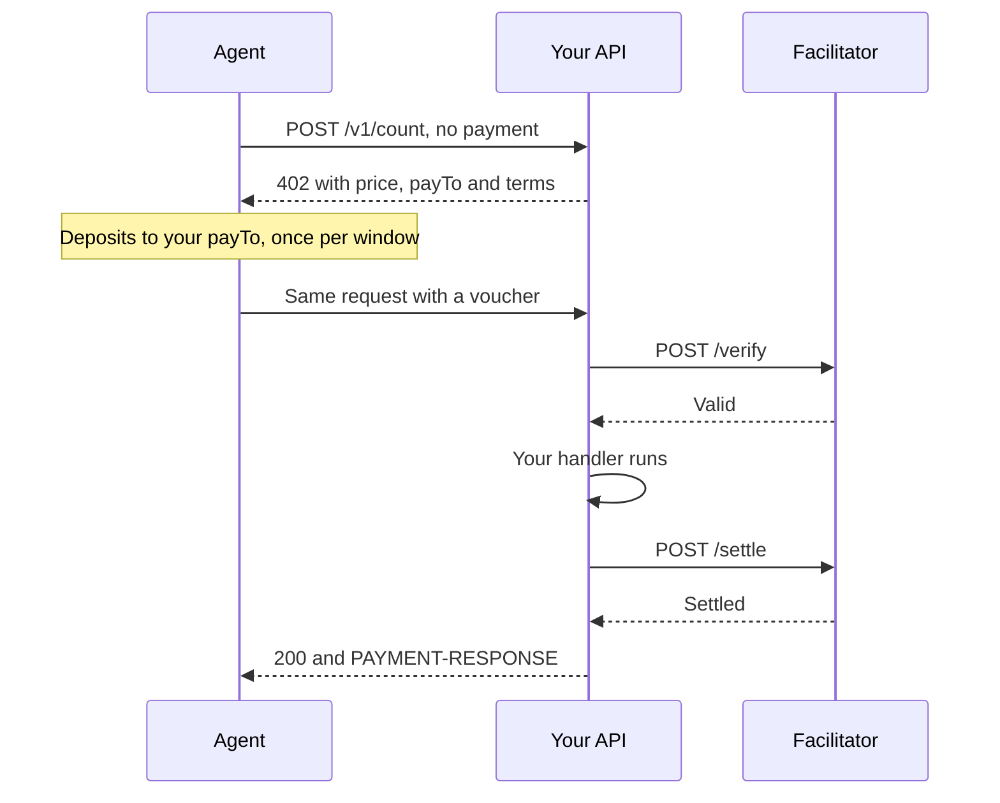
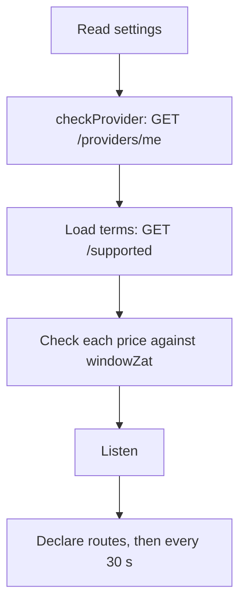

export const meta = {
  title: "Sell an API",
  description: "Charge for any HTTP API in shielded ZEC: register as a provider, add the z402 scheme to the x402 Express middleware, list your routes and go live.",
};

You can charge for any HTTP API in shielded ZEC and keep your own server, code and address. A facilitator checks the payments for you, so you run no Zcash node and no facilitator.

This guide wires the payment scheme into an Express server by hand, the way `apps/api` does. If you would rather describe your routes as data and let a kit do the wiring, read [Build with the service kit](/docs/guides/service-kit). It reaches the same result with less code.

## How a paid call reaches your server



1. The agent's first request carries no payment. Your server answers `402` with your price, your <Term tip="The shielded address that agents deposit to. Every 402 names it.">payTo</Term> address and the rail's terms in the `PAYMENT-REQUIRED` header.
2. The agent deposits shielded ZEC to your `payTo` once per <Term tip="The size of one deposit, in zat. An agent makes one deposit per window, then signs vouchers against it.">window</Term>, then signs a <Term tip="A signed promise of a running total. The agent signs a new one for each call.">voucher</Term> for each call. You never see the deposit. The facilitator reads it with your viewing key.
3. On the paid retry, the x402 middleware asks the facilitator to verify the voucher before your handler runs, and to settle it after.
4. If settlement is refused, your answer is replaced with a `402`. Your handler runs only for calls the facilitator has verified.

| | You | The facilitator |
| --- | --- | --- |
| The address | Create it and keep its spending key | Reads deposits to it with your viewing key. It cannot spend |
| The price | Set it on each route | Accepts any whole number of <Term tip="The smallest unit of ZEC. 100,000,000 zat make 1 ZEC.">zat</Term> from 1 to `windowZat` |
| Each paid call | Ask it to verify before your handler and to settle after | Checks the voucher against your deposits and keeps the ledger |
| Being found | Declare your routes every 30 s | Hosts the Bazaar and counts the calls it settles |

## What you need

- **Node.js 22 or later.**
- **The z402 repository, for its scripts.** `scripts/merchant-keygen.mjs` makes your address and runs `zdecrypt`, which the repository builds with a Rust toolchain. `scripts/register-provider.mjs` registers you, and you can make the same call by hand. The server itself installs from npm, so it can live in any project.
- **A facilitator.** You need its URL, and its registration token if the operator asks for one. The demo stack's facilitator listens on `http://127.0.0.1:4022` after `scripts/demo.sh up`.
- **A public address for your server**, once you go live. Locally, `http://127.0.0.1` is enough.

The server below sells two routes. Each has its own price.

| Route | Price | What one call buys |
| --- | --- | --- |
| `POST /v1/count` | 50 zat | The number of words in a text |
| `POST /v1/analyze` | 400 zat | The number of words and of sentences |

## Create your address and keys

Every provider is paid to its own shielded-only unified address, its `payTo`, and registers the matching <Term tip="Unified incoming viewing key. It shows the payments sent to an address and cannot spend them.">UIVK</Term>. The address is public. The viewing key lets the facilitator see deposits to that address and nothing else.

<Steps>

<Step title="Build the decryptor">

The key script runs `zdecrypt`, a small Rust tool in the repository. Build it once. It needs a Rust toolchain.

```bash
pnpm --filter @z402/facilitator build:native
```

</Step>

<Step title="Generate an account">

```bash
node scripts/merchant-keygen.mjs --network regtest --out "$PWD/.secrets/my-api.json"
```

It prints the address on stdout and saves the keys to the file with mode 0600. Pick your own file name: `.secrets/merchant-regtest.json` is the operator's account on the demo stack, and the script will not replace it without `--force`.

```text
uregtest1...
Saved .secrets/my-api.json (mode 600). Its seed is the only backup of this account, keep a copy somewhere safe.
```

Use `--network testnet` or `--network mainnet` for the network your facilitator serves. Addresses start with `uregtest1`, `utest1` and `u1`.

</Step>

<Step title="Make the view-only file">

```bash
node scripts/merchant-keygen.mjs --view-only --from .secrets/my-api.json --out "$PWD/.secrets/my-api.view.json"
```

This writes `.secrets/my-api.view.json`. It holds only `network`, `uivk` and `orchardOnlyAddress`. The address in it is your `payTo`.

</Step>

</Steps>

<Callout type="warning" title="The seed is the only way to spend">

`.secrets/my-api.json` holds the seed of your account. Back it up offline and never commit it. Do not put it on your server and do not send it to the facilitator. The server needs only the address, and the facilitator needs only the view-only file.

</Callout>

## Register with the facilitator

Registration gives the facilitator your address and your viewing key. It proves that the key owns the address, opens a ledger for you, and issues an API key. You register once.

The script reads the view-only file, sends only the address, the viewing key and the network, and saves the key to a file with mode 0600 without printing it:

```bash
node scripts/register-provider.mjs \
  --keys .secrets/my-api.view.json \
  --facilitator http://127.0.0.1:4022 \
  --out .secrets/provider-key
```

```text
providerId 0f1e689e20871dd9
payTo uregtest1...
key file .secrets/provider-key
```

Add `--registration-token-file <file>` when the facilitator asks for a registration token. The script waits up to 120 s for an answer, because the facilitator opens your ledger before it replies. An existing key file is replaced only with `--force`. Registering an address that is already registered rotates its key.

The same call by hand is one `POST /providers`. The `jq` filter keeps the viewing key off the command line, where other users of the machine could read it in the process list.

```bash
export FACILITATOR=http://127.0.0.1:4022

jq '{payTo: .orchardOnlyAddress, uivk: .uivk, network: ("zcash:" + .network)}' \
  .secrets/my-api.view.json \
  | curl -sS -X POST "$FACILITATOR/providers" \
      -H 'content-type: application/json' \
      --data @-
```

```json
{
  "providerId": "0f1e689e20871dd9",
  "network": "zcash:regtest",
  "payTo": "uregtest1...",
  "apiKey": "z402_..."
}
```

The key is in this answer and nowhere else. Run the command under `umask 077` and redirect its output to a file, or use the script, which saves the key for you.

<Endpoint method="POST" path="/providers" auth="registration-token">

Registers a provider, or rotates the key of a registered one. The route is public unless the facilitator sets `Z402_REGISTRATION_TOKEN`. Then the request needs `Authorization: Bearer <registration token>`. On mainnet the route is closed unless a token is set or the operator opened registration with `Z402_REGISTRATION_OPEN=1`.

</Endpoint>

<Params>
  <Param name="payTo" type="string" required>Your shielded-only unified address. It must have no transparent receiver.</Param>
  <Param name="uivk" type="string" required>The unified incoming viewing key that owns `payTo`. It must have the shape of a viewing key for the facilitator's network.</Param>
  <Param name="network" type="string">The facilitator's network, for example `zcash:regtest`. Leave it out to use the facilitator's own.</Param>
</Params>

| Status | `error` | When |
| --- | --- | --- |
| `201` | none | A new provider. The body is the one above |
| `200` | none | The `payTo` was already registered, so its key was rotated. Same body, new key |
| `400` | `invalid_request` | A field is missing or invalid. `message` names the field |
| `401` | `unauthorized` | The facilitator wants a registration token and the request has none |
| `403` | `not_owner` | The viewing key does not own `payTo`, or `payTo` has a transparent receiver |
| `403` | `provider_limit` | The facilitator has reached its limit of providers |
| `403` | `registration_disabled` | The facilitator has no providers directory, or it runs on mainnet with registration neither opened nor gated by a token, so it takes no registrations |
| `409` | `operator` | `payTo` is the operator's own address |
| `500` | `internal_error` | The registration failed and nothing changed |

### Keep the API key

- The key looks like `z402_` followed by 43 characters. The facilitator shows it once and stores only its SHA-256 hash.
- Keep it in a file with mode 0600 or in your secret store. Never commit it. Anyone who holds it can verify and settle payments for your address and declare routes as you.
- The server reads it as a bearer token: `Authorization: Bearer <key>`.
- If you lose it, register again with the same viewing key. That rotates the key: the answer is `200`, the new key works at once, and the old one stops working at once on every route.

Check a key by reading the provider it belongs to. The key goes in on stdin, so it never shows in the process list:

```bash
curl -sS -K - "$FACILITATOR/providers/me" <<<"header = \"authorization: Bearer $(cat .secrets/provider-key)\""
```

```json
{
  "providerId": "0f1e689e20871dd9",
  "network": "zcash:regtest",
  "payTo": "uregtest1..."
}
```

An unknown key, or one that was rotated out, gets `401` with `WWW-Authenticate: Bearer`.

## Add payment to your server

Install the packages in your server's project, or in a new folder for this example. Pin the x402 packages to exactly `2.28.0`, the version the protocol was written against. `@z402-net/server` takes `@x402/core` as a peer at that version and installs `@z402-net/protocol` with it. The code below imports from `@z402-net/protocol` as well, which is why the first line names it. The second adds the Express middleware, the Bazaar extension and Express itself.

```bash
npm install --save-exact @z402-net/server @z402-net/protocol @x402/core@2.28.0
npm install --save-exact @x402/express@2.28.0 @x402/extensions@2.28.0 express@5.3.0
npm install --save-dev --save-exact @types/express@5.0.6 @types/node tsx typescript
```

The files below are TypeScript in ES modules, so `package.json` needs `"type": "module"`. Run them with `npx tsx main.ts` on Node.js 22 or later. This `tsconfig.json` lets `npx tsc --noEmit` check them:

```json title="tsconfig.json"
{
  "compilerOptions": {
    "target": "ES2023",
    "module": "NodeNext",
    "moduleResolution": "NodeNext",
    "strict": true,
    "verbatimModuleSyntax": true,
    "noUncheckedIndexedAccess": true,
    "skipLibCheck": true,
    "types": ["node"]
  },
  "include": ["*.ts"]
}
```

`app.ts` builds the Express app. It is the stock x402 resource server plus one z402 line: `PrepaidVoucherServerScheme`.

```ts title="app.ts"
import {
  HTTPFacilitatorClient,
  x402HTTPResourceServer,
  x402ResourceServer,
  type RouteConfig,
  type RoutesConfig,
} from "@x402/core/server";
import { paymentMiddlewareFromHTTPServer } from "@x402/express";
import { bazaarResourceServerExtension, declareDiscoveryExtension } from "@x402/extensions/bazaar";
import { ASSET, NETWORK_REGTEST, SCHEME } from "@z402-net/protocol";
import { PrepaidVoucherServerScheme } from "@z402-net/server";
import express, { type Express, type NextFunction, type Request, type Response } from "express";

export interface Settings {
  facilitatorUrl: string;
  /** The API key that POST /providers issued */
  apiKey: string;
  /** The shielded-only address that agents deposit to */
  payTo: string;
  /** The public origin of this server, without a trailing slash */
  publicUrl: string;
}

const network = NETWORK_REGTEST;

/** A price in zat is any whole number from 1 up to the facilitator's windowZat */
const COUNT_ZAT = 50n;
const ANALYZE_ZAT = 400n;

function route(s: Settings, path: string, priceZat: bigint, description: string): RouteConfig {
  return {
    accepts: {
      scheme: SCHEME,
      network,
      price: { amount: priceZat.toString(), asset: ASSET },
      payTo: s.payTo,
      maxTimeoutSeconds: 60,
    },
    resource: `${s.publicUrl}${path}`,
    description,
    mimeType: "application/json",
    extensions: declareDiscoveryExtension({
      bodyType: "json",
      input: { text: "The quick brown fox" },
      inputSchema: { properties: { text: { type: "string", minLength: 1, maxLength: 5000 } }, required: ["text"] },
      output: { example: { words: 4 } },
    }),
  };
}

const parseJson = express.json({ limit: "16kb" });

/** Refuses a wrong method or a bad body. It runs on the unpaid attempt and again on the paid retry */
function refuseEarly(req: Request, res: Response, next: NextFunction): void {
  if (req.method !== "POST") {
    res.set("Allow", "POST").status(405).json({ error: "method_not_allowed" });
    return;
  }
  parseJson(req, res, (err?: unknown) => {
    const text: unknown = req.body?.text;
    if (err !== undefined || typeof text !== "string" || text.trim() === "" || text.length > 5000) {
      res.status(400).json({ error: "invalid_text", message: 'send {"text": "..."} with 1 to 5,000 characters' });
      return;
    }
    next();
  });
}

const wordsIn = (text: string): number => text.split(/\s+/).filter((word) => word !== "").length;

export async function createApp(s: Settings): Promise<{ app: Express; http: x402HTTPResourceServer }> {
  const auth = { Authorization: `Bearer ${s.apiKey}` };
  const facilitator = new HTTPFacilitatorClient({
    url: s.facilitatorUrl,
    // Verify may wait for the chain, so it gets more time than a plain request
    timeoutMs: 60_000,
    createAuthHeaders: async () => ({ verify: auth, settle: auth, supported: auth }),
  });
  const server = new x402ResourceServer(facilitator)
    .register(network, new PrepaidVoucherServerScheme({ payTo: s.payTo, network }))
    .registerExtension(bazaarResourceServerExtension);

  // A key has no verb, so a request of any method has to pay before it reaches a handler
  const routes: Record<string, RouteConfig> = {
    "/v1/count": route(s, "/v1/count", COUNT_ZAT, "Counts the words in a text."),
    "/v1/analyze": route(s, "/v1/analyze", ANALYZE_ZAT, "Counts words and sentences in a text."),
  };
  const http = new x402HTTPResourceServer(server, routes satisfies RoutesConfig);
  // Reads the rail's terms from the facilitator's /supported, and throws if it offers none for this network
  await http.initialize();

  const app = express();
  app.disable("x-powered-by");
  // Everything that can refuse a call comes before the payment middleware
  app.all(Object.keys(routes), refuseEarly);
  // The terms are loaded above, and false keeps the middleware from loading them again
  app.use(paymentMiddlewareFromHTTPServer(http, undefined, undefined, false));

  // These run only for a call whose voucher the facilitator has verified
  app.post("/v1/count", (req, res) => {
    res.json({ words: wordsIn(req.body.text) });
  });
  app.post("/v1/analyze", (req, res) => {
    const text: string = req.body.text;
    const sentences = text.split(/[.!?]+/).filter((part) => part.trim() !== "").length;
    res.json({ words: wordsIn(text), sentences });
  });
  return { app, http };
}
```

What each part does:

- **The facilitator client** sends your API key on all three of its calls: `verify`, `settle` and `supported`. Always pass `url`. If it is empty, the x402 SDK sends payments to x402.org.
- **`PrepaidVoucherServerScheme`** is registered for the network. It turns a price into a requirement, copies the rail's terms into every `402`, and adds the session's limits to the `402` that follows a refused voucher. [`@z402-net/server`](/docs/reference/server) lists every member.
- **The route keys have no verb.** A request of any method must pay before it reaches a handler. A key such as `"GET /v1/count"` charges only `GET`, and Express runs a `GET` handler for `HEAD` too, so a `HEAD` request would skip payment.
- **`price: { amount, asset: "ZEC" }`** is the only price form the scheme accepts. The amount is a whole number of zat as a string, with no leading zero.
- **`resource`** is the public URL of the route. It goes into the `402` and into your Bazaar listing. Without it, the SDK builds the URL from the request's protocol, `Host` header and path, so behind a proxy it can be an internal address.
- **`http.initialize()`** reads the rail's terms from the facilitator's `GET /supported`. It throws if the facilitator offers no `prepaid-voucher` on your network, or advertises terms the scheme cannot use.
- **`paymentMiddlewareFromHTTPServer(http, undefined, undefined, false)`** is the stock middleware. The last argument, `false`, tells it not to load the terms itself. You loaded them already, so a facilitator that is down stops your start-up and not a customer's request.
- **The handlers come after the middleware.** They run only for a call whose voucher the facilitator verified. The middleware holds your answer until it has settled, and swaps it for a `402` if settlement is refused.

## Set prices

A price is what one call costs, in zat. You set it per route, in `price.amount`. The facilitator accepts any whole number of zat from 1 to `windowZat`, the size of one deposit. Read the window from the rail:

```bash
curl -s "$FACILITATOR/supported" | jq '.kinds[0].extra'
```

```json
{
  "windowZat": "100000",
  "creditRatioBps": 2500,
  "creditCapZat": "200000",
  "zeroConfMinExpiryBlocks": 20,
  "termsVersion": "<16 hex characters>"
}
```

| Rule | Value |
| --- | --- |
| Unit | zat, as a decimal string with no sign and no leading zero |
| Smallest price | 1 zat |
| Largest price | `windowZat`, which is 100,000 zat (0.001 ZEC) on the demo terms |
| Where | `price: { amount, asset: "ZEC" }` in each route. The scheme accepts no other form |
| One per route | Each route has its own price. Two routes of one server can differ |

One deposit is one window, so a deposit pays for about `windowZat / price` calls: 2,000 calls at 50 zat, or 250 at 400 zat. A price above `windowZat` could never be covered by one deposit.

## Check your key at start-up

Before your server listens, ask the facilitator whether your key and your address belong together. `checkProvider` calls `GET /providers/me` with your key and compares the answer with your `payTo` and network. If they differ, it throws a `ProviderCheckError` that names the setting to fix.

```ts title="check.ts"
import { NETWORK_REGTEST } from "@z402-net/protocol";
import { checkProvider, ProviderCheckError } from "@z402-net/server";
import type { Settings } from "./app.js";

/** Waits for a facilitator that is still starting, and gives up at once on a mistake of ours */
export async function checkKey(s: Settings): Promise<void> {
  for (let attempt = 1; ; attempt++) {
    try {
      await checkProvider({
        facilitatorUrl: s.facilitatorUrl,
        token: s.apiKey,
        payTo: s.payTo,
        network: NETWORK_REGTEST,
      });
      return;
    } catch (e) {
      // A mistake in the key, the address or the URL is not retryable: fix it and start again
      if (!(e instanceof ProviderCheckError) || !e.retryable || attempt === 30) throw e;
      console.error(`${e.message}; trying again in 2 s`);
      await new Promise((resolve) => setTimeout(resolve, 2000));
    }
  }
}
```

Branch on `field` and `retryable`, never on the message.

| `field` | `retryable` | Meaning |
| --- | --- | --- |
| `facilitatorToken` | no | The key is missing, wrong or rotated out (`401` or `403`) |
| `payTo` | no | The key belongs to another address, or the facilitator serves another network |
| `facilitatorUrl` | no | The URL is not a facilitator of this rail, or its answer is unreadable |
| `facilitatorUrl` | yes | The facilitator is unreachable, slow, or answered `5xx`, `408` or `429` |

The start-up order is the same for every provider, with or without the kit:



## Refuse everything before payment

The stock client sends every call twice. The first request carries no payment and gets the `402`. The second carries a voucher.

If your server fails the second request with a status of 400 or more, the middleware cancels the settlement, so the facilitator does not charge for it. The client cannot know that. The failure carries neither a `PAYMENT-RESPONSE` nor a `PAYMENT-REQUIRED` header, so the client counts the call as possibly charged and moves its running total up. Its next voucher then pays for the failed call too. At 100 zat a call, a call that fails after its voucher, followed by one that works, is settled for 200 zat.

<Callout type="warning" title="An agent pays for a call that fails after its voucher">

Check everything that can fail before the payment middleware. The agent then hears the refusal on its first request, before any voucher exists, and is never charged.

</Callout>

`refuseEarly` in `app.ts` does this. It is mounted with `app.all(...)` before the payment middleware, so it runs for every method.

| Check | Answer |
| --- | --- |
| A method the route does not take | `405` with `Allow` |
| A body that is not JSON, or too large | `400` or `413` |
| A body that breaks your rules | `400` |
| An id that does not exist, or a finished job | `404` or `410` |
| An agent over your rate limit | `429` with `Retry-After` |
| No capacity, or an upstream that is not ready | `503` |

Each of these is a call that cannot succeed, so the agent should not be asked to pay for it.

These checks run twice per call, once on the unpaid attempt and once on the paid retry. Keep them cheap. If one is expensive, keep its result for the retry: URL to markdown fetches and converts the page on the unpaid attempt, then answers the retry from its cache.

Only a failure that nothing before payment could predict, such as an upstream that dies in the middle of the call, should answer `4xx` or `5xx` after the voucher. It is not settled, and the client still counts it.

### Side effects after delivery

Do nothing that cannot be undone until the call is paid and delivered. The middleware settles after your handler, and turns a refused settlement into a `402`, so a `2xx` at the end of the response is the only sign that the call was paid. `onDelivered` from `@z402-net/service-kit` runs `ok` or `failed`, exactly one of them, once the response is over. To use it, install the kit with `npm install --save-exact @z402-net/service-kit`.

```ts
import { onDelivered } from "@z402-net/service-kit";

let sold = 0;
app.post("/v1/count", (req, res) => {
  onDelivered(res, {
    ok: () => {
      sold += 1;
    },
  });
  res.json({ words: String(req.body.text).split(/\s+/).length, sold });
});
```

## List your routes in the Bazaar

The Bazaar is the public catalog of paid APIs. The facilitator hosts it. Agents read it to find services, and the website shows the same list. [Discovery](/docs/concepts/discovery) explains how an agent uses it.

You can be listed in two ways:

| | Declare | Paid calls |
| --- | --- | --- |
| How | Your server posts its routes to `POST /discovery/resources` with your key, at start and every 30 s | Automatic. The facilitator lists a route when it settles a paid call to it |
| Listed | Before the first sale | After the first settled call |
| `lastSeen` (is it up?) | Yes | No |
| `paidCallsToday` | Yes | Yes |
| Content | Exactly what you declare | What the `402` and the payment carried |

Declare your routes, and keep declaring. Once you have declared, payments only update the items you declared and never create one, and your first declaration removes any items that were listed from payments and that you did not declare. Without that rule, any payer could add a listing under your address for the price of one call.

<Endpoint method="POST" path="/discovery/resources" auth="api-key">

Declares 1 to 32 routes. One bad item refuses the whole call with `400`, and the facilitator never fetches your URLs.

</Endpoint>

The body is `{"items": [...]}`. Each item is the standard Bazaar `DiscoveryResource` without `lastUpdated`. Build each item from the `402` that your own route returns, and it matches what the catalog accepts. The `accepts` entry then has your address, your price and the rail's terms exactly as the facilitator expects them.

```ts title="declare.ts"
import { decodePaymentRequiredHeader } from "@x402/core/http";
import type { HTTPAdapter, x402HTTPResourceServer } from "@x402/core/server";

interface PaidRoute {
  method: string;
  path: string;
}

/** The 402 that an unpaid request to the route gets, which is what the Bazaar should list for it */
async function itemFor(http: x402HTTPResourceServer, route: PaidRoute): Promise<Record<string, unknown>> {
  const adapter: HTTPAdapter = {
    getHeader: () => undefined,
    getMethod: () => route.method,
    getPath: () => route.path,
    getUrl: () => route.path,
    getAcceptHeader: () => "",
    getUserAgent: () => "",
  };
  const result = await http.processHTTPRequest({ adapter, path: route.path, method: route.method });
  const header = result.type === "payment-error" ? result.response.headers["PAYMENT-REQUIRED"] : undefined;
  if (header === undefined) throw new Error(`an unpaid ${route.method} ${route.path} gets no 402`);
  const { x402Version, resource, accepts, extensions } = decodePaymentRequiredHeader(header);
  return {
    resource: resource.url,
    type: "http",
    x402Version,
    accepts,
    description: resource.description,
    mimeType: resource.mimeType,
    extensions,
  };
}

/** Declares the routes now and every 30 s, and returns the function that stops it */
export function keepDeclared(o: {
  http: x402HTTPResourceServer;
  routes: readonly PaidRoute[];
  facilitatorUrl: string;
  apiKey: string;
}): () => void {
  const declare = async (): Promise<void> => {
    const items = await Promise.all(o.routes.map((route) => itemFor(o.http, route)));
    const res = await fetch(`${o.facilitatorUrl}/discovery/resources`, {
      method: "POST",
      headers: { "content-type": "application/json", authorization: `Bearer ${o.apiKey}` },
      body: JSON.stringify({ items }),
      signal: AbortSignal.timeout(10_000),
    });
    if (!res.ok) throw new Error(`the facilitator answered the declaration with ${res.status}`);
  };
  const beat = (): void => {
    declare().catch((e: unknown) => console.error(`discovery: ${e instanceof Error ? e.message : String(e)}`));
  };
  beat();
  const timer = setInterval(beat, 30_000);
  return () => clearInterval(timer);
}
```

The heartbeat is the liveness signal. Every declaration sets the item's `lastSeen` to now. Readers derive a status from its age: up under 90 s, stale under 10 min, down after that. A failed declaration must never stop your server. `keepDeclared` logs it and tries again at the next beat.

The facilitator checks every item before it takes it:

| Field | Rule |
| --- | --- |
| `resource` | An absolute `http` or `https` URL of at most 2,048 characters, with no user or password |
| `type` and `x402Version` | `"http"` and `2` |
| `accepts` | 1 to 4 entries. Each is `prepaid-voucher` on the facilitator's network, asset `ZEC`, your `payTo`, an amount from 1 to `windowZat`, and the rail's terms and `termsVersion` |
| `description` | At most 512 characters |
| `mimeType` | At most 128 characters |
| `serviceName` | 1 to 32 printable ASCII characters |
| `tags` | At most 5 distinct tags, each 1 to 32 printable ASCII characters. A repeat that differs only in case is dropped |
| `iconUrl` | Optional. An `http` or `https` URL of at most 2,048 characters, with no user or password, on a named host |
| `extensions` | A JSON object of at most 8 KB. `extensions.bazaar.info.input.method`, when present, is the item's method, and `GET` when absent |
| Counts | 128 items per provider and 4,096 in all. A body is at most 64 KB |

The last piece is `main.ts`, which starts everything in order:

```ts title="main.ts"
import { createApp, type Settings } from "./app.js";
import { checkKey } from "./check.js";
import { keepDeclared } from "./declare.js";

function need(name: string): string {
  const value = process.env[name];
  if (value === undefined || value === "") throw new Error(`${name} is required`);
  return value;
}

async function main(): Promise<void> {
  const settings: Settings = {
    facilitatorUrl: need("Z402_FACILITATOR_URL"),
    apiKey: need("Z402_FACILITATOR_TOKEN"),
    payTo: need("Z402_PAY_TO"),
    publicUrl: need("PUBLIC_URL"),
  };
  // 1. The key and the address must belong together
  await checkKey(settings);
  // 2. Load the rail's terms and build the routes
  const { app, http } = await createApp(settings);
  // 3. Listen, then list the routes in the Bazaar
  const server = app.listen(4040, "127.0.0.1", () => console.log("listening on http://127.0.0.1:4040"));
  const stopDeclaring = keepDeclared({
    http,
    routes: [
      { method: "POST", path: "/v1/count" },
      { method: "POST", path: "/v1/analyze" },
    ],
    facilitatorUrl: settings.facilitatorUrl,
    apiKey: settings.apiKey,
  });
  process.once("SIGTERM", () => {
    stopDeclaring();
    server.close();
  });
}

main().catch((e: unknown) => {
  console.error(e instanceof Error ? e.message : String(e));
  process.exit(1);
});
```

### Run it and look at the listing

Run it from the folder that holds `main.ts`, with the two `.secrets` paths pointing at the files you made earlier:

```bash
export Z402_FACILITATOR_URL=http://127.0.0.1:4022
export Z402_FACILITATOR_TOKEN="$(cat .secrets/provider-key)"
export Z402_PAY_TO="$(jq -r .orchardOnlyAddress .secrets/my-api.view.json)"
export PUBLIC_URL=http://127.0.0.1:4040

npx tsx main.ts
```

An unpaid call gets the offer. A bad body is refused at once, with no voucher involved:

```bash
curl -s -o /dev/null -w '%{http_code}\n' -X POST http://127.0.0.1:4040/v1/count \
  -H 'content-type: application/json' -d '{"text":"one two three"}'
```

```text
402
```

```bash
curl -s -X POST http://127.0.0.1:4040/v1/count -H 'content-type: application/json' -d '{"text":""}'
```

```json
{"error":"invalid_text","message":"send {\"text\": \"...\"} with 1 to 5,000 characters"}
```

Within one heartbeat, the facilitator lists your routes. Filter by your address:

```bash
curl -s "$FACILITATOR/discovery/resources?payTo=$Z402_PAY_TO" \
  | jq '.items[] | {resource, amount: .accepts[0].amount, lastSeen, paidCallsToday}'
```

```json
{
  "resource": "http://127.0.0.1:4040/v1/count",
  "amount": "50",
  "lastSeen": "2026-10-28T15:20:37.267Z",
  "paidCallsToday": 0
}
```

<Video src="/docs/videos/catalog.mp4" poster="/docs/videos/catalog.jpg" title="The service catalog" caption="The website lists every declared route with its price and status." />

## Go live

Work through this before you tell anyone the address.

- [ ] **Public URL.** Set `publicUrl` (`PUBLIC_URL` in the kit) to the origin agents reach, such as `https://api.example.com`. It is the `resource` of every `402` and every listing.
- [ ] **TLS on your server.** Serve the API over `https://`, usually from a reverse proxy in front of Express.
- [ ] **TLS to the facilitator.** Off regtest, use an `https://` facilitator URL. Your API key and every voucher cross that link. `apps/api` refuses plain `http://` to a host that is not loopback on testnet and mainnet. The kit and this guide's code do not check, so you must.
- [ ] **The key stays secret.** Keep it in a file with mode 0600 or a secret store. It is not in git, logs or the process list.
- [ ] **The registration token.** If the facilitator gates registration, its operator gives you a token out of band. It only authorizes `POST /providers` and is not your API key. Keep it in a file and pass `--registration-token-file`.
- [ ] **The seed stays offline.** Only the view-only file leaves the machine that made the account, and only to the facilitator.
- [ ] **Every price is in range.** From 1 zat to `windowZat`. Make one paid call on each route from an agent, as in [Pay from an agent](/docs/guides/pay-from-an-agent).
- [ ] **Everything that can fail is checked before payment.** Look at each handler and ask what it can still refuse.
- [ ] **Your routes are listed.** `lastSeen` stays under 90 s.

<Callout type="privacy" title="What the facilitator learns about you">

The facilitator holds your viewing key, so it sees every payment to your address, with its amount and memo. It cannot spend. It also sees each voucher you send it to verify and settle. The public catalog shows only a count of settled calls per route, `paidCallsToday`, and never a session, a key or an amount per call. [Privacy model](/docs/concepts/privacy) has the full picture.

</Callout>

### Run anonymously

Listing needs no account, and a shielded-only `payTo` links nothing to you on-chain. What can still identify you is the infrastructure around the service:

- [ ] A shielded-only unified address as `payTo`.
- [ ] A new domain, unrelated to your existing sites.
- [ ] A separate host, paid for privately.
- [ ] No IP addresses, analytics IDs, emails or certificates shared with other sites.
- [ ] A separate git identity for the service's repository.
- [ ] An onion address only as a second endpoint. Stock x402 clients cannot reach `.onion` without a proxy.

## Where to go next

<Cards>
  <Card title="Build with the service kit" href="/docs/guides/service-kit">Describe routes as data, and get start-up checks, listing, health and tests for free.</Card>
  <Card title="@z402-net/server" href="/docs/reference/server">Every member of the scheme, and every outcome of checkProvider.</Card>
  <Card title="Facilitator API" href="/docs/reference/facilitator-api">Every route of the facilitator, with requests and answers.</Card>
  <Card title="Discovery" href="/docs/concepts/discovery">How agents find your routes, and how liveness is read.</Card>
</Cards>

## References

- <Source path="apps/api/src/app.ts" />: the minimal reference integration that `app.ts` follows.
- <Source path="packages/server/src/scheme.ts" />: `PrepaidVoucherServerScheme`.
- <Source path="packages/server/src/provider.ts" />: `checkProvider` and `ProviderCheckError`.
- <Source path="packages/service-kit/src/service.ts" />: the same wiring as data, and the start-up order.
- <Source path="packages/service-kit/src/declare.ts" />: the declaration heartbeat and the item limits.
- <Source path="packages/service-kit/src/delivery.ts" />: `onDelivered`.
- <Source path="packages/client/src/outcome.ts" />: why a failure after the voucher is counted by the client.
- <Source path="scripts/merchant-keygen.mjs" />: key generation.
- <Source path="scripts/register-provider.mjs" />: registration and key rotation from a keys file.
- <Source path="docs/superpowers/specs/2026-10-28-z402-multi-provider-design.md" />: sections 4.1, 4.4 and 4.6, providers, the Bazaar and the server scheme.
- <Source path="docs/superpowers/specs/2026-10-27-z402-services-design.md" />: sections 3.4 and 5, refusing before payment and declaring.
- <Source path="docs/spec/protocol.md" />: sections 2, 6, 9 and 10, the offer, the ramp and the client rules.
- <Source path="services/README.md" />: the anonymity checklist.
- [x402](https://github.com/x402-foundation/x402): the standard, its SDK and the Bazaar extension.
- [RFC 6750](https://datatracker.ietf.org/doc/html/rfc6750): the bearer token format.
- [ZIP 316](https://zips.z.cash/zip-0316): unified addresses and viewing keys.
