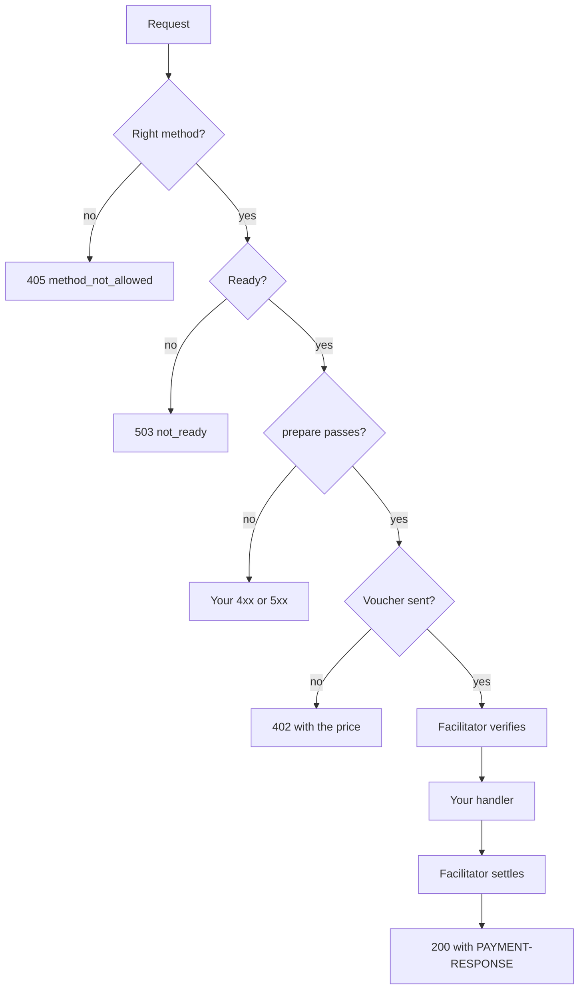
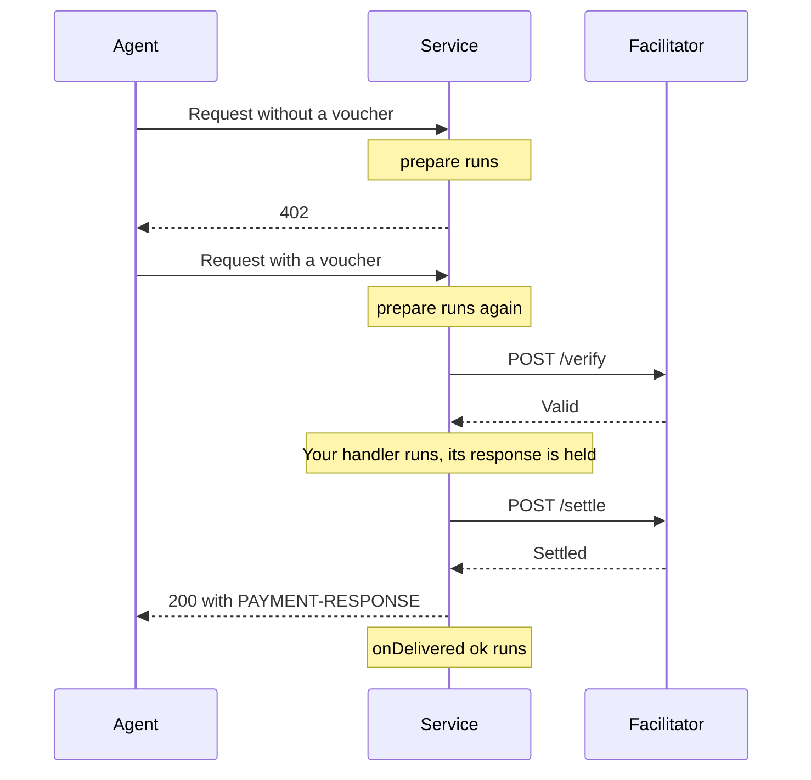

export const meta = {
  title: "Build with the service kit",
  description: "Describe your routes as data and write plain Express handlers. The kit adds payment, the Bazaar listing, health checks and tests. A complete example.",
};

`@z402-net/service-kit` is what the four starter services are built on. You describe your paid routes as data and write ordinary Express handlers. The kit does the rest.

| The kit does this | So you do not |
| --- | --- |
| **Start-up.** Reads and checks your settings. Checks your API key and address with the facilitator, and waits while the facilitator is still starting. Loads the rail's terms and checks every price against `windowZat` | Write the checks, or the retry loop |
| **Payment.** Mounts the stock x402 middleware with the z402 scheme on every paid route, with no verb in the route keys | Wire `@x402/express` yourself |
| **Refusals.** Answers a wrong method (`405`), a service that is not ready (`503`) and a second copy of a voucher already in flight (`409`) before anyone pays | Remember each of them |
| **Listing.** Declares every route to the facilitator's Bazaar at start and every 30 s while the service is ready | Build the declaration, or the heartbeat |
| **Health.** Serves `GET /health` with the routes, their prices and the calls delivered today | Write a health route |
| **Tests.** In the z402 repository, a test stack makes real paid calls in-process, against the real facilitator on a fake chain | Mock the payment |

To add payment to an existing Express API by hand instead, read [Sell an API](/docs/guides/sell-an-api).

<Callout type="note" title="A workspace package">

`@z402-net/service-kit` is a package of the z402 workspace, like the services under `services/`, and it is not published to npm yet. Build your service as a package in the same workspace.

</Callout>

## How a call passes through the kit



Everything above "Your handler" happens before the facilitator settles the call. That is the point of the shape. The stock client sends each call twice, first without payment and then with a voucher, and your checks run on both:



## Describe your routes

A service is a name, some tags and a list of routes. Each route says what it sells, where, and how an agent should call it.

```ts
const service: ServiceDefinition = { serviceName: "Short notes", tags: ["storage", "notes"], routes };
```

| `PaidRoute` field | What it is |
| --- | --- |
| `method` | `GET`, `POST`, `PUT` or `DELETE`. The method agents use, and the method of the catalog item |
| `path` | The route without a verb, such as `/v1/notes` or `/v1/notes/:id/extend` |
| `probePath` | A concrete path for a route with parameters, such as `/v1/notes/example/extend`. Discovery probes it instead of `path` |
| `description` | One sentence for agents, at most 512 characters |
| `unit` | What one call buys, such as `note-hour` or `page` |
| `note` | One short guardrail or privacy note |
| `mimeType` | The answer's type, `application/json` by default |
| `priceZat` | The price of one call in zat, as a `bigint`. Defaults to the service's price |
| `discovery` | How an agent should call the route: an example input, its schema, and an example output |
| `prepare` | Handlers that run before payment, such as a body parser and your checks |

`discovery` is the config of `declareDiscoveryExtension` from `@x402/extensions/bazaar`, without `method`, which the kit takes from the route. A route that reads a query string needs `input` and `inputSchema`. A route with a body adds `bodyType`, one of `json`, `form-data` or `text`. A route with parameters adds `pathParams` and `pathParamsSchema`. Every route should say what it answers with `output.example`. The [reference](/docs/reference/service-kit#paidroute) has every field.

## Build a service

The example is a small paste service. A paid call stores a short text note for one hour. Anyone who has the note's id reads it for free. Another paid call keeps a note for one more hour.

| Route | Paid | What it does |
| --- | --- | --- |
| `POST /v1/notes` | yes | Stores a note and returns its id |
| `POST /v1/notes/:id/extend` | yes | Keeps a note for another hour |
| `GET /v1/notes/:id` | no | Reads a note |

It shows each part of the kit that matters: checks before payment, a side effect that waits for delivery, a route with a parameter, a free route, and tests.

### Create the package

Put the service in `services/notes`. The package follows the starter services.

```json title="services/notes/package.json"
{
  "name": "@z402/service-notes",
  "version": "0.0.0",
  "private": true,
  "type": "module",
  "scripts": {
    "start": "tsx src/main.ts",
    "test": "vitest run",
    "typecheck": "tsc --noEmit"
  },
  "dependencies": {
    "@z402-net/service-kit": "workspace:*",
    "express": "5.3.0"
  },
  "devDependencies": {
    "@types/express": "5.0.6"
  }
}
```

```json title="services/notes/tsconfig.json"
{
  "extends": "../../tsconfig.base.json",
  "include": ["src", "test"]
}
```

Run `pnpm install` in the repository root so that the workspace links the new package.

<Callout type="note">

`@z402-net/service-kit` is not published to npm yet. Until it is, depend on it from the z402 monorepo with `"workspace:*"`, as above, and run with `tsx` on Node 22 or later.

</Callout>

### Write the routes and the handlers

```ts title="services/notes/src/service.ts"
import { randomBytes } from "node:crypto";
import { createPaidService, onDelivered, type PaidRoute, type ServiceEnv } from "@z402-net/service-kit";
import express, { type Express, type NextFunction, type Request, type Response } from "express";

const MAX_CHARS = 2000;
const HOUR_MS = 60 * 60 * 1000;
/** A note is never held more than a day ahead, however often it is extended */
const MAX_HOLD_MS = 24 * HOUR_MS;

interface Note {
  text: string;
  expiresAt: number;
}

export interface NotesService {
  app: Express;
  notes: Map<string, Note>;
  close(): Promise<void>;
}

const parseJson = express.json({ limit: "16kb" });

/** The body of a new note, checked before anyone pays for it */
function checkNote(req: Request, res: Response, next: NextFunction): void {
  parseJson(req, res, (err?: unknown) => {
    const text: unknown = req.body?.text;
    if (err !== undefined || typeof text !== "string" || text.trim() === "" || text.length > MAX_CHARS) {
      res.status(400).json({ error: "invalid_note", message: `send {"text": "..."} with 1 to ${MAX_CHARS} characters` });
      return;
    }
    next();
  });
}

export async function createNotesService(env: ServiceEnv): Promise<NotesService> {
  const notes = new Map<string, Note>();
  const live = (id: string): Note | undefined => {
    const note = notes.get(id);
    return note !== undefined && note.expiresAt > Date.now() ? note : undefined;
  };

  // The note an extend call is about must exist, and have room to grow, before anyone pays to extend it
  const checkExtend = (req: Request, res: Response, next: NextFunction): void => {
    const note = live(String(req.params["id"]));
    if (note === undefined) {
      res.status(404).json({ error: "unknown_note" });
    } else if (note.expiresAt + HOUR_MS > Date.now() + MAX_HOLD_MS) {
      res.status(409).json({ error: "hold_cap_reached" });
    } else {
      next();
    }
  };

  const routes: PaidRoute[] = [
    {
      method: "POST",
      path: "/v1/notes",
      description: "Stores a text note of up to 2,000 characters for one hour.",
      unit: "note-hour",
      note: "Anyone who has the id can read the note.",
      discovery: {
        bodyType: "json",
        input: { text: "Meet at the usual place." },
        inputSchema: { properties: { text: { type: "string", minLength: 1, maxLength: MAX_CHARS } }, required: ["text"] },
        output: { example: { id: "q3Zs0mYbT7cWpAxK", expiresAt: 1793200000000 } },
      },
      prepare: [checkNote],
    },
    {
      method: "POST",
      path: "/v1/notes/:id/extend",
      probePath: "/v1/notes/example/extend",
      description: "Keeps an existing note for one more hour.",
      unit: "note-hour",
      discovery: {
        bodyType: "json",
        input: {},
        pathParams: { id: "<note id>" },
        pathParamsSchema: { properties: { id: { type: "string" } }, required: ["id"] },
        output: { example: { id: "q3Zs0mYbT7cWpAxK", expiresAt: 1793203600000 } },
      },
      prepare: [checkExtend],
    },
  ];

  const paid = await createPaidService({
    env,
    service: { serviceName: "Short notes", tags: ["storage", "notes"], routes },
  });
  const { app } = paid;

  // These run after the payment middleware, so only for a paid call
  app.post("/v1/notes", (req, res) => {
    const id = randomBytes(12).toString("base64url");
    const note: Note = { text: String(req.body.text), expiresAt: Date.now() + HOUR_MS };
    notes.set(id, note);
    // A refused settlement or a lost client makes this a failed delivery, which must not leave a free note
    onDelivered(res, { failed: () => notes.delete(id) });
    res.status(201).json({ id, expiresAt: note.expiresAt });
  });

  app.post("/v1/notes/:id/extend", (req, res) => {
    const id = String(req.params["id"]);
    const note = live(id);
    if (note === undefined) {
      res.status(404).json({ error: "unknown_note" });
      return;
    }
    // The hour is added only once the call is paid and delivered
    onDelivered(res, {
      ok: () => {
        if (live(id) !== undefined) note.expiresAt += HOUR_MS;
      },
    });
    res.json({ id, expiresAt: note.expiresAt + HOUR_MS });
  });

  // Free: the id is the key, as in a paste service
  app.get("/v1/notes/:id", (req, res) => {
    const note = live(String(req.params["id"]));
    if (note === undefined) {
      res.status(404).json({ error: "unknown_note" });
      return;
    }
    res.json({ text: note.text, expiresAt: note.expiresAt });
  });

  const sweeper = setInterval(() => {
    for (const [id, note] of notes) if (note.expiresAt <= Date.now()) notes.delete(id);
  }, 60_000);
  sweeper.unref();

  return {
    app,
    notes,
    close: async () => {
      clearInterval(sweeper);
      await paid.close();
    },
  };
}
```

What to notice:

- **`createPaidService` returns an Express app** that already has `/health` and the payment middleware. The handlers you add to `paid.app` come after the middleware, so a handler on a paid route runs only for a paid call. A route you add that is not in `routes`, like `GET /v1/notes/:id`, is free.
- **`prepare` holds every check that can refuse.** A bad body and an unknown note are answered on the unpaid first request, before the agent has a voucher. The handlers only do the work.
- **`probePath` is for discovery.** The route has a parameter, so the kit builds the route's listing from the `402` of `/v1/notes/example/extend`. It makes that request inside the kit, so `example` is not refused as an unknown note. An outside tool that wants the same `402` over HTTP sends the `X-Z402-Probe` header with no payment, which skips `prepare`.
- **`onDelivered` runs one handler once the response is over.** The first route stores the note before it answers, because the answer holds the id, and removes it if the call is not delivered. The second route adds the hour only after delivery. A delivery is a `2xx` after the facilitator settled. A refused settlement, a handler error or a client that hung up is a failure.
- **`close` stops declaring.** The kit's `close()` stops the Bazaar heartbeat. The HTTP server is yours to close.

### Write the entry point

```ts title="services/notes/src/main.ts"
import { loadDotEnv, loadServiceEnv, runMain, serve } from "@z402-net/service-kit";
import { createNotesService } from "./service.js";

const PORT = 4040;
/** Per note-hour, unless Z402_PRICE_ZAT sets another price */
const PRICE_ZAT = 100n;

runMain("notes", async () => {
  loadDotEnv(new URL("../.env", import.meta.url));
  const env = loadServiceEnv(process.env, { port: PORT, priceZat: PRICE_ZAT });
  const service = await createNotesService(env);
  const listening = await serve(service.app, env).catch(async (e: unknown) => {
    await service.close();
    throw e;
  });
  return {
    readyLine: `listening on ${listening.url} network=${env.network}`,
    close: async () => {
      await listening.close();
      await service.close();
    },
  };
});
```

- `loadDotEnv` reads the service's own `.env` when it exists. A variable already set in the environment wins.
- `loadServiceEnv` reads and checks the variables every paid service shares. Its arguments are the service's own port and default price.
- `serve` listens and sets tighter timeouts than Node's defaults: 15 s for the headers and 30 s for a whole request, so one slow client cannot hold a buffered body for minutes.
- `runMain` prints one ready line on stdout, logs to stderr, exits `1` on a start failure, and closes the service on `SIGINT` or `SIGTERM`.

### Configure and run

Register an address and get an API key first, as in [Sell an API](/docs/guides/sell-an-api#register-with-the-facilitator). Then give the service its settings:

```bash title="services/notes/.env"
Z402_NETWORK=regtest
Z402_FACILITATOR_URL=http://127.0.0.1:4022
Z402_FACILITATOR_TOKEN_FILE=/absolute/path/to/.secrets/provider-key
Z402_PAY_TO=uregtest1...
PUBLIC_URL=http://127.0.0.1:4040
```

```bash
pnpm --filter @z402/service-notes start
```

```text
notes listening on http://127.0.0.1:4040 network=zcash:regtest
```

The ready line goes to stdout. On stderr, the kit says that it listed the routes:

```text
discovery: 2 paid routes listed by the facilitator at http://127.0.0.1:4022, declared again every 30 s
```

Look at what the kit built. `/health` reports the routes with their prices:

```bash
curl -s http://127.0.0.1:4040/health | jq
```

```json
{
  "ok": true,
  "service": "Short notes",
  "ready": true,
  "network": "zcash:regtest",
  "priceZat": "100",
  "callsToday": 0,
  "routes": [
    { "method": "POST", "path": "/v1/notes", "unit": "note-hour", "priceZat": "100" },
    {
      "method": "POST",
      "path": "/v1/notes/:id/extend",
      "probePath": "/v1/notes/example/extend",
      "unit": "note-hour",
      "priceZat": "100"
    }
  ]
}
```

An unpaid call gets the offer. The terms are in the `PAYMENT-REQUIRED` header, which is base64 JSON:

```bash
curl -s -D - -o /dev/null -X POST http://127.0.0.1:4040/v1/notes \
  -H 'content-type: application/json' -d '{"text":"hello"}' | tr -d '\r' \
  | awk -F': ' 'tolower($1) == "payment-required" { print $2 }' | base64 -d | jq '{resource, accepts, z402: .extensions.z402}'
```

```json
{
  "resource": {
    "url": "http://127.0.0.1:4040/v1/notes",
    "description": "Stores a text note of up to 2,000 characters for one hour.",
    "mimeType": "application/json",
    "serviceName": "Short notes",
    "tags": ["storage", "notes"]
  },
  "accepts": [
    {
      "scheme": "prepaid-voucher",
      "network": "zcash:regtest",
      "amount": "100",
      "asset": "ZEC",
      "payTo": "uregtest1...",
      "maxTimeoutSeconds": 60,
      "extra": {
        "windowZat": "100000",
        "creditRatioBps": 2500,
        "creditCapZat": "200000",
        "zeroConfMinExpiryBlocks": 20,
        "termsVersion": "<16 hex characters>"
      }
    }
  ],
  "z402": { "unit": "note-hour", "note": "Anyone who has the id can read the note." }
}
```

The `z402` extension carries the billing unit and the note. The `bazaar` extension next to it carries what `discovery` described.

### Test it

`@z402-net/service-kit/testing` starts a fake chain, the real facilitator on an in-memory ledger, your service, and a stock x402 fetch that pays with a mock wallet. A call made with `paidFetch` is a real paid call: a deposit, a voucher, verification, your handler and settlement. It needs no Docker and no network.

<Callout type="note" title="In the z402 repository only">

`@z402-net/service-kit/testing` is available inside the z402 repository only. It runs the repository's own facilitator and fake chain, `@z402/facilitator` and `@z402/testkit`, which are not published, so the package leaves this entry point out when it is published. Write the test in a service that is a package of the z402 workspace, as this one is.

</Callout>

```ts title="services/notes/test/service.test.ts"
import { declarationRefusal, railOf, startTestStack, TEST_PAY_TO, type TestStack } from "@z402-net/service-kit/testing";
import { afterEach, describe, expect, test, vi } from "vitest";
import { createNotesService, type NotesService } from "../src/service.js";

const stacks: TestStack[] = [];
afterEach(async () => {
  for (const stack of stacks.splice(0)) await stack.close();
});

async function start(o: { catalog?: boolean } = {}): Promise<{ stack: TestStack; service: NotesService }> {
  const built: { service?: NotesService } = {};
  const stack = await startTestStack({
    priceZat: 100n,
    catalog: o.catalog,
    // Declare often, so that a test does not wait for the 30 s beat
    env: o.catalog === true ? { declareIntervalMs: 100 } : {},
    build: async (env) => {
      built.service = await createNotesService(env);
      return built.service;
    },
  });
  stacks.push(stack);
  if (built.service === undefined) throw new Error("the service was not built");
  return { stack, service: built.service };
}

const post = (body: unknown): RequestInit => ({
  method: "POST",
  headers: { "content-type": "application/json" },
  body: JSON.stringify(body),
});

/** What the client has promised to pay so far, which is nothing until it has made a deposit */
const spent = (stack: TestStack): bigint | undefined => stack.scheme.session(TEST_PAY_TO)?.cumulativeZat;

describe("short notes", () => {
  test("a paid call stores a note that anyone can read", async () => {
    const { stack } = await start();
    const res = await stack.paidFetch(`${stack.url}/v1/notes`, post({ text: "hello" }));
    expect(res.status).toBe(201);
    const { id } = (await res.json()) as { id: string };
    expect(spent(stack)).toBe(100n);

    // The read is free, so a plain fetch is enough
    const read = await fetch(`${stack.url}/v1/notes/${id}`);
    expect(await read.json()).toMatchObject({ text: "hello" });
  });

  test("a bad body is refused before any payment", async () => {
    const { stack } = await start();
    const res = await stack.paidFetch(`${stack.url}/v1/notes`, post({ text: "" }));
    expect(res.status).toBe(400);
    // No deposit and no voucher: the client was never asked to pay
    expect(stack.scheme.session(TEST_PAY_TO)).toBeUndefined();
  });

  test("an unknown note is refused before any payment", async () => {
    const { stack } = await start();
    const res = await stack.paidFetch(`${stack.url}/v1/notes/nope/extend`, post({}));
    expect(res.status).toBe(404);
    expect(stack.scheme.session(TEST_PAY_TO)).toBeUndefined();
  });

  test("an extend call adds an hour once it is paid", async () => {
    const { stack, service } = await start();
    const created = await stack.paidFetch(`${stack.url}/v1/notes`, post({ text: "hello" }));
    const { id, expiresAt } = (await created.json()) as { id: string; expiresAt: number };

    const extended = await stack.paidFetch(`${stack.url}/v1/notes/${id}/extend`, post({}));
    expect(extended.status).toBe(200);
    expect(service.notes.get(id)?.expiresAt).toBe(expiresAt + 3_600_000);
    expect(spent(stack)).toBe(200n);
  });

  test("declares both routes to the Bazaar within the catalog's rules", async () => {
    const { stack } = await start({ catalog: true });
    const catalog = stack.catalog;
    if (catalog === undefined) throw new Error("no catalog stub");
    await vi.waitFor(() => expect(catalog.declarations.length).toBeGreaterThan(0));

    const rail = await railOf(stack);
    for (const declaration of catalog.declarations) expect(declarationRefusal(declaration, rail)).toBeUndefined();
  });
});
```

```bash
pnpm --filter @z402/service-notes test
pnpm --filter @z402/service-notes typecheck
```

What each test proves:

- **A paid call.** The handler runs and the client has promised exactly 100 zat.
- **A bad body, an unknown note.** `stack.scheme.session(TEST_PAY_TO)` is still `undefined`: the client never deposited and never signed a voucher, because the refusal came on the unpaid first request. This is the property to test for every check you put in `prepare`.
- **An extend call.** The hour is added after delivery, and the client has promised 200 zat for two calls.
- **The listing.** With `catalog: true`, the stack puts a stub Bazaar in front of the facilitator and records each declaration. `declarationRefusal` checks one against the rules of the facilitator's catalog, so a declaration the real catalog would refuse fails here, not in production. Without `catalog`, a service in the stack declares nothing.

`startTestStack` gives the service the stack's price, 500 zat unless you pass `priceZat`. `stack.client()` makes a second paying client with its own session, since one client's paid calls take turns on its session.

## Refuse before payment, deliver after

Two rules decide where code goes.

**Everything that can fail before payment must.** A call that fails after its voucher is not settled, but the stock client cannot tell, so it counts the call and its next voucher pays for it. Put every check that can refuse in `prepare`: parsing and validating the body, unknown ids, finished jobs, size and format limits, rate limits and capacity. The agent then hears the refusal on its unpaid first request. [Sell an API](/docs/guides/sell-an-api#refuse-everything-before-payment) explains why.

| The kit refuses these itself, before payment | Answer |
| --- | --- |
| A method the route does not take | `405` with `Allow`. A `GET` route also takes `HEAD` |
| A service that is not ready | `503` with `{"error":"not_ready"}` |
| A second copy of a voucher that is already being verified or handled | `409` with `{"error":"payment_in_flight"}`, so one payment runs the handler once |

**Side effects wait for delivery.** Use `onDelivered(res, { ok, failed })` for anything that must happen only for a call that was paid and delivered. The middleware settles after your handler, so a `2xx` at the end of the response is the only sign of a paid call. Exactly one of the two handlers runs, once. The starter services use both halves: the LLM service commits a chunk in `ok` and releases it in `failed`, and the drop box removes an upload in `failed` and extends a hold in `ok`.

`prepare` runs on the unpaid request and again on the paid one, so keep it cheap or cache what it learns. URL to markdown fetches and converts a page on the unpaid attempt, then holds the result for the paid retry.

### Shed load before anyone pays

The `before` option mounts handlers ahead of every paid route's checks, for things like a rate limit or a concurrency cap that must refuse before payment:

```ts
const MAX_IN_FLIGHT = 64;
let inFlight = 0;

const shed: RequestHandler = (_req, res, next) => {
  if (inFlight >= MAX_IN_FLIGHT) {
    res.set("Retry-After", "1").status(503).json({ error: "busy" });
    return;
  }
  inFlight += 1;
  res.once("close", () => {
    inFlight -= 1;
  });
  next();
};

await createPaidService({ env, service, before: [shed] });
```

`before` handlers run for every request except `/health`. If you limit by client address behind a proxy, set Express's `trust proxy` on `paid.app` to the number of proxies in front. Do not set it to `true`, because Express would then trust the left-most `X-Forwarded-For` address, which the client writes itself.

## Prices

A price is a whole number of zat from 1 to the facilitator's `windowZat`. Three places set it, from the most general:

1. **The service's price.** The second argument of `loadServiceEnv`: `loadServiceEnv(process.env, { port: 4040, priceZat: 100n })`.
2. **`Z402_PRICE_ZAT`.** In the environment or the service's `.env`, it replaces the service's price for every route that sets none.
3. **`PaidRoute.priceZat`.** It replaces both, for that route only.

```ts
const ping: PaidRoute = {
  method: "GET",
  path: "/v1/ping",
  description: "Answers pong.",
  unit: "ping",
  priceZat: 1n,
  discovery: { output: { example: { pong: true } } },
};
```

At start, the kit reads `windowZat` from the facilitator and refuses a route whose price is outside the range. The error names the route, and names `Z402_PRICE_ZAT` even when the price came from `PaidRoute.priceZat`:

```text
Z402_PRICE_ZAT: POST /v1/notes would cost 100001 zat, outside 1 to 100000, the facilitator's windowZat
```

The starter services use these prices: 200 zat for an LLM output chunk, 1,000 zat for a page of markdown, 100 zat for about 1,000 tokens of embeddings, and 500 zat for an upload or a hold of 10 blocks.

## Readiness and health

Pass `ready` when your service depends on something that can be down, such as a model server or a database. It returns whether the service can serve right now:

```ts
await createPaidService({
  env,
  service,
  // The kit reuses an answer for 5 s, and the Bazaar heartbeat asks on its own beat. A throw, or an answer that takes over 2 s, counts as not ready
  ready: async () => {
    const res = await fetch(`${upstream}/health`, { signal: AbortSignal.timeout(1500) });
    return res.ok;
  },
});
```

While it is not ready:

- every paid route answers `503` with `{"error":"not_ready"}` before payment, so no one is asked to pay for a call you cannot serve;
- `GET /health` answers `503` with `"ready": false`;
- the kit stops declaring the routes, and checks again every 5 s so the first declaration follows soon after the service is ready.

The kit reuses an answer for 5 s, and treats a `ready` that throws or takes longer than 2 s as `false`. Cache your own slow checks. The embeddings service asks its model server about every 10 s and logs each change of answer.

`GET /health` is free and public. It reports `ok`, the service name, `ready`, the network, the default price, the calls delivered since 00:00 UTC, and each route with its own price. It never reports anything per client or per session. Compose uses it as the container health check.

## Settings

`loadServiceEnv` reads the variables every paid service shares. An empty variable counts as unset, and every error names the variable at fault without quoting a secret.

| Variable | Default | Meaning |
| --- | --- | --- |
| `Z402_NETWORK` | `regtest` | `regtest`, `testnet` or `mainnet`. It must be the facilitator's network |
| `Z402_FACILITATOR_URL` | none, required | The facilitator's `http://` or `https://` URL, with no user or password in it |
| `Z402_FACILITATOR_TOKEN` or `Z402_FACILITATOR_TOKEN_FILE` | none | Your API key. The file form reads the file and trims it. It must be one token of letters, digits and `-._~+/`, which may end in `=` |
| `Z402_PAY_TO` or `Z402_PAY_TO_FILE` | none, required | Your shielded-only unified address. It must be the address your API key is registered to |
| `Z402_PRICE_ZAT` | the service's own price | A whole number of zat, at least 1, for every route without its own price |
| `PUBLIC_URL` | `http://localhost:<PORT>` | The public origin, without a trailing slash. It is the `resource` URL in every `402` and every listing |
| `HOST` | `127.0.0.1` | The address to listen on. Use `0.0.0.0` in a container |
| `PORT` | the service's own port | 0 to 65535. 0 picks a free port |
| `Z402_FACILITATOR_WAIT_MS` | `120000` | How long start-up waits for a facilitator that does not answer yet, 0 to 3,600,000. 0 fails at once |

Your own settings use the same helpers. `read` returns a variable or `undefined`, `readInt` checks a whole number in a range, `readUrl` checks an `http(s)` URL, and `readOrFile` also takes a `_FILE` form. A `ConfigError` stops the start with a message that names the variable.

```ts
import { ConfigError, read, readInt, type Env } from "@z402-net/service-kit";

export interface NotesConfig {
  /** Most characters one note may hold */
  maxChars: number;
  /** A line shown in the logs at start */
  label: string;
}

/** Reads NOTES_*, throwing a ConfigError that names the variable at fault */
export function loadNotesConfig(env: Env): NotesConfig {
  const label = read(env, "NOTES_LABEL") ?? "notes";
  if (label.length > 40) throw new ConfigError("NOTES_LABEL: at most 40 characters");
  return { label, maxChars: readInt(env, "NOTES_MAX_CHARS", 2000, 1, 20_000) };
}
```

## The Bazaar listing

The kit lists every paid route in the facilitator's Bazaar, with no code from you. It builds each item once, from the `402` that an unpaid request to the route gets, so the catalog offers exactly what the route asks for. Then, while the service is ready, it posts the items to `POST /discovery/resources` with your API key at once and again 30 s after each declaration ends. That heartbeat is how the catalog tells that the service is up.

- A failed declaration never stops the service. The kit logs one line each time the outcome changes, never the key, and tries again at the next beat.
- A facilitator without a Bazaar answers `404`. The service keeps serving and logs that its routes are not listed.
- One bad item refuses a whole declaration, so the kit checks the catalog's limits at start. A description over 512 characters, a resource URL over 2,048 characters or more than 128 routes stops the start with a message that says what is wrong.
- `createPaidService` takes `declareIntervalMs` to change the interval. `0` turns declaring off. No variable sets it.

[Sell an API](/docs/guides/sell-an-api#list-your-routes-in-the-bazaar) shows the declaration on the wire and the catalog's rules. The [reference](/docs/reference/service-kit#the-bazaar-declaration) lists the log lines.

## Run it for real

- **Use the key of the address you serve.** `Z402_PAY_TO` and `Z402_FACILITATOR_TOKEN` must belong together. The kit checks with the facilitator before it listens, and names the variable that is wrong.
- **Start order does not matter.** The kit waits up to 2 minutes for a facilitator that is starting or down, trying every 2 s. Any other failure, such as a refused key, is a configuration mistake and stops the start at once.
- **Keep the key in a file.** Use `Z402_FACILITATOR_TOKEN_FILE`, as the compose stack does for URL to markdown, which runs as an independent provider with its own address and key.
- **Set `PUBLIC_URL`** to the origin agents reach, and serve it over `https://`. The kit does not check that `Z402_FACILITATOR_URL` is `https://` off regtest, so use it yourself: your API key and every voucher cross that link.
- **Watch `/health`.** It answers `503` while the service is not ready.
- **Stop with a signal.** `runMain` closes the service on `SIGINT` or `SIGTERM`, and exits `1` if that takes more than 5 s.

<Callout type="tip" title="Start from a starter service">

`services/embeddings` is the smallest of the four, and `services/dropbox` shows routes with parameters and both delivery hooks. Copy one and change its routes.

</Callout>

<Cards>
  <Card title="@z402-net/service-kit" href="/docs/reference/service-kit">Every export, option, variable and limit.</Card>
  <Card title="Starter services" href="/docs/services">The four services built with the kit, and their prices.</Card>
  <Card title="Sell an API" href="/docs/guides/sell-an-api">The same wiring by hand, and the going-live checklist.</Card>
  <Card title="Discovery" href="/docs/concepts/discovery">How agents find the routes the kit lists.</Card>
</Cards>

## References

- <Source path="packages/service-kit/src/service.ts" />: `createPaidService`, the route and service types, the start-up order and the refusals.
- <Source path="packages/service-kit/src/declare.ts" />: the Bazaar declaration and its limits.
- <Source path="packages/service-kit/src/env.ts" />: `loadServiceEnv` and the helpers.
- <Source path="packages/service-kit/src/delivery.ts" />: `onDelivered`.
- <Source path="packages/service-kit/src/run.ts" />: `serve` and `runMain`.
- <Source path="packages/service-kit/src/dotenv.ts" />: `loadDotEnv`.
- <Source path="packages/service-kit/src/testing.ts" />: `startTestStack` and the catalog stub.
- <Source path="services/embeddings/src/service.ts" />: a service with one route and a readiness check.
- <Source path="services/dropbox/src/service.ts" />: routes with parameters, `onDelivered` on both routes, and free routes.
- <Source path="services/llm/src/service.ts" />: `onDelivered` with both handlers.
- <Source path="services/markdown/src/service.ts" />: checks that fetch before payment, and a cache for the paid retry.
- <Source path="services/README.md" />: the starter services and their settings.
- <Source path="docs/superpowers/specs/2026-10-27-z402-services-design.md" />: section 3, the kit's design.
- <Source path="docs/superpowers/specs/2026-10-28-z402-multi-provider-design.md" />: section 4.4, the Bazaar.
- <Source path="docs/spec/protocol.md" />: section 9, why a failure after the voucher is counted.
- [x402](https://github.com/x402-foundation/x402): the standard, its SDK and the Bazaar extension.
