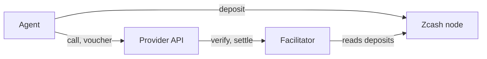
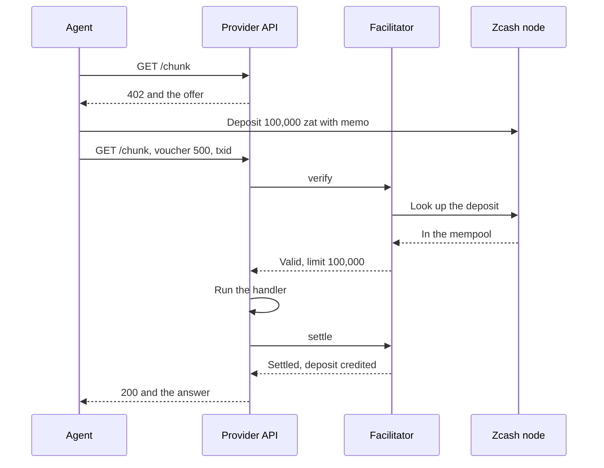
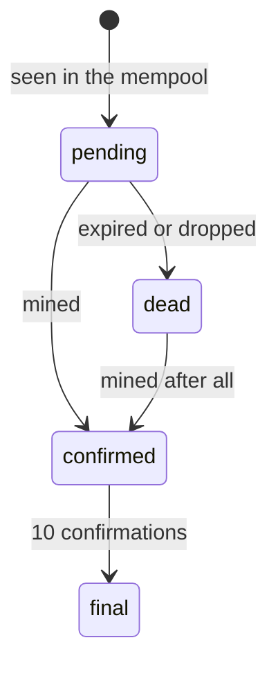
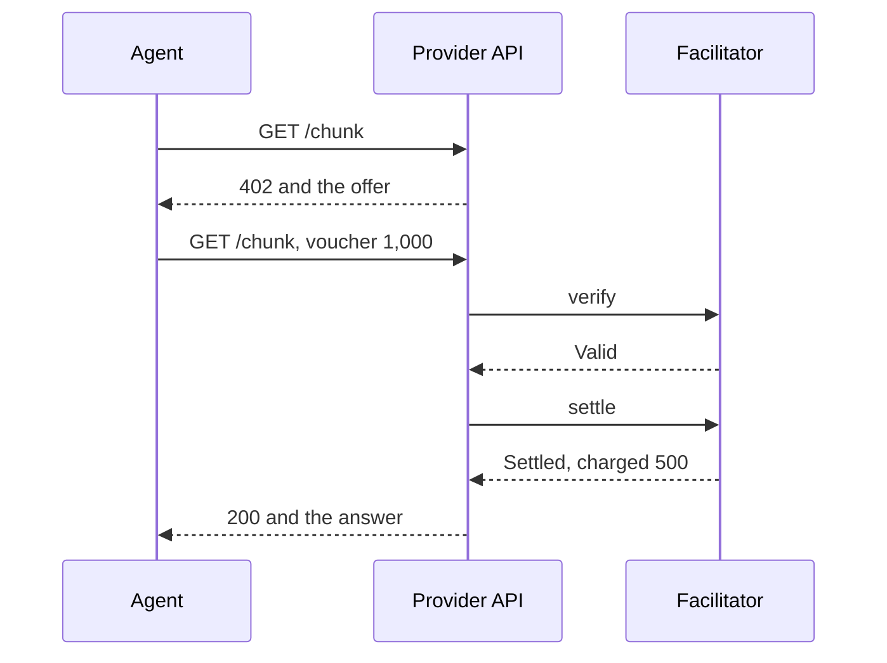
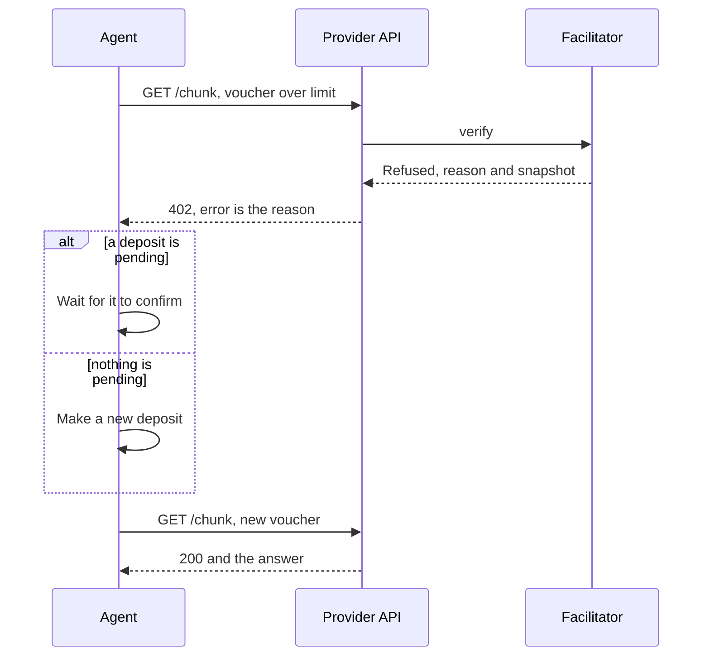
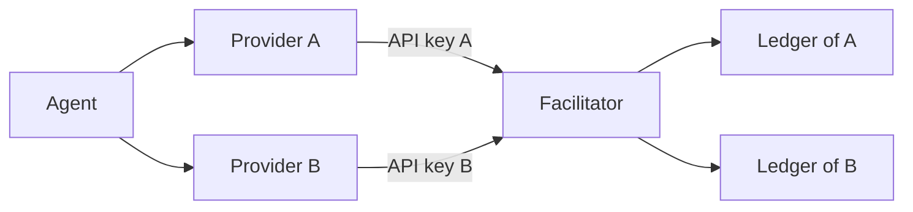

export const meta = {
  title: "How it works",
  description: "One paid call from the 402 to the next call: the deposit, the signed voucher, verify and settle, the credit limit, and the numbers behind them.",
};

An agent pays a provider with two kinds of messages. A **deposit** is an on-chain, shielded payment that happens once per window. A **voucher** is an off-chain signature that goes with every call. The facilitator ties the two together and tells the provider whether to serve.

This page follows one session from the first call to the next hundreds. The numbers are the demo terms: a price of 500 zat per call, a window of 100,000 zat, 25 percent credit and a cap of 200,000 zat.

## The parts

| Part | What it is | Job |
|---|---|---|
| Agent | Your code: the stock x402 client plus `PrepaidVoucherScheme` from `@z402/client`, and a wallet | Makes deposits, signs vouchers, retries after a refusal |
| Provider API | Any HTTP server with the x402 middleware and `PrepaidVoucherServerScheme` from `@z402/server` | Names a price per route, runs the handler once the facilitator says the payment is good |
| Facilitator | `@z402/facilitator`, shared by many providers | Verifies vouchers, finds and reads deposits, settles, keeps the ledger, hosts the catalog |
| Zcash node | A lightwalletd-compatible endpoint (Zaino on the demo chain) | Shows transactions and blocks to the facilitator and to the agent |



## The first call, end to end



1. The agent asks without paying and gets a **402** with the price and the terms.
2. The agent makes one shielded **deposit** to the provider's address. The deposit is not confirmed yet.
3. The agent signs a **voucher** for 500 zat and sends it with the txid of the deposit.
4. The provider asks the facilitator to **verify**. The facilitator finds the deposit in the mempool, reads it with the provider's <Term tip="Unified incoming viewing key (UIVK). Whoever holds it can see the payments made to an address, but cannot spend them.">view-only key</Term>, and counts it toward the limit.
5. The provider runs the handler, then asks the facilitator to **settle**. The facilitator records the voucher and credits the deposit.
6. The agent gets the answer, with the receipt in the `PAYMENT-RESPONSE` header.

The rest of this page takes each step in turn.

## The 402 offer

The stock x402 client sends every call twice: first without payment, to read the offer, then again with the voucher. The offer is the `PAYMENT-REQUIRED` header of the 402, base64 JSON. Its `accepts` entry for z402 looks like this:

```json
{
  "scheme": "prepaid-voucher",
  "network": "zcash:regtest",
  "amount": "500",
  "asset": "ZEC",
  "payTo": "uregtest1...",
  "maxTimeoutSeconds": 60,
  "extra": {
    "windowZat": "100000",
    "creditRatioBps": 2500,
    "creditCapZat": "200000",
    "zeroConfMinExpiryBlocks": 20,
    "termsVersion": "<16 hex characters>"
  }
}
```

<Params>
  <Param name="scheme" type="string" required>`prepaid-voucher`, the payment scheme.</Param>
  <Param name="network" type="string" required>The Zcash network: `zcash:regtest`, `zcash:testnet` or `zcash:mainnet`.</Param>
  <Param name="amount" type="string" required>The price of this call in zat, a whole number from 1 to `windowZat`. The provider sets it for each route.</Param>
  <Param name="asset" type="string" required>`ZEC`. All amounts are in zat, which is one hundred millionth of a ZEC.</Param>
  <Param name="payTo" type="string" required>The provider's shielded-only unified address. Deposits go here.</Param>
  <Param name="maxTimeoutSeconds" type="number" required>The x402 field for how long a payment may take. The demo API sends 60.</Param>
  <Param name="extra.windowZat" type="string" required>The size of one deposit. It is also the most unconfirmed money the provider will count.</Param>
  <Param name="extra.creditRatioBps" type="number" required>Credit on confirmed deposits, in basis points. 2500 is 25 percent.</Param>
  <Param name="extra.creditCapZat" type="string" required>The most credit one session can hold.</Param>
  <Param name="extra.zeroConfMinExpiryBlocks" type="number" required>An unconfirmed deposit counts only with at least this many blocks left before it expires.</Param>
  <Param name="extra.termsVersion" type="string" required>16 hex characters that name the facilitator's terms. The agent ignores it.</Param>
</Params>

The facilitator owns the terms, so every provider on it offers the same window, credit ratio and cap. The provider owns `amount` and `payTo`.

The agent checks the offer before any money moves. It refuses an offer whose scheme is not `prepaid-voucher`, whose network is not a Zcash network, whose asset is not `ZEC`, or whose `payTo` is not a shielded-only address for that network. It also refuses a price of 0, a price above the window, and a window above `maxDepositZat`, which defaults to 1,000,000 zat.

`extra` is the same on every call to a route. Per-session values never appear in it, because the server compares the agent's echo of the offer with its own.

## The deposit

The agent deposits before its first voucher, because it has nothing to spend yet. It waits for the wallet to broadcast the deposit, then signs.

| | |
|---|---|
| Amount | exactly `windowZat`, in one output: 100,000 zat |
| To | the provider's `payTo` |
| <Term tip="A short text that travels encrypted inside a shielded Zcash payment. Only the recipient's keys can read it.">Memo</Term> | the text `<sessionKey>:<index>`, which binds the deposit to the agent's session. The index counts 1, 2, 3 per session and is informational. |
| Fee | about 10,000 zat for a deposit with one output and one change output |
| Time to build | 5 to 10 seconds, while the wallet makes the proof (5.4, 6.9 and 7.4 seconds were measured) |
| Expires | about 40 blocks after it is built, if it is never mined |

The agent makes a fresh <Term tip="An Ed25519 key pair made by the agent for one provider. Its public half, 64 hex characters, is the session key.">session key</Term> for each provider it pays. The public half is the 64-character `sessionKey`. It goes into the memo and into every voucher, which is how the provider ties the deposit and the calls together without an account. Keys are not saved. If the agent restarts, it starts a new session, with a new deposit and no credit.

<Callout type="privacy" title="What the chain shows">

A block explorer sees the deposit as encrypted bytes. The only number in the clear is the net value balance, which here is the fee. The provider's view-only key, held by the facilitator, opens the rest.

| | On the chain | With the view-only key |
|---|---|---|
| Amount | hidden | 100,000 zat |
| Recipient | hidden | the provider's `payTo` |
| Memo | hidden | `<sessionKey>:1` |

On the demo chain the deposit lands in the Ironwood pool. Since the network upgrade NU6.3, consensus puts a payment to an Orchard receiver there.

</Callout>

## The voucher

A voucher says how much the agent has used in total with this provider. It is the Ed25519 signature of six lines joined with newlines:

```text
z402-voucher-v1
prepaid-voucher
zcash:regtest
uregtest1...
<sessionKey>
500
```

The lines are a fixed label, the scheme, the network, the provider's `payTo`, the session key and the new running total, `cumulativeZat`. Because the message names the provider's address, a voucher for one provider can never verify at another.

The agent sends the voucher inside the x402 payment, in the `PAYMENT-SIGNATURE` header. Here are all three headers of a call, decoded:

<CodeTabs>

```json title="PAYMENT-REQUIRED"
{
  "x402Version": 2,
  "error": "Payment required",
  "resource": { "url": "http://api:4021/chunk", "mimeType": "application/json" },
  "accepts": [ { "scheme": "prepaid-voucher", "...": "the offer above" } ]
}
```

```json title="PAYMENT-SIGNATURE"
{
  "x402Version": 2,
  "resource": { "url": "http://api:4021/chunk", "mimeType": "application/json" },
  "accepted": { "scheme": "prepaid-voucher", "...": "the offer, unchanged" },
  "payload": {
    "sessionKey": "7c1e…9d",
    "cumulativeZat": "500",
    "sig": "e04b…3a",
    "depositTxid": "3f2a…c1"
  }
}
```

```json title="PAYMENT-RESPONSE"
{
  "success": true,
  "payer": "7c1e…9d",
  "transaction": "3f2a…c1",
  "network": "zcash:regtest",
  "amount": "500",
  "extra": { "session": { "...": "the snapshot below" } }
}
```

</CodeTabs>

Three rules make a running total safe:

- **The total only grows.** The facilitator remembers the last settled total, `c_last`. A voucher is accepted only if its total is at least `c_last` plus the price of this call. A replayed old voucher buys nothing.
- **The rule is lenient.** A total that jumps by more than the price is still accepted, up to the limit, and the whole difference is charged. That is how a lost response gets paid for by the next voucher.
- **The deposit rides along.** The agent attaches the txid of its newest deposit to every voucher until a successful settle acknowledges it.

## Verify

The provider's middleware calls `POST /verify` on the facilitator with the payment, its own requirements and its API key. The key tells the facilitator which provider is asking. The facilitator checks, in this order:

| Check | Refusal |
|---|---|
| The requirements are this provider's: its `payTo`, a price from 1 to `windowZat`, the facilitator's terms | `invalid_payment_requirements` |
| The payment is well formed: version 2, the same scheme and network as the offer, canonical fields | `invalid_payload`, `invalid_scheme`, `invalid_network`, `invalid_x402_version` |
| The signature verifies under the session key | `z402_invalid_signature` |
| The total grew by at least the price | `z402_cumulative_mismatch` |
| A deposit the session has not used yet is usable: found, fully shielded, with an output to `payTo` that carries this session's memo | `z402_deposit_not_found`, `z402_chain_unavailable`, `z402_deposit_transparent`, `z402_deposit_memo_mismatch`, `z402_deposit_dead` |
| The total is within the limit | `z402_awaiting_confirmation`, `z402_deposit_required` |

To check a deposit, the facilitator asks the node for the transaction by its txid and decrypts it with the provider's view-only key. A transaction in the <Term tip="The pool of transactions that a node has received but that are not in a block yet.">mempool</Term> is `pending`. One in a block is `confirmed`.

If the voucher fits without the new deposit, verify answers at once and looks the deposit up in the background. Otherwise it waits for the lookup, for up to 30 seconds, since a public node behind a load balancer can take about 16 seconds to show a new transaction. The provider allows the facilitator 60 seconds in all.

The facilitator always answers with HTTP 200 and a complete body: `isValid`, `payer` (the session key), and `extra.session`, a snapshot of the session that the agent uses to stay in step:

```json
{
  "sessionKey": "7c1e…9d",
  "cumulativeZat": "500",
  "limitZat": "100000",
  "headroomZat": "99500",
  "confirmedZat": "0",
  "pendingZat": "100000",
  "creditZat": "0",
  "tip": 119,
  "deposits": [
    { "txid": "3f2a…c1", "valueZat": "100000", "status": "pending", "confirmations": 0, "expiryHeight": 160, "zeroConf": true }
  ]
}
```

## Serve and settle

Only after a valid verify does the handler run. The middleware holds the handler's response until the settle returns. The provider then calls `POST /settle`, and the facilitator:

1. repeats the checks, using only what verify already read from the chain, and never waits on the chain;
2. appends the voucher, and the deposit if it is new, to the ledger;
3. commits the new running total and credits the deposit.

Steps 1 to 3 run with no `await` between the last check and the write, so two settles of one voucher can never both succeed.

The ledger is an append-only file with three kinds of events: `deposit`, `voucher` and `status`. The facilitator replays it when it starts, which is why a restart cannot credit a deposit twice or accept an old voucher again. A voucher event records only the running total, never the signature.

The settle reply says `success`, the charged amount, and, in `transaction`, the txid of the deposit when it is credited to this session. That is the acknowledgement. The agent counts a call as paid only on `success: true`, and it stops resending a deposit only after a successful settle acknowledges it. If settle fails after the handler ran, the held response is thrown away and the agent gets a 402 carrying the failure.

## The credit limit

The facilitator turns a session's deposits into one number, the limit: the most the provider will accept right now.

```text
confirmed = the deposits that are confirmed or final
pending   = min(window, the unconfirmed deposits that qualify)
credit    = min(creditCap, confirmed x creditRatio)
limit     = confirmed + pending + credit
accept    = the total grew by at least the price, and the total is at most the limit
```

On the demo terms:

| State of the session | Limit |
|---|---|
| New session | 0 |
| First deposit pending | 100,000 |
| First deposit confirmed | 125,000 |
| First confirmed, second pending | 225,000 |
| Both confirmed | 250,000 |
| Both pending | 100,000 |
| Eight confirmed | 1,000,000 |
| One deposit of 1,000,000 zat, pending | 100,000 |

Three rules sit behind the table:

- **Unconfirmed money counts for one window at most.** Two pending deposits give 100,000, not 200,000.
- **An unconfirmed deposit qualifies** when it is at least one full window and has at least 20 blocks left before it expires, counted from the tip when the facilitator first saw it. That is why the first call can be served before any block.
- **Credit is a quarter of what has confirmed**, up to 200,000. It is a loan: the agent can spend it before it has paid for it.

For a provider, the worst case per session is one unconfirmed window plus the credit line, plus the value of a credited deposit that a chain reorganization removes before it is final. A cheating agent that makes one deposit and no more gets at most 125,000 zat of service for it, and the provider has seen 100,000 zat confirmed by then.

### Deposit status



| Status | Meaning | Counts toward the limit |
|---|---|---|
| `pending` | In the mempool | Up to one window, if it qualifies |
| `confirmed` | Mined, 1 to 9 confirmations | In full, and it earns credit |
| `final` | 10 or more confirmations | The same as confirmed, and no longer polled |
| `orphaned` | Mined on a side chain | Nowhere |
| `dead` | Expired unmined, or not found for 120 seconds and 2 blocks | Nowhere |

The facilitator checks the chain tip every 5 seconds and reads its deposits again whenever the tip changes. Before it refuses a session that has a pending deposit, it reads that deposit once more, at most once per 5 seconds per session, so a block that landed a moment ago is not missed.

## The next calls

Later calls need no chain traffic at all. Each one is a voucher with a larger total.



The agent signs `c_last + price` for each call and keeps one call in flight per session, so totals never collide.

The agent also stays ahead of its limit. When the last snapshot shows nothing pending and the headroom (`limit` minus the total) falls below one window, it starts the next deposit in the background and keeps calling. Here is a recorded run on the demo terms, one call per second and a block every 25 seconds:

| Call | What happened | Total | Limit | Confirmed | Pending | Credit |
|---|---|---|---|---|---|---|
| 1 | First deposit sent inline, call served on it | 500 | 100,000 | 0 | 100,000 | 0 |
| 15 | First deposit mined, credit appears | 7,500 | 125,000 | 100,000 | 0 | 25,000 |
| 51 | Headroom is under 100,000, second deposit starts in the background | 25,500 | 125,000 | 100,000 | 0 | 25,000 |
| 58 | Second deposit pending | 29,000 | 225,000 | 100,000 | 100,000 | 25,000 |
| 65 | Second deposit mined | 32,500 | 250,000 | 200,000 | 0 | 50,000 |

No call waited for a block. Only call 1 waited for anything, and that was the deposit's proof.

## When the limit is reached

An agent that stops depositing runs into its limit. The provider refuses the voucher, and the refusal carries the session snapshot, so the agent learns the exact state.



The reason is a code, and the code carries the action. The stock client allows one recovery per call.

| Reason | Meaning | What the agent does |
|---|---|---|
| `z402_awaiting_confirmation` | Over the limit, a deposit is pending | Never deposits again. Waits until the pending deposit has one confirmation, then retries once. |
| `z402_deposit_required` | Over the limit, nothing is pending | Makes a deposit, then retries once. |
| `z402_cumulative_mismatch` | The total did not grow by the price | Takes the facilitator's total from the snapshot and retries once. |
| `z402_deposit_dead` | The deposit expired or was dropped | Marks it dead, makes a new deposit, retries once. |
| `z402_deposit_not_found` | The facilitator cannot see the deposit | Checks the chain itself, keeps the txid, retries. |
| `z402_chain_unavailable` | The facilitator's node is not answering | Waits 5 seconds and retries once. |
| `z402_deposit_memo_mismatch` | The deposit cannot be credited to this session | Stops. The address is wrong, or there is a bug. |
| any other code | | Stops and reports it. |

The agent waits at most 10 minutes for a confirmation, and then gives up and returns the 402 to its caller. [Errors and reason codes](/docs/reference/errors) lists all 19 codes, and [Troubleshooting](/docs/troubleshooting#a-402-after-paying) says what to do about each.

When the outcome of a call is unknown, for example when the connection breaks after the voucher was sent, the agent assumes the provider may have charged it and advances its total. The next voucher then pays for that call too.

## Many providers, one rail

The facilitator is one rail that many providers share, each with its own address, key and prices. A provider registers once, with its `payTo` and its view-only key, and receives an API key. It sends that key as a bearer token with every verify and settle.



- **Separate state.** The facilitator opens a runtime for each provider, with its own ledger. Deposits decrypt only with that provider's key, and credit is kept per provider. Nothing is shared between two providers' sessions.
- **One session per provider.** The agent keeps one session, with its own session key and deposit, for each `payTo` it pays. A deposit to provider A never funds calls at provider B.
- **A price per route.** Each route sets its own price, from 1 zat up to the window. The routes of one provider share a session, and each voucher advances the total by the price of its own call.
- **The key picks the provider.** The facilitator refuses any requirements whose `payTo` is not the one registered to the key presented.

The [Providers and API keys](/docs/concepts/providers) page covers registration and rotation.

## Finding a provider

Providers list their routes in the facilitator's public catalog, the x402 <Term tip="The public catalog of paid APIs that x402 facilitators host. Agents read it to find services.">Bazaar</Term>. An agent reads the whole list, with `GET /discovery/resources`, and chooses on its own side, so no server learns what it is looking for. The catalog only advertises. The 402 that a route returns stays authoritative: the agent pays what the offer says. See [Discovery](/docs/concepts/discovery).

## Timing

| What | How long |
|---|---|
| Building and broadcasting a deposit | 5 to 10 seconds |
| A new transaction appearing in the node's mempool | about half a second |
| The facilitator's check of the chain tip | every 5 seconds |
| A block on the demo chain | every 25 seconds, set by `Z402_BLOCK_SECONDS` |
| A block on mainnet | about 75 seconds on average |
| A deposit turning `final` | 10 confirmations |
| Verify waiting for a deposit it cannot see yet | up to 30 seconds |
| The provider waiting for the facilitator | up to 60 seconds |
| Zero-conf margin before a deposit expires | at least 20 blocks |
| A deposit judged dead when it is never found | 120 seconds and 2 blocks |

A deposit therefore turns `confirmed` in the facilitator's view a few seconds after its block: the lag of the node, plus up to one 5-second poll.

## References

- <Source path="docs/spec/protocol.md" />: the wire contract. Sections 2 to 8 cover the offer, the payload, the voucher, deposits, the credit limit, the facilitator's answers and the reason codes.
- <Source path="docs/superpowers/specs/2026-10-27-z402-facilitator-design.md" />: the deposit lifecycle, the verify and settle steps, the ledger.
- <Source path="docs/superpowers/specs/2026-10-27-z402-client-design.md" />: what the agent does, and in which order.
- <Source path="docs/superpowers/specs/2026-10-28-z402-multi-provider-design.md" />: providers, API keys, per-route prices and the catalog.
- <Source path="docs/research/live-run.md" />: the measured timings and the recorded run in the table above (section 8.2).
- <Source path="docs/research/x402-e2e-spike.md" />: the x402 headers and the order of the calls, as measured with the stock SDK.
- <Source path="packages/protocol/src/ramp.ts" />: `computeLimit`, `zeroConfEligible` and `checkVoucher`.
- <Source path="packages/protocol/src/voucher.ts" />: the signed message and its verification.
- <Source path="packages/protocol/src/memo.ts" />: the deposit memo.
- <Source path="packages/protocol/src/reasons.ts" />: the closed list of reason codes.
- <Source path="packages/client/src/scheme.ts" />: the client scheme and its deposit and recovery rules.
- <Source path="packages/client/src/session.ts" />: when the agent deposits inline, in the background, or not at all.
- <Source path="packages/facilitator/src/scheme.ts" />: the facilitator's verify, settle and limit decision.
- <Source path="packages/server/src/scheme.ts" />: the provider's server scheme.
- <Source path="docs/demo.md" />: the demo run, call by call.
- [x402 specification](https://github.com/x402-foundation/x402): the payment headers and the verify and settle contract.
- [ZIP 302](https://zips.z.cash/zip-0302): the memo field format.
- [ZIP 317](https://zips.z.cash/zip-0317): the proportional transaction fee.
- [RFC 8032](https://www.rfc-editor.org/rfc/rfc8032): Ed25519 signatures.
