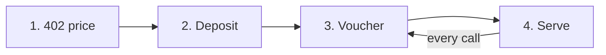

export const meta = {
  title: "Overview",
  description: "z402 lets AI agents pay for API calls in shielded Zcash: one deposit, then a signed voucher per call. No account, no card, no public trail.",
};

z402 is a way for software to pay for API calls in shielded <Term tip="Zcash is a cryptocurrency with a shielded pool, where amounts, addresses and memos are encrypted on the chain.">Zcash</Term>. An AI agent asks for something, the API answers with a price, the agent pays, and the call goes through. The agent needs no account, no card and no sign-up with the provider, and its payments leave no public trail.

It builds on <Term tip="An open standard that lets a web server ask for payment with the HTTP status 402 Payment Required, and lets a client pay and ask again.">x402</Term>, which puts payment into plain HTTP. z402 adds one payment scheme, `prepaid-voucher`, that fits Zcash. Agents use the stock x402 client plus one line of code.

## The problem

Software that buys from APIs runs into three walls:

- **Accounts and cards.** A person has to sign up, add a card and paste an API key into the agent. An agent cannot do that for itself, and every new provider means a new account.
- **One transaction per call.** Paying on a blockchain for each call is slow, because a Zcash block takes from 25 to 75 seconds. It is also expensive: the fee of one transaction (about 10,000 zat) can be larger than the price of a call (500 zat on the demo API).
- **A public trail.** On a transparent chain every payment shows who paid whom and how much, so anyone can read what an agent is doing.

z402 answers all three. The agent pays with a wallet it controls. One transaction covers many calls (200 at the demo price), and that transaction is shielded.

## How it works in four steps



1. **The API names its price.** A call without payment gets `402 Payment Required`. The answer says what one call costs, where to pay and how much to deposit at a time.
2. **The agent deposits once.** It sends one shielded payment to the provider's address: 100,000 zat in the demo, enough for 200 calls at 500 zat. A short memo inside the payment names the agent's <Term tip="A throwaway key the agent makes for each provider. It signs the vouchers and is the name of the session.">session key</Term>.
3. **Each call carries a voucher.** A <Term tip="A signed running total. It says: so far I have used this many zat with this provider.">voucher</Term> is a signed running total, such as "I have used 1,500 zat so far". The agent signs it and sends it with the request. No transaction is needed per call.
4. **The provider checks and serves.** The <Term tip="The service that checks vouchers and deposits for providers and keeps the ledger of who has paid what.">facilitator</Term> checks the signature, the deposit and the total, and the API answers. The first call is served before the deposit confirms. As deposits confirm, the limit grows, and the agent sends its next deposit before the money runs out.

<Video src="/docs/videos/agent-pays.mp4" poster="/docs/videos/agent-pays.jpg" title="An agent pays two providers" />

<Callout type="privacy" title="What stays private">

A deposit is a shielded Zcash transaction. The chain shows that it happened and what it paid in fees. It does not show the amount, the recipient or the memo. Every call after the deposit is an off-chain signature, so it never reaches the chain.

Two parties see more. The facilitator reads the deposits made to each provider with that provider's <Term tip="Unified incoming viewing key. Whoever holds it can see the payments made to an address, but cannot spend them.">view-only key</Term>, and the provider sees the calls it serves. [Privacy model](/docs/concepts/privacy) lists who sees what.

</Callout>

## What it costs on the demo terms

| | Value |
|---|---|
| Price of one call | 500 zat (0.000005 ZEC) on the demo API. Each provider sets its own price per route. |
| One deposit, the window | 100,000 zat (0.001 ZEC), which is 200 calls at 500 zat |
| Network fee of a deposit | about 10,000 zat |
| Credit on confirmed deposits | 25 percent of them, up to 200,000 zat |
| Starter services | 100 to 1,000 zat per call |

A <Term tip="The smallest unit of ZEC. 1 ZEC is 100,000,000 zat.">zat</Term> is one hundred millionth of a ZEC. The window and the credit are set by the facilitator and are the same for every provider on it.

## Who it is for

### Agents and their builders

Your agent is the stock x402 client plus one line that registers the Zcash scheme. `@z402/client` makes the deposits, signs the vouchers and recovers when a call is refused.

<CodeTabs>

```ts title="agent.ts"
import { wrapFetchWithPayment, x402Client } from "@x402/fetch";
import { zcashClientScheme } from "./zcash.js";

const client = new x402Client();
client.register("zcash:regtest", zcashClientScheme); // the one line that adds Zcash
const paidFetch = wrapFetchWithPayment(fetch, client);

const res = await paidFetch("http://localhost:4021/chunk");
console.log(res.status, await res.json());
```

```ts title="zcash.ts"
import { LightwalletdTxStatus, PrepaidVoucherScheme, ZalletRpcWallet } from "@z402/client";
import { createLightwalletdClient } from "@z402/lightwalletd";

// The endpoints and credentials of the local regtest stack
const lwd = createLightwalletdClient({ url: "http://127.0.0.1:28137" });

export const zcashClientScheme = new PrepaidVoucherScheme({
  wallet: new ZalletRpcWallet({ url: "http://127.0.0.1:50232", user: "zebra", password: "zebra" }),
  chain: new LightwalletdTxStatus(lwd),
});
```

</CodeTabs>

<Cards>
  <Card title="Pay from an agent" href="/docs/guides/pay-from-an-agent">Wire the scheme into your own agent, step by step.</Card>
  <Card title="@z402/client" href="/docs/reference/client">Options, events and errors of the client library.</Card>
</Cards>

### API providers

Put the x402 middleware in front of any route, set a price and a payTo address, and register with a facilitator once to get an API key. You never run payment infrastructure. `@z402/service-kit` builds a whole paid service from data: its routes, their prices and the checks that run before payment.

<Cards>
  <Card title="Sell an API" href="/docs/guides/sell-an-api">Charge for a route in a few lines.</Card>
  <Card title="Build with the service kit" href="/docs/guides/service-kit">Describe a paid service as data and let the kit wire it.</Card>
  <Card title="Starter services" href="/docs/services">Four paid services you can run and read.</Card>
</Cards>

### Operators

The operator runs the facilitator. It verifies vouchers, finds and reads deposits with each provider's view-only key, keeps the ledger and hosts the public catalog of paid APIs. One Docker Compose file starts the whole stack on a private chain.

<Cards>
  <Card title="Run the facilitator" href="/docs/guides/run-a-facilitator">Configure it, register providers, and read its logs.</Card>
  <Card title="Deploy with Docker" href="/docs/guides/deploy-with-docker">The one-server deployment, ports and volumes.</Card>
</Cards>

## Where z402 runs today

<Callout type="note" title="A working stack on a private chain">

The whole stack runs today on a private Zcash regtest chain in Docker, with a funded agent wallet, a block clock, and four paid starter services: LLM inference, URL to markdown, text embeddings and an encrypted drop box. The facilitator and the services take the network as a setting (regtest, testnet or mainnet). For real money, the facilitator should read a Zcash node you operate, because it trusts that node about every deposit. The [FAQ](/docs/faq#what-are-the-limits-today) lists the limits that remain.

</Callout>

## Start here

<Cards>
  <Card title="Quickstart" href="/docs/quickstart">Start the stack and pay every starter service.</Card>
  <Card title="How it works" href="/docs/how-it-works">One call from the 402 to the next call, with the numbers.</Card>
  <Card title="FAQ" href="/docs/faq">Money, privacy and limits, answered briefly.</Card>
</Cards>

## References

- <Source path="docs/spec/protocol.md" />: the wire contract between the client and the merchant side, including the demo terms (section 12).
- <Source path="docs/superpowers/specs/2026-10-28-z402-multi-provider-design.md" />: the facilitator as one rail for many providers.
- <Source path="docs/deploy.md" />: the Docker Compose deployment and the regtest limit ("Beyond regtest").
- <Source path="docs/research/live-run.md" />: the fees and timings measured on the regtest stack.
- <Source path="packages/client/src/scheme.ts" />: `PrepaidVoucherScheme`, the client scheme.
- <Source path="apps/agent/src/agent.ts" />: the demo agent, stock x402 plus one `register` line.
- [x402](https://github.com/x402-foundation/x402): the open standard and its SDK. z402 pins version 2.28.0.
- [RFC 9110, 402 Payment Required](https://www.rfc-editor.org/rfc/rfc9110.html#name-402-payment-required): the HTTP status code.
