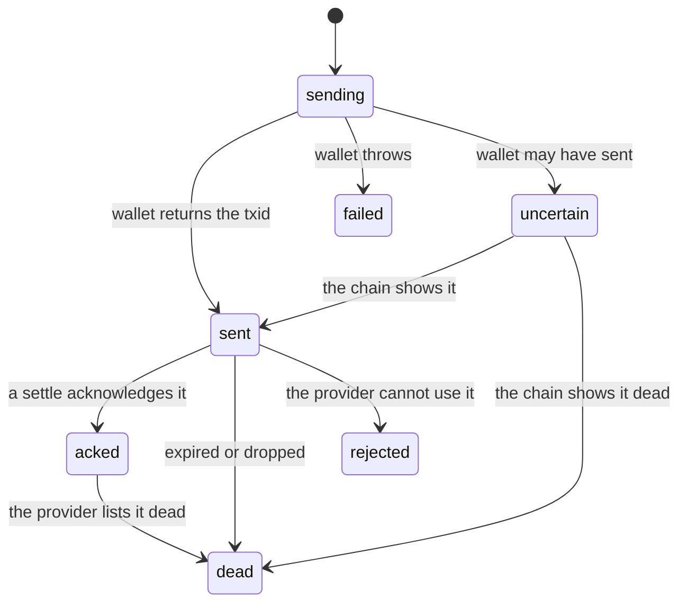

export const meta = {
  title: "@z402/client",
  description: "Every export of @z402/client: the prepaid-voucher scheme, the Zallet wallet, the chain status source, events, errors and the lower-level parts.",
};

`@z402/client` is the paying side of z402. Its main export, `PrepaidVoucherScheme`, plugs into the stock x402 client. For each provider it makes the deposits, signs a voucher for every call, and reads the outcome of each call to decide what to do next. [Pay from an agent](/docs/guides/pay-from-an-agent) shows it at work. This page lists everything the package exports.

## Install and import

```bash
npm install --save-exact @z402/client @x402/fetch@2.28.0
```

`@z402/client` is an ES module. It depends on `@x402/core` 2.28.0 and on `@z402/protocol`, and it has no dependency on `@x402/fetch`: install that yourself for `x402Client` and `wrapFetchWithPayment`. The package needs no gRPC or wallet library. It reaches the chain through an object you give it, and Zallet through `fetch`.

```ts
import {
  LightwalletdTxStatus,
  PrepaidVoucherScheme,
  ZalletRpcWallet,
} from "@z402/client";
```

## At a glance

| Export | Kind | What it is |
|---|---|---|
| [`PrepaidVoucherScheme`](#prepaidvoucherscheme) | class | The x402 client scheme for `prepaid-voucher`. Deposits, vouchers, recovery. |
| [`PrepaidVoucherSchemeOptions`](#scheme-options) | interface | The options of its constructor. |
| [`SessionView`](#sessionview) | interface | A read-only copy of one session, from `session()` and `sessions()`. |
| [`ClientEvent`](#clientevent) | type | What `onEvent` receives. |
| [`ZalletRpcWallet`](#zalletrpcwallet) | class | A wallet that pays deposits through Zallet's JSON-RPC. |
| [`ZalletRpcWalletOptions`](#wallet-options) | interface | The options of its constructor. |
| [`SentTransaction`](#zalletrpcwallet) | interface | What `findSentByMemo` returns. |
| [`zatToZecString`](#zattozecstring) | function | Exact conversion of zat to a ZEC decimal string. |
| [`LightwalletdTxStatus`](#lightwalletdtxstatus) | class | A `TxStatusSource` over a lightwalletd client. |
| [`LightwalletdLike`](#lightwalletdtxstatus) | interface | The two methods it needs from that client. |
| [`RawTx`](#lightwalletdtxstatus) | type | What `getTransaction` answers. |
| [`ZalletRpcError`](#errors) | class | Zallet refused a request, or could not be reached. |
| [`DepositStatusUnknownError`](#errors) | class | A deposit may exist and cannot be found. |
| [`DepositUncertainError`](#errors) | class | A deposit with a known txid may or may not have been broadcast. |
| [`InsufficientFundsError`](#errors) | class | The wallet could not fund the deposit. |
| [`Session`](#lower-level-exports) | class | The state of one provider's session. |
| [`LocalDeposit`](#deposit-states) | interface | One deposit as the session records it. |
| [`waitForConfirmation`](#lower-level-exports) | function | Polls the chain until a transaction is mined, dead or timed out. |
| [`WaitOptions`](#lower-level-exports) | interface | Its options. |
| [`Clock`](#lower-level-exports), [`systemClock`](#lower-level-exports) | interface, constant | The time source of the scheme, and the real one. |
| [`Mutex`](#lower-level-exports) | class | A first-in, first-out async lock. |
| [`classifyOutcome`](#lower-level-exports), [`actionFor`](#lower-level-exports), [`snapshotFromExtra`](#lower-level-exports) | functions | Reading the outcome of a call, and choosing what to do about a refusal. |
| [`Outcome`](#lower-level-exports), [`Action`](#lower-level-exports) | types | Their results. |

## PrepaidVoucherScheme

```ts
class PrepaidVoucherScheme implements SchemeNetworkClient {
  readonly scheme: "prepaid-voucher";
  readonly schemeHooks: { onPaymentResponse(ctx: PaymentResponseContext): Promise<void | { recovered: true }> };
  constructor(opts: PrepaidVoucherSchemeOptions);
  findDefaultAsset(asset: string, network: Network): DefaultAsset | undefined;
  createPaymentPayload(x402Version: number, req: PaymentRequirements, ctx?: PaymentPayloadContext): Promise<PaymentPayloadResult>;
  session(payTo: string, network?: string): SessionView | undefined;
  sessions(): SessionView[];
  close(): Promise<void>;
}
```

The scheme keeps one session for each network and `payTo` pair it pays. A session is created on the first offer from that pair: a new random Ed25519 key, a running total of 0, and no deposits. Sessions live in memory only.

### Scheme options

| Option | Type | Default | What it does |
|---|---|---|---|
| `wallet` | `ZcashWallet` | required | Sends the deposits. See [ZcashWallet](#zcashwallet-and-txstatussource). |
| `chain` | `TxStatusSource` | required | Reads the tip and a transaction's status. The scheme uses it to wait for a deposit to be mined, to look for one the provider could not find, and to recheck an uncertain one. |
| `maxDeposits` | `number` | `Infinity` | The most deposits one session may make. A deposit counts once the wallet returns its txid, and one that dies later still counts. `1` is the demo's cheat mode, and `0` never deposits. |
| `depositTriggerZat` | `bigint` | the offer's `windowZat` | Start a deposit in the background when the headroom falls below this. |
| `maxDepositZat` | `bigint` | `1_000_000n` | Refuse an offer whose `windowZat` is larger. |
| `confirmationWaitMs` | `number` | `600_000` | How long to wait after `z402_awaiting_confirmation` for the pending deposit to be mined, and after `z402_deposit_not_found` for the deposit to be seen. |
| `pollIntervalMs` | `number` | `2_000` | The gap between its own chain reads while it waits. It must be above 0. |
| `facilitatorLagMs` | `number` | `6_000` | The pause after it sees a deposit mined and before it retries, so that the facilitator has seen the block too. |
| `safetyReleaseMs` | `number` | `120_000` | How long a session's lock may be held with no outcome, counted from the moment a voucher is returned, before it is released and the call counts as ambiguous. |
| `onEvent` | `(e: ClientEvent) => void` | none | Receives every [event](#clientevent). An exception it throws is ignored. |
| `seed` | `Uint8Array` | random | Tests only. A fixed 32-byte seed for the session key. Every new session uses it. |
| `clock` | `Clock` | `systemClock` | Tests only. The time source. |

The constructor throws a `RangeError` for a `seed` that is not 32 bytes, for a `pollIntervalMs` that is not above 0, and for a negative or `NaN` `safetyReleaseMs`, `maxDeposits`, `confirmationWaitMs` or `facilitatorLagMs`. The message names the option.

### Members

| Member | What it does |
|---|---|
| `scheme` | Always `"prepaid-voucher"`. |
| `schemeHooks.onPaymentResponse(ctx)` | The stock client calls it after each paid request, with what came back. It reads the outcome, updates the session, acts on a refusal, releases the session's lock, and returns `{ recovered: true }` when the wrapper should retry once. It never throws: an unexpected error becomes a `fatal` event with the code `client_error`. |
| `findDefaultAsset(asset, network)` | Returns `{ asset: "ZEC", decimals: 8, symbol: "ZEC" }` for `ZEC` on a Zcash network, and `undefined` for anything else. It is what lets the stock client's spend controls price ZEC. |
| `createPaymentPayload(x402Version, req, ctx)` | Checks the offer, takes the session's lock, deposits if needed, and returns the signed voucher. See below. |
| `session(payTo, network?)` | The first session with this `payTo`, narrowed to `network` when you pass one, as a [`SessionView`](#sessionview). `undefined` when there is none. |
| `sessions()` | Every session, in the order they started. |
| `close()` | Cancels the safety timers, waits for deposits in flight to finish, then closes the wallet if it has a `close`. It does not close the chain reader. |

`createPaymentPayload` returns `{ x402Version, payload }`, where `x402Version` is the one it was given and `payload` is `{ sessionKey, cumulativeZat, sig, depositTxid? }`. The `cumulativeZat` is the session's running total plus the price of this call. `sig` is the Ed25519 signature of the voucher message, and `depositTxid` is the newest deposit in the state `sent`, until a settle acknowledges it. The fields are in [Protocol](/docs/reference/protocol).

### What createPaymentPayload checks

It checks the offer before it takes any lock or calls the wallet, and every error message names its field. The rules run in this order, and the first one that fails throws.

| Field | Rule | The message starts with |
|---|---|---|
| `scheme` | Must be `prepaid-voucher`. | `scheme: expected "prepaid-voucher"` |
| `network` | Must be `zcash:regtest`, `zcash:testnet` or `zcash:mainnet`. | `network:` |
| `asset` | Must be `ZEC`. | `asset: expected "ZEC"` |
| `payTo` | Must be a shielded-only unified address for the network. | `payTo: not a shielded unified address` |
| `amount` | A canonical zat string of at least 1. | `amount:` |
| `extra` | Must hold valid terms: `windowZat`, `creditRatioBps` from 0 to 10,000, `creditCapZat` and `zeroConfMinExpiryBlocks`. Other keys are ignored. | `extra:` |
| `amount` again | At most `windowZat`. | `amount: ... exceeds windowZat` |
| `extra.windowZat` | At most `maxDepositZat`. | `windowZat: ... exceeds maxDepositZat` |
| `context.maxAmountPerPayment` | When the stock client sets it, it must be an integer zat string, and the window must not exceed it. | `maxAmountPerPayment:` or `windowZat: ... exceeds maxAmountPerPayment` |

After the checks, it throws `session halted by <code> on deposit <txid>` when the session was halted, before and after waiting for the lock. A session halts when the provider rejected a deposit, when the provider asked for another deposit while the one this call presented was pending or not listed, which the scheme treats as a fault on the provider's side, or when the wallet threw `DepositStatusUnknownError`. A halted session never deposits or signs again.

### When the scheme deposits

The scheme decides before each voucher. The first rule that matches wins.

| Situation | Decision |
|---|---|
| The session is halted, or `maxDeposits` is reached | No deposit. |
| No snapshot yet, and a deposit exists that is `sending`, `sent`, `acked` or `uncertain` | No deposit. |
| No snapshot yet, and no such deposit: the first call | Inline. The call waits for the deposit. |
| A deposit is pending: the last snapshot lists one as `pending` that is not dead or rejected here, or the newest deposit here is `sent` and not acknowledged | No deposit. |
| The headroom is below the price of this call | Inline. |
| The headroom is below `depositTriggerZat` | In the background. The call does not wait. |
| Otherwise | No deposit. |

The headroom is the limit in the last snapshot minus the running total. A background deposit runs at most one at a time for a session, and a failed one is reported as `deposit_failed` and tried again at the next trigger. Its txid is attached to the first voucher signed after it returns.

### With the stock client

- **Registration.** `new x402Client().register(network, scheme)` is the whole setup. The scheme pays only offers on the network you register.
- **Spend controls.** `findDefaultAsset` makes ZEC a default asset with 8 decimals. The stock client's default cap of one dollar per payment is then 100,000,000 zat. The scheme gets that cap as `maxAmountPerPayment` and refuses a window above it. Set a cap in zat with `client.setSpendControls({ allowedAssets: [{ network, asset: "ZEC", maxAmountPerPayment: "..." }] })`.
- **One call at a time per provider.** `createPaymentPayload` takes the session's lock, and the outcome hook releases it. Calls to other providers do not wait. If the hook never runs, for example because the request threw, the lock is released after `safetyReleaseMs` and the call counts as ambiguous.
- **One retry.** The stock wrapper retries once when the hook returns `{ recovered: true }`. The scheme knows the retry is the final attempt because the wrapper reuses the same offer object. On a final attempt it never waits and never deposits inline, though it may start a background deposit for the next call.

<Callout type="warning" title="Do not copy the offers">

A policy or a payment selector that returns copies of the offer objects hides the final attempt from the scheme. The worst case is a pointless wait on the final attempt. It never makes a wrong payment.

</Callout>

### SessionView

`session()` and `sessions()` return copies, so changing one changes nothing in the scheme.

```ts
interface SessionView {
  readonly network: string;
  readonly payTo: string;
  readonly sessionKey: string;
  readonly cumulativeZat: bigint;
  readonly snapshot: SessionSnapshot | undefined;
  readonly deposits: readonly Readonly<LocalDeposit>[];
  readonly nextIndex: number;
  readonly depositsMade: number;
}
```

| Field | Meaning |
|---|---|
| `network`, `payTo` | The pair the session belongs to. |
| `sessionKey` | The session's public key, 64 lowercase hex characters. It is in every voucher and in every deposit memo. |
| `cumulativeZat` | The running total, in zat. It resyncs from the provider's snapshots, and it moves up to the attempted value when a call is ambiguous. So it counts a call that failed after its voucher. |
| `snapshot` | The last [snapshot](/docs/reference/protocol) of this session that a provider sent, or `undefined` before the first. |
| `deposits` | Every deposit this session tried, oldest first. |
| `nextIndex` | The index of the next deposit's memo. It starts at 1 and moves for every attempt, failed ones included. |
| `depositsMade` | Deposits that count against `maxDeposits`. |

```ts
const view = scheme.session("uregtest1...", "zcash:regtest");
console.log(view?.cumulativeZat, view?.snapshot?.limitZat, view?.deposits.map((d) => d.state));
```

A view does not say whether the session is halted. Watch for the `fatal` event, or for the `session halted by` error from `paidFetch`.

### Deposit states

```ts
interface LocalDeposit {
  index: number;
  memo: string; // "<sessionKey>:<index>"
  txid?: string;
  state: "sending" | "sent" | "acked" | "dead" | "rejected" | "failed" | "uncertain";
}
```



| State | Meaning | Counts in `depositsMade` | Sent with the next voucher |
|---|---|---|---|
| `sending` | The wallet was asked to send it. | No | No |
| `sent` | The wallet returned the txid. | Yes | The newest one, until it is acknowledged |
| `acked` | A successful settle acknowledged it, by its `transaction` or by listing it in the snapshot. | Yes | No |
| `dead` | It expired, was dropped or was orphaned, as a refusal, a snapshot or the scheme's own chain read said. | Yes, if it was ever `sent` | No |
| `rejected` | The provider cannot use it: wrong address, wrong memo, a transparent part, or another session's. The session halts. | Yes | No |
| `failed` | The wallet threw, and nothing was sent. | No | No |
| `uncertain` | The wallet threw `DepositUncertainError`, so it has a txid the scheme keeps checking, or `DepositStatusUnknownError`, which has none and halts the session. | Only when it becomes `sent` | No |

Only a successful settle acknowledges a deposit. A snapshot that a refusal carries is a projection: the scheme resyncs the running total from it and copies `dead` statuses, but never acknowledges a deposit from it. An uncertain deposit with a txid is checked at most once every 10 seconds, when the next payload is created. It becomes `sent` once the chain shows it, and `dead` after a not-found streak of 120 seconds and 2 blocks, or at its expiry.

## ClientEvent

`onEvent` receives one of these. All amounts are zat strings.

```ts
type ClientEvent =
  | { type: "session"; network: string; payTo: string; sessionKey: string }
  | { type: "deposit_started"; index: number; inline: boolean }
  | { type: "deposit_broadcast"; index: number; txid: string; ms: number }
  | { type: "deposit_failed"; index: number; error: Error }
  | { type: "deposit_acked"; txid: string }
  | { type: "deposit_confirmed"; txid: string; index?: number; height?: number; snapshot?: SessionSnapshot }
  | { type: "deposit_dead"; txid: string }
  | { type: "voucher"; cumulativeZat: string; depositTxid?: string }
  | { type: "paid"; cumulativeZat: string; snapshot?: SessionSnapshot }
  | { type: "refused"; code: string; snapshot?: SessionSnapshot; recovering: boolean }
  | { type: "waiting"; txid: string }
  | { type: "ambiguous"; attemptedZat: string }
  | { type: "fatal"; code: string; message: string };
```

| Event | Emitted when |
|---|---|
| `session` | The first offer from a network and `payTo` pair arrives, and the session is created. `sessionKey` is its public key. |
| `deposit_started` | Before the wallet is asked to send. `index` is the memo index. `inline` is true when a call is waiting for this deposit. |
| `deposit_broadcast` | The wallet returned the txid. `ms` is how long `sendDeposit` took. With Zallet that is nearly all proving time. |
| `deposit_failed` | The wallet threw. `error` is the original error object, which the stock wrapper does not pass on. |
| `deposit_acked` | A successful settle acknowledged the deposit. |
| `deposit_confirmed` | Once for each deposit. Either a snapshot first listed it as `confirmed` or `final` (`index` and `snapshot` are set, and `height` is not), or the scheme's own wait saw it mined (`index` and `height` are set). |
| `deposit_dead` | A deposit became dead. |
| `voucher` | A voucher was signed. `depositTxid` is set when a deposit rides along. |
| `paid` | A call settled. `cumulativeZat` is the session's total after it. `snapshot` is set when the receipt carried a valid snapshot of this session. |
| `refused` | The provider refused a voucher. `recovering` is true when the scheme is going to try to recover: wait, deposit, back off or resync. The attempt can still end without a retry. |
| `waiting` | The scheme is waiting for this deposit to be mined, or to be seen. |
| `ambiguous` | The outcome of a call is unknown. `attemptedZat` is the total that was signed, and the session's total moved up to it. |
| `fatal` | The scheme will not recover this call. See [Fatal codes](#fatal-codes). |

### Fatal codes

The `code` of a `fatal` event is a refusal code, or one of four codes of the client's own:

| Code | Meaning |
|---|---|
| `client_error` | An unexpected exception inside the outcome hook. The call still returns the provider's response. |
| `snapshot_session_mismatch` | A receipt carried a snapshot of another session, which the scheme ignored. |
| `deposit_status_unknown` | The wallet cannot say whether a deposit exists. The session halts, because another deposit could pay twice. |
| `z402_deposit_required_while_presented` | The provider asked for a deposit while the one this call presented was pending or not listed. The session halts rather than pay again. |

### Order of events

| Call | Events, in order |
|---|---|
| The first call to a provider | `session`, `deposit_started` with `inline` true, `deposit_broadcast`, `voucher`, `deposit_acked`, `paid` |
| A later call | `voucher`, `paid` |
| The first call after a snapshot lists the deposit as confirmed | `voucher`, `deposit_confirmed`, `paid` |

## Refusal codes

A provider's refusal reaches the scheme as a code in `settleResponse.errorReason` or in `paymentRequired.error`, and the code carries the action. A refusal's snapshot is applied first, if it is this session's. `recovered` means the scheme returns `{ recovered: true }`, and the stock wrapper then retries once with a new voucher. On the final attempt the scheme never waits and never deposits inline.

| Code | The first attempt | The final attempt |
|---|---|---|
| `z402_awaiting_confirmation` | Does not deposit while a deposit is pending. Waits, up to `confirmationWaitMs`, for the pending deposit to be mined, pauses `facilitatorLagMs`, and recovers. If the deposit turns out dead, it marks it dead, deposits again when allowed, and recovers. On a timeout, or when it knows of no pending txid, it gives up. | Stops. |
| `z402_deposit_required` | Deposits inline when allowed, and recovers. If a deposit it has not presented yet exists, it recovers without depositing, so the retry presents that one. When the txid this call presented is listed `pending`, or is not listed and the snapshot shows fewer than 4 final deposits (which includes a refusal with no snapshot), it halts the session with `z402_deposit_required_while_presented`. | Stops, and starts a background deposit for the next call when one is needed and allowed. The same halt rule applies. |
| `z402_deposit_dead` | Marks the presented deposit dead, deposits again when allowed, and recovers. When it may not deposit, it marks it dead and stops. | Marks it dead, stops, and starts a background deposit when one is needed and allowed. |
| `z402_cumulative_mismatch` | The snapshot has already resynced the running total, so it recovers. Without a snapshot of this session it gives up. | Stops. |
| `z402_deposit_not_found` | Looks for the presented deposit on its own chain reader, up to `confirmationWaitMs`. When it sees it, it pauses 2 seconds and recovers. When the deposit is dead, it deposits again when allowed. On a timeout it gives up. | Stops. |
| `z402_chain_unavailable` | Waits 5 seconds and recovers. | Stops. |
| `unexpected_verify_error`, `unexpected_settle_error` | Waits 1 second and recovers. | Stops. |
| `z402_deposit_not_to_merchant`, `z402_deposit_memo_mismatch`, `z402_deposit_transparent`, `z402_deposit_other_session` | Marks the presented txid `rejected`, halts the session, and emits `fatal`. Never recovers. | The same. |
| Any other code, such as `z402_invalid_signature` or `invalid_payload` | Emits `fatal`. Never recovers. | The same. |

Where a step needs a txid or a snapshot and there is none, the scheme gives up on that call. [Errors and reason codes](/docs/reference/errors) lists the meaning of all 19 codes.

When the response to a paid request carries neither a `PAYMENT-RESPONSE` nor a `PAYMENT-REQUIRED` header, the outcome is unknown. The scheme moves the running total up to the attempted value, emits `ambiguous`, and does not recover. The next voucher then pays for that call too.

## ZalletRpcWallet

```ts
class ZalletRpcWallet implements ZcashWallet {
  constructor(o: ZalletRpcWalletOptions);
  sendDeposit(req: DepositRequest): Promise<{ txid: string }>;
  findSentByMemo(memo: string): Promise<SentTransaction | undefined>;
  spendableBalance(): Promise<bigint>;
}

interface SentTransaction {
  txid: string;
  minedHeight: number | null; // null while it is in the mempool
  expired: boolean; // it expired before it was mined
}
```

It is a regtest wallet for an agent: it talks JSON-RPC 2.0 to [Zallet](https://github.com/zcash/zallet) with HTTP Basic credentials. It has no `close` method.

### Wallet options

| Option | Type | Default | What it does |
|---|---|---|---|
| `url` | `string` | required | Zallet's JSON-RPC endpoint. The regtest default is on port 50232. |
| `user`, `password` | `string` | required | The HTTP Basic login. |
| `account` | `string` | the first account that `z_listaccounts` returns | The account's uuid. |
| `fromAddress` | `string` | the account's Orchard-only address at the lowest diversifier index from 1 to 16 that accepts one | The unified address to send from. |
| `clock` | `now` and `sleep` of a `Clock` | `systemClock` | Tests only. |
| `opPollMs` | `number` | `250` | The gap between polls of the send operation. |
| `opTimeoutMs` | `number` | `300_000` | How long to wait for the operation, and for a ledger row with the memo, before it throws `DepositStatusUnknownError`. |
| `preBroadcastRetries` | `number` | `3` | Retries after a failure for insufficient funds. |
| `retryWaitMs` | `number` | `25_000` | The wait before each such retry. |
| `requestTimeoutMs` | `number` | `30_000` | The network timeout of one request. |

### sendDeposit

It sends `amountZat` to `to` with `memo` as a text memo, and resolves with the txid. The request is one `z_sendmany` from the sending address, with these parameters: the recipient with its amount as a ZEC string and its memo as hex, a minimum of 1 confirmation, the default fee, and the `FullPrivacy` policy. One send runs at a time, and the lock is held from the request until its operation settles, so deposits to two providers never pick the same notes.

| Outcome | Result |
|---|---|
| The operation succeeds with a txid. | Resolves `{ txid }`. |
| Zallet refuses the request (connection refused, HTTP 401, or a JSON-RPC error), the operation is cancelled, or it fails and no transaction with the memo exists. | Throws `ZalletRpcError`. Nothing was sent. |
| The funds are not enough, meaning Zallet's message says "insufficient". | Waits `retryWaitMs`, tries again up to `preBroadcastRetries` times, then throws `InsufficientFundsError`. |
| Zallet no longer knows the operation, and no transaction with the memo exists. | Throws `DepositStatusUnknownError` at once. |
| The outcome is in doubt: a timeout, a reply that cannot be read, or an operation that succeeded with no txid. | Looks the memo up in the wallet's transactions until `opTimeoutMs`. Resolves with the txid it finds, or throws `DepositStatusUnknownError` when the time is out. |

The lookup is what stops a window from being paid twice after an error.

### Zallet methods it calls

| Method | Used for |
|---|---|
| `z_listaccounts` | The default account. |
| `z_getaddressforaccount` | The Orchard-only sending address, asked for at diversifier indices 1 to 16. Zallet's refusal with code -4, "already generated with different receiver types", moves it to the next index. After 16 it throws and asks you to pass `fromAddress`. |
| `z_sendmany` | The deposit. |
| `z_getoperationresult`, `z_getoperationstatus` | The outcome of the send. A result is listed once and then forgotten, so the status call tells a running operation from a lost one. |
| `z_listtransactions` | `findSentByMemo`. |
| `z_getbalanceforaccount` | `spendableBalance`. |

### findSentByMemo and spendableBalance

`findSentByMemo(memo)` returns the transaction in the account's list that has an output with exactly this memo, as text or as hex, or `undefined`. When several match, a pending one ranks above any mined one, a mined one ranks by its height, and an expired one ranks below every live one.

`spendableBalance()` returns the zat the account can spend: the `orchard` and `ironwood` pools with at least 1 confirmation. Transparent funds do not count, which keeps an immature coinbase out.

### zatToZecString

```ts
function zatToZecString(zat: bigint): string;
```

An exact conversion with no floating point, trimmed of trailing zeros. A negative amount throws a `RangeError`.

| zat | Result |
|---|---|
| `500n` | `"0.000005"` |
| `100_000n` | `"0.001"` |
| `125_000n` | `"0.00125"` |
| `100_000_000n` | `"1"` |

## LightwalletdTxStatus

```ts
class LightwalletdTxStatus implements TxStatusSource {
  constructor(lwd: LightwalletdLike);
  tip(): Promise<number>;
  status(txid: string): Promise<TxStatus>;
}

interface LightwalletdLike {
  getTip(): Promise<number>;
  getTransaction(txid: string): Promise<RawTx>;
}

type RawTx =
  | { found: false }
  | { found: true; raw: Uint8Array; location: "mempool" | "mined" | "orphaned"; height: number | null };
```

It adapts a lightwalletd client, for example the one from `createLightwalletdClient` in `@z402/lightwalletd`, to the `TxStatusSource` the scheme reads. It is typed against the two methods above, so the package depends on neither `@z402/lightwalletd` nor gRPC.

| Method | Result |
|---|---|
| `tip()` | The chain height, from `getTip()`. |
| `status(txid)` | `{ found: false }` when the node has no such transaction. Otherwise `{ found: true, location, minedHeight, expiryHeight }`, where `minedHeight` is set only when the location is `mined`, and `expiryHeight` is read from the raw transaction. |

Every failure becomes a `ChainUnavailableError` from `@z402/protocol`, an outage as opposed to a definitive answer. That includes a raw transaction it cannot read. The scheme treats such an error as no answer: it neither counts nor resets a not-found streak.

## Errors

| Class | Extends | Fields | Thrown when |
|---|---|---|---|
| `ZalletRpcError` | `Error` | `code?: number`, `cause` | Zallet refused a request, could not be reached or answered something unreadable. `code` is the JSON-RPC error code when there is one. |
| `DepositStatusUnknownError` | `ZalletRpcError` | `memo: string` | A deposit may exist and no txid is known, so nobody may pay again. The scheme halts the session. Throw it from your own wallet when you cannot tell. |
| `DepositUncertainError` | `Error` | `txid: string` | A send failed after the transaction was built, so it may still reach the chain. The scheme keeps checking the txid. `ZalletRpcWallet` never throws it, and it is for your own wallet. |
| `InsufficientFundsError` | `Error` | `cause` | `ZalletRpcWallet` could not fund the deposit after its retries. |

The constructors are `new DepositUncertainError(txid, { message?, cause? })`, `new ZalletRpcError(message, { code?, cause? })`, `new DepositStatusUnknownError(memo, { cause? })` and `new InsufficientFundsError(message, { cause? })`. Each sets `name` to its class name. The stock wrapper wraps any error from `createPaymentPayload` in a plain `Error` whose message starts `Failed to create payment payload:`, and it does not keep the original. Read the original from the `deposit_failed` event.

## ZcashWallet and TxStatusSource

These are the two seams the scheme needs. They live in `@z402/protocol`, and the client does not re-export them.

```ts
interface DepositRequest {
  to: string; // the provider's payTo
  amountZat: bigint; // exactly one window
  memo: string; // "<sessionKey>:<index>", sent as a text memo
}

interface ZcashWallet {
  sendDeposit(req: DepositRequest): Promise<{ txid: string }>;
  close?(): Promise<void>;
}

type TxStatus =
  | { found: false }
  | { found: true; location: "mempool" | "mined" | "orphaned"; minedHeight: number | null; expiryHeight: number };

interface TxStatusSource {
  tip(): Promise<number>;
  status(txid: string): Promise<TxStatus>; // throws ChainUnavailableError on a transport error
}
```

A wallet must send exactly `amountZat` to `to`, shielded, with the memo as a text memo, and resolve with the txid in display order. It must not send twice for one memo. A chain source must throw `ChainUnavailableError` for any answer that is not definitive, and `{ found: false }` only for a definitive not-found.

## Lower-level exports

These are the parts the scheme is built from. They are exported for tests and for people who write a scheme of their own, and an ordinary agent does not need them.

### waitForConfirmation

```ts
interface WaitOptions {
  timeoutMs: number;
  pollMs: number; // must be above 0, or it throws a RangeError
  clock: Clock;
}

function waitForConfirmation(chain: TxStatusSource, txid: string, o: WaitOptions): Promise<"mined" | "dead" | "timeout">;
```

It polls `chain.status(txid)` every `pollMs` until the transaction is mined, dead or the time is up, with the last poll on the deadline. A transaction is dead when it is unmined and the tip has reached its expiry height, or when every definitive not-found answer since the first spans 120 seconds and 2 blocks. Any found answer resets that streak, and a `ChainUnavailableError` neither counts nor resets it.

### Clock and systemClock

```ts
interface Clock {
  now(): number;
  sleep(ms: number): Promise<void>;
  setTimer(ms: number, fn: () => void): () => void; // returns the cancel function
}

const systemClock: Clock;
```

`systemClock` uses `Date.now()` and `setTimeout`. The timers from its `setTimer` are unreferenced, so a lone safety timer never keeps the process alive.

### Mutex

```ts
class Mutex {
  acquire(): Promise<() => void>;
}
```

A first-in, first-out async lock. `acquire()` resolves with a release function that works only once.

### Reading an outcome

```ts
type Outcome =
  | { kind: "paid"; snapshot?: SessionSnapshot; transaction: string }
  | { kind: "refused"; code: string; snapshot?: SessionSnapshot; via: "verify" | "settle" }
  | { kind: "ambiguous" };

type Action =
  | "wait_confirmation"
  | "deposit"
  | "resync"
  | "redeposit"
  | "check_deposit"
  | "backoff"
  | "reject_txid"
  | "fatal"
  | "stop";

function classifyOutcome(ctx: PaymentResponseContext): Outcome;
function actionFor(code: string, o: { isFinal: boolean; canDeposit: boolean }): Action;
function snapshotFromExtra(extra: unknown): SessionSnapshot | undefined;
```

`classifyOutcome` reads what a paid call came to. A `settleResponse` wins over a `paymentRequired`. A successful settle is `paid`. A failed one is `refused` with its `errorReason` (or `unexpected_settle_error` when it has none) and `via: "settle"`. A `paymentRequired` is `refused` with its `error` (or `unknown`) and `via: "verify"`, and its snapshot is the `extra.session` of the `accepts` entry that has the same scheme, network and `payTo`. With neither, the outcome is `ambiguous`.

`actionFor` maps a refusal code to what the scheme does. On a final attempt every action except `reject_txid` and `fatal` becomes `stop`, and `canDeposit` is false once `maxDeposits` is reached. The mapping is the table in [Refusal codes](#refusal-codes).

`snapshotFromExtra` returns the validated `extra.session` of a verify or settle answer, or `undefined`.

### Session

```ts
class Session {
  constructor(i: { payTo: string; network: string; seed: Uint8Array });
  readonly payTo: string;
  readonly network: string;
  readonly sessionKey: string;
  cumulative: bigint;
  snapshot?: SessionSnapshot;
  readonly deposits: LocalDeposit[];
  nextIndex: number;
  depositsMade: number;
  // methods below
}
```

`Session` is pure state: no I/O and no timers. The scheme holds one for each provider.

| Method | What it does |
|---|---|
| `hasPending()`, `pendingTxid()` | Whether a deposit is pending, and its txid. A deposit is pending when the snapshot lists one as `pending` that is not dead or rejected here, or when the newest local deposit is `sent`. |
| `depositDecision(price, trigger, canDeposit)` | `"inline"`, `"background"` or `"none"`, by the table in [When the scheme deposits](#when-the-scheme-deposits). |
| `resendTxid()` | The newest deposit in the state `sent`, which rides with the next voucher. |
| `owns(snapshot)` | Whether a snapshot names this session's key. |
| `applySnapshot(snapshot)` | Resyncs the running total from a refusal's snapshot and copies `dead` statuses. It never acknowledges a deposit. |
| `applySettle(settle, attempted)` | On a successful settle, acknowledges the deposit named by `transaction`, resyncs from the snapshot, or else sets the total to `attempted`. |
| `newlyConfirmed(snapshot)` | The local deposits a snapshot lists as confirmed or final that were not reported before, and it marks them reported. |
| `noteConfirmed(txid)` | `true` the first time a txid is reported confirmed. |
| `indexOf(txid)` | The deposit's memo index. |
| `markDead(txid)`, `markRejected(txid)` | Set the state. |
| `advanceAmbiguous(attempted)` | Raises the total to `attempted` when it is higher. It never lowers it. |

## References

- <Source path="packages/client/src/index.ts" />: the list of exports.
- <Source path="packages/client/src/scheme.ts" />: `PrepaidVoucherScheme`, its options, the offer checks, the lock and the safety release.
- <Source path="packages/client/src/respond.ts" />: what the scheme does with an outcome and with each refusal code.
- <Source path="packages/client/src/outcome.ts" />: `classifyOutcome`, `actionFor` and `snapshotFromExtra`.
- <Source path="packages/client/src/session.ts" />: `Session`, `LocalDeposit` and the deposit decision.
- <Source path="packages/client/src/events.ts" />: `ClientEvent`.
- <Source path="packages/client/src/wait.ts" />: `waitForConfirmation` and the dead rules.
- <Source path="packages/client/src/wallet/zallet-rpc.ts" />: `ZalletRpcWallet`, its options, its Zallet calls and its recovery after an error.
- <Source path="packages/client/src/chain/lightwalletd.ts" />: `LightwalletdTxStatus`.
- <Source path="packages/client/src/errors.ts" />: the error classes.
- <Source path="packages/client/src/clock.ts" />: `Clock` and `systemClock`.
- <Source path="packages/client/src/mutex.ts" />: `Mutex`.
- <Source path="packages/protocol/src/seams.ts" />: `ZcashWallet`, `DepositRequest`, `TxStatus` and `TxStatusSource`.
- <Source path="packages/protocol/src/snapshot.ts" />: `SessionSnapshot` and its parser.
- <Source path="packages/protocol/src/reasons.ts" />: the closed list of reason codes.
- <Source path="docs/superpowers/specs/2026-10-27-z402-client-design.md" />: the client's design, including the outcome and recovery tables.
- <Source path="docs/spec/protocol.md" />: the wire contract. Section 8 lists the codes and the client's actions, and section 9 the client rules.
- <Source path="apps/agent/src/zcash.ts" />: how the demo agent builds the wallet, the chain reader and the scheme.
- [x402 repository](https://github.com/x402-foundation/x402): `x402Client`, `SchemeNetworkClient` and the spend controls in `@x402/core` 2.28.0.
- [Zallet](https://github.com/zcash/zallet): the wallet that `ZalletRpcWallet` talks to.
