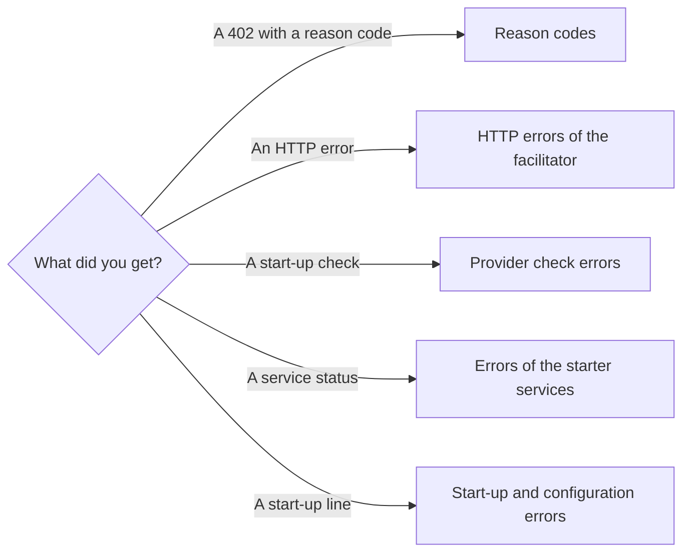

export const meta = {
  title: "Errors and reason codes",
  description: "Every reason code of the z402 protocol and every HTTP error of the facilitator, with what it means and what to do about it.",
};

Errors reach you from several places. This page lists each one, says what it means, and says what to do.



| Where | What you see | Section |
| --- | --- | --- |
| `POST /verify` and `POST /settle` | HTTP 200 with `invalidReason` or `errorReason` | [Reason codes](#reason-codes) |
| The agent, after a refused verify | HTTP 402 whose `PAYMENT-REQUIRED` header carries the reason code as `error` | [Reason codes](#reason-codes) |
| The other facilitator routes | HTTP 400, 401, 403, 404, 409 or 500 with `{ "error": "<code>" }` | [HTTP errors of the facilitator](#http-errors-of-the-facilitator) |
| A resource server at start-up | A `ProviderCheckError` with a `field` and `retryable` | [Provider check errors](#provider-check-errors) |
| A starter service | A status and `{ "error": "<code>" }` | [Errors of the starter services](#errors-of-the-starter-services) |
| A process at start | One line on stderr that names the variable | [Start-up and configuration errors](#start-up-and-configuration-errors) |

## Reason codes

The facilitator answers `POST /verify` and `POST /settle` with HTTP 200 whatever happens. A refusal is a reason code in the body: `invalidReason` for a verify, `errorReason` for a settle. Both use the same closed list of 19 codes, 8 from the x402 standard and 11 of this scheme. The facilitator emits nothing else, and a client treats a code it does not know as fatal.

Only the code reaches the agent, so the code carries the action. A refused verify arrives as a 402 whose `PAYMENT-REQUIRED` header has the code as `error`, and, for this scheme, the session snapshot in `accepts[0].extra.session`. That is the corrective 402: it is the only way a refused client learns its limits. A refused settle arrives as the `errorReason` of the settlement result.

An `invalidMessage` or `errorMessage` accompanies each code. A message names a field and a rule and never a value.

### Standard codes

| Code | When | What the client does |
| --- | --- | --- |
| `invalid_payload` | The body is not a JSON object, is not JSON, or is over 64 KB. The payload or the requirements fail the x402 v2 schema. `accepted` is not an object. The voucher is malformed: a hex field in uppercase or of the wrong length, a `cumulativeZat` that is not canonical, a bad `depositTxid`. The message names the first field and rule. | Fatal. A bug or a version mismatch. |
| `invalid_payment_requirements` | The requirements are not this rail's for this key: `payTo` is not the key's provider, `amount` is not a canonical zat from 1 to `windowZat`, the scheme, network or asset differ, or `extra` does not carry exactly the rail's terms. | Fatal. The resource server drifted from the facilitator. |
| `invalid_network` | `accepted.network` differs from `paymentRequirements.network`. | Fatal. |
| `invalid_scheme` | `accepted.scheme` differs from `paymentRequirements.scheme`. | Fatal. |
| `unsupported_scheme` | The requirements name a version, scheme and network that this facilitator does not serve. | Fatal. |
| `invalid_x402_version` | `paymentPayload.x402Version` is not 2. | Fatal. |
| `unexpected_verify_error` | A verify failed inside the facilitator, or the facilitator is waiting for a restart after a failed ledger write. | Back off 1 s, then try again once. |
| `unexpected_settle_error` | The same for a settle, or the ledger refused the batch. | Back off 1 s, then try again once. |

### Scheme codes

| Code | When | What the client does |
| --- | --- | --- |
| `z402_awaiting_confirmation` | The new total is over the limit, and a live pending deposit exists. `cumulativeZat <total> is over the limit <limit> until a deposit confirms`. | Never deposit. Wait until the pending deposit has one confirmation, then try again. |
| `z402_deposit_required` | The new total is over the limit, and nothing is pending. `cumulativeZat <total> is over the limit <limit> with nothing pending`. | Make a deposit, then try again. A client that is not allowed another deposit stops. |
| `z402_cumulative_mismatch` | The total did not advance by at least this call's price. `cumulativeZat must be at least <last total plus the price>`. | Resync the total from `session.cumulativeZat`, then try again. |
| `z402_invalid_signature` | The Ed25519 signature does not verify over the scheme, network, `payTo`, session key and total. `the voucher signature does not verify`. | Fatal. Report it. |
| `z402_deposit_not_found` | The chain showed no such transaction for the whole wait, 30 s by default. `the chain has no such tx`. | Keep the txid. Check the wallet's own status, back off, then try again. |
| `z402_chain_unavailable` | lightwalletd gave no definitive answer, the lookup queue was full, or a deposit past its expiry has not been read again yet. `the chain is unreadable`, `not looked up`, or `the deposit has not been read since its expiry`. | Keep the txid. Back off 5 s, then try again. |
| `z402_deposit_memo_mismatch` | The transaction was found, and this session cannot use it: no output decrypts to the provider's address, no output carries this session's memo, or the txid is credited to another session. One code and one message, `the deposit cannot be credited`, for all three, so an answer never says whether a transaction pays the provider. | Drop the txid. Fatal: report it. Usually a wrong `payTo`, or a bug. |
| `z402_deposit_transparent` | The transaction has a transparent input or output. Deposits must be shielded. | Drop the txid. Fatal: report it. |
| `z402_deposit_dead` | The deposit expired unmined, was dropped, or was orphaned. `the deposit is dead`. | Drop the txid, make a new deposit, then try again. |
| `z402_deposit_not_to_merchant`, `z402_deposit_other_session` | In the list, but not emitted since protocol v1.2: those cases answer `z402_deposit_memo_mismatch`. | Treated like `z402_deposit_memo_mismatch`. |

A deposit is acknowledged only by a successful settle. A snapshot that comes with a refusal is projected and informational, and the client never reads a deposit listed in it as an acknowledgement.

### Reading the codes as an operator

Most codes are the agent's business. A few point at your facilitator or at a resource server you run:

- **`invalid_payment_requirements`, for every call of one provider.** That provider's resource server has stale terms, a price outside 1 to `windowZat`, or a `payTo` that is not the one its key is registered to. Check the key with `GET /providers/me`, and restart the server after any change to the terms.
- **`unsupported_scheme`.** A resource server points at a facilitator on another network.
- **`z402_chain_unavailable`, in numbers.** The facilitator cannot read the chain. Check the lightwalletd endpoint and `Z402_LWD_URL`.
- **`z402_deposit_not_found`.** The deposit has not reached the endpoint the facilitator reads. On a load-balanced public endpoint, backends see a new transaction up to about 16 s apart.
- **`unexpected_verify_error` and `unexpected_settle_error`.** The facilitator's log has the cause, on a line that starts with `verify failed unexpectedly` or `settle failed unexpectedly`. If the message says the facilitator must restart, a ledger write failed. The process logs `the ledger cannot be written, exiting so that a restart replays it` and exits 1.
- **`z402_deposit_memo_mismatch` for a client that did deposit.** The client paid an address that is not the provider's, or its memo does not carry the session key it vouchers with.

## HTTP errors of the facilitator

Outside `/verify` and `/settle`, an error is an HTTP status with a JSON body. The body is `{ "error": "<code>", "message": "<text>" }`, and some have no `message`. [Facilitator API](/docs/reference/facilitator-api) has the routes.

| Status | `error` | Where | Meaning and what to do |
| --- | --- | --- | --- |
| 400 | `invalid_request` | `POST /providers`, `POST /discovery/resources`, `GET /discovery/resources`, `GET /discovery/search` | A field is missing or invalid, or the body is not JSON or is over 64 KB. The `message` names the field and the rule. A refused declaration also carries the item's `index`. Fix the field and send it again. |
| 401 | `unauthorized` | `POST /verify`, `POST /settle`, `GET /providers/me`, `POST /discovery/resources` | The API key is missing, unknown, or was rotated out. The answer has `WWW-Authenticate: Bearer`. Use the current key. A resource server that gets this from `/verify` shows `Facilitator ... failed (401)`. |
| 401 | `unauthorized` | `GET /supported`, `GET /discovery/resources`, `GET /discovery/search` | The request carried a key that names no provider. These routes need no key, so leave the header out or send a valid one. |
| 401 | `unauthorized`, with `message` | `POST /providers` | The facilitator has a registration token and the request did not carry it: `registration needs the registration token as a bearer token`. Send `Authorization: Bearer <registration token>`. |
| 403 | `not_owner` | `POST /providers` | The viewing key does not own `payTo`, or `payTo` has a transparent receiver. Take both from the same keys file, and use the Orchard-only address. |
| 403 | `provider_limit` | `POST /providers` | `Z402_MAX_PROVIDERS` is reached and the address is new: `the limit of <n> providers is reached`. The operator raises it. |
| 403 | `registration_disabled` | `POST /providers` | The facilitator has no providers directory: `this facilitator has no providers directory`. Only an embedded or test facilitator does. |
| 404 | `not_found` | Any other path or method | The route does not exist. A wrong method on a known path is a 404 too. |
| 409 | `operator` | `POST /providers` | `payTo` is the operator's own address, which is never registered. A provider needs keys of its own. |
| 500 | `internal_error` | Any route | Something failed that the caller did not cause. The body has no detail. The cause is in the facilitator's log. A registration that gets a 500 changed nothing, and can be sent again. |

### Declaration refusals

A refused `POST /discovery/resources` is a 400 with the item's `index`. One bad item refuses the whole call and nothing is applied. The message is a path and a rule:

| Message | What it asks for |
| --- | --- |
| `body: must be a JSON object` | A JSON object with an `items` array. |
| `items: must be an array of 1 to 32 resources` | One to 32 items per call. |
| `items[i].resource: must be an absolute http(s) URL of at most 2048 characters, without userinfo` | A plain absolute URL. |
| `items[i].type: must be "http"` and `items[i].x402Version: must be 2` | The fixed values. |
| `items[i].accepts: must be an array of 1 to 4 entries` | One to four payment options. |
| `items[i].accepts[j].scheme: must be prepaid-voucher` | The scheme of this rail. |
| `items[i].accepts[j].network: must be <network>` | The facilitator's network. |
| `items[i].accepts[j].asset: must be ZEC` | The asset. |
| `items[i].accepts[j].payTo: must be the payTo of this provider` | The address the key is registered to. |
| `items[i].accepts[j].amount: must be a canonical zat amount from 1 to <windowZat>` | A price the facilitator would accept. |
| `items[i].accepts[j].maxTimeoutSeconds: must be a positive number` | A positive number. |
| `items[i].accepts[j].extra: must carry the terms of the rail` | The four terms of `GET /supported`. |
| `items[i].accepts[j].extra.termsVersion: must be the termsVersion of the rail` | The current `termsVersion`. Restart the service, which reads it at start. |
| `items[i].description: must be a string of at most 512 characters` | At most 512, and 128 for `mimeType`. |
| `items[i].serviceName: must be 1 to 32 printable ASCII characters` | The same rule for each tag, `items[i].tags[k]`. |
| `items[i].tags: must be an array of at most 5 tags` or `must hold at most 5 distinct tags` | At most five tags that differ without regard to case. |
| `items[i].iconUrl: must be an http(s) URL of at most 2048 characters, without userinfo, on a named host` | No IP literal and no loopback host. |
| `items[i].extensions: must be a JSON object` or `must be at most 8192 bytes as JSON` | A plain object of at most 8 KB. |
| `items[i].extensions.bazaar.info.input.method: must be one of GET, POST, PUT, PATCH, DELETE, HEAD` | A known HTTP method. |
| `items[i]: this provider already lists 128 resources` or `the catalog already lists 4096 resources` | The caps. A new item is refused. |

### Query refusals

| Message | Cause |
| --- | --- |
| `limit: must be a non-negative decimal integer` | `limit` is not a decimal number. A valid `limit` is clamped to 1 to 100. |
| `offset: must be a non-negative decimal integer` | `offset` is not a decimal number. |
| `<name>: must be given once, as a string` | A parameter was repeated. |
| `<name>: is too large` | A number of more than 15 digits. |
| `query: is required` or `query: must be 1 to 256 characters` | `GET /discovery/search` needs a query of that length. |
| `cursor: must be a non-negative decimal integer` | `cursor` is not a decimal number. Use the cursor the last answer returned. |

## Errors that other layers add

The x402 SDK and the resource server put a few strings of their own in a 402. None of them is a facilitator code, and a client treats each as fatal:

| `error` of the 402 | Meaning |
| --- | --- |
| `Payment required` | The request had no `PAYMENT-SIGNATURE`, or it could not be decoded. This is the first 402 of every paid call. |
| `No matching payment requirements` | The `accepted` entry of the payment was altered, and matches none of the resource's requirements. |
| `Facilitator ... failed (<status>)` | The resource server could not use the facilitator. After a 401, its API key is wrong, missing or was rotated: set `Z402_FACILITATOR_TOKEN`. |

A facilitator that does not answer in time reaches the agent as an HTTP 502 with neither `PAYMENT-REQUIRED` nor `PAYMENT-RESPONSE`. That is an ambiguous outcome, not a refusal: the client cannot tell whether the call was charged, so it counts the call as paid.

## Provider check errors

A resource server calls `checkProvider` from `@z402/server` before it starts, to prove that its API key and its `payTo` belong together. A failure is a `ProviderCheckError`. Branch on `field` and `retryable`, never on the message. The message never echoes the key.

| Outcome | `field` | `retryable` | What to do |
| --- | --- | --- | --- |
| A connection error, a timeout, a body that breaks off, a 5xx, a 408 or a 429 | `facilitatorUrl` | true | The facilitator is starting or briefly down. Wait and ask again. The starter services retry for `Z402_FACILITATOR_WAIT_MS`, 120 s by default. |
| A 404, any other status, or a 200 with an unreadable body | `facilitatorUrl` | false | The URL is not a facilitator of this rail. Check `Z402_FACILITATOR_URL`. |
| A 401 or a 403 | `facilitatorToken` | false | The key is missing, unknown or rotated out. Check `Z402_FACILITATOR_TOKEN`. |
| A 200, but for another `payTo` or network | `payTo` | false | The key belongs to another address, or the facilitator serves another network. Check `Z402_PAY_TO` and `Z402_NETWORK`. |
| Before any request: a URL that is not `http(s)` or that carries a user name or password | `facilitatorUrl` | false | Fix the URL. Use the token for credentials. |
| Before any request: a key that is not one b64token | `facilitatorToken` | false | Fix the key. It is letters, digits and `-._~+/`. |

```ts title="check-key.ts"
import { checkProvider, ProviderCheckError } from "@z402/server";

try {
  await checkProvider({
    facilitatorUrl: "https://facilitator.example.com",
    token: process.env.Z402_FACILITATOR_TOKEN,
    payTo: process.env.Z402_PAY_TO ?? "",
    network: "zcash:regtest",
  });
} catch (e) {
  if (e instanceof ProviderCheckError && e.retryable) {
    console.error(`facilitator not ready (${e.field}), try again`);
  } else {
    throw e;
  }
}
```

## Errors of the starter services

Each starter service refuses everything it can before the agent sends a voucher, so a refused call is never charged. A failure after the voucher is counted as paid by the client, which is why those are rare. Each service page has its own table.

| Status | `error` | Service | Meaning |
| --- | --- | --- | --- |
| 404 | `not_found` | Every service | A spelling of a paid path that the router would not serve, such as a trailing slash or `//v1/generate`. |
| 405 | `method_not_allowed` | Every service | A method the route does not serve. The `Allow` header says which one it does. |
| 409 | `payment_in_flight` | Every service | The same voucher is already paying for a call. |
| 503 | `not_ready` | Every service | The service is not ready: the model provider does not list the model, or the chain tip is not known. Readiness is cached for 5 s. |
| 400 | `invalid_request` | `llm`, `embeddings` | The body is not valid. The `message` says why. |
| 400 | `invalid_url` | `markdown` | No `url`, not an absolute http(s) URL, credentials in it, or a port that is not allowed. |
| 400 | `empty_body`, `bad_request` | `dropbox` | An upload with no body, or an id that is not valid percent-encoding. |
| 403 | `blocked_address` | `markdown` | The host, or a redirect, leads to an address that is not public. |
| 404 | `unknown_stream` | `llm` | The stream id is not known. |
| 404 | `unknown_drop` | `dropbox` | A hold for a drop that is unknown or expired. |
| 409 | `stream_busy` | `llm` | Another call on this stream is in flight. |
| 409 | `hold_cap_reached` | `dropbox` | A hold would take the drop past `DROPBOX_MAX_HOLD_BLOCKS` beyond the tip. |
| 410 | `stream_finished` | `llm` | Every chunk was delivered. |
| 413 | `body_too_large` | `llm` | The request body is too large. |
| 413 | `too_many_tokens` | `embeddings` | The inputs hold more characters than `EMBEDDINGS_MAX_CHARS` or `EMBEDDINGS_MAX_INPUT_CHARS`, or the body is too large. |
| 413 | `too_large` | `markdown`, `dropbox` | A page body over `MARKDOWN_MAX_BYTES`, a page too heavy to convert, or an upload over `DROPBOX_MAX_BYTES`. |
| 415 | `unsupported_content_type` | `markdown` | The page is not `text/html`, `application/xhtml+xml` or `text/plain`. |
| 415 | `not_encrypted`, `unsupported_encoding` | `dropbox` | The upload is not shaped like an age file, or has a `Content-Encoding`. |
| 429 | `rate_limited` | `markdown`, `dropbox` | Over the per-client rate. `Retry-After` says when to try again. |
| 502 | `fetch_failed`, `convert_failed` | `markdown` | The page could not be fetched or converted. |
| 502 | `provider_failed` | `llm`, `embeddings` | The model provider failed. |
| 503 | `busy` | `markdown` | The fetch limit is reached, or the cache is full of pages held for paid retries. |
| 503 | `too_many_streams`, `stream_closed` | `llm` | The stream limit is reached, or the service is shutting down. |
| 504 | `fetch_timeout` | `markdown` | No complete answer from the page within `MARKDOWN_TIMEOUT_MS`. |
| 504 | `chunk_timeout` | `llm` | The chunk took longer than `LLM_CHUNK_TIMEOUT_MS`. |
| 507 | `storage_full` | `dropbox` | The drops on disk would pass `DROPBOX_MAX_TOTAL_BYTES`. |

The demo API answers an unpaid request of any method with a 402, and a paid request that is not a `GET` with a 405 and `Allow: GET`, after verification and before any settlement.

## Start-up and configuration errors

A process that is misconfigured exits 1 with one line on stderr that names the variable at fault and never quotes a secret.

| Component | Line starts with | Where the causes are |
| --- | --- | --- |
| The facilitator | `facilitator:` | [Run the facilitator](/docs/guides/run-a-facilitator#start-up-checks) lists each message, cause and fix. |
| The demo API | `api:` | [Configuration](/docs/reference/configuration#demo-api). |
| A starter service | `llm:`, `markdown:`, `embeddings:`, `dropbox:` | [Configuration](/docs/reference/configuration#resource-servers). |
| `scripts/register-provider.mjs` | `error:`, exit 1 refused or failed, exit 2 a usage error | [Run the facilitator](/docs/guides/run-a-facilitator#register-providers). |
| The `markdown-register` job | `register-provider:` | [Deploy with Docker](/docs/guides/deploy-with-docker#provider-2). |

A start-up check of the facilitator reads `startup check failed (<check>): <detail>`, where the check is `self-test`, `owns`, `ownedByKey`, `hasTransparent`, `network` or `consensusBranchId`. A ledger problem starts with `ledgerPath:`, a registry problem with `providersDir:`, and a listen problem with `port:` or `host:`.

## References

- <Source path="packages/protocol/src/reasons.ts" />: the closed list of 19 reason codes.
- <Source path="packages/facilitator/src/scheme.ts" />: when each code is emitted, and its message.
- <Source path="packages/facilitator/src/core/evaluate.ts" />: how a deposit is judged.
- <Source path="packages/facilitator/src/app.ts" />: the HTTP error bodies, the 401 challenge and the 404 and 500 fallbacks.
- <Source path="packages/facilitator/src/providers/register.ts" />: the registration refusals.
- <Source path="packages/facilitator/src/discovery/validate.ts" />: the declaration and query refusals.
- <Source path="packages/server/src/provider.ts" />: `checkProvider` and `ProviderCheckError`.
- <Source path="packages/facilitator/src/startup.ts" />: the start-up check messages.
- <Source path="packages/facilitator/src/config.ts" />: the configuration messages.
- <Source path="docker/register-provider.mjs" />: the messages of the registration job.
- <Source path="services/README.md" />: the starter services' refusals before payment.
- <Source path="docs/spec/protocol.md" />: section 8, the reason codes and the client actions.
- <Source path="docs/superpowers/specs/2026-10-28-z402-multi-provider-design.md" />: sections 4.1 to 4.4 and 4.6.
