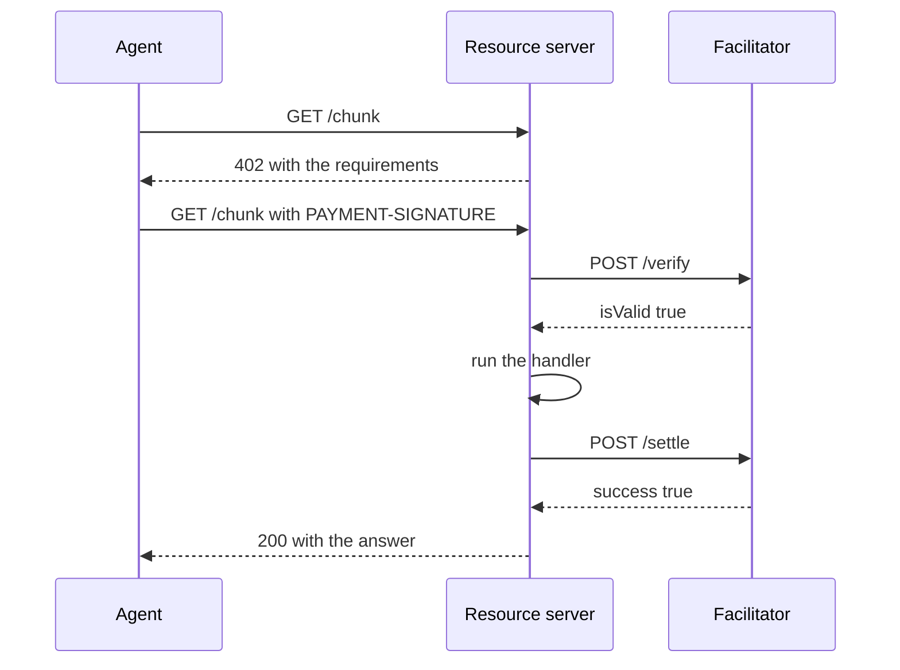

export const meta = {
  title: "Facilitator API",
  description: "Every route of the z402 facilitator: authentication, request and response shapes, status codes and examples.",
};

The facilitator is an HTTP service with eight routes. Resource servers call `POST /verify` and `POST /settle` for every paid request. Providers register with `POST /providers` and list their paid routes with `POST /discovery/resources`. Anyone can read the supported terms and the public catalog.

You rarely call these routes by hand. The stock x402 packages (`@x402/express`, `@x402/core`) call `/verify` and `/settle` for a resource server. At start-up, the demo API and `@z402/service-kit` call `checkProvider` from `@z402/server`, which reads `GET /providers/me`. This page is the contract behind them. The wire format of the payment itself is in [Protocol](/docs/reference/protocol).



## Conventions

- **Base URL.** The facilitator's origin, `http://127.0.0.1:4022` by default. It speaks plain HTTP, so put TLS in front of it when it is reachable from outside ([Run the facilitator](/docs/guides/run-a-facilitator#expose-it-safely)).
- **JSON.** Send `Content-Type: application/json`. A body of another type is not read, and the route answers as it does for a body that is not a JSON object. A request body over 64 KB is refused the same way.
- **Amounts** are zat, as decimal strings with no sign, no leading zero and at most 16 digits, up to 2,100,000,000,000,000. Heights, confirmations and counts are JSON numbers.
- **Networks** are `zcash:regtest`, `zcash:testnet` or `zcash:mainnet`. One facilitator serves one network.
- **`/verify` and `/settle` always answer HTTP 200.** A refusal is in the body, as `invalidReason` or `errorReason`. Only a missing or unknown key (401), an unknown route (404) and an unforeseen failure (500) are not 200. A 4xx has no place in the x402 response schema, and a 500 would leak its body into the client's error.
- **Other errors** are `{ "error": "<code>", "message": "<text>" }`. Some have no `message`. A wrong method on a known path is a 404, not a 405.
- **No CORS headers.** Browsers read the catalog through the website, which proxies the two public reads.
- **Logs** record the path of a request and never its query string, so what an agent searches for stays private.

## Authentication

Three kinds of caller reach the facilitator, and each route says which it needs.

| Auth | Header | Used by |
| --- | --- | --- |
| `public` | None | `GET /supported`, `GET /discovery/resources`, `GET /discovery/search`. A request that does carry a key must carry one that belongs to a provider, or it gets 401. |
| `api-key` | `Authorization: Bearer <API key>` | `POST /verify`, `POST /settle`, `GET /providers/me`, `POST /discovery/resources`. |
| `registration-token` | `Authorization: Bearer <registration token>` | `POST /providers`, but only when the facilitator sets `Z402_REGISTRATION_TOKEN`. Otherwise the route is public. |

- **The API key picks the provider.** Its scheme refuses any `paymentRequirements.payTo` that is not that provider's. The operator's key is `Z402_FACILITATOR_TOKEN`. Every other provider gets a key from `POST /providers`.
- **Key format.** An issued key is `z402_` followed by 43 base64url characters, 32 random bytes. Every key and token must be an RFC 6750 b64token: letters, digits and `-._~+/`, optionally ending in `=`. The word `Bearer` can be in any letter case, followed by one or more spaces.
- **Keys are stored only as hashes, and never logged.** The facilitator keeps the SHA-256 of a key. Request lines in its log name the provider id instead.
- **A failed key check** answers `401` with `WWW-Authenticate: Bearer` and the body `{ "error": "unauthorized" }`. A key that was rotated out gets this answer from the moment it is rotated.

## Routes at a glance

| Method and path | Auth | What it does |
| --- | --- | --- |
| `GET /supported` | public | The scheme, network, trust terms and extensions this rail supports. |
| `POST /verify` | api-key | Checks a voucher. Reads state and writes none. |
| `POST /settle` | api-key | Records a voucher against the provider's ledger. |
| `POST /providers` | registration-token | Registers a provider, or rotates its key. |
| `GET /providers/me` | api-key | The provider a key belongs to. |
| `POST /discovery/resources` | api-key | Declares the caller's paid routes to the catalog. |
| `GET /discovery/resources` | public | Lists the catalog, with filters and paging. |
| `GET /discovery/search` | public | Searches the catalog. |

## Read the supported terms

<Endpoint method="GET" path="/supported" auth="public">

What this rail supports. A resource server reads it when it starts: the trust terms go into every 402 it sends.

</Endpoint>

```bash
curl -s http://127.0.0.1:4022/supported
```

```json
{
  "kinds": [
    {
      "x402Version": 2,
      "scheme": "prepaid-voucher",
      "network": "zcash:regtest",
      "extra": {
        "windowZat": "100000",
        "creditRatioBps": 2500,
        "creditCapZat": "200000",
        "zeroConfMinExpiryBlocks": 20,
        "termsVersion": "0123456789abcdef"
      }
    }
  ],
  "extensions": ["bazaar"],
  "signers": { "zcash:*": [] }
}
```

| Field | Meaning |
| --- | --- |
| `kinds[0].extra` | The trust terms of the whole rail, the same for every provider. See [Prepaid vouchers](/docs/concepts/prepaid-vouchers) for what they do. |
| `extra.termsVersion` | The first 16 hex characters of the SHA-256 of the JSON `["z402-terms-v2", <terms>]`. It names the terms only, so it does not move with a provider or a price. |
| `extensions` | `bazaar`: the facilitator hosts the catalog. |
| `signers` | Always `{ "zcash:*": [] }`. There is no on-chain signer. |

`extra` carries no `payTo`. Each provider has its own, which you read with `GET /providers/me`.

## Verify a payment

<Endpoint method="POST" path="/verify" auth="api-key">

Checks one voucher against the deposits of the provider the key belongs to. It reads state and never writes payment state. It answers HTTP 200 whatever the outcome.

</Endpoint>

<Params>
<Param name="paymentPayload" type="object" required>What the agent sent in its `PAYMENT-SIGNATURE` header, decoded.</Param>
<Param name="paymentPayload.x402Version" type="number" required>Must be `2`. Any other value is refused as `invalid_x402_version`.</Param>
<Param name="paymentPayload.accepted" type="object" required>The requirements entry the agent chose. Its `scheme` and `network` must equal those of `paymentRequirements`.</Param>
<Param name="paymentPayload.payload" type="object" required>The voucher. See the fields below.</Param>
<Param name="paymentPayload.payload.sessionKey" type="string" required>The agent's session key: 64 lowercase hex characters, a raw Ed25519 public key.</Param>
<Param name="paymentPayload.payload.cumulativeZat" type="string" required>The running total the agent has signed for, in zat, canonical.</Param>
<Param name="paymentPayload.payload.sig" type="string" required>The Ed25519 signature: 128 lowercase hex characters.</Param>
<Param name="paymentPayload.payload.depositTxid" type="string">The deposit transaction, 64 lowercase hex characters in display order. Present until the facilitator acknowledges the deposit.</Param>
<Param name="paymentPayload.resource" type="object">The resource the agent paid for. After a settle, the catalog reads `resource.url` from it.</Param>
<Param name="paymentPayload.extensions" type="object">Extensions the agent echoed. After a settle, the catalog reads `extensions.bazaar` from it.</Param>
<Param name="paymentRequirements" type="object" required>The resource server's own requirements for the route, not the agent's copy. See [Payment requirements](#payment-requirements).</Param>
</Params>

A request can also carry a top-level `x402Version`. The SDK sends it, and the facilitator reads only the one inside `paymentPayload`.

```bash
curl -s http://127.0.0.1:4022/verify \
  -H "authorization: Bearer $Z402_API_KEY" \
  -H 'content-type: application/json' \
  --data @verify.json
```

```json title="verify.json"
{
  "x402Version": 2,
  "paymentPayload": {
    "x402Version": 2,
    "resource": { "url": "http://127.0.0.1:4021/chunk" },
    "accepted": {
      "scheme": "prepaid-voucher",
      "network": "zcash:regtest",
      "asset": "ZEC",
      "amount": "500",
      "payTo": "uregtest1...",
      "maxTimeoutSeconds": 60,
      "extra": {
        "windowZat": "100000",
        "creditRatioBps": 2500,
        "creditCapZat": "200000",
        "zeroConfMinExpiryBlocks": 20,
        "termsVersion": "0123456789abcdef"
      }
    },
    "payload": {
      "sessionKey": "03a107bff3ce10be1d70dd18e74bc09967e4d6309ba50d5f1ddc8664125531b8",
      "cumulativeZat": "500",
      "sig": "...128 hex characters...",
      "depositTxid": "...64 hex characters..."
    }
  },
  "paymentRequirements": {
    "scheme": "prepaid-voucher",
    "network": "zcash:regtest",
    "asset": "ZEC",
    "amount": "500",
    "payTo": "uregtest1...",
    "maxTimeoutSeconds": 60,
    "extra": {
      "windowZat": "100000",
      "creditRatioBps": 2500,
      "creditCapZat": "200000",
      "zeroConfMinExpiryBlocks": 20,
      "termsVersion": "0123456789abcdef"
    }
  }
}
```

**What it checks, in order:**

1. The key names a provider, or the answer is 401.
2. The body is a JSON object whose `paymentPayload` and `paymentRequirements` fit the x402 v2 schemas (`invalid_payload`), and `paymentPayload.x402Version` is 2 (`invalid_x402_version`).
3. The requirements fit the rail (`invalid_payment_requirements`): scheme `prepaid-voucher`, the facilitator's network, asset `ZEC`, `payTo` equal to the key's provider, `amount` a canonical zat from 1 to `windowZat`, and `extra` carrying exactly the rail's terms. `termsVersion` is not compared.
4. `accepted.scheme` and `accepted.network` equal the requirements' (`invalid_scheme`, `invalid_network`).
5. The voucher parses (`invalid_payload`) and its signature verifies over the scheme, network, `payTo`, session key and total (`z402_invalid_signature`).
6. The total advances by at least this call's `amount` (`z402_cumulative_mismatch`).
7. If the voucher carries a `depositTxid` that is new to the session, the deposit is looked up on the chain and judged. If the voucher already fits without it, the answer is valid at once and the lookup runs in the background.
8. The total does not pass the session's limit (`z402_awaiting_confirmation`, `z402_deposit_required`).

A verify waits for at most one deposit lookup, up to 30 s, and one refresh of the session, up to 5 s, before it refuses. Give the call a timeout of at least 60 s.

**A valid answer** names the session and carries its snapshot. The snapshot is projected as if the presented deposit were credited:

```json
{
  "isValid": true,
  "payer": "03a107bff3ce10be1d70dd18e74bc09967e4d6309ba50d5f1ddc8664125531b8",
  "extra": {
    "session": {
      "sessionKey": "03a107bff3ce10be1d70dd18e74bc09967e4d6309ba50d5f1ddc8664125531b8",
      "cumulativeZat": "500",
      "limitZat": "100000",
      "headroomZat": "99500",
      "confirmedZat": "0",
      "pendingZat": "100000",
      "creditZat": "0",
      "tip": 214,
      "deposits": [
        {
          "txid": "...64 hex characters...",
          "valueZat": "100000",
          "status": "pending",
          "confirmations": 0,
          "expiryHeight": 254,
          "zeroConf": true
        }
      ]
    }
  }
}
```

**A refusal** has the same shape, with `isValid` false, a reason code and a message. Once the signature has verified, it also carries `payer` and `extra.session`, so the client can resync:

```json
{
  "isValid": false,
  "invalidReason": "z402_deposit_required",
  "invalidMessage": "cumulativeZat 500 is over the limit 0 with nothing pending",
  "payer": "03a107bff3ce10be1d70dd18e74bc09967e4d6309ba50d5f1ddc8664125531b8",
  "extra": {
    "session": {
      "sessionKey": "03a107bff3ce10be1d70dd18e74bc09967e4d6309ba50d5f1ddc8664125531b8",
      "cumulativeZat": "0",
      "limitZat": "0",
      "headroomZat": "0",
      "confirmedZat": "0",
      "pendingZat": "0",
      "creditZat": "0",
      "tip": 214,
      "deposits": []
    }
  }
}
```

`payer` and `extra.session` are absent on `invalid_payload`, `invalid_payment_requirements`, `invalid_network`, `invalid_scheme`, `unsupported_scheme`, `invalid_x402_version`, `z402_invalid_signature` and the `unexpected_*` codes. Those answers come before the voucher is authenticated. Every code is in [Errors and reason codes](/docs/reference/errors#reason-codes).

## Settle a payment

<Endpoint method="POST" path="/settle" auth="api-key">

Records one voucher in the provider's ledger. The resource server calls it after its handler has run. It takes the same request as `/verify` and answers HTTP 200 whatever the outcome.

</Endpoint>

Settle repeats the checks of verify, using only what verify or the background lookup already cached. It never waits on the chain. After the last check, in one synchronous step with no waiting in between, it appends to the ledger, commits the new total, and credits the deposit if one was resolved. Twenty concurrent settles of one voucher give exactly one success.

```json
{
  "success": true,
  "transaction": "...64 hex characters...",
  "network": "zcash:regtest",
  "payer": "03a107bff3ce10be1d70dd18e74bc09967e4d6309ba50d5f1ddc8664125531b8",
  "amount": "500",
  "extra": { "session": { "sessionKey": "03a107bf...", "cumulativeZat": "500", "limitZat": "100000", "headroomZat": "99500", "confirmedZat": "0", "pendingZat": "100000", "creditZat": "0", "tip": 214, "deposits": [ { "txid": "...64 hex characters...", "valueZat": "100000", "status": "pending", "confirmations": 0, "expiryHeight": 254, "zeroConf": true } ] } }
}
```

A refused settle has `success` false, an `errorReason`, an `errorMessage`, an empty `transaction` and no `amount`:

```json
{
  "success": false,
  "errorReason": "z402_cumulative_mismatch",
  "errorMessage": "cumulativeZat must be at least 1000",
  "transaction": "",
  "network": "zcash:regtest",
  "payer": "03a107bff3ce10be1d70dd18e74bc09967e4d6309ba50d5f1ddc8664125531b8",
  "extra": { "session": { "sessionKey": "03a107bf...", "cumulativeZat": "500", "limitZat": "100000", "headroomZat": "99500", "confirmedZat": "0", "pendingZat": "100000", "creditZat": "0", "tip": 214, "deposits": [ { "txid": "...64 hex characters...", "valueZat": "100000", "status": "pending", "confirmations": 0, "expiryHeight": 254, "zeroConf": true } ] } }
}
```

| Field | Meaning |
| --- | --- |
| `success` | True once the voucher is written to the ledger. |
| `transaction` | The `depositTxid` whenever that deposit is credited to this session, on a new credit and on a repeat, so a lost acknowledgement can be sent again. Otherwise an empty string. |
| `network` | The network named by the request's requirements when it is a string of at most 64 characters, otherwise the facilitator's own. |
| `payer` | The session key. Present once the signature has verified. |
| `amount` | The charged delta, the new total minus the last settled one. Omitted on failure. |
| `extra.session` | The session snapshot, success or failure, once the signature has verified. |

A deposit is acknowledged only by a successful settle. The facilitator never answers `settlement_pending`, because the SDK would call `/settle` again.

After a successful settle the facilitator also tells the catalog, so the item that matches the payment gets `paidCallsToday` plus one. A catalog error is logged and never changes the settle answer.

## Register a provider

<Endpoint method="POST" path="/providers" auth="registration-token">

Registers a provider, or rotates the key of one that is registered. Public unless the facilitator sets `Z402_REGISTRATION_TOKEN`, and then `Authorization: Bearer <registration token>` is required.

</Endpoint>

<Params>
<Param name="payTo" type="string" required>The provider's shielded-only unified address for the facilitator's network, such as `uregtest1...`.</Param>
<Param name="uivk" type="string" required>The unified incoming viewing key that owns `payTo`, such as `uivkregtest1...`. It can see payments and cannot spend.</Param>
<Param name="network" type="string">`zcash:regtest`, `zcash:testnet` or `zcash:mainnet`. If given, it must be the facilitator's network.</Param>
</Params>

The facilitator proves that the key owns the address before it accepts either: `zdecrypt owns` must answer `ownedByKey` true and `hasTransparent` false. Registrations run one at a time. For a new address, the provider's runtime opens first, with its ledger lock, ledger header, replay, first poll and watcher. Only then is the registry written and the key issued.

<CodeTabs>

```bash title="curl"
jq '{payTo: .orchardOnlyAddress, uivk: .uivk, network: ("zcash:" + .network)}' provider.view.json |
  curl -s -X POST http://127.0.0.1:4022/providers \
    -H 'content-type: application/json' \
    --data @-
```

```ts title="register.ts"
const facilitator = "http://127.0.0.1:4022";
const payTo = "uregtest1...";
const uivk = "uivkregtest1...";

const res = await fetch(`${facilitator}/providers`, {
  method: "POST",
  headers: {
    "content-type": "application/json",
    // Only when the facilitator sets Z402_REGISTRATION_TOKEN
    ...(process.env.Z402_REGISTRATION_TOKEN
      ? { authorization: `Bearer ${process.env.Z402_REGISTRATION_TOKEN}` }
      : {}),
  },
  body: JSON.stringify({ payTo, uivk, network: "zcash:regtest" }),
});
if (res.status !== 201 && res.status !== 200) {
  const refusal = (await res.json()) as { error: string; message?: string };
  throw new Error(`registration refused: ${res.status} ${refusal.error}`);
}
const { providerId, apiKey } = (await res.json()) as { providerId: string; apiKey: string };
// Store apiKey now. The facilitator shows it once and keeps only its hash.
```

</CodeTabs>

For a new provider the answer is `201`. For a registered address it is `200`, with a new key, and the old key stops working at once. The answer carries `Cache-Control: no-store`. The viewing key is never echoed.

```json
{
  "providerId": "3f9a1c2b4d5e6f70",
  "network": "zcash:regtest",
  "payTo": "uregtest1...",
  "apiKey": "z402_..."
}
```

<Callout type="warning" title="The key is shown once">

The facilitator stores only the hash of the API key. If you lose it, register again with the same address and viewing key. That rotates the key and returns a new one.

</Callout>

The refusals, in the order the facilitator checks them:

| Status | `error` | When |
| --- | --- | --- |
| 403 | `registration_disabled` | The facilitator has no providers directory, as an embedded or test facilitator has. Nothing else is checked. |
| 401 | `unauthorized` | A registration token is set and the request did not carry it. |
| 400 | `invalid_request` | The body is not a JSON object, or a field is missing or invalid. The `message` names the field. |
| 409 | `operator` | `payTo` is the operator's own address, which is not registered. |
| 403 | `provider_limit` | `Z402_MAX_PROVIDERS` is reached, and this address is new. A rotation is not a new provider. |
| 403 | `not_owner` | The viewing key does not own `payTo`, or `payTo` has a transparent receiver. |
| 500 | `internal_error` | The registration hit an error of the facilitator's own, such as a `zdecrypt` that cannot run, and nothing changed. The body has no `message`. |

## Read your provider

<Endpoint method="GET" path="/providers/me" auth="api-key">

The provider a key belongs to. A resource server calls it when it starts, to prove that its key and its configured `payTo` match.

</Endpoint>

<CodeTabs>

```bash title="curl"
curl -s http://127.0.0.1:4022/providers/me -H "authorization: Bearer $Z402_API_KEY"
```

```ts title="check-key.ts"
import { checkProvider, ProviderCheckError } from "@z402/server";

try {
  await checkProvider({
    facilitatorUrl: "http://127.0.0.1:4022",
    token: process.env.Z402_FACILITATOR_TOKEN,
    payTo: process.env.Z402_PAY_TO ?? "",
    network: "zcash:regtest",
  });
} catch (e) {
  if (e instanceof ProviderCheckError) console.error(e.field, e.retryable);
  throw e;
}
```

</CodeTabs>

```json
{
  "providerId": "3f9a1c2b4d5e6f70",
  "network": "zcash:regtest",
  "payTo": "uregtest1..."
}
```

An unknown key, and a key that was rotated out, get `401` and `{ "error": "unauthorized" }`. `checkProvider` turns each outcome into a `ProviderCheckError` with a `field` and a `retryable` flag. The table is in [Errors and reason codes](/docs/reference/errors#provider-check-errors).

## Declare resources

<Endpoint method="POST" path="/discovery/resources" auth="api-key">

Declares the caller's paid routes to the catalog. A service sends this when it is ready and then every 30 s. The repeat is its liveness signal: `lastSeen` is the time of the latest declaration.

</Endpoint>

<Params>
<Param name="items" type="array" required>One to 32 resources. One bad item refuses the whole call.</Param>
<Param name="items[].resource" type="string" required>An absolute `http` or `https` URL of at most 2,048 characters, with no user name or password. Its query and fragment are dropped.</Param>
<Param name="items[].type" type="string" required>Must be `"http"`.</Param>
<Param name="items[].x402Version" type="number" required>Must be `2`.</Param>
<Param name="items[].accepts" type="array" required>One to four entries. Each must be `prepaid-voucher` on the facilitator's network, asset `ZEC`, with the provider's own `payTo`, an `amount` from 1 to `windowZat`, a positive `maxTimeoutSeconds`, and an `extra` that carries the rail's terms and its `termsVersion`. The catalog never advertises a payment the facilitator would refuse.</Param>
<Param name="items[].description" type="string">At most 512 characters.</Param>
<Param name="items[].mimeType" type="string">At most 128 characters.</Param>
<Param name="items[].serviceName" type="string">1 to 32 printable ASCII characters.</Param>
<Param name="items[].tags" type="string[]">At most five distinct tags of 1 to 32 printable ASCII characters. Duplicates that differ only in case are dropped.</Param>
<Param name="items[].iconUrl" type="string">An `http` or `https` URL of at most 2,048 characters, with no user name or password, on a named host. IP literals and loopback hosts are refused.</Param>
<Param name="items[].extensions" type="object">A JSON object of at most 8 KB, kept as declared. The facilitator reads `bazaar.routeTemplate` and `bazaar.info.input.method`. The method must be GET, POST, PUT, PATCH, DELETE or HEAD, and is GET when absent.</Param>
</Params>

```json title="declare.json"
{
  "items": [
    {
      "resource": "https://md.example.com/v1/markdown",
      "type": "http",
      "x402Version": 2,
      "accepts": [
        {
          "scheme": "prepaid-voucher",
          "network": "zcash:regtest",
          "asset": "ZEC",
          "amount": "1000",
          "payTo": "uregtest1...",
          "maxTimeoutSeconds": 60,
          "extra": {
            "windowZat": "100000",
            "creditRatioBps": 2500,
            "creditCapZat": "200000",
            "zeroConfMinExpiryBlocks": 20,
            "termsVersion": "0123456789abcdef"
          }
        }
      ],
      "description": "Turn a web page into clean markdown.",
      "mimeType": "application/json",
      "serviceName": "URL to markdown",
      "tags": ["markdown", "web"],
      "extensions": {
        "bazaar": { "info": { "input": { "type": "http", "method": "GET" } } },
        "z402": { "unit": "page" }
      }
    }
  ]
}
```

```bash
curl -s http://127.0.0.1:4022/discovery/resources \
  -H "authorization: Bearer $Z402_API_KEY" \
  -H 'content-type: application/json' \
  --data @declare.json
```

The answer is `200` with the items as the catalog serves them:

```json
{
  "x402Version": 2,
  "items": [
    {
      "resource": "https://md.example.com/v1/markdown",
      "type": "http",
      "x402Version": 2,
      "accepts": [ { "scheme": "prepaid-voucher", "network": "zcash:regtest", "asset": "ZEC", "amount": "1000", "payTo": "uregtest1...", "maxTimeoutSeconds": 60, "extra": { "windowZat": "100000", "creditRatioBps": 2500, "creditCapZat": "200000", "zeroConfMinExpiryBlocks": 20, "termsVersion": "0123456789abcdef" } } ],
      "lastUpdated": "2026-10-28T12:00:00.000Z",
      "description": "Turn a web page into clean markdown.",
      "mimeType": "application/json",
      "serviceName": "URL to markdown",
      "tags": ["markdown", "web"],
      "extensions": { "bazaar": { "info": { "input": { "type": "http", "method": "GET" } } }, "z402": { "unit": "page" } },
      "lastSeen": "2026-10-28T12:00:00.000Z",
      "paidCallsToday": 0
    }
  ]
}
```

A refusal names the item and the field. The facilitator never fetches a provider's URL, and it never echoes a value from the item:

```json
{
  "error": "invalid_request",
  "message": "items[0].accepts[0].amount: must be a canonical zat amount from 1 to 100000",
  "index": 0
}
```

How the catalog treats declarations:

- It is keyed by the provider, the canonical resource and the HTTP method. The canonical resource is the URL's origin plus the `bazaar.routeTemplate` when that is valid, otherwise the URL's path. Two providers that list the same URL get two items, each with its own `payTo`.
- Declaring one service never removes another service's items.
- A provider's first declaration removes the items that came from its payments and that the declaration does not itself declare. The facilitator writes that change to disk before it answers.
- After that, the provider's settled payments only update items it declared, and never create one. A payment's `resource.url` and `extensions.bazaar` are echoed by the agent, so without this rule any payer could list a resource under a declaring provider's address for the price of one call.
- A provider that has never declared is listed from its payments, as standard x402 Bazaar facilitators do. Such an item has no `lastSeen`.

## List resources

<Endpoint method="GET" path="/discovery/resources" auth="public">

The catalog, in the shape that the stock Bazaar client's `listResources()` reads. It is ordered by resource, then method, then provider id, so offset pages are stable.

</Endpoint>

<Params>
<Param name="type" type="string">Only `http` items match.</Param>
<Param name="payTo" type="string">Keep items that have an `accepts` entry with this address.</Param>
<Param name="scheme" type="string">Keep items that have an `accepts` entry with this scheme.</Param>
<Param name="network" type="string">Keep items that have an `accepts` entry on this network.</Param>
<Param name="extensions" type="string">One extension key, such as `bazaar`. Keep items that carry it.</Param>
<Param name="limit" type="number">Items per page. Default 20. Clamped to 1 to 100.</Param>
<Param name="offset" type="number">Items to skip. Default 0.</Param>
</Params>

`limit` and `offset` must be non-negative decimal integers, or the answer is `400`. A parameter given twice is refused. Parameters that the route does not know are ignored.

<CodeTabs>

```bash title="curl"
curl -s 'http://127.0.0.1:4022/discovery/resources?type=http&limit=20'
```

```ts title="list-services.ts"
import { HTTPFacilitatorClient } from "@x402/core/server";
import { withBazaar } from "@x402/extensions/bazaar";

const bazaar = withBazaar(new HTTPFacilitatorClient({ url: "http://127.0.0.1:4022" })).extensions.bazaar;
const { items, pagination } = await bazaar.listResources({ type: "http", limit: 20 });

for (const item of items) {
  console.log(item.resource, item.accepts[0]?.amount, item.accepts[0]?.payTo);
}
console.log(`${pagination.total} items in all`);
```

</CodeTabs>

```json
{
  "x402Version": 2,
  "items": [ { "resource": "https://md.example.com/v1/markdown", "type": "http", "x402Version": 2, "accepts": [ { "scheme": "prepaid-voucher", "network": "zcash:regtest", "asset": "ZEC", "amount": "1000", "payTo": "uregtest1...", "maxTimeoutSeconds": 60, "extra": { "windowZat": "100000", "creditRatioBps": 2500, "creditCapZat": "200000", "zeroConfMinExpiryBlocks": 20, "termsVersion": "0123456789abcdef" } } ], "lastUpdated": "2026-10-28T12:00:00.000Z", "lastSeen": "2026-10-28T12:00:20.000Z", "paidCallsToday": 12 } ],
  "pagination": { "limit": 20, "offset": 0, "total": 1 }
}
```

## Search resources

<Endpoint method="GET" path="/discovery/search" auth="public">

What the stock client's `search()` calls. It matches a case-insensitive substring of `resource`, `description`, `serviceName` or any tag.

</Endpoint>

<Params>
<Param name="query" type="string" required>1 to 256 characters.</Param>
<Param name="type" type="string">As for the list.</Param>
<Param name="payTo" type="string">As for the list.</Param>
<Param name="scheme" type="string">As for the list.</Param>
<Param name="network" type="string">As for the list.</Param>
<Param name="extensions" type="string">As for the list.</Param>
<Param name="limit" type="number">Default 20, clamped to 1 to 100.</Param>
<Param name="cursor" type="string">An opaque string, which is a decimal offset. Pass the `cursor` of the last answer to get the next page.</Param>
</Params>

```bash
curl -s 'http://127.0.0.1:4022/discovery/search?query=markdown&limit=10'
```

```json
{
  "x402Version": 2,
  "resources": [ { "resource": "https://md.example.com/v1/markdown", "type": "http", "x402Version": 2, "accepts": [ { "scheme": "prepaid-voucher", "network": "zcash:regtest", "asset": "ZEC", "amount": "1000", "payTo": "uregtest1...", "maxTimeoutSeconds": 60, "extra": { "windowZat": "100000", "creditRatioBps": 2500, "creditCapZat": "200000", "zeroConfMinExpiryBlocks": 20, "termsVersion": "0123456789abcdef" } } ], "lastUpdated": "2026-10-28T12:00:00.000Z", "lastSeen": "2026-10-28T12:00:20.000Z", "paidCallsToday": 12 } ],
  "partialResults": false,
  "pagination": { "limit": 10, "cursor": null }
}
```

`pagination.cursor` is `null` on the last page. The facilitator does not need this route for discovery: the site and the demo agent read the whole list from `GET /discovery/resources` and filter on their own side, so nobody learns what they look for.

## Objects

### Payment requirements

One entry of `accepts`, and the `paymentRequirements` of a verify and a settle.

| Field | Rule |
| --- | --- |
| `scheme` | `prepaid-voucher`. |
| `network` | The facilitator's network. |
| `asset` | `ZEC`. |
| `amount` | The price of this call in zat, canonical, from 1 to `extra.windowZat`. The provider sets it per route. |
| `payTo` | The shielded-only unified address of the provider the key belongs to. |
| `maxTimeoutSeconds` | A positive number. The demo services use 60. |
| `extra.windowZat` | The size of one deposit, in zat. |
| `extra.creditRatioBps` | Credit on confirmed deposits, 0 to 10,000 basis points. |
| `extra.creditCapZat` | The most credit one session can hold, in zat. |
| `extra.zeroConfMinExpiryBlocks` | An unconfirmed deposit earns zero-conf credit only with at least this many blocks left before it expires. |
| `extra.termsVersion` | The first 16 hex characters of the terms hash. Copied from `GET /supported`. |

### Session snapshot

`extra.session` in every answer after the signature verifies.

| Field | Meaning |
| --- | --- |
| `sessionKey` | The session's key, 64 hex characters. |
| `cumulativeZat` | The last settled total, in zat. |
| `limitZat` | The most the facilitator accepts as a total right now. |
| `headroomZat` | `limitZat` minus `cumulativeZat`. |
| `confirmedZat`, `pendingZat`, `creditZat` | The three parts of the limit. |
| `tip` | The chain tip the snapshot was judged at. |
| `deposits` | Every deposit that is not final, plus the last four final ones. Each has `txid`, `valueZat`, `status` (`pending`, `confirmed`, `final`, `orphaned` or `dead`), `confirmations`, `expiryHeight` and `zeroConf`. |

A snapshot carried by a refusal is projected and informational. Only a successful settle acknowledges a deposit.

### Catalog item

The standard x402 Bazaar item, plus two fields the facilitator adds.

| Field | Meaning |
| --- | --- |
| `resource`, `type`, `x402Version`, `accepts` | As declared. `type` is `http` and `x402Version` is 2. |
| `lastUpdated` | The time of the latest paid call, or of the first listing if there is none. ISO 8601. |
| `description`, `mimeType`, `serviceName`, `tags`, `iconUrl`, `extensions` | As declared, when present. |
| `lastSeen` | The time of the provider's latest declaration. Absent for an item listed only from payments. Readers call an item up under 90 s, stale under 10 min and down after that. |
| `paidCallsToday` | The successful settles for the item since 00:00 UTC. An aggregate only: no session, key or amount per call is ever exposed. |

## Limits

| Limit | Value |
| --- | --- |
| Request body | 64 KB |
| Providers | 32 by default, the operator not counted (`Z402_MAX_PROVIDERS`, up to 1,000) |
| Items per declaration call | 1 to 32 |
| Items per provider, and in all | 128, and 4,096 |
| `accepts` entries per item | 1 to 4 |
| `extensions` of one item | 8 KB of JSON |
| List page size | 1 to 100, default 20 |
| Search query | 1 to 256 characters |
| Deposit lookup wait inside a verify | Up to 30 s |
| Session refresh wait inside a verify | Up to 5 s |
| Chain poll | Every 5 s per provider, from one tip cached for 1 s |
| Deposit lookups per provider | 4 at once, 16 waiting. More get `z402_chain_unavailable` without a chain read |
| `zdecrypt` runs | 8 at once across all providers |
| Catalog file write | At most every 2 s, and a provider's first declaration at once |
| Unseen catalog items | Dropped at load after 7 days with no declaration and no payment |

Past the item caps, a declaration for a new item is refused with a 400, and a payment does not create one. Either way the facilitator logs it once. The public routes have no rate limit.

## Status codes

| Status | Where | Meaning |
| --- | --- | --- |
| 200 | Every route | The request was understood. For `/verify` and `/settle` the answer may still be a refusal. |
| 201 | `POST /providers` | A new provider was registered. |
| 400 | `POST /providers`, `POST /discovery/resources`, the two catalog reads | `invalid_request`. The `message` names the field and the rule, never a value. A declaration refusal also carries the item's `index`. |
| 401 | Every route that takes a key | `unauthorized`, with `WWW-Authenticate: Bearer`. The key is missing or unknown, or the registration token is wrong. |
| 403 | `POST /providers` | `not_owner`, `provider_limit` or `registration_disabled`. |
| 404 | Any other path or method | `not_found`. |
| 409 | `POST /providers` | `operator`. |
| 500 | Anything unforeseen | `internal_error`, with no detail. The cause is in the facilitator's log. |

## References

- <Source path="packages/facilitator/src/app.ts" />: the routes, the key check and the answers.
- <Source path="packages/facilitator/src/scheme.ts" />: verify, settle and every reason code.
- <Source path="packages/facilitator/src/providers/register.ts" />: registration and its refusals.
- <Source path="packages/facilitator/src/providers/apiKey.ts" />: the key format and its hash.
- <Source path="packages/facilitator/src/discovery/catalog.ts" />: the catalog, its sources and its file.
- <Source path="packages/facilitator/src/discovery/validate.ts" />: every rule a declaration and a query must meet.
- <Source path="packages/facilitator/src/discovery/routes.ts" />: the three catalog routes.
- <Source path="packages/server/src/provider.ts" />: `checkProvider`.
- <Source path="packages/protocol/src/reasons.ts" />: the closed list of reason codes.
- <Source path="docs/spec/protocol.md" />: the wire contract.
- <Source path="docs/superpowers/specs/2026-10-28-z402-multi-provider-design.md" />: the multi-provider design, sections 4.1 to 4.4.
- [x402](https://github.com/x402-foundation/x402): the standard and its Bazaar extension.
- [RFC 6750](https://datatracker.ietf.org/doc/html/rfc6750): the bearer token format.
