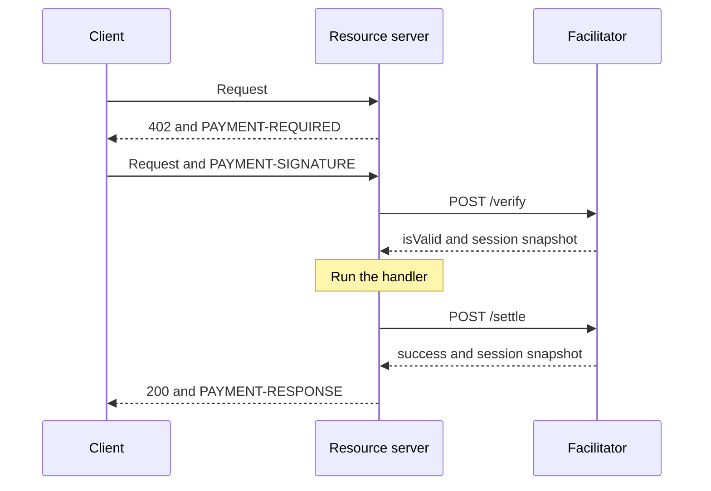

export const meta = {
  title: "Protocol",
  description: "The prepaid-voucher wire format: payment requirements, payload, voucher signature, deposit memo, trust ramp, session snapshot and reason codes.",
};

This page is the wire contract that the client library, the server scheme and the facilitator all build against. Use it to write another client, another resource server or another facilitator for the `prepaid-voucher` scheme. It summarises `docs/spec/protocol.md`, and the section numbers (§) point into that file.

<Callout type="note" title="Versions">

**v2.0** is the contract on `dev`. It turns the facilitator into a rail for many providers, each with its own address and its own price per route, and the facilitator hosts the Bazaar.

Nothing the client sends or signs changed from **v1.2.1**. This page marks each rule that v2.0 changed with **In v2.0**, and [What changes in v2.0](#what-changes-in-v20) lists them side by side.

</Callout>

Each part of this page is one section of the spec:

| Part of this page | Spec section |
| --- | --- |
| Identifiers | §1 |
| Payment requirements | §2 |
| Payment payload | §3 |
| Voucher signature | §4 |
| Deposits | §5 |
| Trust ramp | §6 |
| Facilitator responses | §7 |
| Reason codes | §8 |
| Client rules | §9 |
| Facilitator rules | §10 |
| Chain access, known limits | §11, and the facilitator design §7 |
| What the protocol package exports | §13 |
| What changes in v2.0 | §2, §5.2, §6, §10, §15, §16 and §17 |

## The scheme at a glance

`prepaid-voucher` is a payment scheme for x402 version 2. A client makes one shielded deposit to the provider's address for a window of value, and then signs a cumulative voucher for each call. The facilitator checks each voucher against the deposit and settles it. Only the deposit touches the chain.



The three headers are the standard x402 version 2 ones. Each holds standard base64 (not base64url) of UTF-8 JSON.

| Header | Sent by | Holds |
| --- | --- | --- |
| `PAYMENT-REQUIRED` | the resource server, on a 402 | The offer: `accepts`, `resource` and `extensions`. |
| `PAYMENT-SIGNATURE` | the client, on the retry | The payment: `payload`, the `accepted` entry, `resource` and `extensions`. |
| `PAYMENT-RESPONSE` | the resource server, on the answer | The settle answer, with the session snapshot. |

Between the resource server and the facilitator the calls are plain JSON: `GET /supported`, `POST /verify` and `POST /settle`. See [Facilitator API](/docs/reference/facilitator-api).

## Identifiers

| Name | Value | Notes |
| --- | --- | --- |
| x402 version | `2` | The SDK packages `@x402/core`, `@x402/fetch` and `@x402/express` are pinned to exactly 2.28.0. |
| Scheme id | `prepaid-voucher` | Exported as `SCHEME`. |
| Network id | `zcash:regtest`, `zcash:testnet`, `zcash:mainnet` | A config value, exported as `NETWORK_REGTEST`, `NETWORK_TESTNET` and `NETWORK_MAINNET`. Valid CAIP-2 syntax, but there is no registered `zcash` namespace yet. The network is part of the signed voucher bytes. |
| Asset | `ZEC` | 8 decimals. Amounts are zatoshi (zat) as decimal strings. |

## Payment requirements

A 402 offers the scheme as one entry of `accepts`. This is the abridged offer of a route on regtest:

```json
{
  "scheme": "prepaid-voucher",
  "network": "zcash:regtest",
  "amount": "500",
  "asset": "ZEC",
  "payTo": "uregtest1...",
  "maxTimeoutSeconds": 60,
  "extra": {
    "windowZat": "100000",
    "creditRatioBps": 2500,
    "creditCapZat": "200000",
    "zeroConfMinExpiryBlocks": 20,
    "termsVersion": "9f3c0a5d7e21b684"
  }
}
```

<Params>
<Param name="scheme" type="string" required>Always `prepaid-voucher`.</Param>
<Param name="network" type="string" required>One of the three network ids above.</Param>
<Param name="amount" type="string" required>The price of this call in zat, a canonical decimal from 1 to `windowZat`, set per route by the provider (500 zat on the demo API, which is not a protocol value). **In v2.0**: before, it had to equal the facilitator's one configured price.</Param>
<Param name="asset" type="string" required>Always `ZEC`.</Param>
<Param name="payTo" type="string" required>The provider's shielded-only unified address, checked per network (below). **In v2.0** it must be the address registered to the API key the resource server presents.</Param>
<Param name="maxTimeoutSeconds" type="number" required>How long a paid call may take. The services set 60.</Param>
<Param name="extra.windowZat" type="string" required>The size of one deposit in zat.</Param>
<Param name="extra.creditRatioBps" type="number" required>Credit as basis points of confirmed deposits, 0 to 10,000. 2,500 is 25 percent.</Param>
<Param name="extra.creditCapZat" type="string" required>The most credit a session can have, in zat.</Param>
<Param name="extra.zeroConfMinExpiryBlocks" type="number" required>A pending deposit earns zero-conf credit only with at least this many blocks before it expires.</Param>
<Param name="extra.termsVersion" type="string" required>An opaque 16-hex id for the terms, owned by the facilitator. The client ignores it and echoes `extra` unchanged.</Param>
</Params>

### The address in payTo

`payTo` must be a shielded-only unified address. The check is `isValidPayTo(ua, network)`, and the body is lowercase bech32 (`[02-9ac-hj-np-z]+`) after the prefix and a `1`.

| Network | Accepted prefixes |
| --- | --- |
| regtest | `uregtest`, `zuregtest` |
| testnet | `utest`, `zutest` |
| mainnet | `u`, `zu` |

Prefixes that include a transparent receiver (`turegtest`, `tutest`, `tu`) are always rejected, so a deposit can never be made in the clear.

### The terms

The facilitator owns the terms. They are the same for every provider on the rail. It advertises them through `GET /supported`, and the server scheme copies them into each route's `extra`.

| Term | Demo value | Meaning |
| --- | --- | --- |
| `windowZat` | 100,000 zat | One deposit. The client always deposits exactly this, in one output. |
| `creditRatioBps` | 2,500 | Free credit is 25 percent of confirmed deposits, in basis points. |
| `creditCapZat` | 200,000 zat | Credit never exceeds this. |
| `zeroConfMinExpiryBlocks` | 20 | The expiry margin for zero-conf credit. |

`termsVersion` changes when the terms do. It is the first 16 hex characters of the SHA-256 of the JSON `["z402-terms-v2", encodeTerms(terms)]`, so it moves with the rail's terms and with neither address nor price. **In v2.0**: in v1.2.1 it hashed the address and the price as well.

### Rules for extra

- `extra` is static per route. Per-session values must never appear in it, because the resource server matches the client's echo of `extra`, and a changing value breaks matching.
- `extra` must not contain `paymentFlow` or `assetTransferMethod`. The flow is the default `authorization`: verify, run the handler, settle.
- The facilitator reads the terms from the resource server's `paymentRequirements`, never from `paymentPayload.accepted`, which a client could pad with extra keys.
- After a refused verify, the 402 carries a snapshot of the session in `accepts[0].extra.session` (see [Session snapshot](/docs/reference/protocol#session-snapshot)).

## Payment payload

The client's answer to the offer is a `PaymentPayload` in the `PAYMENT-SIGNATURE` header. Its scheme-specific part, `payload`, is the voucher:

```json
{
  "sessionKey": "03a107bff3ce10be1d70dd18e74bc09967e4d6309ba50d5f1ddc8664125531b8",
  "cumulativeZat": "53000",
  "sig": "<128 lowercase hex characters>",
  "depositTxid": "<64 lowercase hex characters, optional>"
}
```

| Field | Rule |
| --- | --- |
| `sessionKey` | The raw 32-byte Ed25519 public key of the session, as 64 lowercase hex characters. |
| `cumulativeZat` | The running total of everything vouchered to this `payTo` in this session, in zat. No leading zero, at most 2,100,000,000,000,000 (`MAX_MONEY_ZAT`). |
| `sig` | The Ed25519 signature of the voucher message, 128 lowercase hex characters. |
| `depositTxid` | The transaction id of a deposit, in display order as wallets and explorers print it, 64 lowercase hex characters. Optional. |

The exact patterns:

```text
sessionKey     ^[0-9a-f]{64}$
cumulativeZat  ^(0|[1-9][0-9]{0,15})$, and at most 2100000000000000
sig            ^[0-9a-f]{128}$
depositTxid    ^[0-9a-f]{64}$
```

Encodings are canonical or rejected. Uppercase hex, a leading zero or a `+` sign gives `invalid_payload`, and nothing is normalized. Unknown keys are ignored. The client returns the `x402Version` it was given, which is 2.

The whole header decodes to an x402 payment, abridged here:

```json
{
  "x402Version": 2,
  "payload": { "sessionKey": "03a1...", "cumulativeZat": "500", "sig": "7d3c...", "depositTxid": "cd26..." },
  "accepted": { "scheme": "prepaid-voucher", "network": "zcash:regtest", "amount": "500", "...": "the entry the client chose" },
  "resource": { "url": "http://localhost:4021/chunk", "mimeType": "application/json" },
  "extensions": { "bazaar": { "info": "..." } }
}
```

## Voucher signature

A voucher is an Ed25519 signature over six fields joined by a newline, with no trailing newline:

```text
z402-voucher-v1
prepaid-voucher
zcash:regtest
<payTo>
<sessionKey>
<cumulativeZat>
```

The signature is pure Ed25519 (RFC 8032) over the UTF-8 bytes of that text. It is 64 bytes, written as lowercase hex.

- Every field is checked against its pattern first, and none may contain a newline, so the encoding is injective: two different sets of fields never give the same bytes.
- The facilitator builds the message from the received strings after validation. It never writes a parsed number back out.
- `scheme`, `network` and `payTo` come from the resource server's requirements. The message binds the address and the network, so a voucher never verifies at another provider or on another network.
- A client keeps one session key per agent process and `payTo`. Keys are ephemeral: a restart is a new session with no credit.

```ts title="voucher.ts"
import { generateSeed, NETWORK_REGTEST, publicKeyFromSeed, SCHEME, signVoucher, verifyVoucher } from "@z402/protocol";

/** What a client signs for one call, and what a facilitator checks. */
export function signAndCheck(payTo: string): boolean {
  // One seed per session. It never leaves the client.
  const seed = generateSeed();
  const sessionKey = publicKeyFromSeed(seed);

  // The voucher says: my running total with this payTo is now 1,500 zat.
  const fields = { scheme: SCHEME, network: NETWORK_REGTEST, payTo, sessionKey, cumulativeZat: "1500" };
  const sig = signVoucher(seed, fields);

  // The facilitator checks it with the public key and the terms of the 402.
  return verifyVoucher({ sessionKey, cumulativeZat: "1500", sig }, { scheme: SCHEME, network: NETWORK_REGTEST, payTo });
}
```

### Test vectors

`packages/protocol/test/vectors.json` holds a seed, the public key, the message bytes and the signature for `cumulativeZat` of `"1000"` and `"53000"`. Both sides run them as unit tests. Anyone can check the first one with the public key alone:

| Field | Value |
| --- | --- |
| `sessionKey` | `03a107bff3ce10be1d70dd18e74bc09967e4d6309ba50d5f1ddc8664125531b8` |
| `scheme` and `network` | `prepaid-voucher` and `zcash:testnet` |
| `payTo` | the fixture address in `vectors.json` (`utest1q97m3j4x...`) |
| `cumulativeZat` | `1000` |
| `sig` | `7d3ca27de38f3f7020650698b2185aebdacb78b268f936c36a5950401a7f2792e0b9be82999869a6a8fb4920aac807c42bf35227b472bbf52b420c48d823c209` |

## Deposits

### The deposit transaction

A deposit is a shielded payment from the agent's wallet to `payTo`.

- A payment to an Orchard receiver lands as an <Term tip="The shielded pool that the NU6.3 upgrade introduced. It shares the Orchard receiver of an address.">Ironwood</Term> output in a v6 transaction. That is a consensus rule since NU6.3.
- The memo is a ZIP 302 text memo, exactly `"<sessionKey>:<index>"`. After the trailing zero bytes of the memo field are stripped, it must match `^<sessionKey>:(0|[1-9][0-9]{0,8})$`. Nothing else is trimmed.
- The index is informational. There is no uniqueness or ordering rule. The client counts 1, 2, 3 and so on for a session.
- The client always deposits exactly `windowZat`, in one output.

```ts title="memo.ts"
import { depositMemo, parseDepositMemo } from "@z402/protocol";

const sessionKey = "03a107bff3ce10be1d70dd18e74bc09967e4d6309ba50d5f1ddc8664125531b8";

// The memo of this session's first deposit
const memo = depositMemo(sessionKey, 1);
console.log(memo); // 03a107bf...531b8:1

// Strict: no trimming. Anything else is null.
console.log(parseDepositMemo(memo)); // { sessionKey: "03a107bf...", index: 1 }
```

### Crediting

The unit of credit is the lowercase transaction id. A transaction is consumed once per provider, under the key `<network>:<payTo>:<txid>`, with one ledger file per provider. It funds at most one session per `payTo`, and credits each `payTo` with its own outputs only. Credited value is the sum of the outputs to `payTo` whose memo matches this session's pattern. Outputs with other memos are ignored.

**In v2.0**: in v1.2.1 the key was `<network>:<txid>`, with one ledger file per network.

A found transaction that cannot be used is refused with one code:

| Code | When |
| --- | --- |
| `z402_deposit_transparent` | The transaction has any transparent input or output. |
| `z402_deposit_memo_mismatch` | The transaction is found, but this session cannot use it: no output decrypts to `payTo`, no output to `payTo` carries this session's memo, or the transaction is already credited to another session. All three get the same code and the same message, so a refusal tells nothing about the provider's viewing key. |
| `z402_deposit_dead` | The txid is already known dead, or the transaction is unmined and the tip has reached its expiry height. |

- Presenting a txid that is already credited to the same session again is a no-op: no refetch, no second credit and no refusal.
- A deposit below the window is credited at full value once it is mined, but earns no zero-conf credit.
- The facilitator may credit lazily. It can answer `/verify` before its lookup finishes when the voucher fits without the deposit, so the client resends `depositTxid` until it is acknowledged.

### Deposit status

The facilitator reads each deposit from lightwalletd (`GetTransaction`) and gives it one status.

| What it sees | Status |
| --- | --- |
| Height 0, in the mempool | `pending` |
| Mined at height `h` with at least 1 confirmation | `confirmed` |
| 10 or more confirmations | `final` |
| Mined on a fork that is not the main chain | `orphaned`, which counts nowhere |
| Unmined, an expiry height is set and the tip has reached it | `dead` |
| Unmined, and every definitive not-found answer since the first spans at least 120 s and the tip advanced at least 2 blocks since that first one | `dead` |

- Confirmations are `max(tip, h) - h + 1`. A transaction's height can run ahead of the cached tip.
- Any found answer resets the not-found streak. Other errors and timeouts neither count nor reset it. One lagging backend therefore cannot kill a live deposit.
- Dead records are never deleted. Presenting a dead txid again gives `z402_deposit_dead`.
- A deposit is zero-conf eligible when its value is at least `windowZat` and either it has no expiry or its expiry is at least `zeroConfMinExpiryBlocks` past `referenceTip`. The reference tip is the tip when the facilitator first resolved the deposit, so eligibility is fixed per deposit. The client reads `zeroConf` from the snapshot and never works it out itself.

The default transaction expiry is 40 blocks past the tip on Z3 regtest and on mainnet before NU7, and 120 for zingo under NU7. Each passes the margin of 20.

## Trust ramp

The facilitator accepts a voucher while the session's running total stays under its deposits plus a credit line that grows only from confirmed deposits.

```text
D_conf  = sum of valueZat of deposits that are confirmed or final
D_pend  = min(windowZat, sum of valueZat of deposits that are pending and zero-conf eligible)
credit  = min(creditCapZat, floor(D_conf * creditRatioBps / 10000))
limit   = D_conf + D_pend + credit

accept when  c_new - c_last >= amount  and  c_new <= limit
```

`c_last` is the last settled total, `c_new` is the voucher's `cumulativeZat`, and `amount` is the price of the call. The limit is inclusive. The increment rule is lenient (`>=`), so a client that overshoots by one price is still accepted, which absorbs lost responses. A new session has `c_last` and a limit of 0, so its first voucher must carry a deposit. **In v2.0** `amount` is the price of the call being paid, so routes of one provider with different prices share one session, and each voucher advances by its own call's price.

Worst-case loss per session is `min(W, sum of live pending) + min(C_max, r * D_conf)`, where `W` is `windowZat`, `r` the credit ratio and `C_max` the credit cap. A reorg that removes a credited deposit before it is final adds its value.

The limits for the demo terms:

| State | Limit |
| --- | --- |
| New session | 0 |
| D1 pending | 100,000 |
| D1 confirmed | 125,000 |
| D1 confirmed and D2 pending | 225,000 |
| D1 and D2 confirmed | 250,000 |
| D1 and D2 both pending | 100,000 |
| 8 deposits confirmed (credit at the cap) | 1,000,000 |
| 100,001 confirmed | 125,001 |
| 1,000,000 pending (an over-deposit) | 100,000 |

One implementation, `computeLimit()` in `@z402/protocol`, is imported by both sides.

```ts title="ramp.ts"
import { checkVoucher, computeLimit, DEMO_TERMS } from "@z402/protocol";

// Deposit D1 of one window has been mined.
const ramp = computeLimit([{ valueZat: 100_000n, status: "confirmed", zeroConf: true }], DEMO_TERMS);
console.log(ramp.creditZat, ramp.limitZat); // 25000n 125000n

// The next voucher moves the total from 53,000 to 53,500 zat, at a price of 500 zat.
console.log(checkVoucher({ cLast: 53_000n, cNew: 53_500n, price: 500n, limit: ramp.limitZat })); // "ok"

// Over the limit, or an increment smaller than the price:
console.log(checkVoucher({ cLast: 124_700n, cNew: 125_200n, price: 500n, limit: 125_000n })); // "over_limit"
console.log(checkVoucher({ cLast: 53_000n, cNew: 53_200n, price: 500n, limit: 125_000n })); // "cumulative_mismatch"
```

## Facilitator responses

### Verify and settle

Every `/verify` and `/settle` answer is HTTP 200 and complete under the x402 schema. A 500 would leak its body into the client's error, and a 200 without `transaction` becomes a 502.

| Answer | Fields |
| --- | --- |
| `/verify` | `isValid`, `invalidReason`, `invalidMessage`, `payer` (the session key) and `extra.session`. |
| `/settle` | `success`, `errorReason`, `errorMessage`, `transaction`, `network`, `payer`, `amount` and `extra.session`. |

- `transaction` is always a string. It is the `depositTxid` when that deposit is credited to this session, and an empty string otherwise.
- `amount` is the charged delta, `c_new - c_last`. It is present on success and omitted on failure.
- `payer` and `extra.session` are present on every answer after the voucher signature verifies. They are absent on `invalid_payload`, `invalid_payment_requirements`, `invalid_network`, `invalid_scheme`, `unsupported_scheme`, `invalid_x402_version`, `z402_invalid_signature` and `unexpected_*`.
- The answer is never `settlement_pending`, because the SDK would call `/settle` again.

### Session snapshot

The snapshot is the facilitator's view of one session. It rides in `extra.session` of every post-signature answer, success or failure, and in `PAYMENT-REQUIRED.accepts[0].extra.session` after every refused verify. That corrective 402 is how a refused client learns its state, since a refusal otherwise carries only a bare reason code.

```json
{
  "sessionKey": "b8ad...2843",
  "cumulativeZat": "200",
  "limitZat": "100000",
  "headroomZat": "99800",
  "confirmedZat": "0",
  "pendingZat": "100000",
  "creditZat": "0",
  "tip": 1000,
  "deposits": [
    {
      "txid": "cd26...0a50",
      "valueZat": "100000",
      "status": "pending",
      "confirmations": 0,
      "expiryHeight": 1041,
      "zeroConf": true
    }
  ]
}
```

| Field | Meaning |
| --- | --- |
| `sessionKey` | The session this describes. A client that gets another key ignores it and treats it as fatal. |
| `cumulativeZat` | The last settled total, `c_last`. |
| `limitZat` | The most the facilitator would accept now. |
| `headroomZat` | `limitZat` minus `cumulativeZat`. |
| `confirmedZat`, `pendingZat`, `creditZat` | The three parts of the limit. |
| `tip` | The chain tip the facilitator last saw. |
| `deposits` | Every deposit that is not final, plus the last 4 final ones, so the header stays well under 16 KB. Each has `txid`, `valueZat`, `status`, `confirmations`, `expiryHeight` and `zeroConf`. |

All amounts are zat decimal strings. `tip`, `confirmations` and `expiryHeight` are numbers. Both sides validate a snapshot with `parseSessionSnapshot()`.

### Deposit acknowledgement

- A deposit is acknowledged only by a successful settle. That is `success: true` with `transaction` equal to the `depositTxid`, or the txid listed in `session.deposits` of that answer. Until then the client resends the txid on every call.
- Snapshots on refusals (a corrective 402, or a settle with `success: false`) are projected and informational. The facilitator may list a presented txid that is not yet credited as if it were. The client resyncs `cumulativeZat` and copies `dead` statuses from them, and never treats a listing there as an acknowledgement.
- The facilitator never answers `z402_deposit_required` while a presented deposit's lookup is in flight or its cached result is a live pending deposit. That case is `z402_awaiting_confirmation`. A client that gets `z402_deposit_required` for a call that presented an unaccounted txid treats it as a facilitator fault and halts, rather than paying again.

## Reason codes

Only `invalidReason` (verify) or `errorReason` (settle) reaches the client, so the code carries the action. Settle failures use the same codes as verify refusals. The list is closed: 8 standard codes and 11 scheme codes. The facilitator emits nothing else.

| Code | Meaning | Client action |
| --- | --- | --- |
| `invalid_payload` | The payload broke the rules above. | Fatal. |
| `invalid_payment_requirements` | The requirements differ from the facilitator's: the address, the amount, or the terms. | Fatal. |
| `invalid_network` | The network is not the facilitator's. | Fatal. |
| `invalid_scheme` | The payload and the requirements disagree on the scheme. | Fatal. |
| `unsupported_scheme` | No registered version, scheme and network. | Fatal. |
| `invalid_x402_version` | The version is not 2. | Fatal. |
| `unexpected_verify_error`, `unexpected_settle_error` | A facilitator bug. | Back off 1 s and retry once. |
| `z402_awaiting_confirmation` | The voucher is over the limit and a live pending deposit exists. | Never deposit. Wait until it has 1 confirmation, then retry. |
| `z402_deposit_required` | The voucher is over the limit and nothing is pending. | Deposit, then retry. |
| `z402_cumulative_mismatch` | The increment is smaller than the price. | Resync the total from the snapshot, then retry. |
| `z402_invalid_signature` | The signature does not verify. | Fatal. |
| `z402_deposit_not_found` | Only definitive not-found answers for `depositWaitMs` (30 s). | Keep the txid, check the deposit, back off and retry. |
| `z402_chain_unavailable` | lightwalletd errors gave no definitive answer. | Keep the txid, back off 5 s and retry. |
| `z402_deposit_memo_mismatch` | A found deposit this session cannot use. | Drop the txid and report it. |
| `z402_deposit_transparent` | The deposit has a transparent part. | Drop the txid and report it. |
| `z402_deposit_dead` | The deposit expired, was dropped or was orphaned. | Drop the txid, make a new deposit, retry. |
| `z402_deposit_not_to_merchant`, `z402_deposit_other_session` | Kept in the list. Not emitted since v1.2: those cases answer `z402_deposit_memo_mismatch`. | Treated like `z402_deposit_memo_mismatch`. |

The stock x402 wrapper allows one recovery retry per call. An unknown code is fatal.

The SDK and the resource server can still put their own strings in `PAYMENT-REQUIRED.error`. They are not facilitator codes, and the client treats them as fatal: `"Payment required"` (the `PAYMENT-SIGNATURE` was missing or could not be decoded), `"No matching payment requirements"` (`accepted` was altered) and `"Facilitator ... failed (<status>)"` (after a 401 from a bad token). A facilitator timeout reaches the client as HTTP 502 with neither header, which is an ambiguous outcome and not a refusal. See [Errors and reason codes](/docs/reference/errors).

## Client rules

These are what a conforming client does. [`@z402/client`](/docs/reference/client) implements them.

1. **Price ZEC.** Implement `findDefaultAsset(asset, network)` so the stock client's spend controls accept `ZEC` on `zcash:*`.
2. **Spend safely.** Refuse requirements whose `windowZat` exceeds the client's `maxAmountPerPayment` or `maxDepositZat`, or whose `payTo` fails the pattern.
3. **One call at a time per session.** Hold a per-session lock from creating the payload until the answer has been read.
4. **Count calls exactly.** A call is paid only on `success: true`, and the total resyncs from `session.cumulativeZat`. On an explicit refusal the total does not advance. On an ambiguous outcome, where neither header comes back or the safety release trips, it advances to the attempted value.
5. **Deposit at the right time.** Inline before the first call, or when a voucher cannot fit and nothing is pending. In the background when nothing is pending and headroom falls below the trigger (default one window). In the answer to `z402_deposit_required`. Never on `z402_awaiting_confirmation`.
6. **Resend the txid.** Attach the newest unacknowledged, non-dead deposit to every call until it is acknowledged.
7. **Never pay twice after a wallet error.** Look the memo up in the wallet's history before sending a deposit again.

## Facilitator rules

- `/verify` is read-only. `/settle` re-checks and commits synchronously, with no `await` between the check and the write.
- A tip-driven poller reads the chain every 5 s and re-checks deposits on each change. Before refusing a session that has a pending deposit, the facilitator re-queries it, at most once per 5 s per session.
- Every chain call has a 5 s deadline. Transport errors map to `z402_chain_unavailable`. Only the definitive not-found answers of the spec's lightwalletd table mean not-found.
- The API key picks the provider. `payTo` must be that provider's, `amount` a canonical zat from 1 to `windowZat`, and the terms equal to the rail's. Anything else answers `invalid_payment_requirements`. **In v2.0**: in v1.2.1 it compared the address, the amount and the terms with its own configuration.
- It binds to `127.0.0.1` by default and must be running before a resource server starts. A service built with the kit waits for it for up to 2 minutes (`Z402_FACILITATOR_WAIT_MS`).

## What changes in v2.0

v2.0 keeps the payload, the voucher, the memo, the answers, the snapshot and the reason codes byte for byte. It is a major version because `/supported` no longer carries `payTo` and the facilitator accepts any per-route amount, which a resource server built against v1 refuses at start.

| Area | v1.2.1 | v2.0 |
| --- | --- | --- |
| Price (`amount`) | One price, the facilitator's configured value | Any canonical zat from 1 to `windowZat`, set per route by the provider |
| Address (`payTo`) | One address, the facilitator's | The address registered to the resource server's API key |
| `termsVersion` | Hash of address, price and terms | Hash of the rail's terms only |
| `GET /supported` | `extra` carries the terms, `termsVersion` and `payTo` | `extra` carries the terms and `termsVersion`, never `payTo`. `extensions` lists `bazaar`. |
| Credit key | `<network>:<txid>`, one ledger per network | `<network>:<payTo>:<txid>`, one ledger per provider |
| Resource server start-up | Compares `payTo` with `/supported` | Calls `checkProvider`, which reads `GET /providers/me` |
| Discovery | A separate discovery service | The facilitator hosts the Bazaar |

### Providers and API keys

A provider is one address with its own view-only key (<Term tip="Unified incoming viewing key: reads the payments an address receives and cannot spend.">UIVK</Term>), API key, runtime and ledger. The operator is the provider configured at start, and its API key is `Z402_FACILITATOR_TOKEN`. Others register themselves.

| Route | Auth | What it does |
| --- | --- | --- |
| `POST /providers` | none, or the registration token when one is set | Registers `payTo` and its UIVK, after proving that the key owns the address. Answers `201` with `providerId`, `network`, `payTo` and `apiKey`. Registering a registered address again, with a key that owns it, rotates the API key and answers `200`. |
| `GET /providers/me` | API key | Answers `providerId`, `network` and `payTo`, or `401`. |
| `POST /verify`, `POST /settle` | API key | As before. `payTo` must be the key's provider. |

An API key is `z402_` followed by 43 base64url characters. It is shown once and stored only as a hash. `checkProvider` in `@z402/server` calls `GET /providers/me` and throws a `ProviderCheckError` whose `field` (`facilitatorUrl`, `facilitatorToken` or `payTo`) and `retryable` flag tell a caller what to do. See [Providers and API keys](/docs/concepts/providers).

### The Bazaar

The facilitator serves the x402 Bazaar with the exact shapes of `@x402/extensions` 2.28.0.

| Route | Auth | What it does |
| --- | --- | --- |
| `GET /discovery/resources` | none | Lists resources. Filters `type`, `payTo`, `scheme`, `network`, `extensions`. `limit` defaults to 20 and is clamped to 1 to 100. `offset` defaults to 0. |
| `GET /discovery/search` | none | The same items, matched by a case-insensitive substring of `query`. |
| `POST /discovery/resources` | API key | A provider declares 1 to 32 items. A bad item refuses the whole call. Each valid item is upserted with `lastSeen` set to now. |

A served item is the standard `DiscoveryResource` plus two fields: `lastSeen` (the provider's latest declaration, absent for a route listed only from payments) and `paidCallsToday` (settled calls since 00:00 UTC). A reader derives up (under 90 s), stale (under 10 min) and down from `lastSeen`. The access log records paths only, never query strings. See [Discovery](/docs/concepts/discovery).

## Chain access

The facilitator and the client both read the chain through lightwalletd, or Zaino, which speaks the same gRPC.

- On Z3 regtest, Zaino listens on `http://127.0.0.1:28137` (plaintext). Upgrades up to NU6.3 are active, so deposits are Ironwood outputs in v6 transactions. Blocks exist only when something mines them: the demo runs a block clock.
- `GetLightdInfo.chainName` is `"test"` on regtest, so it is never used to find the network. The facilitator identifies the network by `saplingActivationHeight` (419,200 on mainnet, 280,000 on testnet, neither on regtest) and checks the upgrade by `consensusBranchId`.
- On mainnet the facilitator trusts its lightwalletd on whether a deposit exists and how deep it is mined. Use one that the provider operates. A mainnet facilitator warns at start when the endpoint is not a loopback host.

## Known limits

- **Zero-conf trust.** An unconfirmed deposit is trusted on the node's mempool validation. The loss is bounded by one window plus the credit line only while the lightwalletd endpoint is honest.
- **Unbound vouchers.** A voucher is not bound to a resource, so a leaked `PAYMENT-SIGNATURE` can be raced. TLS is the defence, and the header is never logged.
- **No refunds.** Unused deposit balance stays with the provider.
- **Ephemeral sessions.** A client restart is a new session with no credit, which gains at most one window plus credit each time.

## What the protocol package exports

`@z402/protocol` is pure TypeScript with no network access, and the client, the server scheme and the facilitator all import it. Ed25519 uses `node:crypto`.

| Group | Exports |
| --- | --- |
| Constants | `SCHEME`, `ASSET`, `ZEC_DECIMALS`, `NETWORK_REGTEST`, `NETWORK_TESTNET`, `NETWORK_MAINNET`, `ZCASH_NETWORKS`, `isZcashNetwork`, `VOUCHER_DOMAIN`, `MAX_MONEY_ZAT`, `FINAL_CONFIRMATIONS`, `NOT_FOUND_DEAD_MS`, `NOT_FOUND_DEAD_BLOCKS` |
| Validation | `SESSION_KEY_RE`, `ZAT_RE`, `SIG_RE`, `TXID_RE`, `DEPOSIT_INDEX_RE`, `PAY_TO_RES`, `parseZat`, `isValidPayTo` |
| Terms | `Terms`, `PrepaidVoucherExtra`, `DEMO_TERMS`, `parseTerms`, `encodeTerms` |
| Payload and voucher | `parseVoucherPayload`, `voucherMessage`, `signVoucher`, `verifyVoucher`, `publicKeyFromSeed`, `generateSeed` |
| Memo | `depositMemo`, `parseDepositMemo` |
| Ramp | `computeLimit`, `zeroConfEligible`, `confirmations`, `isDepositDead`, `checkVoucher`, `DepositStatus` |
| Snapshot | `SessionSnapshot`, `SnapshotDeposit`, `parseSessionSnapshot` |
| Reasons | `REASON`, `ReasonCode`, `isReasonCode`, `ProtocolError`, `ChainUnavailableError` |
| Seams | `ChainView`, `TxInspection`, `ZcashWallet`, `DepositRequest`, `TxStatusSource`, `TxStatus`, `expiryHeightFromRawTx` |

## References

- <Source path="docs/spec/protocol.md" />: the contract, v2.0
- <Source path="docs/superpowers/specs/2026-10-28-z402-multi-provider-design.md" />: the multi-provider rail behind v2.0, sections 4 and 5
- <Source path="docs/superpowers/specs/2026-10-27-z402-facilitator-design.md" />: deposit lifecycle, ramp and the facilitator's checks, sections 4 and 7
- <Source path="docs/superpowers/specs/2026-10-27-z402-client-design.md" />: the client's session, deposits and recovery, section 3
- <Source path="docs/research/x402-spec.md" />: the x402 version 2 types, headers and error codes the scheme builds on
- <Source path="packages/protocol/src/index.ts" />: the exports of `@z402/protocol`
- <Source path="packages/protocol/src/voucher.ts" />: the voucher message and signature
- <Source path="packages/protocol/src/ramp.ts" />: `computeLimit` and the voucher check
- <Source path="packages/protocol/src/reasons.ts" />: the closed list of reason codes
- <Source path="packages/protocol/src/terms.ts" />: the terms and the demo values
- <Source path="packages/protocol/src/snapshot.ts" />: the session snapshot parser
- <Source path="packages/protocol/test/vectors.json" />: the signature test vectors
- <Source path="packages/server/src/scheme.ts" />: the server scheme that copies the terms into each 402
- [x402 specification, version 2](https://github.com/x402-foundation/x402/blob/main/specs/x402-specification-v2.md)
- [RFC 8032: Edwards-curve digital signature algorithm](https://datatracker.ietf.org/doc/html/rfc8032)
- [ZIP 302: standardized memo field format](https://zips.z.cash/zip-0302)
- [ZIP 316: unified addresses and unified viewing keys](https://zips.z.cash/zip-0316)
- [CAIP-2: blockchain ID specification](https://standards.chainagnostic.org/CAIPs/caip-2)
