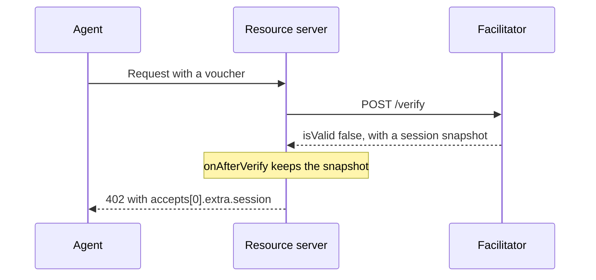

export const meta = {
  title: "@z402/server",
  description: "The provider-side payment scheme for the x402 resource server, the start-up check that an API key and an address belong together, and its error type.",
};

`@z402/server` is the provider side of the z402 payment scheme. A provider's resource server registers `PrepaidVoucherServerScheme` with the stock x402 `x402ResourceServer`, and calls `checkProvider` once before it listens.

The package depends on `@x402/core`, pinned to exactly 2.28.0, and on `@z402/protocol`. It is a workspace package (`private`, version `0.0.0`) with one entry point, `@z402/server`.

| Export | Kind | What it is |
| --- | --- | --- |
| [`PrepaidVoucherServerScheme`](/docs/reference/server#prepaidvoucherserverscheme) | class | The `prepaid-voucher` scheme, for `x402ResourceServer.register` |
| [`TERM_KEYS`](/docs/reference/server#term_keys) | constant | The five keys of a `402`'s `extra` that the facilitator owns |
| [`checkProvider`](/docs/reference/server#checkprovider) | function | Proves that an API key and an address belong together |
| [`ProviderCheckError`](/docs/reference/server#providercheckerror) | class | What `checkProvider` throws, with `field` and `retryable` |
| `ProviderCheckField` | type | `"facilitatorToken"`, `"payTo"` or `"facilitatorUrl"` |

## Use it

```ts
import { HTTPFacilitatorClient, x402ResourceServer } from "@x402/core/server";
import { NETWORK_REGTEST } from "@z402/protocol";
import { PrepaidVoucherServerScheme } from "@z402/server";

const payTo = "uregtest1...";
const server = new x402ResourceServer(new HTTPFacilitatorClient({ url: "https://facilitator.example" })).register(
  NETWORK_REGTEST,
  new PrepaidVoucherServerScheme({ payTo, network: NETWORK_REGTEST }),
);
```

[Sell an API](/docs/guides/sell-an-api) builds a complete server on these two exports. [`@z402/service-kit`](/docs/reference/service-kit) wires them for you.

## PrepaidVoucherServerScheme

```ts
class PrepaidVoucherServerScheme implements SchemeNetworkServer {
  constructor(o: { payTo: string; network: string });
  readonly scheme: "prepaid-voucher";
  readonly defaultAssetTransferMethod: "default";
  readonly paymentFlows: { default: { supported: ["authorization"]; default: "authorization" } };
  readonly schemeHooks: SchemeServerHooks;
  enrichPaymentRequiredResponse(ctx: SchemePaymentRequiredContext): Promise<void>;
  parsePrice(price: Price, network: Network): Promise<AssetAmount>;
  getAssetDecimals(asset: string, network: Network): number | undefined;
  enhancePaymentRequirements(
    paymentRequirements: PaymentRequirements,
    supportedKind: SupportedKind,
    facilitatorExtensions: string[],
  ): Promise<PaymentRequirements>;
  validateFacilitatorSupport(
    network: Network,
    supportedKind: SupportedKind,
    facilitatorExtensions: string[],
  ): string | void;
}
```

Create one instance for each network and register it with `register(network, scheme)`. The x402 server calls the members itself. The constructor takes these options, and throws a plain `Error` for a bad one:

<Params>
  <Param name="payTo" type="string" required>The shielded-only unified address of the provider this scheme serves. It must be valid for `network`, or the constructor throws `payTo: not a shielded-only unified address for <network>`.</Param>
  <Param name="network" type="string" required>`zcash:regtest`, `zcash:testnet` or `zcash:mainnet`. Anything else throws `network: expected one of zcash:regtest, zcash:testnet, zcash:mainnet`.</Param>
</Params>

### Members

| Member | What it does |
| --- | --- |
| `scheme` | The scheme id, `prepaid-voucher` |
| `defaultAssetTransferMethod` | `default` |
| `paymentFlows` | One flow, `authorization`: the facilitator verifies, your handler runs, then the facilitator settles |
| `parsePrice(price, network)` | Accepts only `{ amount, asset: "ZEC" }`, where `amount` is a whole number of zat as a string with no leading zero. It returns `{ amount, asset: "ZEC" }`. Any other form, a number or a `"$0.01"` string included, throws `prepaid-voucher on <network> takes a price of { amount: "<zatoshi, no leading zero>", asset: "ZEC" }` |
| `getAssetDecimals(asset, network)` | 8 for `ZEC`, and `undefined` for any other asset |
| `enhancePaymentRequirements(requirements, supportedKind, extensions)` | Copies the rail's terms into the requirement's `extra`, and nothing else. See [the terms](/docs/reference/server#the-terms) |
| `validateFacilitatorSupport(network, supportedKind, extensions)` | Runs when the x402 server loads `/supported`. It returns a message when the facilitator's terms cannot be used. See [the support check](/docs/reference/server#the-support-check) |
| `schemeHooks.onAfterVerify` | Keeps the session snapshot of a refused verify, for the corrective `402` |
| `enrichPaymentRequiredResponse(ctx)` | Adds the session snapshot to the `402` that follows a refused voucher. See [the corrective 402](/docs/reference/server#the-corrective-402) |

A route sets its own price, and a price may be any whole number of zat from 1 to `windowZat`. The scheme checks only the form of a price. The facilitator checks the range.

```ts
accepts: {
  scheme: "prepaid-voucher",
  network: "zcash:regtest",
  price: { amount: "250", asset: "ZEC" },
  payTo,
  maxTimeoutSeconds: 60,
}
```

### The terms

The facilitator owns the rail's trust terms and advertises them in the `extra` of its `GET /supported` entry. `enhancePaymentRequirements` copies those keys, when the facilitator advertises them, into the `extra` of every `accepts` entry of the `402`. They are the same for every provider and every route.

| Key | Value | Meaning |
| --- | --- | --- |
| `windowZat` | decimal string | The size of one deposit, and the largest price of one call |
| `creditRatioBps` | integer, 0 to 10,000 | Credit on confirmed deposits, in basis points. 2,500 is 25 percent |
| `creditCapZat` | decimal string | The most credit one session can hold |
| `zeroConfMinExpiryBlocks` | integer | An unconfirmed deposit counts only with at least this many blocks left before it expires |
| `termsVersion` | 16 lowercase hex characters | Names the facilitator's terms. The client ignores it |

On the demo terms the window is 100,000 zat, the credit ratio 2,500, the credit cap 200,000 zat and the expiry margin 20 blocks. The facilitator's own `payTo`, if it advertises one, is never copied. `TERM_KEYS` lists exactly these five keys.

`extra` is static per route. The server matches the client's echo of it, so a value that changed per session would break the match.

### The support check

`validateFacilitatorSupport` makes the x402 server refuse a facilitator whose terms the scheme cannot use. The server then throws a `FacilitatorCapabilityError` from `initialize()`, with each message as one of its `problems`. The check fails when:

1. the terms do not parse. `parseTerms` needs `windowZat` of at least 1, a `creditCapZat`, a `creditRatioBps` from 0 to 10,000 and a `zeroConfMinExpiryBlocks`. The message is `facilitator terms are invalid (<reason>)`;
2. `termsVersion` is not 16 lowercase hex characters. The message is `facilitator extra.termsVersion must be 16 lowercase hex characters`.

<Callout type="note" title="payTo in /supported">

A facilitator before protocol v2.0 advertised its own `payTo` in `/supported`, and this check also required it to equal the scheme's `payTo`. The multi-provider facilitator advertises none, and the check no longer compares addresses. A `payTo` that an older facilitator still advertises is ignored, and `checkProvider` proves the address instead.

</Callout>

### The corrective 402

When the facilitator refuses a voucher, the client needs to know where its session stands. The scheme adds the session snapshot to the `402` that the resource server sends back, in `accepts[].extra.session`.



`onAfterVerify` stores the snapshot of a refused verify in a `WeakMap` keyed by the request's payment payload, so it lives only as long as the request. `enrichPaymentRequiredResponse` then adds it to each `accepts` entry of this scheme and network. A request that was not refused gets the plain `402`.

```json
{
  "windowZat": "100000",
  "creditRatioBps": 2500,
  "creditCapZat": "200000",
  "zeroConfMinExpiryBlocks": 20,
  "termsVersion": "<16 hex characters>",
  "session": {
    "sessionKey": "<64 hex characters>",
    "cumulativeZat": "53000",
    "limitZat": "125000",
    "headroomZat": "72000",
    "confirmedZat": "100000",
    "pendingZat": "0",
    "creditZat": "25000",
    "tip": 4547331,
    "deposits": []
  }
}
```

The snapshot has the fields of the wire contract's session snapshot, section 7.2 of the [protocol](/docs/reference/protocol). `deposits` lists each deposit that is not yet final, with its status.

## TERM_KEYS

```ts
const TERM_KEYS: readonly ["windowZat", "creditRatioBps", "creditCapZat", "zeroConfMinExpiryBlocks", "termsVersion"];
```

The facilitator-owned keys of an `accepts` entry's `extra`. A server that builds its own offers can use it to tell the rail's terms from its own keys.

## checkProvider

```ts
function checkProvider(o: {
  facilitatorUrl: string;
  token?: string;
  payTo: string;
  network: string;
  fetch?: typeof fetch;
  timeoutMs?: number;
}): Promise<void>;
```

Resolves when the provider that the API key belongs to is paid at `payTo` on `network`. Otherwise it throws a [`ProviderCheckError`](/docs/reference/server#providercheckerror). Call it before anything that reads the facilitator's terms, so that a wrong key or address is named for what it is.

<Params>
  <Param name="facilitatorUrl" type="string" required>The facilitator's `http://` or `https://` URL. Trailing slashes are ignored. It must not carry a user or a password.</Param>
  <Param name="token" type="string">The API key, sent as `Authorization: Bearer <key>`. No header is sent when it is left out. It must be one token of letters, digits and `-._~+/`, which may end in `=`.</Param>
  <Param name="payTo" type="string" required>The address your server tells clients to pay. It must be the one the key's provider has.</Param>
  <Param name="network" type="string" required>The network your server serves, for example `zcash:regtest`.</Param>
  <Param name="fetch" type="typeof fetch">The fetch to use. Defaults to the global `fetch`.</Param>
  <Param name="timeoutMs" type="number">How long the request may take. Defaults to 5,000.</Param>
</Params>

### What it does

1. It checks `facilitatorUrl` and `token` before any request. A URL that is not `http(s)` or that carries credentials, or a token that breaks the token rule, throws at once.
2. It sends `GET <facilitatorUrl>/providers/me` with `accept: application/json`, aborted after `timeoutMs`.
3. It reads at most 4,096 bytes of the answer. A longer body is not read.
4. It requires a JSON object with the strings `providerId`, `network` and `payTo`, and compares `network` and `payTo` with its options.

A message never contains the token. It names the facilitator by its origin only, and a failed connection by the error's code or name, never by the error's message, which can quote a header.

### Outcomes

Each message starts with `<field>: `. Callers branch on `field` and `retryable` and never on the message.

| Situation | `field` | `retryable` | Message after the prefix |
| --- | --- | --- | --- |
| `facilitatorUrl` is not an `http(s)` URL | `facilitatorUrl` | no | `expected an http:// or https:// URL` |
| `facilitatorUrl` has a user or password | `facilitatorUrl` | no | `must not carry credentials (use facilitatorToken)` |
| `token` is not one token | `facilitatorToken` | no | `must be one token of letters, digits and -._~+/` |
| The connection failed, or the body broke off | `facilitatorUrl` | yes | `cannot reach the facilitator at <origin> (<code>)` |
| No answer within `timeoutMs` | `facilitatorUrl` | yes | `the facilitator at <origin> did not answer /providers/me within <ms> ms` |
| `401` or `403`, with a key | `facilitatorToken` | no | `the facilitator at <origin> refused the API key (<status>)` |
| `401` or `403`, without a key | `facilitatorToken` | no | `the facilitator at <origin> wants an API key (<status>) and none is set` |
| `404` | `facilitatorUrl` | no | `the facilitator at <origin> has no /providers/me (404), so it is not a facilitator of the multi-provider rail` |
| `5xx`, `408` or `429` | `facilitatorUrl` | yes | `the facilitator at <origin> answered /providers/me with <status>` |
| Any other status | `facilitatorUrl` | no | The same message |
| `200`, but a body that is over 4,096 bytes, is not JSON, or lacks the three strings | `facilitatorUrl` | no | `the facilitator at <origin> answered /providers/me with a body that is not {providerId, network, payTo}` |
| `200`, but another network | `payTo` | no | `the facilitator at <origin> serves <network>, not <network>` |
| `200`, but another `payTo` | `payTo` | no | `the facilitator at <origin> has this API key for another payTo than <payTo>` |

A busy or slow facilitator, `408` and `429`, answers later, so those count as retryable like `5xx`.

```ts
import { checkProvider, ProviderCheckError } from "@z402/server";

try {
  await checkProvider({ facilitatorUrl, token, payTo, network: "zcash:regtest" });
} catch (e) {
  if (e instanceof ProviderCheckError) {
    console.error(`${e.field} (retryable: ${e.retryable}): ${e.message}`);
  }
  throw e;
}
```

A `timeoutMs` that no timer accepts throws the runtime's own error, as a bug of the caller, and not a `ProviderCheckError`.

## ProviderCheckError

```ts
class ProviderCheckError extends Error {
  readonly field: ProviderCheckField;
  readonly retryable: boolean;
  constructor(field: ProviderCheckField, retryable: boolean, reason: string);
}

type ProviderCheckField = "facilitatorToken" | "payTo" | "facilitatorUrl";
```

`name` is `ProviderCheckError` and `message` is `<field>: <reason>`. `field` is the setting at fault, named as the options of `checkProvider` are. `retryable` is true when the facilitator may only be starting or briefly down, so asking again later can succeed. Retry only while it is true. Every other outcome is a mistake of yours, and asking again changes nothing.

[`@z402/service-kit`](/docs/reference/service-kit) maps `field` to the variable that sets it: `facilitatorToken` to `Z402_FACILITATOR_TOKEN`, `payTo` to `Z402_PAY_TO` and `facilitatorUrl` to `Z402_FACILITATOR_URL`. It retries while `retryable` is true.

## The facilitator route

<Endpoint method="GET" path="/providers/me" auth="api-key">

Names the provider that the API key belongs to. A resource server reads it at start-up to prove that its key and its address match.

</Endpoint>

```http
GET /providers/me HTTP/1.1
Authorization: Bearer z402_...
```

```json
{
  "providerId": "0f1e689e20871dd9",
  "network": "zcash:regtest",
  "payTo": "uregtest1..."
}
```

An unknown key, and a key that was rotated out from the moment it was rotated, gets `401` with `WWW-Authenticate: Bearer` and `{"error":"unauthorized"}`. The [Facilitator API](/docs/reference/facilitator-api) lists every route.

## References

- <Source path="packages/server/src/index.ts" />: the exports.
- <Source path="packages/server/src/scheme.ts" />: `PrepaidVoucherServerScheme` and `TERM_KEYS`.
- <Source path="packages/server/src/provider.ts" />: `checkProvider` and `ProviderCheckError`.
- <Source path="apps/api/src/app.ts" />: a resource server that uses both.
- <Source path="packages/service-kit/src/service.ts" />: the kit's start-up, which retries on `retryable`.
- <Source path="packages/protocol/src/terms.ts" />: `parseTerms` and the demo terms.
- <Source path="docs/spec/protocol.md" />: sections 2, 7 and 8, the offer, the session snapshot and the reason codes. Protocol v2.0 adds sections 16 and 17, providers with API keys and the Bazaar.
- <Source path="docs/superpowers/specs/2026-10-28-z402-multi-provider-design.md" />: section 4.6, the server scheme and `checkProvider`.
- [x402](https://github.com/x402-foundation/x402): the resource server and its scheme interface.
- [RFC 6750](https://datatracker.ietf.org/doc/html/rfc6750): the bearer token format.
