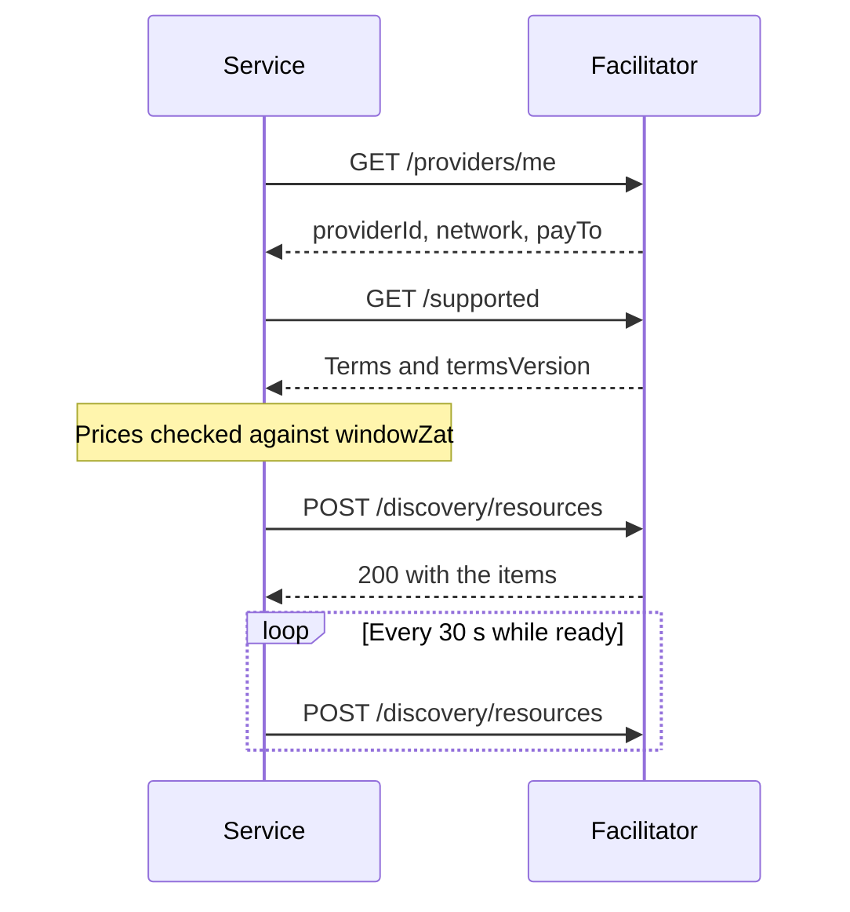
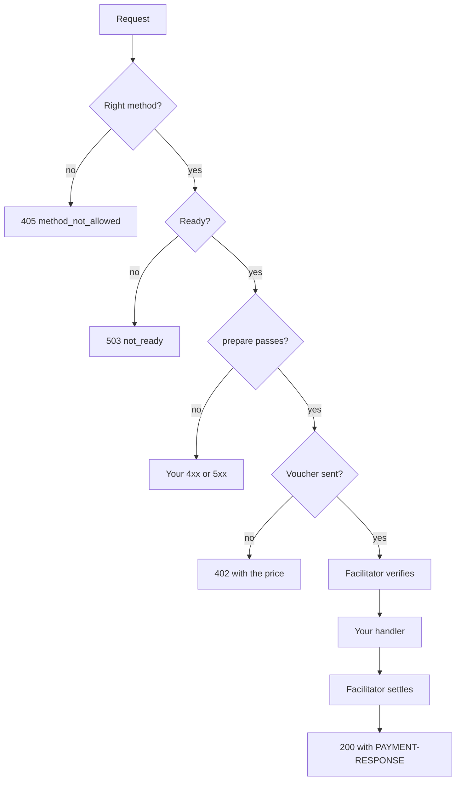

export const meta = {
  title: "@z402-net/service-kit",
  description: "Every export of the service kit: createPaidService, PaidRoute, settings, delivery hooks, the process runner, and the repository-only test stack.",
};

`@z402-net/service-kit` builds a paid HTTP service from a list of routes. It wires the stock x402 Express middleware with the z402 scheme, checks the provider's API key and the facilitator's terms at start-up, lists the routes in the facilitator's Bazaar, and serves `GET /health`. The [guide](/docs/guides/service-kit) builds a service with it. This page lists every export, option, variable and limit.

```bash
npm install --save-exact @z402-net/service-kit
npm install --save-dev --save-exact @types/express@5.0.6
```

The package needs Node.js 22 or later and has no peer dependencies. It depends on `@x402/core`, `@x402/express` and `@x402/extensions`, all pinned to exactly 2.28.0, on `express` 5.3.0, and on `@z402-net/protocol` and `@z402-net/server`, so the one install brings them all. `@types/express` is for TypeScript, because the package's declarations name Express's types. The testing entry point is available inside the z402 repository only, and it also needs `@x402/fetch`, `@z402-net/client`, `@z402/facilitator` and `@z402/testkit`.

## Entry points

| Entry point | Source | Exports |
| --- | --- | --- |
| `@z402-net/service-kit` | `src/index.ts` | `createPaidService`, `PROBE_HEADER`, `Z402_EXTENSION`, `PaidMethod`, `PaidRoute`, `PaidService`, `PaidServiceOptions`, `ServiceDefinition`, `loadServiceEnv`, `ConfigError`, `read`, `readInt`, `readOrFile`, `readUrl`, `Env`, `ServiceEnv`, `loadDotEnv`, `onDelivered`, `DeliveryHandlers`, `serve`, `Listening`, `runMain`, `CallStats` |
| `@z402-net/service-kit/testing`, in the z402 repository only | `src/testing.ts` | `startTestStack`, `TestStack`, `TestStackOptions`, `PayingClient`, `Built`, `CatalogStub`, `Declaration`, `paymentRequiredOf`, `railOf`, `Rail`, `declarationRefusal`, `TEST_NETWORK`, `TEST_PAY_TO`, `TEST_TOKEN`, `TEST_PUBLIC_URL` |

## createPaidService

```ts
function createPaidService(o: PaidServiceOptions): Promise<PaidService>;
```

Checks the definition and the settings, loads the facilitator's terms, and returns the Express app with `/health` and the payment middleware mounted. Nothing listens yet: the app is the caller's to serve and to add handlers to.

### PaidServiceOptions

```ts
interface PaidServiceOptions {
  env: ServiceEnv;
  service: ServiceDefinition;
  ready?: () => boolean | Promise<boolean>;
  before?: RequestHandler[];
  facilitatorWaitMs?: number;
  declareIntervalMs?: number;
  log?: (message: string) => void;
}
```

<Params>
  <Param name="env" type="ServiceEnv" required>The shared settings, from `loadServiceEnv`.</Param>
  <Param name="service" type="ServiceDefinition" required>The service name, its tags and its paid routes.</Param>
  <Param name="ready" type="() => boolean | Promise<boolean>">Whether the service can serve right now. Default: always ready. Reused for 5 s, and a throw or an answer that takes over 2 s counts as not ready.</Param>
  <Param name="before" type="RequestHandler[]">Handlers mounted before the checks of every paid route, for things that must refuse before anyone pays, such as a rate limit. They do not run for `/health`.</Param>
  <Param name="facilitatorWaitMs" type="number">How long to keep retrying a facilitator that does not answer yet. Default `env.facilitatorWaitMs`, else 120,000. `0` fails at once.</Param>
  <Param name="declareIntervalMs" type="number">How often the routes are declared to the Bazaar. Default `env.declareIntervalMs`, else 30,000. `0` never declares.</Param>
  <Param name="log" type="(message: string) => void">Where the start-up retries and the outcomes of declarations go. Default: stderr.</Param>
</Params>

### PaidService

```ts
interface PaidService {
  app: Express;
  stats: CallStats;
  http: x402HTTPResourceServer;
  close(): Promise<void>;
}
```

| Field | What it is |
| --- | --- |
| `app` | The Express app, with `/health` and the payment middleware. Add your handlers to it: they run after the middleware |
| `stats` | The [`CallStats`](/docs/reference/service-kit#callstats) of paid calls delivered today |
| `http` | The x402 HTTP resource server the kit built, for tests and tooling |
| `close()` | Stops declaring the routes. The HTTP server is the caller's to close |

### Start-up order

Everything below runs before `createPaidService` returns, so before anything listens. Every failure names the setting at fault.



1. **The definition and the public URL.** The service definition and `PUBLIC_URL` are checked. See [the errors](/docs/reference/service-kit#start-up-errors).
2. **The key.** [`checkProvider`](/docs/reference/server#checkprovider) calls `GET /providers/me` with a 5 s timeout and proves that the API key and `Z402_PAY_TO` belong together.
3. **The terms.** The kit reads `GET /supported` with a 5 s timeout and lets the x402 server load the rail's terms. A facilitator that offers no `prepaid-voucher` on the network, or terms the scheme cannot use, fails here.
4. **The wait.** Steps 2 and 3 repeat every 2 s while the failure may be temporary (a facilitator that is starting, unreachable or slow), until `facilitatorWaitMs` has passed. The first retry logs `<message>; waiting for it`. A refused key, another address, another network or a service that is not a facilitator fails at once.
5. **The prices.** Every route's price must be from 1 to the terms' `windowZat`.
6. **The items.** The kit builds each route's catalog item once, from the `402` of an unpaid request to it, and checks its size.
7. **The app.** The middleware is mounted, and the declaration heartbeat starts unless `declareIntervalMs` is `0`.

### Requests the app handles

In the order they run for a request:

1. **The path is made canonical.** A spelling that the payment middleware treats as a paid path but Express would not route (`//v1/notes`, a percent-encoded letter, a trailing slash) is rewritten to the route's one spelling. No spelling skips a route's checks or its payment.
2. **`GET /health`** answers at once. See [GET /health](/docs/reference/service-kit#get-health).
3. **The counter** notes each response that is a `2xx` and carries `PAYMENT-RESPONSE`.
4. **Your `before` handlers** run.
5. **Each paid route's gate.** A method the route does not take gets `405` with `Allow`, and `{"error":"method_not_allowed"}`. A `GET` route also takes `HEAD`. A service that is not ready gets `503` and `{"error":"not_ready"}`.
6. **The route's `prepare` handlers** run in order, unless the request is a probe.
7. **The payment middleware** answers `402`, or verifies the voucher, runs your handler and settles. If the routes and the middleware disagree about whether a path is paid, the kit answers `404` and `{"error":"not_found"}`. A second request that carries a voucher that is already being verified or handled gets `409` and `{"error":"payment_in_flight"}`. One payment therefore runs your handler once.



A **probe** is a request with the `X-Z402-Probe` header and no `PAYMENT-SIGNATURE` or `X-PAYMENT` header. It skips `prepare`, so a placeholder id or an empty body is not refused, and it gets the route's `402`. It is for tools that want a route's offer, and `paymentRequiredOf` in the testing helpers sends one. A request that carries a payment never skips `prepare`.

The facilitator client the kit builds sends the API key as a bearer token on `verify`, `settle` and `supported`. It allows 60 s for verify and settle, which covers the facilitator's 30 s wait for a deposit it has not seen yet, and 5 s for `supported`.

Every `402` carries one `accepts` entry for the route:

```json
{
  "scheme": "prepaid-voucher",
  "network": "zcash:regtest",
  "amount": "100",
  "asset": "ZEC",
  "payTo": "uregtest1...",
  "maxTimeoutSeconds": 60,
  "extra": { "windowZat": "100000", "creditRatioBps": 2500, "creditCapZat": "200000", "zeroConfMinExpiryBlocks": 20, "termsVersion": "<16 hex characters>" }
}
```

Its `resource` is `PUBLIC_URL` and the route's `path`. The extensions are the route's `bazaar` extension and a `z402` extension, `{ "unit": "...", "note": "..." }`.

## ServiceDefinition

```ts
interface ServiceDefinition {
  serviceName: string;
  tags?: string[];
  routes: PaidRoute[];
}
```

<Params>
  <Param name="serviceName" type="string" required>1 to 32 printable ASCII characters. The catalog shows it. A name that breaks the rule stops the start with `serviceName: expected 1 to 32 printable ASCII characters`.</Param>
  <Param name="tags" type="string[]">At most 5, each 1 to 32 printable ASCII characters. The kit drops a tag that breaks the rule, and a repeat that differs only in case, without an error.</Param>
  <Param name="routes" type="PaidRoute[]" required>1 to 128 paid routes. 128 is the most the facilitator lists for one provider.</Param>
</Params>

## PaidRoute

```ts
type PaidMethod = "GET" | "POST" | "PUT" | "DELETE";

interface PaidRoute {
  method: PaidMethod;
  path: string;
  probePath?: string;
  description: string;
  unit: string;
  note?: string;
  mimeType?: string;
  priceZat?: bigint;
  discovery: DeclareDiscoveryExtensionInput;
  prepare?: RequestHandler[];
}
```

<Params>
  <Param name="method" type="PaidMethod" required>The method agents use, which is also the method discovery probes with and the method of the catalog item. A `GET` route also answers `HEAD`.</Param>
  <Param name="path" type="string" required>The route key without a verb, starting with `/`, such as `/v1/generate` or `/v1/drops/:id/hold`. It may hold only letters, digits and `. _ ~ : / -`, and no space. A path must not be declared twice. The key has no verb so that a request of any method must pay.</Param>
  <Param name="probePath" type="string">A concrete path for a route with parameters, starting with `/`, which discovery probes instead of `path`. A path with `:` needs one.</Param>
  <Param name="description" type="string" required>One sentence for agents, 1 to 512 characters, not blank.</Param>
  <Param name="unit" type="string" required>What one call buys, such as `output chunk`, `page` or `10 blocks`. Not blank.</Param>
  <Param name="note" type="string">One short guardrail or privacy note. The site shows it behind a `?`.</Param>
  <Param name="mimeType" type="string">The answer's type, at most 128 characters. Default `application/json`.</Param>
  <Param name="priceZat" type="bigint">The price of one call in zat, from 1 to `windowZat`. Default `env.priceZat`.</Param>
  <Param name="discovery" type="DeclareDiscoveryExtensionInput" required>How an agent should call the route. See [the discovery config](/docs/reference/service-kit#discovery-config).</Param>
  <Param name="prepare" type="RequestHandler[]">Handlers that run before the payment middleware on this route, such as a body parser and your request checks. Call `next()` to go on, or answer to refuse.</Param>
</Params>

A refusal in `prepare` reaches the client on its unpaid first attempt, before any voucher exists. A failure after the voucher is sent is ambiguous to the client, which counts the call and pays for it with its next voucher. So every check that can run in `prepare` must.

### Discovery config

`discovery` is the input of `declareDiscoveryExtension` from `@x402/extensions/bazaar`, without `method`, which the kit fills in from the route. It describes the route for agents, and it becomes the `bazaar` extension of the route's `402` and of its listing.

| Field | Use |
| --- | --- |
| `input` | An example of what the agent sends: the query parameters of a `GET` route, or the body of a route that takes one |
| `inputSchema` | A JSON Schema of `input` |
| `bodyType` | `json`, `form-data` or `text`. Needed on a route that takes a body |
| `pathParams` | Example values for the parameters of `path` |
| `pathParamsSchema` | A JSON Schema of `pathParams` |
| `output` | `{ example, schema? }`: what a paid call answers |

A route that reads a query string:

```ts
const search: PaidRoute = {
  method: "GET",
  path: "/v1/search",
  description: "Searches the index and returns the number of hits.",
  unit: "search",
  discovery: {
    input: { q: "zcash" },
    inputSchema: { properties: { q: { type: "string" } }, required: ["q"] },
    output: { example: { hits: 3 } },
  },
};
```

A route that takes a JSON body has `bodyType: "json"` and a body in `input`. A route with parameters adds `pathParams`. The [guide's example](/docs/guides/service-kit#write-the-routes-and-the-handlers) has both.

## Constants

```ts
const Z402_EXTENSION = "z402";
const PROBE_HEADER = "x-z402-probe";
```

`Z402_EXTENSION` is the key of the extension that rides next to `bazaar` in every `402`: `{ unit, note? }`. `PROBE_HEADER` is the header of a probe.

## GET /health

<Endpoint method="GET" path="/health" auth="public">

Answers `200` when the service is ready and `503` when it is not. It never reports anything per client or per session.

</Endpoint>

```json
{
  "ok": true,
  "service": "Short notes",
  "ready": true,
  "network": "zcash:regtest",
  "priceZat": "100",
  "callsToday": 0,
  "routes": [
    { "method": "POST", "path": "/v1/notes", "unit": "note-hour", "priceZat": "100" },
    {
      "method": "POST",
      "path": "/v1/notes/:id/extend",
      "probePath": "/v1/notes/example/extend",
      "unit": "note-hour",
      "priceZat": "100"
    }
  ]
}
```

| Field | Value |
| --- | --- |
| `ok` | Always `true` |
| `service` | The `serviceName` |
| `ready` | Whether `ready` says the service can serve. The answer is reused for 5 s |
| `network` | `zcash:regtest`, `zcash:testnet` or `zcash:mainnet` |
| `priceZat` | The service's default price, as a decimal string |
| `callsToday` | Paid calls delivered with a `2xx` since 00:00 UTC. An aggregate, with nothing per session or per client |
| `routes` | Each route's `method`, `path`, `probePath` when it has one, `unit`, and its own `priceZat` |

## The Bazaar declaration

While the service is ready, the kit lists its routes in the facilitator's Bazaar with `POST /discovery/resources`. The facilitator's [Bazaar rules](/docs/guides/sell-an-api#list-your-routes-in-the-bazaar) decide what it accepts.

**What it sends.** Each item is built once at start from the `402` of an unpaid request to the route, so the catalog offers exactly what the route asks for: `resource` (`PUBLIC_URL` plus the route's `path`), `type: "http"`, `x402Version`, `accepts`, `description`, `mimeType`, `serviceName`, `tags` and `extensions` (`bazaar`, with the `method` and, for a route with parameters, its `routeTemplate`, and `z402`). The request carries `content-type: application/json` and `authorization: Bearer <key>`. It is not redirected.

**When.** At once when the service is ready, then `declareIntervalMs` after each declaration ends, so two never overlap. Each request has 10 s. A service that is not ready asks again after 5 s or the interval, whichever is shorter, so that its first declaration follows soon after it is ready. A beat that is due never keeps the process alive.

**How.** The items go in order, 32 items and 60 KiB at most per request, one request at a time.

**What it logs.** One line each time the outcome changes, on `log` (stderr by default), never the key:

| Outcome | Line |
| --- | --- |
| Listed | `discovery: <n> paid route(s) listed by the facilitator at <url>, declared again every <s> s` |
| Unreachable | `discovery: cannot reach the facilitator at <url> (<reason>); trying again every <s> s` |
| `400` | `discovery: the facilitator at <url> refused the declaration (400, item <i>: <message>); trying again every <s> s` |
| `404` | `discovery: the facilitator at <url> has no Bazaar to declare to (404), so the routes are not listed; trying again every <s> s` |
| `401` or `403` | `discovery: Z402_FACILITATOR_TOKEN: the facilitator at <url> refused the declaration (<status>); trying again every <s> s` |
| Any other status | `discovery: the facilitator at <url> answered the declaration with <status>; trying again every <s> s` |

A failed declaration never stops the service.

## loadServiceEnv

```ts
function loadServiceEnv(env: Env, o: { port: number; priceZat: bigint }): ServiceEnv;
```

Reads and checks the variables every paid service shares, and throws a `ConfigError` that names the one at fault. `o.port` is the service's own port and `o.priceZat` its default price for one call. An empty variable counts as unset.

| Variable | Default | Meaning |
| --- | --- | --- |
| `Z402_NETWORK` | `regtest` | `regtest`, `testnet` or `mainnet`. Anything else throws `Z402_NETWORK: expected regtest, testnet or mainnet` |
| `Z402_FACILITATOR_URL` | none, required | The facilitator's `http://` or `https://` URL. Trailing slashes are dropped. A user or password in it throws `must not contain credentials (use Z402_FACILITATOR_TOKEN)` |
| `Z402_FACILITATOR_TOKEN` | none | The API key. One token of letters, digits and `-._~+/`, which may end in `=` |
| `Z402_FACILITATOR_TOKEN_FILE` | none | A file that holds the API key, trimmed. Read only when `Z402_FACILITATOR_TOKEN` is unset |
| `Z402_PAY_TO` | none, required | The shielded-only unified address of the provider, valid for the network. The error names the expected form: `uregtest1... or zuregtest1...`, `utest1... or zutest1...` or `u1... or zu1...` |
| `Z402_PAY_TO_FILE` | none | A file that holds the address, trimmed. Read only when `Z402_PAY_TO` is unset |
| `Z402_PRICE_ZAT` | `o.priceZat` | A canonical whole number of zat, at least 1, for every route without its own price |
| `PUBLIC_URL` | `http://localhost:<PORT>` | The public origin without a trailing slash, used for each `402`'s `resource` and for discovery |
| `HOST` | `127.0.0.1` | The address to listen on. Not blank |
| `PORT` | `o.port` | A whole number from 0 to 65535. 0 picks a free port |
| `Z402_FACILITATOR_WAIT_MS` | `120000` | A whole number from 0 to 3,600,000. How long start-up waits for a facilitator |

A `_FILE` variable that points at a file that cannot be read throws `<NAME>_FILE: cannot read <path> (<code>)`, and one that points at an empty file throws `<NAME>_FILE: <path> is empty`.

### ServiceEnv

```ts
interface ServiceEnv {
  network: ZcashNetwork;
  facilitatorUrl: string;
  facilitatorToken: string | undefined;
  payTo: string;
  priceZat: bigint;
  publicUrl: string;
  host: string;
  port: number;
  facilitatorWaitMs?: number;
  declareIntervalMs?: number;
}
```

| Field | What it is |
| --- | --- |
| `network` | `zcash:regtest`, `zcash:testnet` or `zcash:mainnet`, from `Z402_NETWORK` |
| `facilitatorUrl`, `facilitatorToken`, `payTo` | The facilitator, the API key and the address |
| `priceZat` | The price of one call for every route that sets none |
| `publicUrl` | The public origin, without a trailing slash |
| `host`, `port` | Where to listen |
| `facilitatorWaitMs` | How long start-up waits for a facilitator. `loadServiceEnv` sets it |
| `declareIntervalMs` | How often a ready service declares its routes, 30,000 by default. `loadServiceEnv` does not set it and no variable does: set it on the object or pass it to `createPaidService` |

### Reading settings

Your own settings use the same helpers.

```ts
type Env = Record<string, string | undefined>;

function read(env: Env, name: string): string | undefined;
function readOrFile(env: Env, name: string): string | undefined;
function readInt(env: Env, name: string, fallback: number, min?: number, max?: number): number;
function readUrl(env: Env, name: string, fallback?: string): string;

class ConfigError extends Error {}
function loadDotEnv(file: URL): void;
```

| Function | What it does |
| --- | --- |
| `read` | The value of `name`, or `undefined` when it is unset or empty |
| `readOrFile` | `name` itself, else the trimmed contents of the file named by `<name>_FILE`. It throws a `ConfigError` for a file that cannot be read or is empty |
| `readInt` | A whole number in `[min, max]`, with `min` 0 and `max` `Number.MAX_SAFE_INTEGER` by default. `fallback` when unset. Throws `<name>: expected a whole number from <min> to <max>` |
| `readUrl` | An `http(s)` URL without trailing slashes, `fallback` when unset. Throws `<name> is required (an http:// or https:// URL)` when there is neither, and `<name>: expected an http:// or https:// URL` for another scheme |
| `ConfigError` | What the helpers throw. `name` is `ConfigError` and the message names the variable |
| `loadDotEnv` | Loads the `.env` file at `file` when it exists. A variable already set in the environment wins. A file that exists but cannot be read throws a `ConfigError` |

`loadDotEnv(new URL("../.env", import.meta.url))` in a service's `src/main.ts` reads `services/<name>/.env`.

## onDelivered

```ts
interface DeliveryHandlers {
  ok?: () => void;
  failed?: () => void;
}

function onDelivered(res: Response, h: DeliveryHandlers): void;
```

Runs exactly one of the handlers, once, when the response is over. The x402 middleware settles after your handler and turns a refused settlement into a `402`, so a `2xx` at the end is the only sign that the call was paid and delivered.

| Handler | Runs when |
| --- | --- |
| `ok` | The response finished with a `2xx` |
| `failed` | Anything else: a refused settlement, a status of 400 or more, a handler error, or a connection that closed first |

A handler that throws is logged as `delivery handler failed` and does not stop the other work. A response that is already over when you call `onDelivered` runs its handler at once.

## serve and runMain

```ts
interface Listening {
  url: string;
  server: Server;
  close(): Promise<void>;
}

function serve(app: Express, o: { host: string; port: number }): Promise<Listening>;

function runMain(
  name: string,
  start: () => Promise<{ readyLine: string; close(): Promise<void> }>,
): void;
```

**`serve`** listens on `host` and `port`, where port 0 picks a free one. `url` is `http://<host>:<port>`, with an IPv6 host in brackets. It allows 15 s for a request's headers and 30 s for the whole request, instead of Node's 5 minutes, so one slow client cannot hold a buffered body before payment. `close()` stops listening, closes idle connections at once and the others as their calls end. A failure to listen rejects with `PORT: cannot listen on <host>:<port> (<code>)` for `EADDRINUSE` and `EACCES`, and `HOST: ...` for any other.

**`runMain`** is the process wrapper every service `main` uses. When `start` resolves it prints `<name> <readyLine>` on stdout. Logs and errors go to stderr. A failure in `start` prints `<name>: <message>` and exits `1`. `SIGINT` or `SIGTERM` calls `close()` and exits `0`, or exits `1` if the close fails or takes more than 5 s. A second signal gets the default and ends the process at once.

## CallStats

```ts
class CallStats {
  constructor(now?: () => Date);
  record(): void;
  today(): number;
}
```

Counts paid calls delivered since 00:00 UTC. It keeps an aggregate only: nothing per session or per client. The kit calls `record()` for each response that is a `2xx` and carries `PAYMENT-RESPONSE`, so only a settled, delivered call counts. `today()` starts at 0 each UTC day. `now` replaces the clock, for tests.

## The testing entry point

`@z402-net/service-kit/testing` starts an in-process stack for service tests. It is available inside the z402 repository only. It runs the repository's own facilitator and fake chain, `@z402/facilitator` and `@z402/testkit`, which are not published, so the published package leaves this entry point out. A call made with `paidFetch` is a real paid call: a deposit, a voucher, verification, your handler and settlement. It needs no Docker and no network.

### startTestStack

```ts
function startTestStack(o: TestStackOptions): Promise<TestStack>;
```

It starts, in order:

1. A `FakeChain` with an expiry delta of 40 blocks.
2. The real facilitator on an in-memory ledger, polling every 50 ms, with the demo terms and the token `TEST_TOKEN`, paid at `TEST_PAY_TO`.
3. With `catalog`, a stub Bazaar in front of the facilitator.
4. Your service, built by `build(env)`, on `127.0.0.1` and a free port.
5. A paying client: `PrepaidVoucherScheme` with a `MockWallet`, in the stock x402 fetch wrapper.

If a later step fails, it closes what already started.

### TestStackOptions

```ts
interface TestStackOptions {
  build: (env: ServiceEnv) => Promise<Built>;
  priceZat?: bigint;
  env?: Partial<ServiceEnv>;
  catalog?: boolean;
}

type Built = Express | { app: Express; close?(): Promise<void> };
```

<Params>
  <Param name="build" type="(env: ServiceEnv) => Promise<Built>" required>Builds your service from the stack's settings. Return the Express app, or `{ app, close }` to have `close` run when the stack closes.</Param>
  <Param name="priceZat" type="bigint">The default price of one call. It becomes `env.priceZat`: what every route that sets no `priceZat` charges, and what `/health` reports. The kit checks it against the demo terms' `windowZat`, 100,000. The stack's facilitator ignores it, because each provider prices its own routes and the amount in each `402` is what is paid. Default 500.</Param>
  <Param name="env" type="Partial<ServiceEnv>">Overrides of the settings that `build` receives.</Param>
  <Param name="catalog" type="boolean">Puts a stub Bazaar in front of the facilitator and lets the service declare to it. Without it the stack sets `declareIntervalMs` to 0, and the service declares nothing.</Param>
</Params>

The `env` that `build` receives is: `network` `TEST_NETWORK`, `facilitatorUrl` the stack's facilitator (or the stub, with `catalog`), `facilitatorToken` `TEST_TOKEN`, `payTo` `TEST_PAY_TO`, `priceZat`, `publicUrl` `TEST_PUBLIC_URL`, `host` `127.0.0.1`, `port` `0`, `declareIntervalMs` `0` unless the stack has a `catalog`, and your overrides on top. The `402`s therefore name `http://service.test` as their resource, while the service listens at `stack.url`.

### TestStack

```ts
interface PayingClient {
  paidFetch: typeof fetch;
  scheme: PrepaidVoucherScheme;
}

interface TestStack extends PayingClient {
  chain: FakeChain;
  facilitator: FacilitatorHandle;
  url: string;
  env: ServiceEnv;
  catalog?: CatalogStub;
  client(): PayingClient;
  close(): Promise<void>;
}
```

| Field | What it is |
| --- | --- |
| `paidFetch` | The stock x402 fetch, paying through the prepaid-voucher client scheme. Use it for paid calls, and the plain `fetch` for free ones |
| `scheme` | The client scheme. `scheme.session(TEST_PAY_TO)?.cumulativeZat` is what the client has promised to pay. It is `undefined` until the client has made a deposit, so a call refused before payment leaves it `undefined` |
| `chain` | The fake chain, to mine blocks or reorganize |
| `facilitator` | The running facilitator, with `url`, `pollNow()` and `close()` |
| `url` | The service's own base URL |
| `env` | The settings `build` received |
| `catalog` | The stub Bazaar, present when the stack was started with `catalog` |
| `client()` | Another paying client with its own session, since one client's paid calls take turns on its session |
| `close()` | Closes the clients, the service, the stub and the facilitator. Safe to call twice |

### The catalog stub

With `catalog`, the service declares to a stub that records each declaration. It answers `POST /discovery/resources` itself and passes every other request to the facilitator.

```ts
interface CatalogStub {
  readonly declarations: Declaration[];
  readonly mostAtOnce: number;
  delayMs: number;
  answer(how: number | "drop", body?: unknown): void;
}

interface Declaration {
  authorization: string | undefined;
  body: unknown;
  bytes: number;
  at: number;
}
```

| Member | What it is |
| --- | --- |
| `declarations` | Each declaration the stub took, in order. `body` is the parsed JSON, or `undefined` when it is not JSON, and `at` is `Date.now()` on arrival |
| `mostAtOnce` | The most declarations it was answering at one time |
| `delayMs` | How long it holds each answer |
| `answer(how, body?)` | How it answers from now on: `200` with the items (the default), another status with `body`, or `"drop"`, which closes the connection |

### Test helpers

```ts
function paymentRequiredOf(url: string, method: string): Promise<PaymentRequired>;

interface Rail {
  network: string;
  payTo: string;
  extra: Record<string, unknown>;
}

function railOf(stack: TestStack): Promise<Rail>;
function declarationRefusal(d: Declaration, rail: Rail): string | undefined;

const TEST_NETWORK: ZcashNetwork; // zcash:regtest
const TEST_PAY_TO: string; // uregtest1 and 60 times q
const TEST_TOKEN: string;
const TEST_PUBLIC_URL: string; // http://service.test
```

- **`paymentRequiredOf(url, method)`** sends a probe, so that no check of the route refuses it first, and returns the decoded `402`. It throws when the answer is not a `402` with a `PAYMENT-REQUIRED` header.
- **`railOf(stack)`** reads the facilitator's `/supported` for the stack's own `payTo` and returns the rail a declared item must name: the network, the address, and the `extra` that holds the terms and `termsVersion`.
- **`declarationRefusal(d, rail)`** says why the facilitator's catalog would refuse a declaration, or returns `undefined` when it would take every item. It is written from the design of the catalog and not from the kit, so it checks what the kit sends. It checks that:
  - the body is at most 64 KB and holds 1 to 32 items;
  - an item has no field beyond `resource`, `type`, `x402Version`, `accepts`, `description`, `mimeType`, `serviceName`, `tags`, `iconUrl` and `extensions`;
  - `resource` is an absolute `http(s)` URL of at most 2,048 characters with no user or password, `type` is `http` and `x402Version` is 2;
  - `accepts` holds 1 to 4 entries, each `prepaid-voucher` on the rail's network, asset `ZEC`, the rail's `payTo`, an amount from 1 to `windowZat`, and the rail's terms and `termsVersion`;
  - `description` is at most 512 characters, `mimeType` at most 128, `serviceName` 1 to 32 printable ASCII characters, and `tags` at most 5, each 1 to 32 printable ASCII characters (the stub also refuses a repeat that differs only in case, where the real catalog drops it and takes the item);
  - `extensions` is an object of at most 8 KB, and `extensions.bazaar.info.input.method`, when present, is one of `GET`, `POST`, `PUT`, `PATCH`, `DELETE` or `HEAD`.

## Limits and timings

| What | Value |
| --- | --- |
| Routes in one service | 128 |
| `description` of a route | 512 characters |
| `mimeType` of a route | 128 characters |
| A route's resource URL (`PUBLIC_URL` and `path`) | 2,048 characters |
| `extensions` of one route's `402` | 8,192 bytes as JSON |
| Items per declaration request | 32 |
| One declaration request body | 60 KiB, under the facilitator's 64 KB |
| One declaration request | 10 s |
| Declaration interval | 30 s |
| Recheck of a service that is not ready | 5 s |
| `ready` answer reused for | 5 s |
| `ready` must answer within | 2 s |
| `checkProvider` and `GET /supported` at start-up | 5 s each |
| Verify and settle | 60 s each |
| Wait for a facilitator at start-up | 120 s, retrying every 2 s |
| `maxTimeoutSeconds` in each `402` | 60 |
| Request headers, whole request | 15 s, 30 s |
| Shutdown | 5 s |

## Start-up errors

`createPaidService` and `loadServiceEnv` fail with a message that names the variable, option or route at fault. `runMain` prints it as `<name>: <message>` and exits `1`.

| Message starts with | Cause |
| --- | --- |
| `Z402_FACILITATOR_URL is required`, `Z402_PAY_TO is required` | A required variable is missing |
| `Z402_FACILITATOR_TOKEN: <reason>`, `Z402_FACILITATOR_TOKEN_FILE: <reason>` | The key is refused (`401` or `403`), which always names `Z402_FACILITATOR_TOKEN`, or is not one token, which names `Z402_FACILITATOR_TOKEN_FILE` when the key came from the file |
| `Z402_PAY_TO: <reason>` | The address is not valid for the network, or the key belongs to another address, or the facilitator serves another network |
| `Z402_FACILITATOR_URL: cannot reach ...`, `... did not answer /providers/me within ... ms`, `... answered /providers/me with <status>` (a `5xx`, `408` or `429`), `cannot read /supported from ...` | The facilitator is unreachable, slow or failing. The kit waits and then fails |
| `Z402_FACILITATOR_URL: ... advertises terms this service cannot use (...)` | The scheme's support check failed. The reasons are listed |
| `Z402_FACILITATOR_URL: ... has no /providers/me (404) ...`, `... answered /providers/me with <status>` (another `4xx`), `... with a body that is not {providerId, network, payTo}`, `... is not a facilitator ...` | `/providers/me` answered `404`, another `4xx` or a body that is not a provider's, or `/supported` answered with a `4xx` other than `401` or `403`, or with a body that is not a facilitator's. The kit fails at once |
| `Z402_NETWORK: ... offers prepaid-voucher on <networks>, not on <network>` | The facilitator does not serve the service's network |
| `Z402_PRICE_ZAT: <METHOD> <path> would cost <price> zat, outside 1 to <windowZat>, the facilitator's windowZat` | A price is out of range, whether it came from the variable or from `priceZat` |
| `PUBLIC_URL: must not contain credentials`, `PUBLIC_URL: with <path> it makes a resource URL over 2048 characters` | The public URL breaks the catalog's rules |
| `serviceName: ...` | The service name is not 1 to 32 printable ASCII characters |
| `routes: a paid service needs at least one route` | `routes` is empty |
| `routes: at most 128, ...` | There are too many routes |
| `routes: "<path>" must be a path without a verb, starting with /` | A `path` has a verb, a space or a character outside the allowed set |
| `routes: "<path>" is declared twice` | Two routes share a `path` |
| `routes: "<path>" has parameters, so it needs a probePath for discovery` | A path with `:` has no `probePath` |
| `routes: probePath of <path>` | A `probePath` does not start with `/` |
| `routes: "<path>" needs a billing unit`, `routes: "<path>" needs a description` | `unit` or `description` is blank |
| `routes: the description of "<path>" is over 512 characters`, `routes: the mimeType of "<path>" is over 128 characters` | A field is too long |
| `routes: an unpaid <METHOD> <path> gets no 402 to declare` | The route's `402` could not be built |
| `routes: the 402 of "<path>" has <n> bytes of extensions, over 8192` | The route's `discovery` is too large |
| `PORT: cannot listen on ...`, `HOST: cannot listen on ...` | `serve` could not listen |

## References

- <Source path="packages/service-kit/src/index.ts" />: the exports of the main entry point.
- <Source path="packages/service-kit/src/service.ts" />: `createPaidService`, the route and service types, the start-up order and the refusals.
- <Source path="packages/service-kit/src/declare.ts" />: the declaration heartbeat, the item limits and the log lines.
- <Source path="packages/service-kit/src/env.ts" />: `loadServiceEnv`, `ServiceEnv`, the readers and `ConfigError`.
- <Source path="packages/service-kit/src/dotenv.ts" />: `loadDotEnv`.
- <Source path="packages/service-kit/src/delivery.ts" />: `onDelivered`.
- <Source path="packages/service-kit/src/run.ts" />: `serve` and `runMain`.
- <Source path="packages/service-kit/src/stats.ts" />: `CallStats`.
- <Source path="packages/service-kit/src/testing.ts" />: the test stack, the catalog stub and `declarationRefusal`.
- <Source path="packages/server/src/provider.ts" />: `checkProvider`, which the start-up calls.
- <Source path="services/embeddings/src/service.ts" />, <Source path="services/dropbox/src/service.ts" />, <Source path="services/llm/src/service.ts" /> and <Source path="services/markdown/src/service.ts" />: the four services built with the kit.
- <Source path="docs/superpowers/specs/2026-10-27-z402-services-design.md" />: section 3, the kit's design.
- <Source path="docs/superpowers/specs/2026-10-28-z402-multi-provider-design.md" />: sections 4.4 and 4.6, the Bazaar and the provider check.
- [x402](https://github.com/x402-foundation/x402): the SDK the kit wires, and the Bazaar extension.
