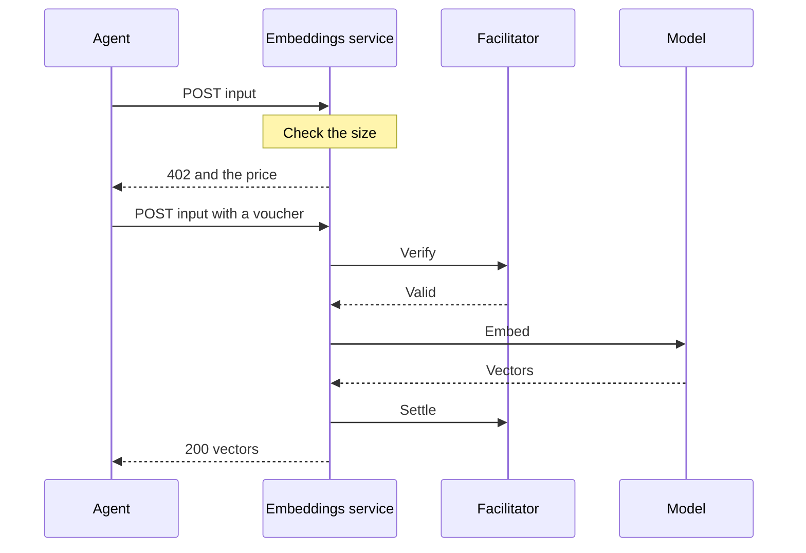

export const meta = {
  title: "Text embeddings",
  description: "Pay 100 zat to turn up to about 1,000 tokens of text into vectors, in the OpenAI embeddings shape, for search and retrieval.",
};

Text embeddings turn text into vectors that an agent can compare, store and search. One paid call embeds up to about 1,000 tokens, in a single string or in many, and costs 100 zat.

The service asks any OpenAI-compatible embeddings API (Ollama by default) and answers in the OpenAI shape, so code written for that API reads the answer unchanged.

<Callout type="privacy" title="The provider sees your text">

The service sends your text to its embeddings provider. With the default Ollama setup that is the operator's own machine. With a hosted provider, the text goes to that host as well. The operator can read everything you send.

</Callout>

## At a glance

| Property | Value |
| --- | --- |
| Paid route | `POST /v1/embeddings` |
| Price | 100 zat per call (`Z402_PRICE_ZAT` replaces it) |
| One paid call buys | up to about 1,000 tokens of text, at most 4,000 characters and 64 strings |
| Free route | `GET /health` |
| Default port | 4033 |
| Provider | the operator |
| Ready when | the model provider lists `EMBEDDINGS_MODEL` |
| Listed in the Bazaar as | "Text embeddings", tags `embeddings`, `vectors`, `rag` |

## How it works



The service checks the whole body before it asks for money. A body that is invalid or too long is refused on the unpaid attempt, so a call is never failed for being long after you paid. After payment the only way a call fails is the provider failing.

### What a call buys

The unit is "about 1,000 tokens". The service does not count tokens before payment. It limits characters, which it can count exactly, and 4,000 characters is about 1,000 tokens of English text. Text that tokenizes less efficiently, such as code or some languages, can hold more tokens in the same characters.

Characters are counted in Unicode code points, so an emoji counts once. The total is summed over all the strings in the call. To embed more text, make more calls.

## The route

<Endpoint method="POST" path="/v1/embeddings">

Embeds one string or a list of strings. Paid: 100 zat per call. An unpaid call that passes the checks gets a 402 with the offer in the `PAYMENT-REQUIRED` header. Send `Content-Type: application/json`.

</Endpoint>

<Params>
<Param name="input" type="string or string[]" required>One string, or 1 to 64 strings (`EMBEDDINGS_MAX_INPUTS`). No string may be blank or hold an unpaired surrogate. All strings together hold at most 4,000 characters (`EMBEDDINGS_MAX_CHARS`). One string may hold at most `EMBEDDINGS_MAX_INPUT_CHARS`, which is unlimited by default and 2,000 under Docker.</Param>
</Params>

The answer:

| Field | Type | Meaning |
| --- | --- | --- |
| `object` | string | Always `list`. |
| `model` | string | The model that embedded the text (`EMBEDDINGS_MODEL`). |
| `dimensions` | integer | The length of each vector. |
| `data` | array | One entry per input: `object` (`embedding`), `index` (the input's position) and `embedding` (the vector). |
| `usage` | object | `prompt_tokens` and `total_tokens`, as the provider reports them. |
| `usageEstimated` | boolean | Present, and `true`, only when the provider reported no usage. The service then estimates about 4 characters a token, at least 1 for each input. |

`dimensions` and `usageEstimated` are additions to the OpenAI shape. Every vector has the same length and a distinct `index`, and the service refuses any provider answer that does not.

<CodeTabs>

```bash title="curl"
curl -si http://127.0.0.1:4033/v1/embeddings \
  -H 'content-type: application/json' \
  -d '{"input":"The quick brown fox"}'
```

```http title="402 response"
HTTP/1.1 402 Payment Required
Content-Type: application/json; charset=utf-8
PAYMENT-REQUIRED: eyJ4NDAyVmVyc2lvbiI6MiwiZXJyb3IiOiJQYXltZW50IHJlcXVpcmVkIiw...
Cache-Control: no-store

{}
```

```json title="Header, decoded and abridged"
{
  "x402Version": 2,
  "error": "Payment required",
  "resource": {
    "url": "http://localhost:4033/v1/embeddings",
    "description": "Embeds up to about 1,000 tokens of text per paid call (OpenAI-style request and answer).",
    "mimeType": "application/json",
    "serviceName": "Text embeddings",
    "tags": ["embeddings", "vectors", "rag"]
  },
  "accepts": [
    {
      "scheme": "prepaid-voucher",
      "network": "zcash:regtest",
      "amount": "100",
      "asset": "ZEC",
      "payTo": "uregtest1...",
      "maxTimeoutSeconds": 60,
      "extra": {
        "windowZat": "100000",
        "creditRatioBps": 2500,
        "creditCapZat": "200000",
        "zeroConfMinExpiryBlocks": 20,
        "termsVersion": "6bf13b52edefddb2"
      }
    }
  ],
  "extensions": {
    "z402": {
      "unit": "1k tokens",
      "note": "About 1,000 tokens per call."
    }
  }
}
```

```json title="Paid answer"
{
  "object": "list",
  "model": "nomic-embed-text",
  "dimensions": 768,
  "data": [{ "object": "embedding", "index": 0, "embedding": [0.0123, -0.0456, "..."] }],
  "usage": { "prompt_tokens": 5, "total_tokens": 5 }
}
```

</CodeTabs>

The paid answer above is abridged. A real vector lists all `dimensions` numbers.

## Price and billing

A call costs 100 zat however many strings it holds, up to the limits. Five short strings in one call cost the same as one. Batch what you can: a call at the cap of 4,000 characters costs 100 zat, and the same text sent in 64 calls costs 6,400.

## Limits and refusals

Every refusal below is answered on the unpaid first attempt. No <Term tip="A message the agent signs for each call. It states the agent's running total, so the facilitator can check it against the deposit.">voucher</Term> is sent and nothing is counted against you.

| Status | `error` | When |
| --- | --- | --- |
| 400 | `invalid_request` | The body is not JSON, or `input` is missing, is not a string or a list of strings, holds too many strings, or has a blank string or one with an unpaired surrogate. `message` says which. |
| 405 | `method_not_allowed` | Any method but POST. The `Allow` header says POST. |
| 409 | `payment_in_flight` | The same voucher is already paying for a call. |
| 413 | `too_many_tokens` | The strings hold more than `EMBEDDINGS_MAX_CHARS` characters in total, or one string holds more than `EMBEDDINGS_MAX_INPUT_CHARS`, or the body is over its size limit. The body carries `maxChars` and, when it is lower, `maxInputChars`. |
| 503 | `not_ready` | The provider is down or does not list the model. Checked about every 10 seconds. |

The body size limit is 256 KiB, or 12 bytes for each character of `EMBEDDINGS_MAX_CHARS` plus room for the strings when that is more. It is what a call at the cap weighs when a client writes every character as an escape.

### Failures after payment

A call fails after payment only when the provider does: `502 provider_failed`. The facilitator does not settle it, but the stock client cannot tell a failed call from a paid one, so it counts the call and its next voucher pays for it. That is why `not_ready` is checked first.

The provider is trusted to be up and not to be right. The service reads its answer up to 1 MiB plus 256 KiB for each input, reads its model list up to 8 MiB, and does not read the body of an error answer at all. A list that does not hold one finite vector of the same length for each input, each with its own index, is refused as a provider failure.

## Make a paid call

This example ranks three documents against a query with cosine similarity. The four strings go in one call, so the whole search costs 100 zat. It needs a funded wallet and a running service: [Make a paid call](/docs/services#make-a-paid-call) names the stack that `paid-fetch.ts` reaches, and [Pay from an agent](/docs/guides/pay-from-an-agent) explains the setup.

<CodeTabs>

```ts title="call.ts"
import { close, paidFetch } from "./paid-fetch.js";

interface Embeddings {
  model: string;
  dimensions: number;
  data: { index: number; embedding: number[] }[];
  usage: { prompt_tokens: number; total_tokens: number };
}

async function embed(input: string[]): Promise<number[][]> {
  const res = await paidFetch("http://127.0.0.1:4033/v1/embeddings", {
    method: "POST",
    headers: { "content-type": "application/json" },
    body: JSON.stringify({ input }),
  });
  if (!res.ok) throw new Error(`${res.status} ${await res.text()}`);
  const body = (await res.json()) as Embeddings;
  return [...body.data].sort((a, b) => a.index - b.index).map((d) => d.embedding);
}

function cosine(a: number[], b: number[]): number {
  const dot = a.reduce((sum, x, i) => sum + x * (b[i] ?? 0), 0);
  const norm = (v: number[]): number => Math.sqrt(v.reduce((sum, x) => sum + x * x, 0));
  return dot / (norm(a) * norm(b));
}

const query = "private payments for software agents";
const docs = [
  "How to file quarterly taxes",
  "Shielded payments hide who pays whom",
  "A recipe for sourdough bread",
];

try {
  const [queryVector, ...docVectors] = await embed([query, ...docs]);
  if (queryVector === undefined) throw new Error("no vectors came back");
  const ranked = docs
    .map((text, i) => ({ text, score: cosine(queryVector, docVectors[i] ?? []) }))
    .sort((a, b) => b.score - a.score);
  console.log(ranked);
} finally {
  await close();
}
```

```ts title="paid-fetch.ts"
import { wrapFetchWithPayment, x402Client } from "@x402/fetch";
import { LightwalletdTxStatus, PrepaidVoucherScheme, ZalletRpcWallet } from "@z402/client";
import { createLightwalletdClient } from "@z402/lightwalletd";
import { NETWORK_REGTEST } from "@z402/protocol";

// Zallet pays the deposit and lightwalletd (Zaino) reports its status.
// These are the Z3 regtest defaults.
const wallet = new ZalletRpcWallet({
  url: "http://127.0.0.1:50232",
  user: "zebra",
  password: process.env.ZALLET_PASSWORD ?? "zebra",
});
const lwd = createLightwalletdClient({ url: "http://127.0.0.1:28137" });
const scheme = new PrepaidVoucherScheme({ wallet, chain: new LightwalletdTxStatus(lwd) });

// The one line that adds Zcash to the stock x402 client
export const paidFetch = wrapFetchWithPayment(fetch, new x402Client().register(NETWORK_REGTEST, scheme));

/** Lets a deposit in flight finish, then closes the wallet and the chain client. */
export async function close(): Promise<void> {
  await scheme.close();
  lwd.close();
}
```

</CodeTabs>

## Privacy

- The operator and its provider see the text you send and the vectors that come back.
- The service keeps no copy of your text in its own code. A hosted provider may keep one, so read its policy before you send sensitive text.
- The facilitator sees the payment, not the request: the voucher, the price and the route's public URL.

See [Privacy model](/docs/concepts/privacy) for what the payment itself reveals.

## Run it yourself

```bash
ollama pull nomic-embed-text
cp services/embeddings/.env.example services/embeddings/.env   # set the facilitator URL and key, and Z402_PAY_TO
pnpm --filter @z402/service-embeddings start
```

The ready line goes to stdout. Logs go to stderr.

```text
embeddings listening on http://127.0.0.1:4033 network=zcash:regtest model=nomic-embed-text provider=http://127.0.0.1:11434
```

An empty variable counts as unset, and a bad one stops the start with a line that names it.

### Settings

The variables every service shares (`Z402_NETWORK`, `Z402_FACILITATOR_URL`, `Z402_FACILITATOR_TOKEN`, `Z402_PAY_TO`, `Z402_PRICE_ZAT`, `PUBLIC_URL`, `HOST`, `PORT`) are listed under [LLM inference](/docs/services/llm#settings). Here `Z402_PRICE_ZAT` defaults to 100 and `PORT` to 4033. Its own:

| Variable | Default | Meaning |
| --- | --- | --- |
| `EMBEDDINGS_BASE_URL` | `http://127.0.0.1:11434/v1` | The provider's OpenAI-style base URL, without credentials. |
| `EMBEDDINGS_API_KEY` or `_FILE` | none | Sent as a bearer token. |
| `EMBEDDINGS_MODEL` | `nomic-embed-text` | The service is ready only while the provider lists it. A name and `name:latest` are one model. |
| `EMBEDDINGS_MAX_CHARS` | `4000` | Most characters in one call, summed over all inputs, 1 to 60,000. Keep it within the model's context, since a provider that rejects a long input can only do so after payment. |
| `EMBEDDINGS_MAX_INPUT_CHARS` | unlimited | Most characters in one string, 1 to 60,000. A local model with a short context needs it. |
| `EMBEDDINGS_MAX_INPUTS` | `64` | Most strings in one call, 1 to 2,048. |

Under Docker, compose reads `docker/env/embeddings.env` first, then `services/embeddings/.env`, which wins. The Docker defaults point at the bundled llama.cpp server with the `nomic-embed-text` model and cap one string at 2,000 characters, because that model takes 2,048 tokens per string and a character can be a whole token. With a hosted provider, put an empty `EMBEDDINGS_MAX_INPUT_CHARS=` in `services/embeddings/.env` to lift the cap:

```bash title="services/embeddings/.env"
EMBEDDINGS_BASE_URL=https://api.openai.com/v1
EMBEDDINGS_API_KEY=your-provider-key
EMBEDDINGS_MODEL=text-embedding-3-small
EMBEDDINGS_MAX_INPUT_CHARS=
```

See [Deploy with Docker](/docs/guides/deploy-with-docker).

### Readiness

`GET /health` answers 200 when the provider lists the model and 503 when it does not. The service lists its route in the Bazaar only while it is ready. See [Discovery](/docs/concepts/discovery).

## Next steps

<Cards>
<Card title="Pay from an agent" href="/docs/guides/pay-from-an-agent">Set up the wallet and the client for your own agent.</Card>
<Card title="LLM inference" href="/docs/services/llm">Pair the vectors with a model that pays per chunk.</Card>
<Card title="Discovery" href="/docs/concepts/discovery">How an agent finds a service like this one.</Card>
</Cards>

## References

- <Source path="services/embeddings/src/service.ts" />: the route, the checks before payment and the paid handler
- <Source path="services/embeddings/src/provider.ts" />: the OpenAI-compatible client and the checks on its answer
- <Source path="services/embeddings/src/config.ts" />: the settings and their limits
- <Source path="services/embeddings/README.md" />: the route, refusals and settings
- <Source path="services/embeddings/.env.example" />: every variable with its default
- <Source path="packages/service-kit/src/service.ts" />: the kit that adds the 402, `/health` and the Bazaar declarations
- <Source path="docs/superpowers/specs/2026-10-27-z402-services-design.md" />: section 4.3, the service's contract
- <Source path="docker/env/embeddings.env" />: the Docker defaults
- [Ollama: OpenAI compatibility](https://docs.ollama.com/api/openai-compatibility)
- [nomic-embed-text v1.5 (GGUF)](https://huggingface.co/nomic-ai/nomic-embed-text-v1.5-GGUF)
