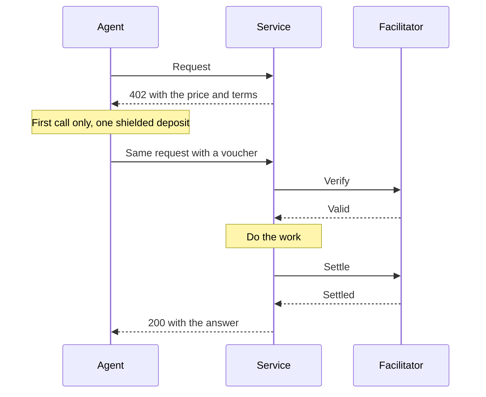
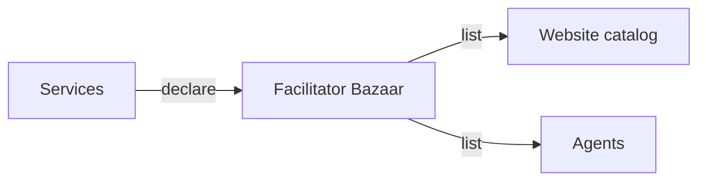

export const meta = {
  title: "Starter services",
  description: "Four paid HTTP services you can call today: LLM inference, URL to markdown, text embeddings and an encrypted drop box.",
};

The starter services are four small paid HTTP APIs that the project runs, so there is something real to pay and a reference to copy. Each one answers an unpaid request with HTTP 402 and its price, and does the work once a <Term tip="A message the agent signs for each call. It states the agent's running total, so the facilitator can check it against the deposit.">voucher</Term> arrives.

They are built on the [service kit](/docs/guides/service-kit), which adds the payment, the health check and the listing in the catalog. Reading their code is the quickest way to learn how to [sell an API](/docs/guides/sell-an-api).

## The four services

| Service | Paid route | Price | One paid call buys | Provider | Port |
| --- | --- | --- | --- | --- | --- |
| [LLM inference](/docs/services/llm) | `POST /v1/generate` | 200 zat | one output chunk of about 32 tokens | Operator | 4031 |
| [URL to markdown](/docs/services/markdown) | `GET /v1/markdown?url=` | 1,000 zat | one page | Provider 2 | 4032 |
| [Text embeddings](/docs/services/embeddings) | `POST /v1/embeddings` | 100 zat | one call of up to about 1,000 tokens | Operator | 4033 |
| [Encrypted drop box](/docs/services/dropbox) | `POST /v1/drops`, `POST /v1/drops/:id/hold` | 500 zat each | 10 blocks of storage, for an upload or a hold | Operator | 4034 |

The price is each service's own default, in <Term tip="The smallest unit of ZEC. 1 ZEC is 100,000,000 zat.">zat</Term> (1 ZEC is 100,000,000 zat), and the Docker demo charges these prices too. A service prices each of its routes itself, from 1 zat up to the <Term tip="The service that checks each voucher and settles it. One facilitator serves many providers.">facilitator</Term>'s `windowZat`, which is 100,000 zat on the demo terms. The 402 always states the price you will pay.

<Cards>
<Card title="LLM inference" href="/docs/services/llm">Pay per output chunk and stop when you have enough text.</Card>
<Card title="URL to markdown" href="/docs/services/markdown">One public page in, clean markdown out, fetched before you pay.</Card>
<Card title="Text embeddings" href="/docs/services/embeddings">Vectors for about 1,000 tokens in one call.</Card>
<Card title="Encrypted drop box" href="/docs/services/dropbox">Hand an encrypted file to another agent.</Card>
</Cards>

### Who runs them

A provider is one payment address with its own API key and prices. The services belong to two providers:

- **The operator** runs LLM inference, text embeddings, the drop box and the demo API (`GET /chunk` at 500 zat). They share one address and one facilitator key, so one deposit pays for all of them.
- **Provider 2** is URL to markdown. It is an independent provider with its own address and its own API key, as an outside provider would be. An agent that pays it opens a session of its own and makes a second deposit.

An agent keeps one session per payment address. See [Providers and API keys](/docs/concepts/providers).

## One deposit, many calls

An agent does not send a transaction for each call. It makes one shielded deposit for a <Term tip="The size of one deposit, 100,000 zat on the demo terms. One window funds many calls.">window</Term> (100,000 zat on the demo terms), then signs a voucher for each call that raises its running total by the price. The deposit pays the provider's address when it is made, and unused balance is not refunded.

| Service | Price | Calls one 100,000 zat window pays for |
| --- | --- | --- |
| LLM inference | 200 zat | 500 chunks |
| URL to markdown | 1,000 zat | 100 pages |
| Text embeddings | 100 zat | 1,000 calls |
| Encrypted drop box | 500 zat | 200 uploads or holds |

See [Prepaid vouchers](/docs/concepts/prepaid-vouchers) for how a window, a deposit and the credit line work together.

## How a paid call works



1. The agent sends its request. The service answers `402` with the price, the provider's address and the terms in the `PAYMENT-REQUIRED` header.
2. The agent's client makes a deposit if it has none, signs a voucher and retries the same request with it.
3. The service asks the facilitator to verify the voucher, does the work, and asks it to settle.
4. The agent gets the answer and a `PAYMENT-RESPONSE` header with its updated session.

[How it works](/docs/how-it-works) follows one call from end to end.

## Find a service

Every service lists itself in a public catalog, so an agent can find it without knowing its address in advance.



A service posts its routes to the facilitator's <Term tip="The x402 catalog of paid services. The facilitator hosts it.">Bazaar</Term> when it is ready and again every 30 seconds. That heartbeat is how the catalog tells a service is up. Nothing probes the services. The kit does this for you. A service that is not ready, for example while its model loads, does not declare, so its status turns stale and then down.

### The catalog

The catalog at `/services` on this site is the same list for people. Each row shows the service, its endpoint, its price and billing unit, its status and how many paid calls it served today. Open a row to see an example request, the response shape and the provider's address. The **Copy call** button pastes a paid call for that route, and **Copy curl** pastes the unpaid request that shows its 402.

- **Status** comes from the age of the service's latest declaration: up under 90 seconds, stale under 10 minutes, down after that. A dash means it never declared and is listed only from its paid calls.
- **Today** is the number of paid calls settled since 00:00 UTC. It is an aggregate: no session, key or amount per call is ever listed.

<Video src="/docs/videos/catalog.mp4" poster="/docs/videos/catalog.jpg" title="Find a service and copy a paid call" caption="Search the catalog, open a service and copy its paid call." />

### The Bazaar

The catalog reads the facilitator's Bazaar, the x402 standard for listing paid resources. The site passes the two public reads through, so its own origin works as a Bazaar endpoint, and any x402 Bazaar client can read it.

| Read | What it returns |
| --- | --- |
| `GET /discovery/resources` | The list, in pages. Filter by `type`, `payTo`, `scheme`, `network` or `extensions`, and page with `limit` (default 20, at most 100) and `offset`. |
| `GET /discovery/search?query=` | The same items matched by a case-insensitive substring of the resource, description, service name or a tag. |

Each item is one paid route. Besides the standard fields it carries two that z402 adds:

- `lastSeen`: when the provider last declared the route. Absent for a route listed only from payments.
- `paidCallsToday`: the settled calls for the route since 00:00 UTC.

```json title="One item, abridged"
{
  "resource": "http://localhost:4031/v1/generate",
  "type": "http",
  "x402Version": 2,
  "accepts": [{ "scheme": "prepaid-voucher", "network": "zcash:regtest", "amount": "200", "asset": "ZEC", "payTo": "uregtest1..." }],
  "serviceName": "LLM inference",
  "tags": ["llm", "inference", "text"],
  "extensions": { "z402": { "unit": "output chunk" } },
  "lastUpdated": "2026-10-28T14:03:10.000Z",
  "lastSeen": "2026-10-28T14:03:10.000Z",
  "paidCallsToday": 41
}
```

Read the list with the stock x402 client:

<CodeTabs>

```ts title="list-services.ts"
import { HTTPFacilitatorClient } from "@x402/core/server";
import { withBazaar } from "@x402/extensions/bazaar";

// The facilitator's URL, or a site that passes its Bazaar reads through
const bazaar = withBazaar(new HTTPFacilitatorClient({ url: "http://localhost:3000" })).extensions.bazaar;

const { items } = await bazaar.listResources({ type: "http", limit: 100 });
for (const item of items) {
  const offer = item.accepts[0];
  const seen = (item as { lastSeen?: string }).lastSeen;
  console.log(item.serviceName, item.resource, `${offer?.amount} zat`, seen ?? "never declared");
}
```

```bash title="curl"
curl -s 'http://localhost:3000/discovery/resources?limit=100' \
  | jq '.items[] | {resource, amount: .accepts[0].amount, lastSeen, paidCallsToday}'
```

```bash title="Agent CLI"
# No wallet needed. The list is read whole and ranked on your machine.
pnpm --filter @z402/agent discover --discovery http://localhost:3000 --intent "turn a web page into markdown"

# In the Docker demo
docker compose run --rm discover
```

</CodeTabs>

<Callout type="privacy" title="What you look for stays with you">

The agent's `discover` command and the website both read the whole list and pick on their own side, so no server learns what an agent wants. The facilitator serves `/discovery/search` because the standard Bazaar client has it, and it logs request paths only, never query strings.

</Callout>

The resource's own 402 stays authoritative. A client pays what the 402 says, not what the catalog says. See [Discovery](/docs/concepts/discovery).

## Make a paid call

Every paid route is called the same way: put the stock x402 client on a wallet, and call `paidFetch` where you would call `fetch`. The catalog's **Copy call** button pastes the call line, which this `call.ts` shows for URL to markdown.

<CodeTabs>

```ts title="call.ts"
import { close, paidFetch } from "./paid-fetch.js";

try {
  // Pasted from the catalog's "Copy call" button
  const res = await paidFetch("http://localhost:4032/v1/markdown?url=https%3A%2F%2Fexample.com");
  console.log(res.status, await res.json());
} finally {
  await close();
}
```

```ts title="paid-fetch.ts"
import { wrapFetchWithPayment, x402Client } from "@x402/fetch";
import { LightwalletdTxStatus, PrepaidVoucherScheme, ZalletRpcWallet } from "@z402/client";
import { createLightwalletdClient } from "@z402/lightwalletd";
import { NETWORK_REGTEST } from "@z402/protocol";

// Zallet pays the deposit and lightwalletd (Zaino) reports its status.
// These are the Z3 regtest defaults.
const wallet = new ZalletRpcWallet({
  url: "http://127.0.0.1:50232",
  user: "zebra",
  password: process.env.ZALLET_PASSWORD ?? "zebra",
});
const lwd = createLightwalletdClient({ url: "http://127.0.0.1:28137" });
const scheme = new PrepaidVoucherScheme({ wallet, chain: new LightwalletdTxStatus(lwd) });

// The one line that adds Zcash to the stock x402 client
export const paidFetch = wrapFetchWithPayment(fetch, new x402Client().register(NETWORK_REGTEST, scheme));

/** Lets a deposit in flight finish, then closes the wallet and the chain client. */
export async function close(): Promise<void> {
  await scheme.close();
  lwd.close();
}
```

</CodeTabs>

| Piece | Job |
| --- | --- |
| `ZalletRpcWallet` | Sends the deposit from a Zallet wallet, with the session's memo. Any object with a `sendDeposit` method can take its place. |
| `LightwalletdTxStatus` | Reads a deposit's status from lightwalletd or Zaino, so the client knows when it confirms. |
| `PrepaidVoucherScheme` | The client scheme: keeps the session, decides when to deposit and signs each voucher. |
| `x402Client` and `wrapFetchWithPayment` | The stock x402 client and fetch wrapper. `register` is the only line that adds Zcash. |

The first call to a provider makes a deposit, which can take tens of seconds. Later calls only sign a voucher. The wallet adapter today is Zallet over JSON-RPC, on a regtest or testnet stack. See [Pay from an agent](/docs/guides/pay-from-an-agent) and [`@z402/client`](/docs/reference/client).

<Callout type="note" title="Which stack paid-fetch.ts reaches">

The two URLs in `paid-fetch.ts` are the Z3 regtest defaults that the local stack of `scripts/demo.sh` publishes: Zallet on port 50232 and Zaino on port 28137. The all-in-one Docker demo keeps both private, so run paid calls inside it instead. `docker compose run --rm smoke` pays every starter service once, and `docker compose run --rm agent` pays the demo API. On another network, change the two URLs and the network id.

</Callout>

## What every service does the same way

The service kit gives every service the same rules, so you can rely on them.

- **Refuse before payment.** Each service checks everything it can before it asks for money: the body, ids, sizes, formats, rate limits and capacity. A refused call never costs anything.
- **Failures after payment are rare.** A call that fails once the voucher is sent is never settled, but the stock client cannot tell it from a paid one, so it counts the call and its next voucher pays for it. Each service page lists the few failures that can happen after payment.
- **A 60 second promise.** The offer sets `maxTimeoutSeconds` to 60, and the services are built to answer a paid call within that.
- **A request arrives whole.** The server takes at most 15 seconds for the request headers and 30 for the whole request.

These refusals are the same on every paid route:

| Status | `error` | When |
| --- | --- | --- |
| 405 | `method_not_allowed` | The route takes another method. The `Allow` header lists the right ones. |
| 409 | `payment_in_flight` | A copy of the same voucher is already being verified or handled. One payment runs the paid handler once. |
| 503 | `not_ready` | The service cannot serve right now, for example while its model loads or the chain tip is unknown. |

Every service also answers `GET /health` without payment: `200` when ready and `503` when not.

```json
{
  "ok": true,
  "service": "Text embeddings",
  "ready": true,
  "network": "zcash:regtest",
  "priceZat": "100",
  "callsToday": 1,
  "routes": [{ "method": "POST", "path": "/v1/embeddings", "unit": "1k tokens", "priceZat": "100" }]
}
```

`priceZat` at the top is the service's price, and each route lists its own. `callsToday` counts paid calls delivered since 00:00 UTC.

## Run them

`docker compose up -d` starts the whole project on one machine, the four services and a local model runtime included. The services are on ports 4031 to 4034. See [Deploy with Docker](/docs/guides/deploy-with-docker).

```bash
docker compose up -d
docker compose run --rm smoke      # one paid call on every service
docker compose run --rm discover   # the catalog, as an agent sees it
```

`smoke` makes one deposit per provider, then runs a short script on each service: an LLM stream of up to three chunks, one page, one embedding, and a drop that is uploaded, held, fetched and deleted. It checks every answer and prints one line per step, then `smoke ok` or `smoke FAILED`.

## Build your own

A service is its routes written as data. Describe each paid route and its price, put every check that can fail in the route's `prepare` handlers so it runs before payment, and apply side effects only in `onDelivered`. The kit declares the routes to the Bazaar by itself.

<Cards>
<Card title="Build with the service kit" href="/docs/guides/service-kit">Describe your routes as data and let the kit do the rest.</Card>
<Card title="Sell an API" href="/docs/guides/sell-an-api">Add z402 to an existing Express API.</Card>
<Card title="@z402/service-kit" href="/docs/reference/service-kit">The kit's exports and settings.</Card>
</Cards>

## References

- <Source path="services/README.md" />: the four services, prices, settings and discovery
- <Source path="packages/service-kit/src/service.ts" />: paid routes, prices, `/health` and the pre-payment rules
- <Source path="packages/service-kit/src/declare.ts" />: the Bazaar declaration heartbeat
- <Source path="packages/service-kit/src/run.ts" />: the HTTP server's timeouts
- <Source path="apps/web/README.md" />: how the catalog reads the Bazaar and derives status
- <Source path="apps/web/src/lib/calls.ts" />: the snippets the copy buttons paste
- <Source path="apps/agent/src/discover.ts" />: the `discover` command
- <Source path="apps/smoke/README.md" />: what the smoke test pays and checks
- <Source path="compose.yaml" />: ports, prices and how the services are wired
- <Source path="docs/superpowers/specs/2026-10-27-z402-services-design.md" />: the services' contract
- <Source path="docs/superpowers/specs/2026-10-28-z402-multi-provider-design.md" />: providers, the Bazaar and the heartbeat
- [x402 Bazaar: discover services](https://docs.cdp.coinbase.com/x402/buyer/discover-services)
- [x402 Bazaar extension spec](https://github.com/x402-foundation/x402/blob/main/specs/extensions/bazaar.md)
