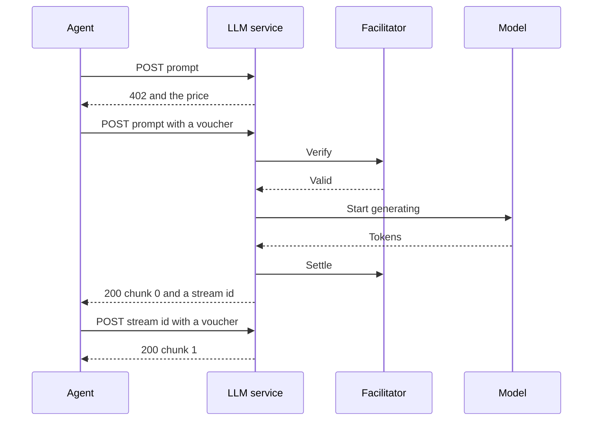

export const meta = {
  title: "LLM inference",
  description: "Pay 200 zat for each chunk of about 32 tokens from an open-weights model, and stop paying whenever you have enough text.",
};

LLM inference is sold one chunk at a time. Each paid call returns the next chunk of a model's answer, about 32 tokens, so an agent that has enough text stops calling and stops paying.

The service has no model of its own. It streams from any OpenAI-compatible chat API: Ollama by default, a bundled llama.cpp server under Docker, or a hosted provider such as OpenRouter.

<Callout type="privacy" title="The operator sees your prompts">

The service sends your prompt and system prompt to its model provider and reads the output before it passes it on, so whoever runs the service sees both. The 402 says so in `extensions.z402.note`. Do not send anything you would not show the operator.

</Callout>

## At a glance

| Property | Value |
| --- | --- |
| Paid route | `POST /v1/generate` |
| Price | 200 zat per call (`Z402_PRICE_ZAT` replaces it) |
| One paid call buys | one output chunk of about 32 tokens (`LLM_CHUNK_TOKENS`) |
| Free route | `GET /health` |
| Default port | 4031 |
| Provider | the operator |
| Ready when | the model provider lists `LLM_MODEL` |
| Listed in the Bazaar as | "LLM inference", tags `llm`, `inference`, `text` |

## How it works



1. **Start.** Send a `prompt`. The service checks the body before it asks for any money, so a bad request gets a 400 and costs nothing. A good one gets the 402.
2. **Pay and read.** Retry with a <Term tip="A message the agent signs for each call. It states the agent's running total, so the facilitator can check it against the deposit.">voucher</Term>. The service verifies it, starts the generation, waits for the first chunk, settles, and answers with chunk 0 and a `stream` id. Nothing is generated before this call is paid.
3. **Continue.** Send `{ "stream": "<id>" }` with a new voucher for each further chunk. The last chunk has `done: true`.

### What a chunk is

The service reads the provider's stream and counts each non-empty piece of text as one token. A chunk is released when it holds `LLM_CHUNK_TOKENS` pieces and the next one has arrived, or when the provider's stream ends. That makes `done` exact: the service never sends a full chunk marked `done: false` and then an empty one. A generation with no output at all gives one empty final chunk.

Chunks are delivered in order, and a stream's position moves only after a paid call was delivered. If a call fails after its chunk was ready, the next call gets the same chunk.

## The route

<Endpoint method="POST" path="/v1/generate">

Starts a stream, or returns the next chunk of one. Paid: 200 zat per call. An unpaid call gets a 402 with the offer in the `PAYMENT-REQUIRED` header. Send `Content-Type: application/json`.

</Endpoint>

Send `prompt` to start a stream, or `stream` to continue one, never both. Any other field is refused.

<Params>
<Param name="prompt" type="string">Starts a stream. Required to start. 1 to 8,000 characters (an emoji counts as 2), not blank, valid Unicode (no lone surrogate).</Param>
<Param name="system" type="string">A system prompt for the model. Optional, only with `prompt`. Up to 8,000 characters, counted the same way.</Param>
<Param name="maxTokens" type="integer">The most output tokens for the whole stream, 1 to 1,024 (`LLM_MAX_TOKENS`). Optional, only with `prompt`. Defaults to 1,024.</Param>
<Param name="stream" type="string">The id from an earlier answer. Required to continue. Send it alone.</Param>
</Params>

The answer is one chunk:

| Field | Type | Meaning |
| --- | --- | --- |
| `stream` | string | The stream id. Keep it to buy the next chunk. |
| `index` | integer | The chunk number, from 0. |
| `text` | string | The chunk's text. Join the chunks in order. A chunk may start with a space. |
| `done` | boolean | `true` on the last chunk. |
| `finishReason` | string | Only on the last chunk. `stop` when the model ended, `length` when `maxTokens` ended it, or what the provider reported. |

### See the offer

An unpaid call shows the price. The 402 body is `{}`. The offer is base64 JSON in the `PAYMENT-REQUIRED` header.

<CodeTabs>

```bash title="curl"
curl -si http://127.0.0.1:4031/v1/generate \
  -H 'content-type: application/json' \
  -d '{"prompt":"Explain shielded payments in three sentences.","maxTokens":96}'
```

```http title="402 response"
HTTP/1.1 402 Payment Required
Content-Type: application/json; charset=utf-8
PAYMENT-REQUIRED: eyJ4NDAyVmVyc2lvbiI6MiwiZXJyb3IiOiJQYXltZW50IHJlcXVpcmVkIiw...
Cache-Control: no-store

{}
```

```json title="Header, decoded and abridged"
{
  "x402Version": 2,
  "error": "Payment required",
  "resource": {
    "url": "http://localhost:4031/v1/generate",
    "description": "Streams qwen2.5:0.5b output, one chunk of about 32 tokens per paid call: send {prompt} to start, then {stream} to continue.",
    "mimeType": "application/json",
    "serviceName": "LLM inference",
    "tags": ["llm", "inference", "text"]
  },
  "accepts": [
    {
      "scheme": "prepaid-voucher",
      "network": "zcash:regtest",
      "amount": "200",
      "asset": "ZEC",
      "payTo": "uregtest1...",
      "maxTimeoutSeconds": 60,
      "extra": {
        "windowZat": "100000",
        "creditRatioBps": 2500,
        "creditCapZat": "200000",
        "zeroConfMinExpiryBlocks": 20,
        "termsVersion": "cb7f148af0fda19a"
      }
    }
  ],
  "extensions": {
    "z402": {
      "unit": "output chunk",
      "note": "The operator sees your prompts. Open-weights model."
    }
  }
}
```

</CodeTabs>

The offer also carries the Bazaar's `info` (an example call) and a JSON Schema for the body under `extensions.bazaar`. See [Protocol](/docs/reference/protocol) for every field. To read the header yourself, decode it:

```bash
curl -si http://127.0.0.1:4031/v1/generate -H 'content-type: application/json' -d '{"prompt":"hi"}' \
  | grep -i '^payment-required:' | cut -d' ' -f2 | base64 -d
```

### Read a stream

These answers are illustrative. The `stream` id is random, and the text depends on the model.

<CodeTabs>

```json title="Chunk 0"
{
  "stream": "jB8ajHfqaLW5NG0QGT0SeA",
  "index": 0,
  "text": "Shielded payments hide who pays whom and how much. For a software agent that matters, because a public ledger would show every purchase it makes",
  "done": false
}
```

```json title="Chunk 1"
{
  "stream": "jB8ajHfqaLW5NG0QGT0SeA",
  "index": 1,
  "text": ". Anyone could read its habits, its suppliers and its budget from the chain. A shielded payment keeps those details between the agent and the",
  "done": false
}
```

```json title="Last chunk"
{
  "stream": "jB8ajHfqaLW5NG0QGT0SeA",
  "index": 2,
  "text": " seller, so the agent can buy what it needs without publishing a record of it.",
  "done": true,
  "finishReason": "stop"
}
```

</CodeTabs>

## Price and billing

One paid call is one chunk at 200 zat, so each token costs about 6 zat. Each call raises your voucher total by the price, and the vouchers draw down the deposit you made once for the window (see [Prepaid vouchers](/docs/concepts/prepaid-vouchers)).

Set `maxTokens` to what you need. It ends the stream at that many tokens, so it also caps the most a stream can cost:

| `maxTokens` | Most chunks | Most cost at 200 zat |
| --- | --- | --- |
| 32 | 1 | 200 zat |
| 96 | 3 | 600 zat |
| 256 | 8 | 1,600 zat |
| 1,024 | 32 | 6,400 zat |

Stopping early costs nothing more. The service keeps generating in the background up to `maxTokens`, so stopping saves your vouchers and not the operator's compute. A stream with no call for `LLM_STREAM_IDLE_MS` (10 minutes) is dropped and its generation is stopped.

## Limits and refusals

Everything the service can decide without calling the model is refused on your unpaid first attempt, before any voucher exists. A refused call is never charged.

| Status | `error` | When |
| --- | --- | --- |
| 400 | `invalid_request` | The body is not JSON, was sent without `Content-Type: application/json`, has an unknown field, or breaks a rule above. `message` says which. |
| 404 | `unknown_stream` | The id is unknown, or the stream was dropped after 10 idle minutes. |
| 405 | `method_not_allowed` | Any method but POST. The `Allow` header says POST. |
| 409 | `stream_busy` | Another call on this stream is in flight. Streams take one paid call at a time. |
| 409 | `payment_in_flight` | The same voucher is already paying for a call. |
| 410 | `stream_finished` | Every chunk was delivered. Start a new stream. |
| 413 | `body_too_large` | The body is over 100,096 bytes with the default limits. |
| 502 | `provider_failed` | The stream's generation failed. Later calls on it are refused here, before payment. |
| 503 | `too_many_streams` | `LLM_MAX_STREAMS` (64) streams are live. |
| 503 | `not_ready` | The provider does not list `LLM_MODEL`. |

### Failures after payment

A few failures cannot be seen earlier. The facilitator does not settle them, but the stock client cannot tell a failed call from a paid one, so it counts the call and its next voucher pays for it.

| Status | `error` | When |
| --- | --- | --- |
| 502 | `provider_failed` | The model failed while the first chunk was being made. |
| 504 | `chunk_timeout` | The chunk was not ready in `LLM_CHUNK_TIMEOUT_MS` (60 s). |
| 503 | `too_many_streams` | Several paid starts that each found room arrived together at the limit. |
| 503 | `stream_closed` | The service is shutting down. |

## Make a paid call

The call buys one chunk at a time and stops when it has 200 characters. It needs a funded wallet and a running service: [Make a paid call](/docs/services#make-a-paid-call) names the stack that `paid-fetch.ts` reaches, and [Pay from an agent](/docs/guides/pay-from-an-agent) explains the setup.

<CodeTabs>

```ts title="call.ts"
import { close, paidFetch } from "./paid-fetch.js";

const url = "http://127.0.0.1:4031/v1/generate";

interface Chunk {
  stream: string;
  index: number;
  text: string;
  done: boolean;
  finishReason?: string;
}

async function next(body: { prompt: string; maxTokens?: number } | { stream: string }): Promise<Chunk> {
  const res = await paidFetch(url, {
    method: "POST",
    headers: { "content-type": "application/json" },
    body: JSON.stringify(body),
  });
  if (!res.ok) throw new Error(`${res.status} ${await res.text()}`);
  return (await res.json()) as Chunk;
}

try {
  // The first call opens the stream. Each later call buys the next chunk.
  let chunk = await next({ prompt: "Explain shielded payments in three sentences.", maxTokens: 96 });
  let text = chunk.text;
  while (!chunk.done && text.length < 200) {
    chunk = await next({ stream: chunk.stream });
    text += chunk.text;
  }
  console.log(text);
} finally {
  await close();
}
```

```ts title="paid-fetch.ts"
import { wrapFetchWithPayment, x402Client } from "@x402/fetch";
import { LightwalletdTxStatus, PrepaidVoucherScheme, ZalletRpcWallet } from "@z402/client";
import { createLightwalletdClient } from "@z402/lightwalletd";
import { NETWORK_REGTEST } from "@z402/protocol";

// Zallet pays the deposit and lightwalletd (Zaino) reports its status.
// These are the Z3 regtest defaults.
const wallet = new ZalletRpcWallet({
  url: "http://127.0.0.1:50232",
  user: "zebra",
  password: process.env.ZALLET_PASSWORD ?? "zebra",
});
const lwd = createLightwalletdClient({ url: "http://127.0.0.1:28137" });
const scheme = new PrepaidVoucherScheme({ wallet, chain: new LightwalletdTxStatus(lwd) });

// The one line that adds Zcash to the stock x402 client
export const paidFetch = wrapFetchWithPayment(fetch, new x402Client().register(NETWORK_REGTEST, scheme));

/** Lets a deposit in flight finish, then closes the wallet and the chain client. */
export async function close(): Promise<void> {
  await scheme.close();
  lwd.close();
}
```

</CodeTabs>

The first paid call also makes the deposit, so it can take tens of seconds. Later calls only sign a voucher. See [Prepaid vouchers](/docs/concepts/prepaid-vouchers).

## Privacy

- The operator sees the prompt, the system prompt and the output. The model provider behind the service sees them too.
- The facilitator sees the payment, not the request: the voucher, the price and the route's public URL. It never receives your prompt.
- A stream id is 16 random bytes, base64url. It is the only thing that names a stream, so treat it as private for as long as the stream lives.
- Under the default model, the prompt goes to a small open-weights model that the operator runs. With a hosted `LLM_BASE_URL`, it also goes to that host.

See [Privacy model](/docs/concepts/privacy) for what the payment itself reveals.

## Run it yourself

The service reads `services/llm/.env` and the environment, and a variable set in the environment wins. An empty value counts as unset. A bad value stops the start with an `llm: ...` line that names it.

```bash
ollama pull qwen2.5:0.5b
cp services/llm/.env.example services/llm/.env   # set the facilitator URL and key, and Z402_PAY_TO
pnpm --filter @z402/service-llm start
```

The ready line goes to stdout. Logs go to stderr.

```text
llm listening on http://127.0.0.1:4031 model=qwen2.5:0.5b network=zcash:regtest
```

To use a hosted provider, change three lines:

```bash title="services/llm/.env"
LLM_BASE_URL=https://openrouter.ai/api/v1
LLM_API_KEY=your-provider-key
LLM_MODEL=qwen/qwen-2.5-7b-instruct
```

### Settings

Shared by every service:

| Variable | Default | Meaning |
| --- | --- | --- |
| `Z402_FACILITATOR_URL` | none | Required. The facilitator's URL. |
| `Z402_PAY_TO` or `Z402_PAY_TO_FILE` | none | Required. The provider's shielded-only unified address. It must be the one the facilitator key belongs to. |
| `Z402_FACILITATOR_TOKEN` or `_FILE` | none | The provider's API key, sent as a bearer token. |
| `Z402_NETWORK` | `regtest` | `regtest`, `testnet` or `mainnet`. Must match the facilitator. |
| `Z402_PRICE_ZAT` | `200` | Zat per chunk, from 1 to the facilitator's `windowZat`. |
| `PUBLIC_URL`, `HOST`, `PORT` | `http://localhost:4031`, `127.0.0.1`, `4031` | The origin used in the 402 and in the Bazaar, and where the service listens. |
| `Z402_FACILITATOR_WAIT_MS` | `120000` | How long the service keeps retrying at start while the facilitator does not answer, 0 to 3,600,000. `0` fails at once. |

Its own:

| Variable | Default | Meaning |
| --- | --- | --- |
| `LLM_BASE_URL` | `http://127.0.0.1:11434/v1` | OpenAI-compatible API root. |
| `LLM_API_KEY` or `_FILE` | none | Sent to the provider as a bearer token. |
| `LLM_MODEL` | `qwen2.5:0.5b` | The model id. A name without a tag also matches `name:latest`. |
| `LLM_CHUNK_TOKENS` | `32` | Tokens per paid chunk, 1 to 512. |
| `LLM_MAX_TOKENS` | `1024` | Output cap per stream and the largest `maxTokens`, 1 to 32,768. |
| `LLM_MAX_PROMPT_CHARS` | `8000` | Longest prompt, and longest system prompt, in characters. |
| `LLM_MAX_STREAMS` | `64` | Streams live at once. |
| `LLM_STREAM_IDLE_MS` | `600000` | An idle stream is dropped and its generation stopped. |
| `LLM_CHUNK_TIMEOUT_MS` | `60000` | How long a paid call waits for its chunk, at most 60,000. |

Under Docker, compose reads `docker/env/llm.env` first, then `services/llm/.env`, which wins. The Docker defaults point at the bundled llama.cpp server (`qwen2.5-0.5b-instruct`) and cap prompts at 1,600 characters so they fit its context. The first start downloads the model. See [Deploy with Docker](/docs/guides/deploy-with-docker).

### Readiness

The service is ready while the provider lists the model. It asks about every 10 seconds and logs each change. `GET /health` answers 200 when ready and 503 when not, and the service lists its route in the Bazaar only while it is ready. See [Discovery](/docs/concepts/discovery).

```json
{
  "ok": true,
  "service": "LLM inference",
  "ready": true,
  "network": "zcash:regtest",
  "priceZat": "200",
  "callsToday": 3,
  "routes": [{ "method": "POST", "path": "/v1/generate", "unit": "output chunk", "priceZat": "200" }]
}
```

`callsToday` counts paid calls delivered since 00:00 UTC. It is an aggregate and holds nothing per client.

## Next steps

<Cards>
<Card title="Pay from an agent" href="/docs/guides/pay-from-an-agent">Set up the wallet and the client for your own agent.</Card>
<Card title="Prepaid vouchers" href="/docs/concepts/prepaid-vouchers">How one deposit pays for many chunks.</Card>
<Card title="Build with the service kit" href="/docs/guides/service-kit">Sell your own model the same way.</Card>
</Cards>

## References

- <Source path="services/llm/src/service.ts" />: the route, its checks and the paid handler
- <Source path="services/llm/src/streams.ts" />: chunking, the stream registry and idle cleanup
- <Source path="services/llm/src/provider.ts" />: the OpenAI-compatible client and model readiness
- <Source path="services/llm/src/config.ts" />: the settings and their limits
- <Source path="services/llm/README.md" />: the route, refusals and settings
- <Source path="services/llm/.env.example" />: every variable with its default
- <Source path="packages/service-kit/src/service.ts" />: the kit that adds the 402, `/health` and the Bazaar declarations
- <Source path="docs/superpowers/specs/2026-10-27-z402-services-design.md" />: section 4.1, the service's contract
- <Source path="docker/env/llm.env" />: the Docker defaults
- [Ollama: OpenAI compatibility](https://docs.ollama.com/api/openai-compatibility)
- [llama.cpp server](https://github.com/ggml-org/llama.cpp/tree/master/tools/server)
