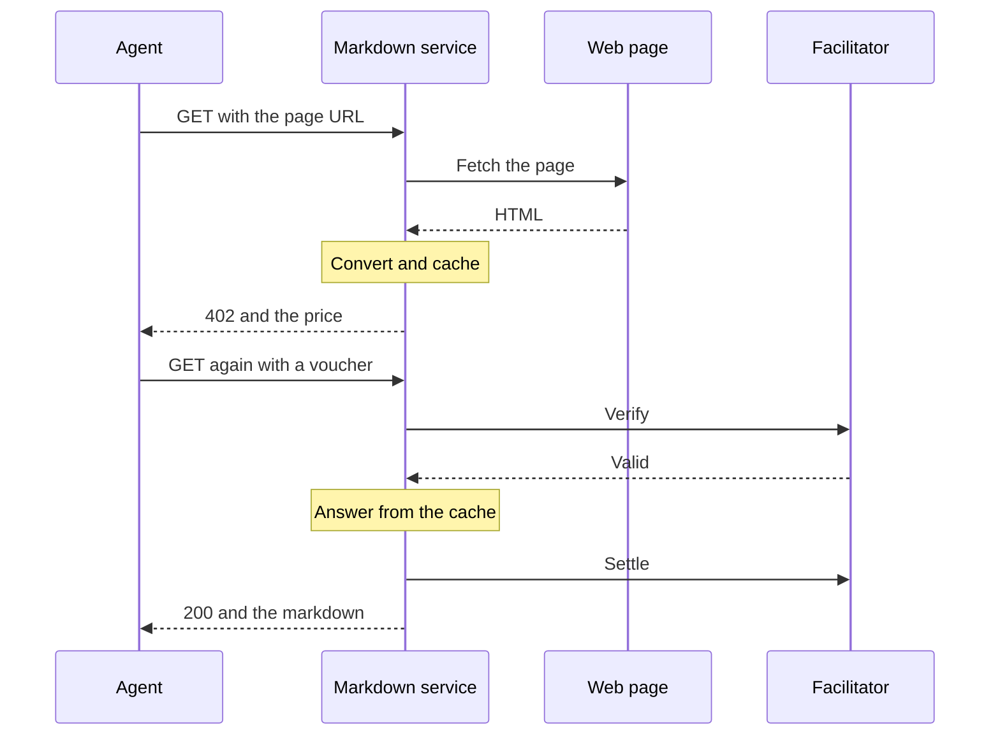

export const meta = {
  title: "URL to markdown",
  description: "Pay 1,000 zat to turn one public web page into clean markdown. The page is fetched before you pay, so a page that fails costs nothing.",
};

URL to markdown fetches one public web page and returns its main content as clean markdown. One page is one paid call of 1,000 zat.

An agent that needs to read the web does not have to parse HTML. It sends a URL and gets headings, links, code blocks and lists, without the navigation, scripts and ads around them.

<Callout type="tip" title="You pay only for pages that work">

The service fetches and converts your page on the unpaid first attempt, before it answers with a 402. If the page cannot be served, you get an error and never see a price. The paid retry is answered from a cache, so it does not fetch again.

</Callout>

## At a glance

| Property | Value |
| --- | --- |
| Paid route | `GET /v1/markdown?url=<page URL>` |
| Price | 1,000 zat per call (`Z402_PRICE_ZAT` replaces it) |
| One paid call buys | one page |
| Free route | `GET /health` |
| Default port | 4032 |
| Provider | provider 2, an independent provider with its own address and API key |
| Listed in the Bazaar as | "URL to markdown", tags `web`, `markdown`, `scrape` |

## How it works



1. **Unpaid attempt.** The service checks the URL, fetches the page through its address guard, converts it and caches the result. Any failure is returned here as an error.
2. **402.** If the page worked, the service answers with the price.
3. **Paid retry.** The agent sends the same request with a <Term tip="A message the agent signs for each call. It states the agent's running total, so the facilitator can check it against the deposit.">voucher</Term>. The service verifies it and answers from the cache, so it does not fetch the page a second time. You get the version the unpaid attempt saw, even if the page changed in between.

The service holds a page for your paid retry for as long as `MARKDOWN_CACHE_MS` (60 seconds, 120 under Docker, since a first deposit can take tens of seconds). Other clients' pages cannot push it out of the cache. A client holds at most four pages at a time, and its oldest hold goes first. A paid retry that arrives after its hold has run out finds no page and fetches again, so it can fail like an unpaid attempt, with the voucher already signed. The stock client counts that call as paid.

## The route

<Endpoint method="GET" path="/v1/markdown">

Fetches one page and returns it as markdown. Paid: 1,000 zat per call. An unpaid call that passes every check gets a 402 with the offer in the `PAYMENT-REQUIRED` header.

</Endpoint>

<Params>
<Param name="url" type="string" required>The page to fetch, as a query parameter. An absolute `http` or `https` URL of at most 4,096 characters, with no user or password, on port 80, 443, 8080 or 8443 (`MARKDOWN_ALLOWED_PORTS`). Percent-encode it. A fragment is ignored.</Param>
</Params>

The answer:

| Field | Type | Meaning |
| --- | --- | --- |
| `url` | string | The URL you asked for. |
| `finalUrl` | string | Where the page came from, after redirects. |
| `title` | string or null | The page title, cut at 1 KiB. |
| `byline` | string or null | The author line, when the page has one, cut at 1 KiB. |
| `markdown` | string | The main content as markdown. |
| `length` | integer | The number of characters in `markdown`. |
| `truncated` | boolean | `true` when the page held more than `MARKDOWN_MAX_MARKDOWN_BYTES` (1 MiB) and the answer was cut. |

<CodeTabs>

```bash title="curl"
curl -si 'http://127.0.0.1:4032/v1/markdown?url=https%3A%2F%2Fexample.com'
```

```http title="402 response"
HTTP/1.1 402 Payment Required
Content-Type: application/json; charset=utf-8
PAYMENT-REQUIRED: eyJ4NDAyVmVyc2lvbiI6MiwiZXJyb3IiOiJQYXltZW50IHJlcXVpcmVkIiw...
Cache-Control: no-store

{}
```

```json title="Header, decoded and abridged"
{
  "x402Version": 2,
  "error": "Payment required",
  "resource": {
    "url": "http://localhost:4032/v1/markdown",
    "description": "Fetches one public web page and returns its main content as clean markdown.",
    "mimeType": "application/json",
    "serviceName": "URL to markdown",
    "tags": ["web", "markdown", "scrape"]
  },
  "accepts": [
    {
      "scheme": "prepaid-voucher",
      "network": "zcash:regtest",
      "amount": "1000",
      "asset": "ZEC",
      "payTo": "uregtest1...",
      "maxTimeoutSeconds": 60,
      "extra": {
        "windowZat": "100000",
        "creditRatioBps": 2500,
        "creditCapZat": "200000",
        "zeroConfMinExpiryBlocks": 20,
        "termsVersion": "cb7f148af0fda19a"
      }
    }
  ],
  "extensions": {
    "z402": {
      "unit": "page",
      "note": "The site sees this server's IP, not yours."
    }
  }
}
```

```json title="Paid answer"
{
  "url": "https://example.com/",
  "finalUrl": "https://example.com/",
  "title": "Example Domain",
  "byline": null,
  "markdown": "This domain is for use in documentation examples without needing permission. Avoid use in operations.\n\n[Learn more](https://iana.org/domains/example)",
  "length": 149,
  "truncated": false
}
```

</CodeTabs>

The `url` in the query string is not part of the offer. The 402 names the route, so the facilitator never sees which page you asked for.

## Price and billing

A page costs 1,000 zat whatever its size. A page longer than 1 MiB of markdown is cut and marked `truncated`, at the same price.

The rate limit counts fetches, not requests. Only a cache miss takes a token, so an unpaid attempt and its paid retry cost one token together, and a page already in the cache is never refused for the limit. A miss that joins a fetch of the same URL already running takes none.

## Limits and refusals

Every refusal below happens on the unpaid first attempt, before any voucher exists, so a refused page is never charged.

| Status | `error` | When |
| --- | --- | --- |
| 400 | `invalid_url` | No `url`, not an absolute http(s) URL, over 4,096 characters, credentials in it, or a port outside `MARKDOWN_ALLOWED_PORTS`. |
| 403 | `blocked_address` | The host leads to an address that is not public, or a redirect does. A redirect to a scheme, credentials or port that is not allowed is refused here too. |
| 405 | `method_not_allowed` | Any method but GET. HEAD is also answered, and it must pay too. |
| 409 | `payment_in_flight` | The same voucher is already paying for a call. |
| 413 | `too_large` | The body is over `MARKDOWN_MAX_BYTES` (5 MiB, also once decompressed), or the page is too heavy to convert. |
| 415 | `unsupported_content_type` | The page is not `text/html`, `application/xhtml+xml` or `text/plain`. |
| 429 | `rate_limited` | More than `MARKDOWN_RATE_PER_MIN` (30) fetches a minute from your IP. `Retry-After` says when to try again. |
| 502 | `fetch_failed` | DNS or connection failure, too many redirects, or a final status that is not 2xx. `upstreamStatus` carries that status. |
| 502 | `convert_failed` | The page could not be converted. |
| 503 | `busy` | `MARKDOWN_MAX_CONCURRENT` (4) fetches are running, or the cache is full of pages held for paid retries. `Retry-After` is 1. |
| 504 | `fetch_timeout` | No complete answer within `MARKDOWN_TIMEOUT_MS` (15 s). |

Error bodies hold the code and, for a fetch that failed upstream, that status. They never name an address the service resolved.

## The address guard

A service that fetches any URL a stranger sends is an <Term tip="Server-side request forgery: tricking a server into fetching an address inside its own network.">SSRF</Term> target. This one checks each request and each redirect before it connects.

| Check | Rule |
| --- | --- |
| Scheme and shape | `http` or `https` only, no user or password, at most 4,096 characters. |
| Port | The explicit or default port must be in `MARKDOWN_ALLOWED_PORTS` (80, 443, 8080, 8443). |
| Names | Resolved through c-ares with the system's DNS servers, A and AAAA. `/etc/hosts` is not read. `localhost` and every name under it are refused without a lookup. |
| Addresses | Every address a name resolves to must be public unicast. A name with one bad address among good ones is refused. An IP literal is judged at once. |
| Pinning | The connection goes only to the addresses that were checked, so DNS rebinding cannot change where it lands. |
| Redirects | Followed one hop at a time, at most `MARKDOWN_MAX_REDIRECTS` (5). Each hop goes through the guard again. |
| Proxies | No pooled socket, and no proxy from `HTTP_PROXY` or `HTTPS_PROXY`, even with `NODE_USE_ENV_PROXY` set. |
| Deadline | One deadline covers the lookups, connections, redirects and body (`MARKDOWN_TIMEOUT_MS`). |
| Request | Fixed headers only: `User-Agent`, `Accept` and `Accept-Encoding`. No cookies and nothing from your request. |

Refused addresses are private, loopback, link-local (including 169.254.0.0/16, where cloud metadata lives), carrier-grade NAT, unique-local, multicast, reserved, unspecified, broadcast, documentation and benchmarking ranges. IPv4-mapped IPv6 addresses are judged as the IPv4 address they map, and IPv4-compatible, NAT64, 6to4 and Teredo addresses are refused.

## The conversion

1. jsdom parses the page at its final URL. Scripts never run and nothing else is loaded.
2. Readability finds the main content. When it finds none, or the document is more than 64 levels deep or has more than 40,000 elements, the whole body is used.
3. Links and images are made absolute. A link keeps only an `http`, `https` or `mailto` target and an image only an `http` or `https` one. Any other link keeps its text without a target, and any other image is removed.
4. Turndown writes markdown with `#` headings, fenced code and `-` bullets. Scripts, styles, `noscript`, iframes and forms are removed.

The charset comes from a byte order mark, then `Content-Type`, then a `<meta>` tag in the first 1 KiB, and is UTF-8 otherwise. `text/plain` is returned as it is.

Conversions run on worker threads (`MARKDOWN_CONVERT_WORKERS`, one by default), each with a heap of `MARKDOWN_WORKER_HEAP_MB` (192) and the same deadline. A page that runs out of either ends only its worker and is refused as `too_large`, so the server itself never stalls or runs out of memory. The heap also sets the page budget: (heap minus 64) times 300 start tags, which is 38,400 by default. Nesting deeper than 512 elements is refused. Long Wikipedia articles have about 22,000 tags.

## Make a paid call

This is the service that runs as its own provider, so your first call to it also makes a deposit to its address, one more window of 100,000 zat, even if you already paid the operator's services. It needs a funded wallet and a running service: [Make a paid call](/docs/services#make-a-paid-call) names the stack that `paid-fetch.ts` reaches, and [Pay from an agent](/docs/guides/pay-from-an-agent) explains the setup.

<CodeTabs>

```ts title="call.ts"
import { close, paidFetch } from "./paid-fetch.js";

interface Page {
  url: string;
  finalUrl: string;
  title: string | null;
  byline: string | null;
  markdown: string;
  length: number;
  truncated: boolean;
}

const request = new URL("http://127.0.0.1:4032/v1/markdown");
request.searchParams.set("url", "https://example.com");

try {
  const res = await paidFetch(request);
  if (!res.ok) throw new Error(`${res.status} ${await res.text()}`);
  const page = (await res.json()) as Page;
  console.log(`${page.title} (${page.length} characters)`);
  console.log(page.markdown);
} finally {
  await close();
}
```

```ts title="paid-fetch.ts"
import { wrapFetchWithPayment, x402Client } from "@x402/fetch";
import { LightwalletdTxStatus, PrepaidVoucherScheme, ZalletRpcWallet } from "@z402-net/client";
import { createLightwalletdClient } from "@z402-net/lightwalletd";
import { NETWORK_REGTEST } from "@z402-net/protocol";

// Zallet pays the deposit and lightwalletd (Zaino) reports its status.
// These are the Z3 regtest defaults.
const wallet = new ZalletRpcWallet({
  url: "http://127.0.0.1:50232",
  user: "zebra",
  password: process.env.ZALLET_PASSWORD ?? "zebra",
});
const lwd = createLightwalletdClient({ url: "http://127.0.0.1:28137" });
const scheme = new PrepaidVoucherScheme({ wallet, chain: new LightwalletdTxStatus(lwd) });

// The one line that adds Zcash to the stock x402 client
export const paidFetch = wrapFetchWithPayment(fetch, new x402Client().register(NETWORK_REGTEST, scheme));

/** Lets a deposit in flight finish, then closes the wallet and the chain client. */
export async function close(): Promise<void> {
  await scheme.close();
  lwd.close();
}
```

</CodeTabs>

## Privacy

- **The site sees the service, not you.** The page's server sees the service's IP address and a fixed `User-Agent` (`z402-markdown/0.1`). It gets no cookies and nothing from your request. That also means pages behind a login cannot be fetched.
- **The operator sees the URL and the page.** It has to, to fetch and convert it. The URL travels in the query string, so keep secrets out of it.
- **The facilitator sees the payment, not the page.** The offer names the route and not the query, so the URL never reaches the facilitator.
- **The payment goes to a separate provider.** Its address and API key are not the operator's.

See [Privacy model](/docs/concepts/privacy) for what the payment itself reveals.

## Run it yourself

```bash
cp services/markdown/.env.example services/markdown/.env   # set the facilitator URL, key and Z402_PAY_TO
pnpm --filter @z402/service-markdown start
```

The ready line goes to stdout. Logs go to stderr.

```text
markdown listening on http://127.0.0.1:4032 network=zcash:regtest
```

The service has no model and no model provider key. It fetches public pages itself. A bad value stops the start with a `markdown: <VARIABLE>: ...` line on stderr and exit code 1.

### Running as provider 2

URL to markdown runs as an independent provider of the rail, paid to its own address and connecting with its own API key, as an outside provider would. The operator's other services use the operator's address and key. To run it the same way:

<Steps>
<Step title="Make keys for the provider">

`merchant-keygen` writes a new account and prints its shielded-only address. The file holds the spending seed, so keep it under `.secrets/`. It needs the `zdecrypt` binary (`pnpm --filter @z402/facilitator build:native`).

```bash
node scripts/merchant-keygen.mjs --network regtest --out "$PWD/.secrets/markdown-keys.json"
```

</Step>
<Step title="Register the view-only key">

`POST /providers` takes the address and its view-only key (UIVK). The script reads only the network, the address and the UIVK from the file, sends those three, and writes the API key the facilitator issues to a file without printing it.

```bash
node scripts/register-provider.mjs \
  --keys .secrets/markdown-keys.json \
  --facilitator http://127.0.0.1:4022 \
  --out .secrets/markdown-api-key
```

</Step>
<Step title="Point the service at them">

```bash title="services/markdown/.env"
Z402_FACILITATOR_URL=http://127.0.0.1:4022
Z402_FACILITATOR_TOKEN_FILE=../../.secrets/markdown-api-key
Z402_PAY_TO=uregtest1...
```

</Step>
</Steps>

At start the service calls the facilitator's `GET /providers/me` to prove that its key and address belong together. If they do not, it stops and names `Z402_FACILITATOR_TOKEN` or `Z402_PAY_TO`. See [Providers and API keys](/docs/concepts/providers).

### Settings

The variables every service shares (`Z402_NETWORK`, `Z402_FACILITATOR_URL`, `Z402_FACILITATOR_TOKEN`, `Z402_PAY_TO`, `Z402_PRICE_ZAT`, `PUBLIC_URL`, `HOST`, `PORT`) are listed under [LLM inference](/docs/services/llm#settings). Here `Z402_PRICE_ZAT` defaults to 1000 and `PORT` to 4032. Its own:

| Variable | Default | Meaning |
| --- | --- | --- |
| `MARKDOWN_ALLOWED_PORTS` | `80,443,8080,8443` | Ports a page URL and every redirect may use. |
| `MARKDOWN_MAX_BYTES` | `5242880` (5 MiB) | Largest page body, counted as received and again after decompression. |
| `MARKDOWN_MAX_MARKDOWN_BYTES` | `1048576` (1 MiB) | Largest answer. A longer one is cut and marked `truncated`. |
| `MARKDOWN_TIMEOUT_MS` | `15000` | Deadline of one fetch, and again of its conversion. |
| `MARKDOWN_MAX_REDIRECTS` | `5` | Redirects followed. |
| `MARKDOWN_RATE_PER_MIN` | `30` | Fetches a minute per client IP (an IPv6 client per /64). A cached page costs nothing. |
| `MARKDOWN_MAX_CONCURRENT` | `4` | Pages fetched at once. More get `503 busy`. |
| `MARKDOWN_CONVERT_WORKERS` | `1` | Conversion worker threads. |
| `MARKDOWN_WORKER_HEAP_MB` | `192` | Heap of each worker. It also sets how many tags a page may have. |
| `MARKDOWN_CACHE_MS` | `60000` | How long a page answers unpaid attempts, and as long again for the paid retry. 120,000 under Docker. |
| `MARKDOWN_CACHE_ENTRIES` | `100` | Pages the cache holds. |
| `MARKDOWN_CACHE_BYTES` | `33554432` (32 MiB) | What the cache holds at most (markdown, title, byline and URLs). |
| `MARKDOWN_USER_AGENT` | `z402-markdown/0.1` | The `User-Agent` sent to sites. |
| `MARKDOWN_TRUST_PROXY` | off | Express "trust proxy": the number of proxies in front, or their addresses. |

Behind your own reverse proxy, set `MARKDOWN_TRUST_PROXY` so that the rate limit sees client IPs and not the proxy's. `true` is refused, because Express would then take the left-most `X-Forwarded-For` address, which the client writes itself.

Memory is about 330 MB idle with one warm worker, and a busy worker can add up to its heap. With the defaults the worst page brings that to about 520 MB. The Docker deployment gives it 768 MiB.

## Next steps

<Cards>
<Card title="Pay from an agent" href="/docs/guides/pay-from-an-agent">Set up the wallet and the client for your own agent.</Card>
<Card title="Providers and API keys" href="/docs/concepts/providers">How an independent provider joins the rail.</Card>
<Card title="Privacy model" href="/docs/concepts/privacy">What each party sees of a paid call.</Card>
</Cards>

## References

- <Source path="services/markdown/src/service.ts" />: the route, the checks before payment, the cache and the paid handler
- <Source path="services/markdown/src/guard.ts" />: URL checks and the address policy
- <Source path="services/markdown/src/fetch.ts" />: the pinned, redirect-by-hand fetch and body limits
- <Source path="services/markdown/src/convert.ts" />: jsdom, Readability and turndown
- <Source path="services/markdown/src/convert-pool.ts" />: conversion workers and their limits
- <Source path="services/markdown/src/limits.ts" />: the rate limit and the page cache
- <Source path="services/markdown/src/errors.ts" />: the error codes and their statuses
- <Source path="services/markdown/src/config.ts" />: the settings and their limits
- <Source path="services/markdown/README.md" />: refusals, the guard, conversion and provider 2
- <Source path="services/markdown/.env.example" />: every variable with its default
- <Source path="scripts/register-provider.mjs" />: registering a provider and saving its key
- <Source path="docs/superpowers/specs/2026-10-27-z402-services-design.md" />: section 4.2, the service's contract
- <Source path="docs/superpowers/specs/2026-10-28-z402-multi-provider-design.md" />: sections 4.1 and 4.6, providers and the start-up check
- [OWASP: Server Side Request Forgery](https://owasp.org/www-community/attacks/Server_Side_Request_Forgery)
- [Mozilla Readability](https://github.com/mozilla/readability)
- [Turndown](https://github.com/mixmark-io/turndown)
- [jsdom](https://github.com/jsdom/jsdom)
